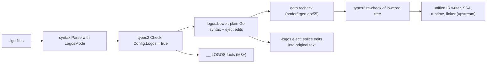

# loGo/s implementation plan

## Requirements and user decisions

The user's direction of 2026-10-19 makes loGos one toolchain for Go and loGo/s. It is recorded in R-U1 (first-class Go, the plain-`go` rule, lints on Go, cgo for Go, local defaults), R-U2 (two-way interop, nil checks on Go calls into loGo/s code), R-U3 (module and package purity), assumptions A-LGOSEL and A-GOBOUNDARY, and rule G3 (upstream files take hook lines only).

- R-U1 (user, 2026-10-19; replaces the backward-compatibility rule): loGos is one complete toolchain for Go and loGo/s. Go support is first-class, not legacy. Every backend, runtime, GC, stack, SIMD, wasm, cgo, PGO, optimization-level, and tooling improvement applies to Go packages as well as loGo/s packages, under both `logos` and plain `go`. An improvement that changes a Go result or needs loGo/s syntax or types is a loGo/s language rule and stays in `.lgo` (the `make` length overflow check in T-303, the array operators of M14, the collection chains of M6). Plain `go` MAY differ from upstream Go 1.27.2 in performance, code generation, runtime, and tooling. It keeps Go language semantics (every valid Go program keeps its Go meaning, and `run.bash` is the regression floor) and its upstream command text (`go version`, `go help`). A default that changes under plain `go` flips only after `run.bash` passes with it. `logos lint` lints Go packages with the language-neutral rules of M9, at `deny` where the rule's default is `forbid`; `logos build` runs no default lints on Go packages (an author `//logos:zeroalloc` directive is the Sec 17.2 exception). The cgo overhaul covers Go packages (M20): the existing `#cgo noescape` plus `#cgo nocallback` pair is the trigger, and the zig fallback of M0-S5 applies to Go packages. Third-party modules of either kind get no code lints; capabilities apply to every module.
- R-U2 (user, 2026-10-19; replaces the no-interop decision): Go and loGo/s interoperate in both directions, per import. A loGo/s package MAY import any Go package, and a Go package MAY import any loGo/s package, in one workspace or across modules. Go-mode declarations seen from `.lgo` code are platform declarations (platform pointers, M3). loGo/s declarations seen from Go code use their Go-facing signatures, the same ones `logos eject` emits (T-0.3, T-Sec5); a Go package that this toolchain compiles also gets nil checks on its calls into loGo/s code (M3-S7). The diagnostics `correctness::logos_imports_go` and `correctness::go_imports_logos` do not exist. One import has no Go form: a loGo/s union used both as a type constraint and as a value type cannot be expressed in Go, so a Go package that imports it fails (M2-S7). Each module and each package keeps one kind (R-U3). A loGo/s package, and a Go package that imports one, build under `logos`; plain `go` ignores `.lgo` files (A-LGOSEL).
- R-U3 (user, 2026-10-19): a whole module is one kind, Go or loGo/s; a module that holds both kinds fails with `[correctness::mixed_module]`. A package is one kind too; a package that holds both fails with `[correctness::mixed_package]`. Interop is per import, not per package.
- R-U4 (user, 2026-10-19): a struct satisfies an interface with properties only through an explicit `: I` declaration, in any package (T-203.2).
- D-U5 (user, 2026-10-19): `logos-doc/PLAN.md` is renamed to `logos-doc/SPEC.md`; SPEC.md holds the tailored normative spec only (P0-S1).
- D-U6 (user, 2026-10-19): this plan is committed as `logos-doc/IMPLEMENTATION.md`, with no session-only references (P0-S4).
- D-U7 (user, 2026-10-19): the root `AGENTS.md` gives agents that work on loGos the commands, gotchas, workflow, and references (P0-S8).
- R-SKILLS: ship an official loGo/s agent skills plugin for Claude Code, Codex, AGY (Antigravity), and the Agent Skills standard. User decisions (2026-10-19): skills `logos`, `logos-from-go`, and `logos-review` ship in P1; `logos-concurrency` ships with M8 and `logos-performance` with M13; `plugins/logos/templates/AGENTS.md` ships in P1 for loGo/s repositories; the plugin stays in this repository.
- Q-ARCH = lower then re-check (section Architecture).
- Q-CUTS = no cuts; tailor every feature in PLAN.md.
- Q-NIL = non-nil `*T` in `.lgo`, `T?` options, platform pointers for values from Go-mode declarations.
- Q-CLI = a separate `logos` command.
- Q-DEPTH = every milestone is planned now.
- Q-SEAMS = both: existing Go harnesses and a new `test/logos` harness (PLAN Sec 22).
- R-EXECUTION: after approval, execute P0 through M22 without routine milestone review pauses. Keep all commits local. Do not push branches, open pull requests, publish packages, or create releases.
- R-PERFORMANCE: revise the planned performance milestones, not existing executable code. Optional speed implementations require a stable same-workload baseline, measured candidates, exact behavioral parity, and the G6 keep-or-revert gate. Planning results are not speed measurements.
- R-SIMPLICITY: preserve all requested features and acceptance checks while removing redundant prose and unnecessary implementation layers. No existing Go source cleanup or refactor is authorized by this planning pass.
- Skills invoked by the user that bind execution: offensive-first TDD (tdd), adversarial tests (tests-adversarial), validation-first state machines, spec-driven six-area spec, writing-for-agents (plugin skills), good-readme and github-presence (README), production-go (Go conventions), autoplan (ledger and gate), spine-driven (anchor tags on every step).

## Global rules (apply to every step)

### G1. Test-first protocol (every slice)

1. Write the attack tests named in the slice first, at the named seam. Run them. Each must fail red for the predicted reason (wrong error text, missing behavior), never for a typo. Save the red output in the commit body as one line per test: `RED <test> <reason>`.
2. Implement only what the attacks need. Never edit an attack test in the same repair step as the implementation. If a test was wrong, revert the implementation, fix the test in its own commit with a stated reason, and restart from red.
3. Green: rerun the slice tests plus the slice gate. Diff every test file against its red state; the diff must be empty.
4. Mutation probe: flip one condition or bound in the new implementation, rerun, confirm at least one attack fails, revert the mutation. Record `PROBE <file:line> caught by <test>` in the commit body.
5. One commit per slice. Subject: capitalized imperative, at most 72 characters, no period. Body: what and why, the RED, GREEN, and PROBE lines. No `Co-Authored-By` or agent trailers. Remove any repo-local `user.name`/`user.email` before committing (`git config --local --unset user.name`, same for `user.email`).
6. Adversarial coverage: for every error path a slice adds, write one violation test per documented assumption (inputs, ordering, state, resources, impossible cases), and test every numeric limit at N-1, N, N+1. Every failure path must produce a descriptive error that names the rule and the position.
7. Correction budget: at most three implementation attempts per slice. If the attacks are still red after the third, discard the implementation, save the red attack files as `logos-doc/blocked/<slice id>.patch` (`git diff` of the attack files only), mark the slice's REDTEAM rows `blocked`, commit both as `Record blocked slice <slice id>`, and stop that slice; dependent slices wait.

### G2. Environment and gates
- Go baseline: the tree is go1.27.2 (`VERSION`); `src/go.mod` and `src/cmd/go.mod` declare `go 1.27`, so new code may use every Go 1.27 feature (generic methods, `new(expr)`, `testing/synctest`, `sync.WaitGroup.Go`, `errors.AsType`) and nothing newer.
- Go conventions for new packages (production-go): `ctx context.Context` first; errors wrapped with `%w`, messages lowercase without punctuation; error types named `XxxError`; table-driven tests with subtests; new packages also pass `go test -race -count=1 <pkg>`.

- Toolchain build: run `./make.bash` in `src`. After M0-S1 this installs `bin/go` and `bin/logos`.
- Shell setup for every command below: put the fork `bin` directory first on `PATH` and work from `src` unless a step says otherwise.
- Upstream toolchains: set `UPROOT1272` to the upstream Go 1.27.2 tree. Set `UPROOT1273` to the upstream Go 1.27.3 tree. `UPROOT1272` builds ejected output. `UPROOT1273` is the behavior oracle. `src/cmd/go/script_test.go` passes both names through `extraEnvKeys`. `src/cmd/internal/goparity` reads `UPROOT1273`.
- Slice gate (every slice): `./make.bash` succeeds; the slice's named `go test` commands pass when run with `-count=1` (no cached results count as evidence); `gofmt -l` over changed `.go` files prints nothing; `go vet` over changed packages passes.
- Race gate (slices that touch concurrency, runtime, or the go command): the slice's tests also pass with `go test -race -short <pkgs>`.
- Milestone gate: `./run.bash --no-rebuild` passes (this is PLAN Sec 22.1 "upstream regression gate"), then the milestone's acceptance command.
- Lint gate (slices that add a new package): golangci-lint v2 (2.15.0, built with go1.27.2, so it accepts `go 1.27` modules) with the v2 `standard` linter set, configured by `logos-doc/golangci.yml` (M0-S1 adds it). It runs on new packages only, once per module, with the fork `go` first on `PATH`: from `src/cmd`, `golangci-lint run --config ../../logos-doc/golangci.yml ./compile/internal/logos/... ./go/internal/logos/...`; from `src`, `golangci-lint run --config ../logos-doc/golangci.yml ./logos/...`. Hook lines in upstream files and `runtime/*_logos.go` stay under `go vet` and `run.bash` only, because the upstream tree is not golangci-clean and G3 forbids unrelated edits there.

#### Release-channel grounding (2026-10-19)
Anchor: Richard Feynman, John Carmack

Repository pins take precedence over newer releases. This is a Go toolchain fork, not a new application: preserve Go 1.27.2 and both modules' `go 1.27` ceilings. The inherited vendored modules stay unchanged. Host tools are not automatically installed or upgraded.

| Choice | Selected version | Release date | Channel and decision |
|---|---|---|---|
| Go | 1.27.2 | 2026-10-08 | [Official releases](https://go.dev/doc/devel/release), [download metadata](https://go.dev/dl/?mode=json): repository baseline wins; no Go LTS track |
| golangci-lint | 2.15.0 | 2026-10-16 | [Release](https://github.com/golangci/golangci-lint/releases/tag/v2.15.0): verified installed baseline; config schema 2 |
| Claude Code | 2.1.303 | 2026-10-18 | [npm channel](https://registry.npmjs.org/@anthropic-ai/claude-code): latest non-prerelease; the schema was inspected in installed 2.1.301, so verify `plugin eval --help` before using the newer CLI |
| Codex | 0.163.0 | 2026-10-15 | [Official release](https://github.com/openai/codex/releases/tag/rust-v0.163.0): current stable, no LTS track |
| AGY | 1.4.0 | 2026-10-16 | [Changelog](https://www.agy.dev/changelog): current stable; check the CLI version directly, not the language-server log |
| skills-ref | 0.1.1 | 2026-01-10 | [PyPI metadata](https://pypi.org/pypi/skills-ref/0.1.1/json): latest published non-prerelease; its wheel declares the `agentskills` console command |
| uv/uvx | 0.13.1 | 2026-10-14 | [PyPI metadata](https://pypi.org/pypi/uv/json): current stable |
| gopls | 0.24.0 | 2026-10-14 | [Module channel](https://proxy.golang.org/golang.org/x/tools/gopls/@latest), [version requirements](https://proxy.golang.org/golang.org/x/tools/gopls/@v/v0.24.0.mod): Go 1.27-compatible |
| Node.js | 24.22.0 LTS | 2026-10-14 | [Release index](https://nodejs.org/dist/index.json): latest stable LTS, not Current 26.12.0 |
| Zig | 0.17.0 | 2026-10-01 | [Release index](https://ziglang.org/download/index.json): stable, not 0.18 development snapshots |
| stringer source | x/tools v0.45.1-0.20260917185718-3dd9077b8066 | 2026-09-17 | [Pinned revision](https://proxy.golang.org/golang.org/x/tools/@v/v0.45.1-0.20260917185718-3dd9077b8066.info): matches `src/cmd/go.mod`; keep this upstream revision rather than latest v0.52.0 |

Go 1.27 support ends when Go 1.29 ships; [support data](https://endoflife.date/api/v1/products/go/) publishes no fixed end date. Node 24 support ends 2028-04-30 ([support data](https://endoflife.date/api/v1/products/nodejs/)). No support-end date was published by the other channels above. The older reference documents' 1.26/1.27-RC descriptions are not evidence of present behavior; the installed source and the pinned release's documentation decide.

Inherited module inventory: `src/go.mod` and `src/cmd/go.mod` pin x/crypto v0.52.1-0.20260526024921-9beb694f9766 (2026-05-26), x/net v0.55.1-0.20260731170536-c1d18010be90 (2026-07-31), x/sys v0.45.0 (2026-05-21), x/text v0.37.0 (2026-05-08), google/pprof v0.0.0-20260507013755-92041b743c96 (2026-05-07), x/arch v0.27.1-0.20260521044007-9c1a596a2c97 (2026-05-21), x/build v0.0.0-20260522210304-d55d0041b921 (2026-05-22), x/mod v0.36.1-0.20260813213634-8569e2639ca1 (2026-08-13), x/sync v0.20.0 (2026-02-23), x/telemetry v0.0.0-20260519152614-eab6ae52b5e2 (2026-05-19), x/term v0.43.0 (2026-05-08), x/tools as above, ianlancetaylor/demangle v0.0.0-20250417193237-f615e6bd150b (2025-04-17), and rsc.io/markdown v0.0.0-20240306144322-0bf8f97ee8ef (2024-03-06). Each pin was checked through `https://proxy.golang.org/<full-module-path>/@v/<version>.info`; x/ names expand to `golang.org/x/`, and GitHub modules to `github.com/<owner>/<name>`. These are upstream source revisions, not new dependency choices. Their support-end dates are not published. The rsc.io/markdown channel has no release within 12 months; changing that vendored dependency is outside this plan.

Before a dependent gate, record the actual output of the tool's version command and compare it with this table. A missing tool or command is a blocked gate, not a reason to install an arbitrary release or silently lower the test. In P1, verify `claude plugin eval --help`, `codex plugin --help`, `agy plugin --help`, and the selected skills-ref distribution's entry points. The skills-ref 0.1.1 wheel was read without installation and its SHA-256 matched PyPI metadata (`d35db5bb8de71ae301daf5ca9cb71f8a555e8c6f83a6d40e46a5bc09f8f461b5`); `entry_points.txt` declares `agentskills = skills_ref.cli:main`. Validation execution is still required at P1. QEMU and the shell utilities remain unpinned host prerequisites; no latest-version claim is made for them.

Production Go scope: retain upstream cmd/go command registration, compiler APIs, and runtime synchronization. Do not introduce Cobra, functional-option constructors, application contexts, third-party goroutine groups, or logging frameworks into those layers merely to match a generic application convention. Use standard-library or existing upstream facilities first; a new dependency or wrapper needs a requirement-specific reason. No Go source changed during planning, and no build, race, vet, or lint pass is claimed for the future implementation.

### G3. Upstream diff rule (rebase economics, PLAN Sec 18)

- In upstream files, add hook lines only: a call into a `*_logos.go` file or a new package, guarded by a logos condition (language behavior) or by the improvement's own flag or experiment (backend, runtime, cgo, tooling). All logic lives in new files: `*_logos.go` beside the hook, or new packages `cmd/compile/internal/logos/...`, `cmd/go/internal/logos/...`, `src/logos/...`, `runtime/*_logos.go`.
- Plain `go` keeps Go language semantics and its upstream command text (`go version`, `go help`); improvements are allowed behind hooks (R-U1). Language behavior (`.lgo` recognition, loGo/s syntax and type rules, loGo/s lints) is selected by the `logos` command (argv[0] mode) or by a `logos` condition. Backend, runtime, cgo, and tooling improvements carry no `logos` guard: they apply to Go packages under `go` and `logos`, and experimental ones stay behind GOEXPERIMENT. Plain `go` reads no `logos.toml` and registers its improvement flags (`-O`, `-gc`, `--wasm-features`) without help text, so `go help` stays upstream. A default that changes under plain `go` flips only after `run.bash` passes with it. The slice that moves a plain-`go` default records its blessing `run.bash` pass (command, date, result) in its commit body.

### G4. Lexicon (one name per thing)

| Thing | Name |
|---|---|
| Command | `logos` (GOROOT/bin/logos; same program as `go`, selected by argv[0]) |
| Source files | `.lgo`; aliases: U+1F4DC (scroll), U+26A1 (lightning), U+0295 U+25D4 U+03D6 U+25D4 U+0294 (gopher) |
| Config file | `logos.toml` next to `go.mod` (PLAN's `bettergo.toml`, renamed) |
| Build tag set in logos mode | `logos` |
| Directives | `//logos:allow(<rule>)`, `//logos:cgo_fastcall`, `//logos:wasmexport`, `//logos:wasmimport`, `//logos:zeroalloc` |
| Lint package | `cmd/compile/internal/logos/lint` (PLAN's `betterlint`, renamed); rule IDs `group::name` |
| Lowering package | `cmd/compile/internal/logos` |
| Support packages | `logos/rt` (helpers), `logos/sync` (`Locked[T]`, `Hot[T]`), virtual `comptime` |
| Reserved identifier prefixes in `.lgo` | `_logos_`, `Logos_` |
| Spec | `logos-doc/SPEC.md`, the tailored normative spec; `SPEC Sec N` cites its section N (P0-S2) |
| Original spec | `PLAN`: `git show 57475ed:logos-docs/PLAN.md`; `PLAN:<n>` cites its line n and `PLAN Sec N` its section N. SPEC.md keeps the section numbers, so the tailored text of a cited section is `SPEC Sec N`, and where the two differ, SPEC wins |
| Implementation plan | this document, committed as `logos-doc/IMPLEMENTATION.md` (P0-S4) |
| Cross-package facts | archive member `__.LOGOS` |
| Compiler flags | `-logos.eject=DIR`, `-logos.json`, `-logos.mode=next|context|hints`, `-logos.hintsout=FILE` (required by `hints`), `-logos.cfg=FILE` |
| Experiments | `GOEXPERIMENT=logosarena`, `logosstack`, `logosfastcgo` (default off; explicit `logosfastcgo` enables it; `nologosfastcgo` or `none` disables it) |
| cmd/go build flags | `-O`, `--wasm-features`, `--wasm-loader`: accepted by `logos build` and `go build`; plain `go` registers them without help text; a flag that only changes what cmd/go writes or passes (the loader, the tier) is a flag and never a `GOEXPERIMENT`, because an experiment rebuilds the standard library and changes every cache key |

### G5. Spine anchors

Every milestone and slice carries an `Anchor:` line (anchors from the user's spine skill). Subagent briefs must copy the slice text, its anchors, and these stance limits: offense stays inside the surface the slice names; formal rigor only where a plausible defect breaks an invariant; minimalism keeps every useful part (error paths, tests, needed detail); one shallow abstraction level, extract on the third use.

### G6. Optional speed implementations (no feature cuts)
Anchor: Richard Feynman, John Carmack

- Scope: optional speed implementations in the performance milestones, not removal of features, callers, tests, or diagnostics. Benchmarks report measurements; no measurement is a pass condition.
- Freeze before mutation: record the tracked source set, content hashes, input hashes, revision, caller contract, signatures, errors, and API/configuration boundaries. A boundary change needs user consent.
- Baseline: use the same machine, workload, flags, and `GOMAXPROCS` on both sides. Default `GOMAXPROCS=1`; a concurrency workload records its required level instead. Calibrate an iteration count `N` until a benchmark performs at least one second of useful work, then freeze that count for baseline, every candidate, and integration. If a candidate completes below one second, raise `N` for every side and recapture the baseline. Never compare different work counts.
- Measurement: use compiled test binaries with `hyperfine --warmup 3 --min-runs 10 --export-json`. Warmups are excluded by hyperfine. Require standard deviation at most 20% of the median; otherwise resolve noise before scoring. Record median, standard deviation, minimum, and maximum. Run the CPU profile separately, without profiling timed samples. Corroborate with `go test -run='^$' -bench='<exact-name>' -benchtime="${N}x" -count=10 -benchmem <package>`; `-run` excludes tests and does not select benchmarks.
- Hot-path admission: require at least 5% of measured time in the path, or input-scaled call counts confirmed by instrumentation. Compute the contract's lower bound and `baseline / floor` with a calculator. A path within 2x of its floor needs no candidate rewrite.
- Metrics: pin latency as the speed metric before collecting candidate results. Report `B/op`, `allocs/op`, and binary bytes separately. An allocation or size reduction alone is not a speedup.
- Candidates: dispatch five isolated worktree lanes concurrently, one for algorithm, layout, caching, concurrency, and local boundary/code-generation cost. A single function below 50 lines with one evident concern may use one candidate, with the reason recorded. Each candidate changes one mechanism within the frozen source set. Candidates return edits without running gates or formatters. The parent measures and verifies; serialize benchmark runs on a shared host to prevent contention from corrupting measurements.
- Evidence: append the baseline, fingerprint, calibrated `N`, environment, candidate results, parity verdicts, and decisions to `.outline/optimize/<slice>/log.jsonl`. Reuse a baseline only while source, workload, and environment fingerprints match. Store each baseline, candidate, and integration run in a separate run-ID subdirectory so JSON and profiles cannot overwrite earlier evidence. A changed fingerprint starts a new baseline record; never overwrite earlier evidence.
- Ranking: compute `ratio * safety * (1 - cost * 0.3)`, where `ratio = baseline_median / candidate_median` for identical work, `safety = 1` for exact verified parity and `0` otherwise, and `cost` is the recorded readability/complexity cost in `[0,1]`. Rank the viable candidates before integration.
- Parity: compare outputs, error semantics, nil versus empty, bounds, panic conditions, NaN, cancellation, concurrent sequences, and required floating-point order. The optimization must not change behavior with `-O`. Use the unchanged implementation as oracle where applicable.
- Acceptance: after integration, repeat the same benchmark and require a ratio of at least 1.05. Limit promotion attempts to the viable-candidate count. A 1.02 marginal-gain floor stops further attempts; it never lowers the 1.05 acceptance gate.
- Non-win: restore only the candidate delta, preserving feature implementation and user changes. Keep the measurement record. Classify cold units as fixed, at floor, or left with a reason; do not add a cache, branch, or flag for cold-path microseconds.
- Winner: the parent runs G2 verification and a native/ejected behavior smoke once across the integrated change. Land one local optimization commit with measurements and parity evidence. No push, PR, release, or publication.
- Workload matrix: reuse the benchmarks below after their owning features exist. Run from `src/` with the fork's `bin` first on `PATH`. Set `slice` to the current slice ID and `run` to the unique measurement record ID, then `out="$PWD/../.outline/optimize/$slice/$run"; mkdir -p "$out"`. Each row is a separate campaign with its own frozen `N`; do not compare rows. Missing benchmark, profiler, hyperfine, or wasm runner means that measurement is blocked, not passed.

| Owner | Package | Exact benchmark | Required runtime |
|---|---|---|---|
| M5-S4 | `./logos/rt` | `BenchmarkConstMapLookup` | native |
| M11-S1 | `./logos/rt/json` | `BenchmarkJsonEscapeScan` | native |
| M15-S3 | `runtime` | `BenchmarkLogosLoopStride` | js/wasm through `../lib/wasm/go_js_wasm_exec` and Node |
| M20-S1 | `cmd/cgo/internal/testlogos` | `BenchmarkFastcall` | native with cgo; two builds of the same benchmark: candidate with `GOEXPERIMENT=logosfastcgo`, baseline with `GOEXPERIMENT=nologosfastcgo` |

The M20-S1 row runs the block twice, once per experiment setting, because the experiment is a compile-time choice: each build goes to its own run-ID subdirectory, with one frozen `N`, and the ratio is `baseline_median / candidate_median`. The M20-S1 blocking-call delay check uses the same procedure with the ready-goroutine delay as the metric. For each native row, set `pkg` and `bench` from the table and preserve its environment for every command:

```bash
go test -c -o "$out/workload.test" "$pkg"
hyperfine --warmup 3 --min-runs 10 --export-json "$out/timing.json" "\"$out/workload.test\" -test.run='^$' -test.bench='^${bench}$' -test.benchtime=${N}x -test.benchmem"
"$out/workload.test" -test.run='^$' -test.bench="^${bench}$" -test.benchtime="${N}x" -test.cpuprofile="$out/cpu.out"
```

For the wasm row, compile with `GOOS=js GOARCH=wasm` and invoke the built binary through `"$PWD/../lib/wasm/go_js_wasm_exec"` in both timed and profile commands. Retain the experiment/flags established by M15-S3; do not invent a runtime `-d` flag. Record an unavailable profiling capability as a measurement blocker. None of these future workloads has been measured during planning.

### G7. Change boundaries and test seams (seams recorded here; SPEC Sec 18 holds 18.1 and 18.2)

- Seams for the tests are `cmd/go` script tests, `syntax` testdata, `types2` testdata, `test/logos` run files, and unit tests beside new packages.
- Exported API carries Go doc comments.
- Ask first before changing `.go` package semantics, adding new exported standard-library API, or using network access.
- Never commit secrets and never edit `src/vendor` or `src/cmd/vendor`.

## Architecture (Q-ARCH)



Invariants:
- A1. The lowered tree contains no loGo/s node kind. `logos.Lower` ends with a walk that calls `base.FatalfAt(pos, "logos: %T survived lowering", n)` if one remains.
- A2. Native and ejected programs come from the same lowered nodes; eject splices printed lowered snippets into the original source, so comments outside replacement spans survive. Comments inside a rewritten statement need explicit text-level preservation (M1-S5, M1-S6); whole-statement `Edit` printing alone loses them.
- A3. Lowered nodes copy positions from the source node they replace (`SetPos(orig.Pos())`, reusing the same `*PosBase`); errors and stack traces point into `.lgo` files.
- A4. Nodes are never shared between two places in the lowered tree; duplicated subtrees are deep-copied with `logos.clone` (types2 stores types in syntax nodes, `irgen.go:70`).
- A5. The re-check runs with fresh `types2.Info` maps (they are built after `recheck:`) and resets `types.PkgMap()` `Direct` flags and `typecheck.Target.Imports`, copying the midway reset at `noder/irgen.go:193-199`.
- A6. Checked-lowering sequencing: lowering starts only after the first types2 check succeeds; it precedes the existing SIMD midway transformation and range-function rewriting; each transformation has its own once-only state (`didLogos` beside `didMidway`) so a later upstream recheck never repeats loGo/s lowering. First-pass language facts needed after lowering survive as owned package/export information bound to the `__.PKGDEF` fingerprint. The recheck checks the lowered Go representation under Go semantics: the recreated config selects `conf.Logos = originalPackageIsLogos && !didLogos`, so source-only loGo/s rules (reserved `_logos_`/`Logos_` names, non-nil nils, `?` placement, and the like) never rerun on generated code. Source-only checks run on the first pass, before lowering erases their evidence; the original package kind is retained separately for emission and export facts.
- A7. Eject preserves comments inside replacement spans as well as outside them. Valid comments never cause eject or lowering to reject a program. An AST-only `syntax.String` comparison cannot prove comment preservation; M1-S6 carries a text-level oracle.

## Milestone index

| ID | Name | SPEC sections | Depends on |
|---|---|---|---|
| P0 | Spec rename to SPEC.md, tailored spec, IMPLEMENTATION.md, root AGENTS.md, ledgers, todos | all | none |
| M0 | `logos` command, `.lgo` packages, config, harnesses | 0.1, 0.2, RFC-101, Sec 8, Sec 17 harness | P0 |
| M1 | `?`, `defer f()?`, `errdefer`, error traces, eject | RFC-104.1-2, 0.3, Sec 6, Sec 1.4 (errTrace) | M0 |
| P1 | Agent skills plugin v1: skills `logos`, `logos-from-go`, `logos-review`, AGENTS.md template, evals | R-SKILLS | M1 |
| P2 | README | good-readme | M1 |
| M2 | Closed unions, switch expressions, inline assertions | RFC-203.1, RFC-203.3, Sec 2.3 | M1 |
| M3 | Facts sidecar, non-nil pointers, `T?`, `?.`, `??`, platform pointers | RFC-202, Sec 5 | M2 |
| M4 | Interface properties | RFC-203.2, Sec 2.3 | M3 |
| M5 | Const composites, CTFE, const views, const maps | RFC-201, Sec 7 | M3 |
| M6 | Sugar: `$"..."`, `&expr`, defaults, spread, tuples, lambdas, chains, `yield`, `scope defer` | RFC-104.3-6, RFC-204.1 | M3, M5 |
| M7 | Comptime | RFC-205, Sec 2.5 | M6 |
| M8 | `go group`, `logos/sync` | RFC-206, Sec 15 | M6 |
| M9 | Lints and JSON diagnostics | RFC-102, Sec 14 | M8 |
| M10 | `logos next`, `logos context` | RFC-103 | M9 |
| M11 | Static JSON | Sec 10 | M7 |
| M12 | Capabilities auditor | Sec 11 | M0 |
| M13 | `-O` levels and CPU targets | RFC-105 | M9 |
| M14 | Fixed-array SIMD | RFC-204.2 | M6 |
| M15 | Backend peepholes, long-loop preemption | RFC-303, Sec 13 | M13 |
| M16 | WASM profile | Sec 12 | M3, M15 |
| M17 | Smart stack | RFC-302 | M13 |
| M18 | Tier-0 arena and bump allocator | RFC-301.1, Sec 3.1 | M17 |
| M20 | CGo in loGo/s packages, Fast-CGo for Go and loGo/s | RFC-304, Sec 3.4 | M0 |
| M21 | `logos lsp` | Sec 16 | M9 |
| M22 | Verification suites and end-to-end example | Sec 9, Sec 17 | all |
| M23 | Architecture collapses | Sec 5, Sec 8, Sec 16, Sec 17 | M21 |

The skills plugin (P1) and README (P2) are updated after each later milestone with its shipped features (step "Docs" in each milestone).

## P0. Spec, plan, agent instructions, ledgers, todos

Anchor: Christopher Alexander, Tony Hoare, J.R.R. Tolkien

P0 slices are documentation-only. Each carries its named structural Check (counts, `cmp`, file listings); P0 uses no G1 RED/GREEN/PROBE cycle and no `./make.bash` toolchain rebuild. Executable slices retain G1/G2.

- P0-S1 Rename the spec (user decision, 2026-10-19): `git mv logos-doc/PLAN.md logos-doc/SPEC.md` and nothing else, so the commit is a pure rename and `git log --follow logos-doc/SPEC.md` keeps the history.
  Anchor: J.R.R. Tolkien, Tony Hoare
  - Check: `git show --stat --format= HEAD` prints exactly ` logos-doc/{PLAN.md => SPEC.md} | 0` and ` 1 file changed, 0 insertions(+), 0 deletions(-)` (output format confirmed with Git in a scratch repository).
- P0-S2 Rewrite `logos-doc/SPEC.md` as the tailored normative spec, and only that: copy the planning-session draft `logos-doc/SPEC.md` byte for byte (`cp <draft> logos-doc/SPEC.md`; it is approved with this plan). If the draft file is missing, stop P0 and report the missing path; never rewrite the spec from scratch. Rules the draft follows (they also govern every later change to SPEC.md):
  Anchor: Tony Hoare, Richard Feynman
  - Content: what users and tools observe (syntax, meaning, diagnostics, commands, flags, config keys, runtime guarantees, limits, performance targets). Internal mechanisms (internal names, struct fields, file locations, assembly sequences, algorithms without an observable effect) stay out; this plan holds them.
  - Structure: a header (`Status: ...`, `Base: Go 1.27.2`, `Original: ...`), then `## 0.` to `## 18.` with the original section numbers, then `## 18. Spec areas`.
  - Sources: table T row by row (each row's tailored rule replaces the text it names), table N, R-U1 to R-U4, and assumptions A-STD, A-LGOSEL, A-CODEGEN, A-XMOD, A-EXAMPLES, A-MODKIND. Lexicon G4 names everywhere (`bettergo.toml` -> `logos.toml` with one rename note, `betterlint` -> `logos lint`, `go lint`/`go next`/`go context` -> `logos lint`/`logos next`/`logos context`, "Go 1.24-1.26" -> "Go 1.27").
  - Register: ASD-STE100; one requirement per sentence; RFC 2119 keywords (MUST, MUST NOT, SHOULD, SHOULD NOT, MAY) replace SHALL; each requirement ends with its trace tags, one ID per bracket and adjacent when several (`[T-104.1]`, `[T-104.1][R-U3]`).
  - Section 18 holds 18.1 Objective and 18.2 Compiler-made names.
  - Check: `grep -c '^## ' logos-doc/SPEC.md` prints `19`; `grep -c 'SHALL' logos-doc/SPEC.md` prints `0`; `grep -c 'bettergo' logos-doc/SPEC.md` prints `1`; `grep -c 'Go 1.24-1.26' logos-doc/SPEC.md` prints `0`; every `[T-...]` tag names a row of table T (`grep -o '\[T-[^]]*\]' logos-doc/SPEC.md | huniq` lists only those IDs).
- P0-S4 Commit this plan as `logos-doc/IMPLEMENTATION.md` (user decision, 2026-10-19), after P0-S1 so the rename stays pure. The committed copy drops every session-only reference (links with the `local` scheme and paths under the agent session directory): the P0-S2 draft path becomes `logos-doc/SPEC.md`, and every other one is removed with its clause (the P1 evidence clause, the `cmp` against the draft in the P0-S2 check).
  Anchor: David Parnas, Tony Hoare
  - Check: `grep -Ec 'loca[l]:/{2}' logos-doc/IMPLEMENTATION.md` prints `0`; `grep -c "$HOME/.omp/" logos-doc/IMPLEMENTATION.md` prints `0`.
- P0-S5 Create `logos-doc/REDTEAM.md`, the test-status ledger for the attacks #1 to #230 (rows #183 to #189 were appended by the 2026-10-19 direction for the interop, boundary, loader, and cgo attacks it adds; their resolutions are SPEC.md Section 17.5, the interop suite; rows #190 to #230 were added later by the audit and closure lanes). The resolutions live only in SPEC.md Section 17, so this file holds no resolution text. Content: line 1 `Rules: logos-doc/SPEC.md. Status values: planned, tested, satisfied upstream, blocked.`, line 2 empty, then a table with header `| ID | Attack | Milestone | Test | Status |` and one row per attack in ID order: `ID` is `#N`; `Milestone` lists the milestones of every slice whose `Red-team rows` line in this plan names `#N`, comma-separated in plan order (`#80` gets `M22`); `Test` starts empty; `Status` starts `planned`.
  Anchor: Tony Hoare, Edward Tufte
  - Rule for later slices: a slice that lands a test for `#N` sets `Test` to the repository path of that test (for example `test/logos/redteam/attack_042_defer_close_join.lgo`, or the slice test that covers the attack) and `Status` to `tested` in the same commit. A slice that only pins upstream Go behavior sets `satisfied upstream` and names the upstream test. G1 rule 7 sets `blocked`.
  - Check: `grep -c '^| #' logos-doc/REDTEAM.md` counts one row per attack; `grep -c '| planned |$' logos-doc/REDTEAM.md` counts the untested rows until a slice lands a test.
- P0-S6 Create `tasks/autoplan-ledger.jsonl` with exactly the lines in section "Autoplan ledger" of this plan.
  Anchor: Tony Hoare, Edward Tufte
  - Check: `jaq -c . tasks/autoplan-ledger.jsonl` parses every line; `jaq -r .id tasks/autoplan-ledger.jsonl | huniq -c` shows each ID once.
- P0-S7 Replace the session todo list with one item per milestone slice in dependency order, each tagged with its anchors.
  Anchor: Christopher Alexander, Tony Hoare
- P0-S8 Create the root `AGENTS.md` (user decision, 2026-10-19), read natively by Claude Code, Codex, Cursor, and other agents. Exact content:
  Anchor: David Parnas, Dieter Rams
  ````markdown
  # loGos

  loGos is a fork of Go 1.27.2 that adds the loGo/s language (`.lgo` files) and the `logos` command. It is one toolchain for Go and loGo/s: backend, runtime, cgo, and tooling improvements apply to Go packages too.

  ## Commands

  Run from `src/` with the fork first on PATH: `export PATH="$(cd .. && pwd)/bin:$PATH"`.

  - Build the toolchain: `./make.bash`. Rerun it after every compiler, runtime, or cmd/go change, because tests use the installed binaries.
  - Test one package: `go test -count=1 -short <pkg>`. Cached results are not evidence.
  - Add `-race` for concurrency, runtime, and cmd/go changes.
  - Script tests: `go test -count=1 cmd/go -run 'Script/^logos_<name>$'`.
  - Compiler run and errorcheck tests: `go test -count=1 cmd/internal/testdir -run 'Test/logos/'`.
  - Changed files: `gofmt -l <files>` prints nothing, and `go vet <pkgs>` passes.
  - Milestone gate: `./run.bash --no-rebuild`.

  ## Gotchas

  - Plain `go` keeps Go language semantics and its upstream command text (`go version`, `go help`), and `run.bash` is its regression floor. It may differ from upstream in performance, code generation, runtime, and tooling.
  - Upstream files take hook lines only: one call into a `*_logos.go` file or a new package. Guard language behavior with a logos condition; backend, runtime, and cgo improvements take no logos guard and apply to Go packages too. Put the logic in new files, because every upstream line costs rebase work.
  - Leave `src/vendor` and `src/cmd/vendor` unchanged; they are vendored copies.
  - A module holds only `.go` packages or only `.lgo` packages. Go and loGo/s packages import each other, per import; only `logos` builds `.lgo` files.

  ## Workflow

  - Work slice by slice from `logos-doc/IMPLEMENTATION.md`: write the slice's attack tests, see them fail, build, then pass the slice gate (rules G1 and G2).
  - A changed language rule updates its Table T row in IMPLEMENTATION.md and the matching SPEC.md sentence in the same commit.
  - A slice that stays red after three attempts is recorded as blocked (rule G1, item 7); tests are never weakened to reach green.

  ## References

  - Language spec: `logos-doc/SPEC.md`
  - Build plan, gates, and lexicon: `logos-doc/IMPLEMENTATION.md`
  - Red-team test ledger: `logos-doc/REDTEAM.md`
  ````
  - Check: `wc -l < AGENTS.md` prints at most 60; each referenced path exists (`test -f logos-doc/SPEC.md && test -f logos-doc/IMPLEMENTATION.md && test -f logos-doc/REDTEAM.md && echo OK` prints OK); `grep -Ec 'loca[l]:/{2}' AGENTS.md` prints 0; quote-back: a fresh agent session asked "Which files take hook lines only?" answers with the upstream-files rule.
  - Upkeep: M0-S1 adds, in the same commit as `logos-doc/golangci.yml`, the lint lines (`New packages only: from src, golangci-lint run --config ../logos-doc/golangci.yml ./logos/...; from src/cmd, golangci-lint run --config ../../logos-doc/golangci.yml ./compile/internal/logos/... ./go/internal/logos/...` and the gotcha `golangci-lint reports issues in upstream code; run it on new packages only`) and the `logos` command lines (`logos build ./...`, `logos test ./...`); any later change to the G2 commands updates this file in the same commit.
- Commits, in this order: P0-S1 `Rename the loGo/s spec to SPEC.md`; P0-S2 `Tailor the loGo/s spec without removing features`; P0-S4 `Add the loGo/s implementation plan`; P0-S5 `Add the red-team test ledger`; P0-S6 `Add the autoplan task ledger`; P0-S8 `Add agent instructions for the loGos repository`.


### Table T: tailored rules (normative content of SPEC.md)

| Row | PLAN ref | Tailored rule | Milestone |
|---|---|---|---|
| T-0.1 | Sec 0.1 | Plain `go` keeps Go language semantics: every valid Go program keeps its Go meaning, the CI process runs `./run.bash` and keeps its suite green as the regression floor, and `go version` and `go help` print the upstream text. Go support stays first-class in every release. Plain `go` MAY differ from upstream Go 1.27.2 in performance, code generation, runtime, and tooling, and every backend, runtime, cgo, and tooling improvement applies to Go packages as well as loGo/s packages under both `go` and `logos` (R-U1). The loGo/s language (`.lgo` recognition and loGo/s syntax and type rules) is selected by the `logos` command; plain `go` ignores `.lgo` files (A-LGOSEL). `logos` builds Go packages with Go semantics: no loGo/s typing rules apply to Go. A module is one kind: all its packages are `.lgo` (a loGo/s module) or all are `.go` (a Go module). A package is one kind. A workspace may hold both kinds. Imports cross kinds in both directions, per import (R-U2). | M0, M9 |
| T-0.2 | Sec 0.2 | No new global keywords. Contextual words, valid only in `.lgo`: `errdefer` (statement start, followed by an identifier or `func`), `yield` (statement start inside generator functions), `scope` (immediately before `defer`), `group` (immediately after `go`). `const` gains new positions (`const for/if/switch/func`) that are syntax errors in Go today. Sec 4.1 counts 4 contextual identifiers (errdefer, yield, scope, group). | M1, M6, M7, M8 |
| T-0.3 | Sec 0.3 | `logos eject -o DIR` (alias `logos build --emit-go=DIR`) writes a complete pure-Go copy of the main module to DIR (must not exist or be empty): `.lgo` files become `.go` files and comments are kept. Every non-standard loGo/s dependency module is ejected too, into `DIR/_logos_deps/<module path>@<version>/`, with `replace` lines added to `DIR/go.mod` (a Go package that imports a loGo/s package resolves it to the ejected copy, R-U2; the Go-facing signatures of T-Sec5 are the ones eject emits). The support sources (`logos/rt`, `logos/sync`) become one shared module `github.com/gosuda/loGos/rt` in `DIR/_logos_deps/rt` (one type identity for `Option[T]` and friends across ejected modules), with a `replace` line. `import "comptime"` is removed. No `//go:build !logos` line and no in-place coexistence (R-U3). Ejected code builds with an upstream Go 1.27 toolchain. | M1 |
| T-0.4 | Sec 0.4 | Kept as the design axiom; each later section states its own rules; enforced by types (M2, M3, M5) and lints (M9); the lint registry enumerates the enforced lint rules. | all |
| T-101.1 | RFC-101.1 | Source extensions `.lgo` and the three aliases, recognized only in logos mode. Strip trailing U+FE0E/U+FE0F from the extension before matching. NFC normalization is the identity on all four extension strings (no code point in them decomposes canonically), so no normalizer runs. Two files whose names differ only by alias extension in one package: error `correctness::duplicate_stem_filename`. Alias files cannot be published: module zips reject non-letter symbols (x/mod `zip.go:306-308`); `logos` reports warning `portability::alias_extension` for each alias file when the main module path's first element contains a dot. | M0 |
| T-101.2 | RFC-101.2 | When the main module is a loGo/s module, an absent `logos.toml [build] cgo` key defaults to `forbid` (`CGO_ENABLED` defaults to 0), but an explicitly set `CGO_ENABLED=0\|1` in the environment overrides that absent-key default. Presence wins: explicit `cgo = "forbid"` stays disabled even with `CGO_ENABLED=1`; explicit `cgo = "restricted"` keeps its `cgo_allowlist` check even with `CGO_ENABLED=1`; explicit `cgo = "allow"` stays enabled even with `CGO_ENABLED=0`; each violation is error `restriction::cgo_usage`. `logos.toml [build] cgo = "forbid" \| "restricted" \| "allow"`; `"restricted"` requires every package with `import "C"` to match `cgo_allowlist` globs. When cgo is enabled, `CC` is unset, and the default C compiler is missing, `logos` and plain `go` MUST use `zig cc -target <zig-arch>-<zig-os>[-musl]` for the build target if `zig` is in PATH (`-musl` only for linux), for Go packages and loGo/s packages alike (R-U1). The build target is the GOOS/GOARCH pair of the build, not the host. A Go main module keeps the upstream default and upstream `CGO_ENABLED` handling; a `cgo` key in a Go module's `logos.toml` has no effect (the policy is loGo/s-only). `go` keeps `cfg.go:171-178` behavior for the `CGO_ENABLED` default. Concern stated once: cgo off switches `net` and `os/user` in the standard library to their pure-Go paths. | M0 |
| T-102 | RFC-102 | Linter runs inside `cmd/compile` on `.lgo` packages after the first types2 pass (syntax rules) and inside escape analysis (escape rules). `go vet` owns printf, copylocks, structtag, assign, httpresponse, and stringintconv checks; `logos lint` does not repeat them. `logos lint` also lints the Go packages of the main module with the language-neutral rules (the rules marked in M9-S2); rules defined on loGo/s syntax or types do not apply to Go. `logos build` runs no lints on Go packages, and plain `go` has no lint step. Default severities apply to both kinds, except that a language-neutral rule whose default is `forbid` runs at `deny` on Go packages, so `//logos:allow(<rule>)` can suppress a Go false positive, and a group configured `forbid` also runs at `deny` there. `--pedantic` raises the pedantic group from `allow` to `warn`, `--pedantic=false` forces `allow`, and a `logos.toml` value that lowers a forbid group fails with `[configuration::forbid_lowered]`. Rule set, severities, and tailored definitions in M9. The warnings that types2 reports (`suspicious::unapplied_struct_default`, `suspicious::side_effect_before_sort`) and that cmd/go reports (`portability::alias_extension`) follow the same policy: the group severity of `logos.toml [lints]` decides warn, deny, forbid, or allow, and `//logos:allow(<rule>)` silences them under warn and deny; for an alias-extension file the directive sits in the comment block directly above its package clause. Third-party modules of either kind get no code lints; capabilities (M12) apply to every module in the build. The rule set adds the nine placement-region and native-nogo rules (`correctness::region_escape`, `perf::arena_fallback` in `.lgo`; `concurrency::unguarded_access`, `concurrency::nonatomic_access`, `concurrency::lock_requirement_unmet`, `correctness::layout_constant_mismatch`, `portability::atomic_plain_int64`, `correctness::linkname_mismatch`, `pedantic::unsafe_outside_unsafe_file` language-neutral) with the directive grammar `//logos:guardedby`, `//logos:atomic`, `//logos:requires`, `//logos:acquires`, `//logos:releases`, `//logos:zeroalloc [local]`, `//logos:sizeof`, `//logos:offsetof`, `//logos:alignof`. | M9 |
| T-103 | RFC-103 | `logos context <pkg>#<Symbol>` and `logos next [--fix | --ai-patch]` are compiler modes (`-logos.mode=context|next`) driven by cmd/go, because cmd/go cannot import `cmd/compile/internal/syntax`. `next` converts a whole Go module to a loGo/s module (R-U3, module purity) with byte-span splicing and keeps every import of a Go package outside the module (R-U2; the imported declarations are platform declarations); complex refactors go to `next_tasks.json`. | M10 |
| T-104.1 | RFC-104.1 | `?` is a postfix operator allowed only as the outermost operator of: the right side of `=` or `:=` with one right-hand call, an expression statement, a `defer` call, an `errdefer` call, or the body of an expression lambda (M6). The operand is a call whose last result type is identical to `error`; the enclosing function's last result type is identical to `error`. Desugaring: the statement runs, then `if err != nil { return zero..., err }`; assignments in the statement happen before the check. `runtime_recordErrPC` becomes `logos/rt.TraceErr(err)` on the error path, backed by runtime fields when built by `logos` (no-op in ejected code). Zero remaining results MUST be allowed only in an expression statement or a defer. | M1 |
| T-104.2 | RFC-104.2 | `defer f()?` joins a non-nil result into the error result (`err = e` if nil, else `errors.Join(err, e)`). `errdefer f()` and `errdefer f()?` run iff, when they pop, the frame is panicking or exiting via Goexit, or the error result is non-nil (state machine FrameExit). Typed-nil errors count as non-nil. The function, receiver, and arguments are evaluated at the statement (Go defer rule). `_retErr.data` and `recover()` are not used. | M1 |
| T-104.3 | RFC-104.3 | `?.` and `??` operate on option types `T?` (M3). Map index in `.lgo` yields `V?`; `v, ok := m[k]` keeps Go meaning. `??` precedence is below `||`; the precedence table shifts by one (`precOrOr` becomes 2). | M3 |
| T-104.4 | RFC-104.4 | `$"..."` interpolation: `{expr}` operands of type string, any integer, bool, float32/float64, `[]byte`, `error` (calls `Error()`), or `fmt.Stringer` (calls `String()`); other types are compile errors. `{{` and `}}` are literal braces. Operands are evaluated once, left to right. Lowering: one `make([]byte, 0, n)` with `n` = literal bytes + `len` of string and byte operands + 20 per integer + 24 per float + 5 per bool, appends via `strconv.Append*`, result via `unsafe.String`. Exact two-pass sizing is replaced by this bound (one allocation, never a regrow). | M6 |
| T-104.5 | RFC-104.5 | `&expr` for a non-addressable operand lowers to Go 1.26 `new(expr)`. Struct field defaults `F T = constExpr` (default before the tag) apply in loGo/s composite literals of the type (a Go struct literal gets zero values, a documented hole); `var x T` and `new(T)` stay zero and trigger `suspicious::unapplied_struct_default`. Defaults must be constant expressions or composite literals of constants. Spread `T{..src}` copies fields with identical names and identical types; same name with different type is error `correctness::spread_type_mismatch`; explicit fields win; `x = T{f: e, ..x}` lowers to one tuple assignment of the explicit fields. | M6 |
| T-104.6 | RFC-104.6 | Lambdas: expression `x => expr` and block `x => { stmts }`, plus `(a, b) => ...`, allowed wherever a function value of known parameter types is expected (target typing); parameter types come from the target. Chain methods on slices: `filter map find any all sortBy first last get take drop sum count`. `find/first/last/get` return `T?`; `take/drop/get` clamp indices; `sortBy` is a stable sort by `cmp.Compare` of keys (`cmp.Ordered`); `.sum()` on floats uses fixed pairwise order, no FMA. Chains fuse into one loop with the receiver evaluated once; lambda parameters are const views. `?` in an expression-lambda body propagates from the enclosing function; a `?`-chain nested in a lambda body, in a `??` fallback, or in a `?.` call argument fails with `correctness::nested_try_capture`. A chain owns only the `io.Closer` values its last `map` stage produces: a call result, a composite literal, `&T{}`, or `new(T)`, returned directly or through a lambda-local variable whose every assignment is such an expression, where a `map` whose result type is its argument type keeps the ownership its argument had and a value read from the receiver, a field, or a captured variable is never owned; a lambda owns its result only when every return is owned. The chain closes an owned value it does not return, exactly once: at the `filter` or `drop` that discards it, at the terminal for each value the terminal does not return, and, on a failure or a panic, in reverse order for the values produced so far and for the value a `filter` predicate holds between two maps, which sits in one slot until the next `map` takes it; a value handed to a later `map` belongs to that stage. Leading-dot continuation: in `.lgo`, a newline followed by spaces or tabs and then `.` plus a letter or `_` inserts no semicolon. A `?`-chain in a `for` condition or post runs every iteration (infinite loop with the hoisted computation at the top, the narrowed post at the bottom, and `continue` reaching the post); in a `switch` tag once before any guard and in a case guard only when earlier guards miss (sequential guarded ifs over one tag temporary, multi-guard temporaries, done and `fallthrough` flags); in a `go {}` child returns to the group with only the error result. A switch with a mid-chain `default` keeps the plain path. | M6 |
| T-104.7 | Sec 15, RFC-206 | `scope defer f()` runs `f` when control leaves the enclosing block: last in, first out with the other scope defers of that block; the function value and arguments are evaluated at the statement; every exit (`return`, `break`, `continue`, labeled `break`, `goto` out of the block, panic) runs it first; inside a loop body it runs once per iteration. Sec 15's unwind table is replaced by an emitted guard `defer` per scope defer plus inline exit stanzas (no wrapper closure, so plain `defer` statements in the same tail keep firing at function exit). | M6 |
| T-104.8 | Sec 1.4 | A function whose single result is `iter.Seq[T]` or `iter.Seq2[K, V]` is a generator: `yield e` (one value for Seq, two for Seq2, each assignable to its element type) is allowed only directly inside it, else `correctness::yield_outside_generator`. The body lowers to `return func(_logos_yield func(T) bool) { ... }` with each `yield e` as `if !_logos_yield(e) { return }`; no `return` is needed (falling off ends the sequence) and a valued `return` acts as bare. | M6 |
| T-105 | RFC-105 | `logos build` and `go build` accept `-O=0|1|2|3|s`; plain `go` registers the flag without help text, so `go help` stays upstream. Under `logos` the default comes from `logos.toml [build] opt_level` (default `"O2"`). Under `go` the default is `O1` and `-O=<level>` overrides it. O0 = `-N -l`. O1 = upstream. O2 = inline budget 120 and variable-make stack buffer 256 bytes for non-standard packages (`-d=inlbudget=120,variablemakethreshold=256`). O3 = inline budget 400 with 80 inside recursive cycles, and variable-make buffer 4096 bytes for non-standard packages (`-d=inlbudget=400,inlrecursivebudget=80,variablemakethreshold=4096`). Flags are mapped and appended by `src/cmd/go/internal/work/logos_opt.go` and enter action IDs in `work/exec.go:373`. Standard-library packages and external test packages never receive the variable-make buffer: upstream Go 1.27.3 fails `runtime`'s slice-growth tests (`TestAppendByteInLoop`, `TestAppendPtrInLoop`, `TestAppendGrowthStack`, `TestAppendByteCapInLoop`) and `cmd/compile/internal/test` `TestStackAllocation` with `-d=variablemakethreshold` on, so standard-library-provenance packages keep the default 32-byte threshold at every opt level while the level's other flags still apply there (`src/cmd/go/internal/work/logos_stdlib_gate.go`; verified by `logos test -O=2` on those tests and by `Script/logos_opt_levels` passing for a user module; non-standard packages keep 256 bytes at O2 and 4096 bytes at O3). A function in a recursive call-graph cycle keeps the upstream 32-byte variable-make buffer at every level: each inlined variable-size `make` and each append onto a non-escaping slice takes its own `[K]E` buffer in the frame, and the recursion repeats that frame at every level (row #134; `encoding/asn1` `parseField` held 15 such sites, a 63,320-byte frame, and overflowed the stack at depth 10,000 under O3). Os = inline budget 15. `target_cpu = "deterministic"` (default under `logos`: GOAMD64=v3, GOARM64=v8.2), `"baseline"` (v1, v8.0), `"native"` (host level); plain `go` keeps the upstream `GOAMD64` and `GOARM64` defaults and reads no `target_cpu`. Concern stated once: the default `logos` binary does not run on x86 CPUs older than v3. Generic dictionary sharing is upstream behavior, not a new pass: shaped instantiations share code, generic functions carry `Dupok` (`noder/reader.go:829`), and the linker picks one duplicate. [build] opt_level takes the spec spellings "O0", "O1", "O2", "O3", "Os" (default "O2"); `-O=<level>` on either command takes the same level without the `O` (`-O=2`, `-O=s`) and under `logos` overrides the file; any other value in the file fails with `logos.toml:<line>:<col>: opt_level must be one of O0, O1, O2, O3, Os`. | M13 |
| T-201 | RFC-201 | `const` composites (structs, arrays, slices, maps) and calls to `const func` evaluate at compile time by a tree-walking interpreter (step default 100,000 configurable via `max_ctfe_steps`; fixed 1 MB value cap; target integer widths; `max_comptime_ast_nodes` also raisable; validation and boundary tests use the selected limits; an overflow, a NaN or duplicate map key, an executed panic, or an unsupported form reports `correctness::const_eval`). Lowering: a package-level `var` with directive `//logos:rodata`; the compiler emits pointer-free data as `RODATA` and pointer-containing data as read-only-after-relocation data. Const views `const []T`, `const *T`, `const map[K]V` are a qualifier checked by the logos pass (no index or field assignment, `append`, `delete`, `clear`, `b[:cap(b)]`, calls to methods with fact `ReceiverMutated`, or passing to non-const parameters of `.lgo` functions; Go-mode parameters (the standard library or any Go package) accepted only with fact `ParamMutated=0`). `string` to `const []byte` is zero-copy; conversions to a const view spell the target `const T` (as in `const []byte(s)`); `const []byte` to `string` is zero-copy only when provenance is a string or a const composite, else it copies. An interface method `const Name() string` is a readonly method obligation, distinct from property `const Name string` (no `Logos_Get`/`Logos_Set` lowering). Concrete satisfaction needs a proven readonly concrete method or a trusted imported `FnFact.Readonly` fact; unknown effects fail closed, absent or old facts prove nothing, order-independent with no code before final errors. Identity distinguishes the obligation; qualified-to-ordinary narrowing preserves Go behavior, ordinary-to-qualified needs the proof. Dynamic calls through const views are allowed only for `const`-declared methods; other interface methods stay rejected through const. Explicit `const` receivers and value-receiver inference are unchanged. Container `const []I` stays allowed and is not an effect obligation. Receiver-readonly is not parameter purity: readonly-only and assertion-only records do not prove arguments unmodified; absent `ParamMutated` is unknown, while explicit `ParamMutated=0` is proven zero. Ordinary generic assertion definitions and asserting generic receiver methods remain legal. Types2 records assertion/type-switch targets, propagates effects through wrappers at package end, and checks function and receiver-type instantiations for manufacture of erased readonly obligations (`correctness::const_view_mutation`). Unknown imported effects fail conservatively only for potentially manufacturable qualified arguments; concrete named arguments and nominal nesting remain legal. Verified known-zero identity functions and storage-only containers remain usable with qualified arguments; their names do not exempt unknown imported effects. Assertion and mutation masks have arbitrary arity, with no truncation at parameter 64. Eject erases the keyword for Go (plain method) keeping facts. Parent validation of the generic assertion changes is recorded in REDTEAM.md row #190 (`test/logos/compile/const_interface_generic_assert.lgo`, `test/logos/run/const_interface_generic_assert.lgo`, `src/cmd/go/testdata/script/logos_const_interface_generic_assert.txt`). | M5 |
| T-202 | RFC-202 | `*T` in `.lgo` is non-nil; `*T?` is optional. Pointers from Go-mode declarations (the standard library, every other Go package that `.lgo` code imports, cgo-generated declarations) and type-parameter values instantiated with a non-nil pointer are platform pointers: dereference and nil comparison are allowed; storing into a non-nil location inserts `logos/rt.MustNonNil(p, "file:line")` (panics with that position). Zero values of non-nil pointers are compile errors (`var p *T`, `[N]*T`, `make([]*T, n)` with n > 0, struct values with non-nil fields lacking initializers). Narrowing: `if x != nil`, early-exit `if x == nil { return|panic|break|continue }`, and `&&` chains narrow local variables and parameters until their next assignment; disabled for variables whose address is taken or that a closure assigns. Error-first guard applies to callees declared in `.lgo` only (standard-library and other Go-package callees such as `io.Reader.Read` keep their own contracts). `T?` lowering: `*T?` where `*T` is non-nil stays the bare pointer with nil as none (zero-overhead; `unsafe.Sizeof` equal); an interface-backed union option with no nil-capable member stays the bare interface with nil as none; an option whose payload kind admits nil as a valid value, other than that union exception (slice, map, func, chan, and interface payloads that can be nil, including a present nil slice versus an absent map key), uses presence-bearing `logos/rt.Option[T]` so present-nil stays distinguishable from absent; every other `T` -> `logos/rt.Option[T]`; `(T?)?` -> `logos/rt.Option[T?]`. `T??` syntax is an error. | M3 |
| T-203.1 | RFC-203.1 | Closed union = interface whose type set is a finite union of non-`~` terms; it may also declare methods every member implements. Allowed in value positions in `.lgo`. A union used both as a type constraint and as a value type has no Go-facing form (T-Sec5): `logos eject` fails on it, and a Go package that imports it fails with the same text. Runtime representation is the upstream interface (the IR reader already folds unions, `noder/reader.go:541-574`); the two-tier tag layout is replaced by this. Membership is checked for assignments, conversions, comparisons with constants, assertions, and case types; `x.(U)` and `case U:` lower to membership-checking code. Exhaustive `switch x.(type)` must cover every member and `nil`, or have `default`. Switch expressions `switch x { case A => e1; case B => e2 }` evaluate the switched value once and run only the chosen arm; result type is the common type of the arms (identical types, default type of untyped constants, or `T` when other arms are `nil`); mismatches are errors. Reflection and `unsafe` can store non-members; this is documented, not checked. Closed-union JSON is static per member: marshal dispatches on the dynamic member type to that member's generated helper, and unmarshal decodes each member in declaration order into a fresh scratch value, counts successes (a member without key helpers counts decode success alone), assigns the target only on a single success, else returns an ambiguity error naming the union and the members (M11-S4). | M2 |
| T-203.2 | RFC-203.2 | Interface properties `const Name string` (read-only) and `HP int` (read-write). Satisfaction is explicit (user decision, 2026-10-19): a struct type satisfies a property interface `I` only when its declaration lists `I` (`type S struct : I { ... }`, T-203.3), in any package, because the declaring package names `I`. For each property `F T` of `I` the declaring package generates exported accessor methods `Logos_GetF() T` and, for read-write properties, `Logos_SetF(T)`, sourced from an exported field `F T` (Go selector depth rules for embedded fields; getter on a value receiver, setter on a pointer receiver) or from methods `F() T` / `SetF(T)` (the accessor forwards and keeps the method's receiver kind). Property elements lower to these interface methods, so dynamic assertions such as `any(x).(I)` work. Identifiers starting with `Logos_` or `_logos_` are reserved in `.lgo`. Read-write properties need a pointer type. `&c.HP` is an error. Compound updates pin the receiver once and write back. Concern stated once: only declaring types gain the accessor methods and `reflect` counts them (the spec's zero-pollution clause holds for every type without a `: I` list); types without the declaration, and non-struct types, cannot satisfy a property interface. | M4 |
| T-203.3 | RFC-203.3 | `type S struct : I, J { ... }` asserts `*S` implements `I` and `J` at the declaration; lowers to `var _ I = (*S)(nil)`. | M2 |
| T-204.1 | RFC-204.1 | Tuple types `(a A, b B)` and `(A, B)` in non-result positions lower to `struct{ T_a A; T_b B }` / `struct{ T_0 A; T_1 B }` (exported field names keep types identical across packages). Multi-value calls still unpack in calls and assignments; a tuple-typed variable packs them. Tuples containing non-comparable elements are not comparable. | M6 |
| T-204.2 | RFC-204.2 | Element-wise `+ - * / & | ^` and `.sum() .min() .max() .dot()` on `[N]T` with N a power of two, T an integer or floating-point kind other than complex (`int`, `uint`, `uintptr` on the 64-bit lane), size at most 64 bytes; `a.dot(b)` takes one argument of `a`'s shape; larger arrays fail `correctness::simd_array_too_large`, other lengths `correctness::simd_array_shape`. Lowering: `simd/archsimd` calls when `GOEXPERIMENT=simd` is on for amd64 or arm64 and the element is a fixed-width numeric kind or an alias of one (`int`, `uint`, `uintptr`, and defined non-alias element types stay scalar), else unrolled scalar code; on amd64 each vector form sits behind the archsimd CPU feature check its methods need (`X86.AVX()` for 128-bit shapes and 256-bit float shapes, `X86.AVX2()` for 256-bit integer shapes, `X86.AVX512()` for 512-bit shapes and 64-bit integer `*`, per the `CPU Feature:` lines of `ops_amd64.go`) and takes the scalar form when it is false, with the check omitted when GOAMD64 guarantees the feature (v3: AVX and AVX2, v4: AVX512) and no check on arm64 (baseline NEON); integer `/` stays scalar (no archsimd method); `*` stays scalar on amd64 8-bit lanes and arm64 64-bit integer lanes (no archsimd method); reductions use the same fixed pairwise order in both forms. | M14 |
| T-205 | RFC-205 | `const if` takes a constant condition; both branches must type-check; only the live branch is lowered. The condition ends at the `{` that opens the branch (`const if name {` and `const if true {` name the condition, as in an `if` header). `comptime.IsStruct[T]()` is a constant `const if` condition, true when the underlying type of `T` is a struct, taken per instantiation inside a comptime generic (a `const if` in a copy or a `const for` body evaluates per instantiation or per field over `true`, `false`, constants, that predicate with a type argument, type parameter or `f.Type`, and `!`, `&&`, `||`, `==`, `!=`; any other non-constant condition, including one on `f.Name`, `f.Index`, `f.Exported` or the index variable, fails `comptime::not_constant`); elsewhere it is `comptime::runtime_use`; a `const for` in a dead `const if` branch is silent. `const for _, f := range comptime.Fields[T]()`, `val.[f]`, `f.Name`, `f.Type`, `f.Tag.Get(k)`, `comptime.IsStruct[T]()`, `comptime.TypeOf[X]()`, `comptime.Error(msg)`: generic functions using them are comptime generics, expanded per instantiation into non-generic copies (`<f>·logosct<N>`) in the instantiating package; exported comptime generics travel as source text in `__.LOGOS`. Fields: exported, plus unexported when T is in the current package, in declaration order. Caps: configurable default of 4096 expanded nodes per function (configuration MAY raise it; selected-limit tests); instantiation cycles are error `comptime::circular_instantiation`. Further errors: `comptime::const_for_fields` (the range is not `comptime.Fields[T]()` over a struct), `comptime::const_for_projection` (`val.[f]` is not a field-variable projection of the loop's struct), `comptime::const_for_assign` (a `const for` index variable is assigned), `comptime::error_not_constant` (a `comptime.Error` message is not constant), `comptime::generic_targ` (an instantiation names a type parameter, an unresolvable argument, or leaves a type argument implicit inside an expansion), `comptime::generic_method` (a method of a generic type uses `const for` over a type parameter). `const switch T` outside comptime generics lowers per PLAN Sec 7.2 (runtime type switch on `any((*T)(nil))` with `unsafe` rebinding for exact cases; interface cases via assertion). `case int` matches `int` only; `case ~int` matches underlying `int`. A comptime generic that marshals through `const for` over `comptime.Fields[T]()` expands once per instantiation, and each instantiation carries its own static JSON helpers (M11-S4). Diagnostics for `const switch`: a non-basic `~` case fails with `comptime::tilde_not_basic`; a tag or case that is not a type fails with `comptime::switch_not_type` or `comptime::case_not_type`; a `default` arm or a multi-type case is a syntax error (SPEC Sec 2.5); an unlabeled `break` or `continue` directly in a case fails compilation, because the cases lower into generated switches. `comptime.SizeOf[T]()`, `comptime.AlignOf[T]()`, and `comptime.HasPointers[T]()` are compile-time-only untyped constants in each expansion: SizeOf and AlignOf equal `unsafe.Sizeof` and `unsafe.Alignof` of `T`, and HasPointers reports whether `T` contains pointers. | M7 |
| T-206 | RFC-206 | `go group (ctx, limit = N) { go { ... } }` lowers to `logos/rt.Group` (context cancel on first error or panic, WaitGroup join, semaphore for `limit`). `?` inside a child `go { }` block returns to the group. A `?`-chain in a child lowers with only the error result, never the enclosing function's results. Plain channel operations written directly inside child blocks lower to `select` with `<-gctx.Done()`; on cancel the child returns. Children blocked in network I/O are woken through the runtime (M8-S4). A child panic becomes `*logos/rt.PanicError` (value and stack) returned by the group. `logos/sync.Locked[T]` (`WithLock(func(*T))` uses `Lock`, `defer Unlock`, then calls the function) and `logos/sync.Hot[T]` (`Load() const *T`, `Update(func(const *T) *T)`, built on `atomic.Pointer[T]`). Sec 15's pclntab unwind table is replaced by open-coded defers; cost measured by `BenchmarkWithLock` against manual `Lock`/`Unlock`. For `go f(args)` inside a group body, the function value and arguments MUST be evaluated in the calling goroutine before the child is submitted, including when the concurrency limit would block submission. | M8 |
| T-301.1 | RFC-301.1, Sec 3.1 | Placement substrate and implicit placement: region memory comes from 64 KB chunks leased by the goroutine that holds region objects, each open region holds at most its own chain, and a chunk holds a bottom-up noscan region and a top-down scan region; an allocation that would cross the cursors links a fresh chunk and still succeeds. Scan-region objects carry a type word and are scanned with the goroutine stack; popped scan memory is zeroed before reuse, and a collection finds no stale pointers after a release. Pointer-containing region objects keep their heap referents alive across `runtime.GC()`. A parked goroutine with empty regions holds no chunk. `runtime.SetFinalizer` and `runtime.AddCleanup` on a region object panic with `runtime: <API> on loGo/s arena object`, naming the called function; cgo pointer checks do not panic on region addresses. Region placement never changes program meaning: every program prints the same output when every region allocation is a heap allocation. Implicit placement: with `GOEXPERIMENT=logosarena` on, an object that escape analysis proves does not outlive its frame but cannot live on the stack allocates in the frame's region; frame exit and loop back-edges release iteration-local objects; a returned value the caller keeps allocates in the caller's region; a value stored into `sync.Pool` stays on the heap. Implicit placement stays off unless the build sets `GOEXPERIMENT=logosarena`; under `logos` the `[build] arena` key sets it and defaults to true; under plain `go` only the experiment enables it. Gate: `GOEXPERIMENT=logosarena go test -short std`. | M18 |
| T-301.2 | RFC-301.2 | Placement regions: the std package `logos/arena` provides `Open() Region`, `New[T any](r Region) *T`, `Make[T any](r Region, n int) []T`, and `Append[T any](r Region, s []T, v ...T) []T`; without `GOEXPERIMENT=logosarena` they behave exactly as `Region{}`, `new(T)`, `make([]T, n)`, and `append(s, v...)`. Under `logos` with `[build] arena` true, each call resolves at compile time, per type argument, to the noscan region when `comptime.HasPointers[T]()` would be false, and to the scan region otherwise; constant-size noscan objects of at most 512 bytes use the inline bump sequence on amd64 in non-race builds, and other targets call the region slow path. `Open` makes a region owned by the innermost enclosing block; block exit and each loop iteration release its objects. An `Open` in an `if`, `switch`, or `for` init clause belongs to the whole statement; its close runs after the statement. The compiler places an object in `r` only when escape analysis proves no pointer to it outlives the owner block of `r`, else the object goes to the heap with `perf::arena_fallback` naming the call and the escaping flow. A store of a region pointer into a region object whose owner block is the same as, or nested inside, the owner block of the stored pointer's region is not an escape, and a store into an object of an enclosing region counts as an escape; a callee may place objects in an `r` it receives. In `.lgo` a `Region` stored outside a local variable, returned, sent on a channel, captured by a `go` statement, or captured by an escaping closure fails with `correctness::region_escape`; in a Go package the use is allowed and every placement through that region falls back to the heap. A `go group` child may read a parent-region object through a const view; a non-const capture counts as an escape. `logos eject` lowers `arena.Open()` to `_logos_rt.Region{}`, `arena.New[T](r)` to `new(T)`, `arena.Make[T](r, n)` to `make([]T, n)`, and `arena.Append[T](r, s, v...)` to `append(s, v...)`; `logos/rt` provides `type Region = arena.Region`, the eject support module carries the `arena` package, and the eject appends `_ = r` after each local Region declaration. The toolchain ships no `arena` package, no `reflect.ArenaNew`, and no `GOEXPERIMENT=arenas`. | M18 |
| T-302 | RFC-302 | Stack-first dynamic slices: the variable-size `make` stack buffer (`base.Debug.VariableMakeThreshold`, default 32 bytes) is set by `-O` (256 at O2, 4096 at O3; standard-library packages keep the upstream placement, see T-105), except in a function that sits in a recursive call-graph cycle, which keeps the upstream 32 bytes (row #134, T-105). Foreign boundary (#144): a slice `make` with variable effective capacity (explicit capacity when present, otherwise length; variable only when `ir.IsSmallIntConst` is false after literal rewriting) that flows into a cgo call argument or an `unsafe.Pointer` conversion MUST NOT use the stack buffer and MUST heap-allocate its backing storage; fixed-effective-capacity makes, including variable length with constant capacity, retain ordinary escape and size behavior. Adaptive goroutine sizing per `go` statement PC: `GOEXPERIMENT=logosstack`, an EMA of final stack sizes per PC chooses the initial size, falling back to the upstream global average. | M17 |
| T-303 | RFC-303, Sec 13 | x86: masked tails only in loops produced by M14 reductions over slices (fault-suppressing masked loads, so no tail padding; eject output of slice reductions uses the scalar form, so it builds with an upstream toolchain); BMI2 from existing GOAMD64=v3 rules, and CMOV from the baseline `CondSelect` rules through `branchelim` at every GOAMD64 level; overflow-checked `make` lengths: in `.lgo`, a non-constant integer product inside a `make` length or capacity lowers to `logos/rt.MulLen` while constant products stay constant; Go packages keep the wrapped result that Go defines (R-U1). ARM64: verify the existing pairing pass against the PLAN safety predicates and add tests; LSE via GOARM64=v8.2 default. Long-loop preemption: back-edge checks every 4096 iterations in `logos` builds only where async preemption is absent (GOARCH=wasm), for Go and loGo/s packages. Pairing stays in the SSA `pair` pass before register allocation (`ssa/compile.go:497` before `:517`); no post-regalloc `ldpstp_logos.go` pass is built. Cache-line spacing keeps the upstream 128-byte constant (`src/internal/cpu/cpu_arm64.go:10`); the plan adds no new padding. Variable-count rotates keep the existing lowering path; immediate (constant-count) rotates may use BMI2 `RORXQ`/`RORXL` at GOAMD64=v3 besides `SARX`/`SHLX`/`SHRX` (`src/cmd/internal/obj/x86/avx_optabs.go:74-77` accepts only immediate counts; both rotate forms use that table at `:1151-1155`). Back-edge checks every 4096 iterations carry target overhead below 0.01%, measured by BenchmarkLogosLoopStride. A call-free loop never starves peers: the M15-S3 test requires the second goroutine to print before the deadline (zero starvation). An explicit `clear` of a slice reaches the runtime memory clear, and dead-store elimination never removes it (#149). | M15 |
| T-304 | RFC-304 | A C function is eligible for the fast call path when it carries the cgo directive pair `#cgo noescape F` and `#cgo nocallback F` (`src/cmd/cgo/doc.go`); Go code gets no new directive or syntax. `//logos:cgo_fastcall` is the `.lgo` spelling of the same pair. The path uses the syscall-style `reentersyscall`/`asmcgocall`/`exitsyscall` sequence so it may release the P like a syscall while diagnostics stay on the original M (`m.inFastCall` and `m.fastCgoFrame[0]`); sysmon retakes the P from a fast call under the same rule and threshold as from a syscall (the upstream `retake`), with no longer grace period, so existing `noescape` and `nocallback` code never blocks other goroutines longer than it does today. One trampoline (`runtime.logosCgocallFast`) and one cgo pipeline serve Go and loGo/s packages under both `go` and `logos`; no second cgo path exists. The trampoline reads no clock in the fast body, so nothing is measured per call that no consumer reads. The fast path stays behind `GOEXPERIMENT=logosfastcgo`, which is off by default under both commands; explicit `GOEXPERIMENT=logosfastcgo` enables it and `nologosfastcgo` or `none` disables it. `SIGPROF` during a fast call never crashes the process (#165, #173); Go pointer arguments stay valid during a fast call (#160); a fast-called C function that blocks does not stop other goroutines (#5). A C function marked `nocallback` that calls into Go panics on the fast path as the directive documents; it never hangs and never corrupts state. A CPU profile attributes the time spent in a fast-called C function to its Go call site. Upstream files in cmd/cgo, runtime, and cmd/go take hook lines only; the cgo file layout, the generated file names, and the action cache key format do not change. | M20 |
| T-Sec5 | Sec 5 | Facts travel in archive member `__.LOGOS` with no declaration header: exported declaration signatures remain in `__.PKGDEF`, and the member carries fingerprint-bound typed fact records, per-function facts (`AlwaysNilError`, `ReceiverMutated`, `ParamMutated` mask, `FnFact.Readonly`, `MayYield`, `AssertTP`, `AssertRTP`), and comptime generic sources, bound to the `__.PKGDEF` fingerprint. Facts format v3 is a clean cutover: older members are rejected. `HasAssert` distinguishes unknown assertion effects from analyzed `AssertTP`/`AssertRTP` masks, including explicit zero masks; assertion and mutation masks are arbitrary-arity hexadecimal values. Exported generic assertion effects are emitted for Go and `.lgo` packages at every optimization level, under either command and on every target, including known-zero effects. A Go package with these effects writes `__.LOGOS` outside `logos` and wasm builds too; the other Go-package facts (`MayYield`, `AlwaysNilError`, `ParamMutated`) retain their `logos` or GOARCH=wasm emission condition (T-Sec12). The member of a Go package carries one `lang go` record (M16-S1), so no importer reads a Go package as a loGo/s package: `hasLogosFacts` and the const-view callee facts skip it, while generic assertion effects are imported without declaration overlays or mutation-purity inference. Go importers of a loGo/s package see the signatures that `logos eject` emits (R-U2): a closed union value type is its methods-only interface with the terms dropped; `*T?` is the bare pointer when `*T` is non-nil, else `logos/rt.Option[T]`; a non-nil `*T` is a plain `*T`; a property interface is its `Logos_GetF` and `Logos_SetF` accessor methods; a const view is its plain type. When this toolchain compiles a Go package, it inserts `logos/rt.MustNonNil` checks for each non-nil pointer parameter of a loGo/s function or method that the Go code calls directly or in a `go` or `defer` statement, using the callee facts from `__.LOGOS` (M3-S7). Calls through function values, method values, or interfaces, const-view mutation, closed-union non-member stores, and loGo/s field defaults in Go struct literals stay documented holes (A-GOBOUNDARY), and code built by an upstream toolchain from eject output has none of these checks. An exported `const` composite keeps the package-level variable shape that eject emits; a Go write into it is outside the loGo/s contract and MAY fault (read-only data), a documented hole. | M2, M3, M4, M5 |
| T-Sec7 | Sec 7 | Const maps lower to generated lookup code: up to 8 keys -> `switch`; more -> bounded bucketed perfect-hash tables in rodata plus a generated lookup function: lookup performs constant-time auxiliary metadata reads plus exactly one final key/value-slot probe with full-key validation (absent keys return none after that probe; no logarithmic fallback); construction tries at most 1,000,000 seed candidates in total per const map, split into 8 deterministic outer rounds (salts `0..7` ascending) of at most 125,000 trials each shared across the round's bucket tables (1000000//8); a round that exhausts its budget discards its tentative layout and the next salt is tried; after 8 exhausted rounds emit `comptime::constmap_seed_not_found`; key equality is Go `==` after M5-S2 canonicalization (`-0.0` to `+0.0` before hash/compare; `NaN` keys are a compile error); success is validated by the 1/8/9/10,000-key acceptance, not by a mathematical guarantee; `range` iterates keys in sorted order; using the map as a `map[K]V` value materializes a regular map once. A const map key MUST be a string, number, bool, or a struct or array of those; other key types fail with comptime::constmap_key_type. Use as a plain map materializes a copy that const reads never observe. A const map passes to a standard-library parameter only when the compiler table marks it read-only, and to a parameter of a same-package const func; any other callee rejects it with const_view_mutation (SPEC Sec 7). | M5 |
| T-Sec9 | Sec 9 | The end-to-end example becomes `test/logos/example/order_service.lgo`, rewritten to valid syntax: leading-dot chains allowed by T-104.6; `WithLock(m => { ... })` uses a block lambda; `CreateOrderReq` assertion target is `*CreateOrderReq`; "zero-alloc" claim for `receipts` removed. | M22 |
| T-Sec10 | Sec 10 | For each `.lgo` struct type with json tags, defaults, or non-nil pointer fields, the lowering generates `MarshalJSON` (output byte-identical to `encoding/json`, verified against it by fuzzing under both `goexperiment.jsonv2` settings where claimed) and `UnmarshalJSON` (defaults first, required non-nil fields via a seen mask sized `[(K+63)/64]uint64` where K counts the required non-nil fields; arrays grow as elements arrive, because JSON has no length header). Decoding through reflection-based decoders other than encoding/json is documented as a hole. No call site is rewritten (tailored: spec interception duplicates `Marshaler` dispatch): the fork baseline is `goexperiment.jsonv2` enabled (`src/internal/buildcfg/exp.go:79-89` sets JSONv2 true); in that default build, `json.Marshal` is `jsonv2.Marshal` (`encoding/json/v2_encode.go:185-186`) and reaches the generated value-receiver `MarshalJSON` by interface dispatch, which compacts, validates, and re-escapes HTML; the generated output is already compact valid HTML-escaped JSON, so it carries the same bytes as the MarshalJSON method of SPEC Sec 10.1 with one mechanism instead of two. Byte parity is verified under both experiment configurations where M11 claims it. The fast path calls no `reflect`; only unmodeled fields use the reflective `json.Marshal` fallback. Each string field is read once into a local, which narrows the race window; concurrent mutation is a data race under Go's memory model and the generated body adds no synchronization. One `make` serves each marshal; the buffer is returned, so it escapes to the heap, with no size threshold and no caller buffer. Escaping uses portable Go with the `encoding/json` rules and no SIMD requirement. | M11 |
| T-Sec11 | Sec 11 | Severities default to `deny`, except `transitive_reflect` which defaults to `warn`; M12-S1 enforces `transitive_unsafe` in cmd/go at load over the package graph. Linker post-pass after `deadcode`: BFS from `main.main` and init functions with synthetic edges for interface calls and reflection; one shortest chain per sink and dependency, so a standard-library-only chain never hides a dependency's chain (`reflect`, `os/exec`, `syscall.ForkExec`, `syscall.StartProcess`, `net` sockets, `syscall.Socket`, `syscall.Connect`, the raw syscall entry points: every function of `syscall` on every target whose parameters are all `uintptr` and whose first two results are `uintptr`, when it is exported or pushed by `//go:linkname` and not blocked by the linker (`TestLogosCapRawEntriesComplete` checks the table against `GOROOT/src/syscall` in both directions), the `(*Proc).Call` and `(*LazyProc).Call` methods, and the `golang.org/x/sys/unix`, `golang.org/x/sys/windows`, and `golang.org/x/sys/plan9` entry points, each judged as both exec and net, and `runtime.cgocall` reached through the per-call-site `pkg._Cfunc_*` or `pkg._C2func_*` (two-result call) wrapper of the dependency that owns it); a raw entry and a direct reference to `runtime.cgocall` (a dependency can make one with `//go:linkname`) are blamed only on the dependency frame that reaches them directly, by a call or by a function value: data symbols and `-fm` method value wrappers pass the blame along, text of the standard library and of first-party code stops it, so a wrapper such as `syscall.Kill` blames nobody; every relocation is attributed to the innermost inlined function that contains it (the `pcinline` table at the relocation offset), so a dependency function inlined into first-party code keeps its blame, and the interface-dispatch relocations of an inlined function's own body count as its own; the cmd/go load graph finds packages importing `unsafe` and packages holding assembly files or `.syso` objects (reported as `unclassified_assembly` under the `transitive_unsafe` severity and allowlist, because the audit cannot see a raw `SYSCALL` instruction), reading every file of each non-exempt package: the files its configuration excludes count too, with every tag both set and unset except `ignore` (`imports.AnyTags`, the file set `go mod tidy` reads), and an excluded file's import is not followed into a package the load graph lacks; the standard library (packages the compiler built with `-std`, read from the object flag, so `-trimpath` and a moved GOROOT change nothing), the program's own packages, and packages under a main module never blame, and neither do edges through package `runtime`; a generic instantiated in another package's object is blamed on the package named by its symbol; policy from `logos.toml [capabilities]`; the audit runs only in `logos` builds (plain `go` reads no policy) and covers modules of both kinds. The PLAN sink `runtime.logosFastCgoCall` names no symbol in this tree; the tailored sink is `runtime.logosCgocallFast`, the M20 fast path. | M12 |
| T-Sec12 | Sec 12 | Go's wasm port uses 8-byte pointers and 24-byte slice headers; the 8-byte pointer rule is Sec 12.1. Selective resume points: a `MayYield=0` function with straight-line code compiles without resume-point dispatch, while one with inter-block jumps keeps the entry-loop dispatch that addresses those jumps; a function with a call that keeps a resume point keeps resume-point dispatch, while one without such a call keeps dispatch only for inter-block jumps (a prologue stack check or a nil check alone needs none, though each sets `MayYield=1`); under `--wasm-features=stack-switching` continuation calls replace dispatch, kept only for deferreturn, runtime, and mcall-caller frames besides the entry-loop dispatch. `logos build` emits `<name>.loader.mjs` that re-reads `memory.buffer` after every call into wasm. Reflection and method tables stay: deadcode removes unreachable functions, but typelinks and itablinks remain so reflect and encoding/json keep resolving. `BenchmarkWasmLoaderSize` reports the emitted loader size; no budget is a pass condition. WASM targets are `GOOS=js GOARCH=wasm` and `GOOS=wasip1 GOARCH=wasm`; the profile activates automatically with no external tool under `logos`, for Go and loGo/s packages, while plain `go` needs the explicit `--wasm-features` flag; `logos build` emits the loader by default for a `.wasm` output, for Go and loGo/s main packages; `go build` emits the same loader, with identical bytes, by default (`--wasm-loader=false` is the opt-out; the flag has no help text, G4), and the implicit `logos/rt` import is skipped when the module graph already provides the helpers. A build with no `-o` writes no loader, because the default wasm output name has no `.wasm` suffix. The loader works under `GOOS=js` and, in a reactor module that the host initializes through WASI, under `GOOS=wasip1`. `logos/rt` carries the wasm helpers `_logos_scratch_alloc`, `_logos_scratch_reset`, `_logos_errmsg_ptr`, `_logos_errmsg_len`, and `WasmError(err error) int32`, which records the text of a non-nil error as the last message and returns the nonzero errCode 1. Alignment needs no forcing code: wasm `StdSizes` already gives 8-byte alignment for 64-bit types, so the slice verifies `alignof` equals 8 and emits naturally aligned atomics. | M16 |
| T-Sec14 | Sec 14 | `--json-diagnostics`: one JSON object per line on stderr for every compiler diagnostic in `.lgo` and `.go` files and every lint diagnostic of either kind, schema version `1.0`, fields as in PLAN Sec 16 (`rule_id` is empty for a compiler diagnostic that carries no rule ID). | M9 |
| T-Sec16 | Sec 16 | `logos lsp` is a pull-model proxy: one document store keyed by source URI holds the text, the client version, and at most one lowered snapshot per package. A request on a `.lgo` document uses a snapshot whose versions equal the current client versions of every document of the package; the proxy computes it on demand, once per version set, and concurrent requests share one computation. The store keeps the newest client version of each document and drops an older version's change without forwarding it to `gopls`; a frame that carries a duplicate Content-Length header fails with a descriptive error. The proxy does not recompile without a request or a `didSave`. The lowering comes from one `logos list -compiled -json -overlay=<file>` run that returns, per `.lgo` file, the lowered text, the edit map, the hints JSON, and the compiler diagnostics. Position translation uses the shared edit map package. In a mixed workspace Go packages stay on disk for `gopls`; a definition request on an import of the other kind resolves through that package's own kind (R-U2), with no disk emission. A `textDocument/formatting` request for a `.lgo` document is refused; formatting for Go documents passes through. Inlay hints, hover expansions, and code actions come from the compiler's JSON diagnostics and the lowering result. | M21 |
| T-Sec8 | Sec 8 | `logos.toml` is parsed by a strict TOML subset (tables, `key = value`, basic and literal strings, integers, booleans, string arrays, `#` comments; 1 MiB cap). Unknown tables or keys are errors. Plain `go` reads no `logos.toml` (R-U1). Each key ships in the milestone that reads it. `strict_files` lists the enabled loGo/s extensions (default: all four), and a source file with an unlisted extension fails with `correctness::extension_not_enabled` (M0-S4). | M0 and each milestone |
| T-Sec17 | Sec 17 | Suites under `test/logos/` (harness in M0-S6): upstream regression at O1/O2/O3; red-team suite (one file per attack); codegen checks (a function marked `//logos:zeroalloc` that allocates fails with `[perf::zeroalloc_violation]`; the diagnostic is not a configurable lint, so no `[lints]` severity lowers it and `//logos:allow` does not silence it; a directive that does not sit on its own line directly above a function declaration fails the same way; the check reports the allocation sites escape analysis puts on the heap plus `make(chan T)`, and not a constant converted to an interface, a function literal that captures nothing, or a zero-size object); reproducibility (two builds produce identical binaries). The `< 45KB` WASM figure becomes a tracked size metric with a no-regression gate. Upstream regression runs the full unmodified `std` and `cmd` suites without `-short` at O1, O2, and O3, under `logos` and under plain `go`. Runtime attack tests run under `-race`. | M22 |
| T-Sec10.1 | Sec 10.3 | Binary encoding implements `encoding.BinaryMarshaler`, `encoding.BinaryUnmarshaler`, and `encoding.BinaryAppender` (`encoding/encoding.go:16-47`) per JSON-eligible struct whose every JSON-visible field has a binary representation, with layout: version byte `0x01`, then fields in declaration order (all integer kinds little-endian 8 bytes of the 64-bit value, float32 as 4 bytes of `Float32bits`, float64 as 8 bytes of `Float64bits`, bool as one byte, string and `[]byte` as uvarint length plus raw bytes, slice and array as uvarint count plus elements, map with string keys as uvarint count plus sorted entries, nested struct inline, optional as presence byte plus payload; `portability::serialized_unsized_int` warns on `int` and `uint` fields in structs with a JSON-tagged field; a `-` tag excludes the field while other tag options change nothing); `UnmarshalBinary` rejects truncation, bad presence bytes, version mismatch, and trailing bytes with errors naming the field and offset; for a count header whose elements have nonzero wire payload it pre-allocates at most `min(len(rest)/2, 1 MB / sizeof(elem))` elements (spec Resolution 139) and grows past that only as input bytes arrive; for a zero-wire slice the count header is charged against no total budget and the count itself is capped at 1,048,576 checked first and at 8 MiB / sizeof(elem) checked next, with one count allocating at most 8 MiB of element storage, a larger count being rejected with a count-out-of-range error in encoder and decoder alike, checked before allocation in constant time with respect to count and without per-element iteration, so each count is capped independently and fields or nested slices are never rejected for their sum; accepted wire bytes stay unchanged; round-trip fuzzed with the JSON corpus; binary decoding and encoding reject a value nested deeper than 10,000 composite levels, counting the outermost struct as level 1; entering a struct, slice, array, or map counts as one level, an empty one included; entering a tuple counts as entering a struct; entering a pointer or option payload adds none; the decoder error names the field and the byte offset. | M11 |

### Table N: spec names

PLAN.md names internal compiler and runtime entities (AST nodes, parser helpers, struct fields, variables, files). These names are not normative. The plan names below replace them in the tailored spec (P0-S2); `none: <mechanism>` names the mechanism that makes the entity unnecessary.

| PLAN name | Plan name | Slice |
|---|---|---|
| types2/interface.go | none: Logos-gated `: I` property-conformance gate in types2/property_logos.go (extends M2-S6 `: I` check); interface.go keeps upstream behavior | M4-S1 |
| OptSelectorExpr.X | none: receiver expression in M3-S2 ?. lowering; no dedicated node field | M3-S2 |
| OptSelectorExpr.Sel | none: selector name in M3-S2 ?. lowering; no dedicated node field | M3-S2 |
| OptSelectorExpr.expr | none: plain syntax node embedding in M3-S2 ?. lowering; no OptSelectorExpr node | M3-S2 |
| ConstCaseClause | none: const-switch case list handled inline in ConstSwitchStmt; no separate clause node in logos lowering | M7-S4 |
| OptSelectorExpr | none: ?. and ?? lowering via pexpr loop and generated func wrappers in M3-S2 | M3-S2 |
| types2/interface.go union unseal | none: Logos-gated closed-union value gate in types2/union_logos.go (M2-S1); interface.go keeps upstream behavior | M2-S1 |
| p.exprOrType | none: parse the '(' element list once, then branch on ':' ',' ')' | M6-S5 |
| ArrowFuncLit | LambdaExpr | M6-S6 |
| ParenExpr | ParenExpr | M6-S6 |
| constswitch_logos.go | cmd/compile/internal/types2/constswitch_logos.go | M7-S4 |
| noder/stencil.go | none: lowering-time comptime copies in the instantiating package | M7-S3 |
| MarshalStatic_User | none: generated MarshalJSON method plus per-type helper | M11-S1 |
| MarshalStatic[T] | none: per-type generated helper reached by interface dispatch | M11-S1 |
| UnmarshalStatic[T] | UnmarshalJSON | M11-S2 |
| runtime_logos | logos/rt/json | M11-S1 |
| noder/izer.go | cmd/compile/internal/logos | M11-S1 |
| _name | none: single-read local per string field | M11-S1 |
| _role | none: single-read local per optional field | M11-S1 |
| _exactLen | none: exact-length local | M11-S1 |
| _buf | none: cursor-filled buffer local | M11-S1 |
| runtime.Int64StringLen | logos/rt/json.IntLen | M11-S1 |
| runtime.JsonEscapedLen | logos/rt/json.EscapedLen | M11-S1 |
| runtime.AppendJsonEscaped | logos/rt/json.AppendEscaped | M11-S1 |
| _seenMask | _logos_seen | M11-S2 |
| _requiredMask | none: required-mask constant | M11-S2 |
| capabilitySinks | capabilitySinks | M12-S2 |
| CapabilityKind | CapabilityKind | M12-S2 |
| CapReflect | CapReflect | M12-S2 |
| CapExec | CapExec | M12-S2 |
| CapNet | CapNet | M12-S2 |
| CapCgo | CapCgo | M12-S2 |
| parentSym | parentSym | M12-S2 |
| runtime.logosFastCgoCall | runtime.logosCgocallFast | M12-S2 |
| ldpstp_logos.go | none: SSA pair pass in src/cmd/compile/internal/ssa/pair.go | M15-S1 |
| `runtime.gopark` | `runtime.gopark` | M16-S1 |
| `types/size.go` | `none: StdSizes MaxAlign verification` | M16-S2 |
| cancelChan | none: logos/rt.Group cancellation channel | M18-S4 |
| fastCgoFrame / m_fastCgoFrame | fastCgoFrame | M20-S1 |
| inFastCall / m_inFastCall | inFastCall | M20-S1 |

## M0. `logos` command, `.lgo` packages, config, harnesses

Anchor: David Parnas, J.R.R. Tolkien, John Carmack

Seams (Q-SEAMS = both): cmd/go script tests `src/cmd/go/testdata/script/logos_*.txt` (runner `src/cmd/go/script_test.go:39-40`, run one with `go test cmd/go -run 'Script/^logos_name$'`); syntax tests `src/cmd/compile/internal/syntax/testdata/logos/`; types2 tests `src/internal/types/testdata/logos/`; compiler run/errorcheck tests `test/logos/`; unit tests beside new packages.

### M0-S1 The `logos` command
Anchor: J.R.R. Tolkien, John Carmack
- Attack: `src/cmd/go/testdata/script/logos_command.txt`: `logos version` stdout matches `^logos version go1\.27\.2`; `go version` stdout matches `^go version go1\.27\.2`; `logos help` stdout contains `logos <command> [arguments]`; `env GOTOOLCHAIN=go1.99.0` then `logos version` still prints `go1.27.2` (logos mode never switches toolchains).
- Attack: `src/cmd/go/testdata/script/logos_toolchain.txt`: a current-version main module imports a local replacement module that requires Go 1.99. With `GOTOOLCHAIN=auto` and `GOPROXY=off`, `logos mod tidy` reports the required version without attempting a switch. Plain `go mod tidy` still attempts the upstream switch. A too-new main module alone does not exercise this dependency-loading path.
- Build:
  - cmd/dist: right after `goInstall(toolenv(), goBootstrap, toolsToInstall...)` (`src/cmd/dist/build.go:1646`, and the cross-build call at `:1629`), copy `$GOROOT/bin/go` to `$GOROOT/bin/logos` (same `copyfile(..., writeExec)` helper the debug path uses at `build.go:1567`/`:1594`; `.exe` suffix on Windows). Add `logos` to the allowed `$GOROOT/bin` names checked at `build.go:1673`, and to `binExes` in `src/cmd/distpack/pack.go:185-188`. A separate `cmd/logos` main package is not used: it cannot import `cmd/go` (package main), and dist's `install()` path rejects other main packages (`build.go:1164`, applied at `:826`).
  - `src/cmd/go/internal/cfg/logos.go` (new): `var Logos bool` set in `init()` when `strings.TrimSuffix(filepath.Base(os.Args[0]), ".exe") == "logos"`.
  - `src/cmd/go/main.go`: one hook line before `toolchain.Select()` (`main.go:110`): `if cfg.Logos { logos.ConfigureCommand(base.Go) }` where `cmd/go/internal/logos.ConfigureCommand` sets `UsageLine = "logos"` (upstream value at `base/base.go:57`), `Long` = `Logos is a tool for managing loGo/s source code.` plus the upstream list, and registers logos-only subcommands as they land (M1 `eject`, M9 `lint`, M10 `next`, `context`, M21 `lsp`).
  - Toolchain switching: `toolchain.Select` (`toolchain/select.go:98`) returns at entry when `cfg.Logos`. `toolchain.Switcher.NeedSwitch` also returns false in logos mode, so newer dependencies cannot trigger a later switch during module loading. The ordinary Go path retains both switching mechanisms.
  - Help: logos mode uses the logos verb in root and subcommand usage, help references, and unknown-command guidance. The root retains additional help topics. Plain `go` help and version output stay upstream (R-U1). Mode-specific logic lives in the new logos, base, and help files.
  - Version output: `src/cmd/go/internal/version/version.go` (output near `:91`): when `cfg.Logos`, the `version` command prints `logos version go1.27.2`; otherwise it keeps the upstream `go version go1.27.2` text. This hook owns the `logos version` expectation in the Attack above.
  - Script harness: in `src/cmd/go/go_test.go` `TestMain`, after `testGo` is built, create `testLogos = filepath.Join(testBin, "logos"+exeSuffix)` as a hard link (copy on failure); in `scriptcmds_test.go` `scriptCommands` add `add("logos", scriptGoNamed(testLogos, cancel, waitDelay))` (same body as `scriptGo`, parameterized by path).
  - `logos-doc/golangci.yml` (the G2 lint gate config, verified against golangci-lint 2.15.0 with `golangci-lint config verify`): `version: "2"`, `linters.default: standard`, `linters.exclusions.presets: [std-error-handling]`. No formatter section: `gofmt -l` in the slice gate already covers formatting. The same commit adds the lint and `logos` command lines to the root `AGENTS.md` (P0-S8 upkeep).
- Gate: `go test cmd/go -run 'Script/^logos_(command|toolchain)$'`; `go test -short cmd/dist`; `golangci-lint config verify --config ../logos-doc/golangci.yml`. The installed-command smoke checks version, root/subcommand help, and the ignored `GOTOOLCHAIN` value, then compares plain-`go` version and help output with its pre-change baseline (command identity text stays upstream, R-U1).

### M0-S2 Package classification in cmd/go and go/build
Anchor: David Parnas, Christopher Alexander
- Attack (script tests):
  - `logos_package.txt`: module with `main.lgo` (plain Go syntax, prints `hello`) -> `logos run .` prints `hello`; `logos build` succeeds; `go build .` fails with the upstream `no Go files` message.
  - `logos_nomix.txt`: `a.go` and `b.lgo` in one package -> `logos build` fails with stderr matching `\[correctness::mixed_package\] cannot mix \.go files \(a\.go\) and \.lgo files \(b\.lgo\) in one package`.
  - `logos_interop.txt`: the cross-kind import cases and the edge checks behind them live in M0-S8. The `fmt` and `context` case (the `logos/rt` import case is owned by M1-S4, which ships `logos/rt`; M0-S2 MUST not assume it), the `mixed_module` case, and the workspace case carry over unchanged into M0-S8.
  - `logos_alias.txt`: files with each alias extension build and run; an alias written with trailing U+FE0F builds; `x.lgo` beside the scroll alias with stem `x` fails with `\[correctness::duplicate_stem_filename\]`; a module path `example.com/m` prints warning `\[portability::alias_extension\]` per alias file.
  - `logos_test_files.txt`: `p.lgo` plus `p_test.lgo` -> `logos test` runs the test; `p_test.go` beside `p.lgo` fails with `mixed_package`.
  - `logos_cmdline_files.txt`: `logos run main.lgo` works; `logos run a.go b.lgo` fails with `mixed_package`.
- Build:
  - `logos` mode appends tool tag `logos` to `cfg.BuildContext.ToolTags` (in `cmd/go/internal/cfg/logos.go`, called where `cfg.go:126-134` rebuilds tool tags).
  - go/build (`src/go/build/build.go`): in `matchFile` (`:1461`, extension gate `:1471-1476`) and `Import` dispatch (`:898-912`), when `ctxt.ToolTags` contains `logos`, treat `.lgo` and alias extensions (after stripping U+FE0E/U+FE0F) as Go-family sources: they go to `GoFiles`, `TestGoFiles`, or `XTestGoFiles` by the same rules as `.go` (test suffix `_test.lgo`), and are header-scanned by `readGoInfo` (`read.go:272`). Classification helpers live in new `src/go/build/logos.go`: `isLogosExt(ext string) bool`, `logosStem(name) string`. After the file loop, `Import` returns the mixed-package error (text above) when both classes exist, and the duplicate-stem error. No exported API changes.
  - modindex: bump `indexVersion` to `"go index v3"` (`modindex/write.go:14`); stop returning `errNonSource` for logos files (`modindex/build.go:245`); parse their headers (`scan.go:244`); extend `.go` checks at `read.go:494`, `:712`, `:737` with the same helpers (copied into `cmd/go/internal/modindex/logos.go`, because modindex mirrors go/build).
  - load (`cmd/go/internal/load/pkg.go`): `hasGoFiles` (`:1443`) and `PackagesAndErrors` file arguments (`:2945`) and `GoFilesPackage` (`:3285-3291`) accept logos files in logos mode; add `func (p *Package) IsLogos() bool` (true when its first GoFile has a logos extension) in new `load/logos.go`; after imports resolve, `checkLogosModules` reports `mixed_module` once per module that has packages of both kinds among the loaded packages; the alias warning is printed once per file by `checkLogosAliases` (landed there together with the cross-kind import edge checks, which M0-S8 removes).
  - work: `work/exec.go:1169`, `:1237` and `work/gc.go:301` treat logos files like `.go` files (overlay and file-list paths).
- Gate: the six scripts above; `go test -short go/build cmd/go/internal/modindex cmd/go/internal/load`.

### M0-S8 Go and loGo/s interop (follow-up to M0-S2; runs after M0-S2 and before M0-S3)
Anchor: David Parnas, Christopher Alexander
- Context: this slice keeps module purity (`mixed_module`), package purity (`mixed_package`), the alias warning, and `checkLogosModules` unchanged and changes only the import-edge rejection.
- Attack (script test): `src/cmd/go/testdata/script/logos_interop.txt` holds five cases, each with its own fixture so an earlier diagnostic cannot mask a later one. Cases 1 and 2 cover the removed rejections; cases 3 to 5 stay as regression pins:
  1. A loGo/s package imports a Go package from another workspace module: `logos build ./...` succeeds and the binary runs and prints a string from the Go package; `logos test ./...` runs a `_test.lgo` that imports the same Go package.
  2. A Go package imports a loGo/s package from another workspace module: `logos build ./...` succeeds and the binary runs and prints a string from the loGo/s package; `logos test ./...` runs a `_test.go` that imports the loGo/s package; plain `go build ./...` of that Go module fails with stderr matching `no required module provides package example\.com/l/p` (observed with the installed `go` in a scratch `go.work`), because plain `go` ignores `.lgo` files (A-LGOSEL).
  3. A loGo/s package imports `fmt` and `context` and runs.
  4. `mixed_module` with its exact current text: a module with one `.go` package and one `.lgo` package fails with stderr matching `\[correctness::mixed_module\] module example\.com/m has Go packages \(example\.com/m/a\) and loGo/s packages \(example\.com/m/b\)`.
  5. A `go.work` workspace root: `logos build ./...` builds a Go module and a loGo/s module, and each binary runs.
- Build: remove the import-edge rejection and nothing else. The edge-rejection helpers are gone from `cmd/go/internal/load/logos.go`; the remaining load hooks are `IsLogos` and `checkLogosModules` there with the alias warning in `checkLogosAliases` (`src/cmd/go/internal/load/logos_alias.go:31`), called once per package at `load/pkg.go:2153` (`logos_alias.txt` stays green). Module purity (`mixed_module`), package purity (`mixed_package`), the alias warning, and `checkLogosModules` stay as landed (R-U3). No other upstream file changes.
- Gate: `go test cmd/go -run 'Script/^logos_(interop|package|nomix|alias|test_files|cmdline_files)$'`; `go test -short cmd/go/internal/load`.
- Red-team rows: #183 (a loGo/s package imports a Go package from another module: case 1), #184 (a Go package imports a loGo/s package from another module: case 2). Cases 3 to 5 are regression pins and own no row.
- Docs: none here; the interop rows of Table T, SPEC.md (Section 17.5), REDTEAM.md (rows #183 to #189), AGENTS.md, README text, and plugin text change in the one documentation commit that precedes this slice.

### M0-S3 Compiler accepts `.lgo` files
Anchor: David Parnas, Tony Hoare
- Attack: `src/cmd/compile/internal/syntax/logos_test.go` `TestLogosModeParsesGo`: every `.go` file in `syntax/testdata` parses to an identical `Fdump` under `LogosMode` and plain mode. `test/logos/compile/plain.lgo` (`// run`, plain Go syntax, prints `ok`) is defined here; its testdir execution is owned by M0-S6, which ships the `test/logos` harness (prerequisite: M0-S6).
- Build: `syntax/syntax.go LogosMode`: add `LogosMode` (`1 << 1`). `noder/noder.go`: pass `syntax.CheckBranches | logosMode(filename)` where `logosMode` (new `noder/logos.go`) returns `syntax.LogosMode` for logos extensions; `noder.LoadPackage` fails with `[correctness::mixed_package]` if files of both classes arrive (`base.ErrorfAt`), except cgo outputs (names starting with `_cgo_` or ending in `.cgo1.go`), which M20-S0 compiles beside `.lgo` files. `noder/irgen.go` config gets `Logos: allLogos(noders)`; `types2.Config` (`types2/api.go` `Config` struct) gains field `Logos bool // package sources are .lgo files`.
- Gate: `go test -short cmd/compile/internal/syntax cmd/compile/internal/types2` (testdir execution of `test/logos/compile` is gated in M0-S6).

### M0-S4 `logos.toml`
Anchor: Tony Hoare, Dieter Rams
- Attack: `src/cmd/go/internal/logos/config/config_test.go`: table tests for valid documents (each value kind, comments, CRLF, trailing commas in arrays) and one violation test per rule: duplicate key, duplicate table, unknown table, unknown key, wrong value type, unterminated string, invalid escape, non-UTF-8 byte, input larger than 1 MiB (at 1 MiB-1, 1 MiB, 1 MiB+1), inline table, float, date. Errors read `logos.toml:<line>:<col>: <message>`. `FuzzParse`: never panics; a parsed document re-serialized and re-parsed yields an equal value.
- Build: package `cmd/go/internal/logos/config`: `type File struct{ Project Project; Build Build; ... }`, `func Load(modRoot string) (*File, error)` (absent file -> defaults), `func Parse(name string, data []byte) (*File, error)`. M0 schema: `[project] strict_files (string array, subset of the four extensions)`; `strict_files` lists the loGo/s extensions enabled in the module (default: all four), and cmd/go load rejects a source file whose loGo/s extension is not listed; `[build] cgo (string: forbid|restricted|allow, presence-tracked), cgo_allowlist (string array of path globs, `**` matches any suffix)`. `Parse` records whether the `cgo` key was present (`Build.CgoSet`); `Load` with an absent file, table, or key returns default `forbid` with `CgoSet=false`, while an explicit key sets `CgoSet=true`, so M0-S5 lets an explicit policy win over `CGO_ENABLED` and lets explicit env override only the absent-key default. Location: `filepath.Join(modRoot, "logos.toml")` where `modRoot` is the root of the main module containing the current directory (`modload` `MainModules.ModRoot`, `modload/init.go:170-175`; in workspace mode pick the main module whose root contains the current directory; with no main module, in GOPATH mode, or for `command-line-arguments`, `ModRoot` is empty (`init.go:171-173`, `:985`) and defaults apply). Code that runs before `modload.Init` uses `modload.FindGoMod(cwd)` (`init.go:633-634`).
- Attack (project keys): `src/cmd/go/testdata/script/logos_project_keys.txt`: `[project] name` and `[project] edition` each fail with `logos.toml:<line>:<col>: unknown key "<key>"`; `capabilities.direct_reflect` fails the same way; with `strict_files = [".lgo"]` a file `x.⚡` fails with `[correctness::extension_not_enabled] x.⚡: extension .⚡ is not enabled by logos.toml strict_files`, and with the key absent the same file builds.
- Gate: `go test -short cmd/go/internal/logos/config`; `go test -fuzz=FuzzParse -fuzztime=60s cmd/go/internal/logos/config`; `go test cmd/go -run 'Script/^logos_project_keys$'`.

### M0-S5 CGo policy
Anchor: Tony Hoare, John Carmack
- Attack (script tests, `[cgo]` condition): `logos_cgo_default.txt` (package with `import "C"`, no logos.toml -> stderr matches `\[restriction::cgo_usage\] cgo is disabled`); (restricted allowlist case lives in the `logos_cgo_env_policy.txt` `res/` block below); `logos_cgo_zig.txt` (CC unset, default compiler hidden from PATH, fake `zig` script on PATH that logs its arguments -> log contains `cc -target x86_64-linux-musl` on linux/amd64; the same fixture as a Go module (a `.go` cgo package, no `logos.toml`, `CGO_ENABLED=1`) logs the same `cc -target` under `logos build` and under plain `go build`, so the fallback covers Go packages under both commands; the same Go fixture with `CGO_ENABLED` unset, `CC` unset, and the default compiler hidden stays cgo-off under both commands even with the fake `zig` on PATH, as upstream does (`cfg.go:173-179`), and the `zig` log stays empty, because the fallback picks a compiler only for a build where cgo is already on and a default change waits for `run.bash` (T-0.1)); `logos_cgo_env.txt` (`env CGO_ENABLED=1` with no logos.toml -> explicit env wins and the build proceeds); `logos_cgo_env_policy.txt` (mixed presence, `[cgo]` condition): loGo/s with `cgo = "forbid"` plus `env CGO_ENABLED=1` still fails with `\[restriction::cgo_usage\]`; loGo/s with `cgo = "restricted"` (allowlist `example.com/m/ok/**`) plus `env CGO_ENABLED=1` still builds `ok/` and still fails `bad/`; the same `restricted` module plus `env CGO_ENABLED=0` still builds `ok/` and still fails `bad/` (explicit wins in the other direction); loGo/s with `cgo = "allow"` plus `env CGO_ENABLED=0` still builds (explicit wins); loGo/s with no `cgo` key plus `env CGO_ENABLED=0` stays disabled; a Go module with no logos.toml keeps upstream `CGO_ENABLED` handling (`logos build` and `go build` agree); a Go module whose `logos.toml` sets `cgo = "forbid"` is unaffected, so `env CGO_ENABLED=1` still builds its cgo package under `logos build`.
- Build: cgo policy in `src/cmd/go/internal/logos/settings` (`CgoOpinion` and `CgoAllow` in `module.go:61-103`, `cgoDecision` in `settings.go:256`, applied in `Load` at `settings.go:110`); precedence: when `cfg.Build.CgoSet` is true the file policy wins over `CGO_ENABLED` (forbid/restricted/allow per T-101.2), else an explicitly set `CGO_ENABLED=0\|1` overrides the absent-key default, else the loGo/s default `forbid` (0) or the upstream Go default applies; allowlist check in `CgoAllow` against the importing package path; zig mapping in `src/cmd/go/internal/cfg/logos.go` (`ZigTarget` at `:126`, `zigCompiler` at `:171`, `ZigCC` at `:215`), used from `src/cmd/go/internal/work/logos_cc.go`. The zig fallback carries no loGo/s policy and runs in both modes, with its hook where cmd/go resolves the C compiler for a build with cgo on (an explicit `CGO_ENABLED=1`, or a loGo/s policy of `allow` or `restricted`): when `CC` is unset and `LookPath(DefaultCC)` fails and `zig` is on PATH, it sets the compiler to the zig command. It never changes `defaultCgoEnabled`, so the upstream default stays. Go packages get the fallback under `go` and `logos` (R-U1); the file policy stays `logos`-only and skips Go main modules even when `CgoSet` is true, so a Go module keeps the upstream `CGO_ENABLED` default. M0-S5 owns routing: cmd/go passes logos files that import `"C"` to cmd/cgo (cmd/cgo accepts the `.lgo` name); M20-S0 keeps the Go-syntax-only rule and Go-mode file decisions.
- Gate: `go test cmd/go -run 'Script/^logos_cgo_'` (all cgo scripts including `logos_cgo_env_policy.txt`); race gate on `cmd/go`.

### M0-S6 Test harnesses
Anchor: Edsger W. Dijkstra, Edward Tufte
- Build:
  - syntax: `syntax/logos_test.go` `TestLogosErrors` runs `testdata/logos/*.lgo` through the same ERROR-comment matcher as `error_test.go`, with `LogosMode`.
  - types2: `check_test.go` gains `TestLogos` that runs `src/internal/types/testdata/logos` with `LogosMode` parsing and `Config.Logos = true` (copy `TestLocal` at `:401`; the harness filter `:440-462` must accept `.lgo` names).
  - testdir: `src/cmd/internal/testdir` runs `test/logos/**` files ending in `.lgo` with the same directives (`// run`, `// errorcheck`, `// compile`, `// runoutput`) using `logos` (`bin/logos`) instead of `go`, and runs files ending in `.go` under `test/logos/**` with the same directives using `go` (the Go-package twins of the backend checks in M13-M20, R-U1). Directory map, stated once: `.lgo` files run with `logos`; `.go` files run with `go` except under `test/logos/lint/`, where they run with `logos lint` (M9-S2). A `.go` twin that needs an optimization tier builds through `go build -O=<level>` (a `// run -O=<level>` style directive read by the harness), never through `go tool compile`, because `-O` belongs to cmd/go; M13-S1 owns the twin whose assertion differs between `-O=1` and `-O=3`; register directory `logos` beside the existing list (confirm the list with `grep -n '"fixedbugs"' src/cmd/internal/testdir/testdir_test.go`).
  - Directories: `test/logos/compile/`, `test/logos/run/`, `test/logos/redteam/`, `test/logos/codegen/`, `test/logos/example/`.
- Attack (harness self-test): temporary intentional-red proof only, never a committed broken tree. Write `test/logos/compile/harness_selftest.lgo` once with a non-matching ERROR comment, run the harness, confirm it fails, record that output as RED in the commit body; then replace it with the matching ERROR comment before committing. The single G1 commit contains only the green harness plus the passing self-test file.
- Gate: `go test cmd/internal/testdir -run 'Test/logos/'` (exact test-name form: confirm in testdir_test.go).
- Red-team rows: #122, #133.
- Milestone gate: `./run.bash --no-rebuild`, then `go test cmd/go -run 'Script/^logos_'`.
### M0-S7 Pedantic opt-in flag
Anchor: Tony Hoare, Dieter Rams
- Attack: `src/cmd/go/testdata/script/logos_pedantic.txt` owned here: `logos build --pedantic` accepts the flag, and `--pedantic=false` stays silent at the flag layer. This slice asserts the build flag leg only, not lint semantics. Later slices extend pedantic coverage without blocking this one.
- Build: `cmd/go/internal/logos` defines bool flag `--pedantic` (default false) for `logos build` here. It overrides `logos.toml`. Wiring lives in `cmd/go/internal/cfg/logos.go`.
- Gate: `go test cmd/go -run 'Script/^logos_pedantic$'`.

### M0-A-S1 Assert module and toolchain class rules
Anchor: David Parnas, J.R.R. Tolkien, John Carmack
- Attack: `src/cmd/go/testdata/script/logos_interop.txt` case 5: one Go module builds under plain `go` and `logos` with one output oracle, and the fixture carries a reserved `_logos_` identifier and an `errdefer` variable. `logos_interop_xmod.txt`: a local `golang.org/x` module path replaces in, and a `.lgo` main imports and runs it.
- Build: none (test-only).
- Gate: `go test -count=1 cmd/go -run 'Script/^logos_interop$|Script/^logos_interop_xmod$'`.
- Red-team rows: none.
- Docs: none.

### M0-A-S2 Assert extension normalization and zip rejection
Anchor: David Parnas, J.R.R. Tolkien, John Carmack
- Attack: `src/cmd/go/internal/modindex/logos_scan_test.go` (`TestLogosExtensionsNFC`): NFC is the identity on all four extensions and the loader runs no normalizer. `logos_extension_normalization.txt`: the compatibility-folded gopher extension is rejected and the exact spelling accepted. `logos_module_zip_alias.txt`: alias extensions are rejected as non-letter paths.
- Build: none (test-only).
- Gate: `go test -count=1 cmd/go/internal/modindex -run TestLogosExtensionsNFC`; `go test -count=1 cmd/go -run Script/^logos_extension_normalization$`; `go test -count=1 cmd/go -run Script/^logos_module_zip_alias$`.
- Red-team rows: none.
- Docs: none.

### M0-A-S3 Assert cgo defaults and zig targets
Anchor: David Parnas, J.R.R. Tolkien, John Carmack
- Attack: `logos_cgo_zig.txt`: a cross-target zig invocation carries no non-Linux musl suffix. `logos_cgo_purego_paths.txt`: with cgo off, net and os/user in the standard library use their pure-Go paths. `logos_plain_go_cgo_default.txt`: plain `go` keeps the upstream CGO_ENABLED default.
- Build: none (test-only).
- Gate: `go test -count=1 cmd/go -run Script/^logos_cgo_zig$`; `go test -count=1 cmd/go -run Script/^logos_cgo_purego_paths$`; `go test -count=1 cmd/go -run Script/^logos_plain_go_cgo_default$`.
- Red-team rows: none.
- Docs: none.

### M0-A-S4 Cover every alias in module zip rejection
Anchor: David Parnas, J.R.R. Tolkien, John Carmack
- Attack: `src/cmd/go/testdata/script/logos_module_zip_alias.txt`: the scroll, lightning, and gopher alias extensions are all rejected at publication; the `rsc.io/badlogos` fixture carries all three spellings.
- Build: none (test-only).
- Gate: `go test -count=1 cmd/go -run Script/^logos_module_zip_alias$`.
- Red-team rows: none.
- Docs: none.

### M0-A-S5 Assert plain go reads no logos.toml
Anchor: David Parnas, J.R.R. Tolkien, John Carmack
- Attack: `src/cmd/go/testdata/script/logos_plain_go_ignores_toml.txt`: a hostile `logos.toml` (forbid cgo, deny variant) stops `logos build` while plain `go build` ignores every key.
- Build: none (test-only; plain `go` already ignores every key).
- Gate: `go test -vet=off -count=1 -run TestScript/logos_plain_go_ignores_toml cmd/go`.
- Red-team rows: none.
- Docs: none.

### M0-A-S6 Assert plain-go upstream CGO default
Anchor: David Parnas, J.R.R. Tolkien, John Carmack
- Attack: `src/cmd/go/testdata/script/logos_cgo_default.txt`: an unset `CGO_ENABLED` with no C compiler keeps the upstream cgo-off default under plain `go`.
- Build: none (test-only).
- Gate: `go test -vet=off -count=1 -run TestScript/logos_cgo_default cmd/go`.
- Red-team rows: none.
- Docs: none.

### M0-A-S7 Assert plain go version and help stay upstream
Anchor: David Parnas, J.R.R. Tolkien, John Carmack
- Attack: `src/cmd/go/testdata/script/logos_plain_go_help_version.txt`: plain-`go` version and help output stay byte-identical to the upstream text and added flags stay absent from the help text.
- Build: none (test-only).
- Gate: `go test -vet=off -count=1 -run TestScript/logos_plain_go_help_version cmd/go`.
- Red-team rows: none.
- Docs: none.

### M0-A-S8 Assert workspace vet and test over both module kinds
Anchor: David Parnas, J.R.R. Tolkien, John Carmack
- Attack: `src/cmd/go/testdata/script/logos_interop.txt`: `logos vet` and `logos test` cover Go and loGo/s packages in one workspace run.
- Build: none (test-only).
- Gate: `go test -vet=off -count=1 -run 'Script/^logos_interop$' cmd/go`.
- Red-team rows: none.
- Docs: none.

### M0-A-S9 Assert plain-go help stays upstream across topics
Anchor: David Parnas, J.R.R. Tolkien, John Carmack
- Attack: `src/cmd/go/testdata/script/logos_plain_go_help_version.txt` extended across topics: every help topic keeps the upstream text under plain `go`.
- Build: none (test-only).
- Gate: `go test -vet=off -count=1 -run TestScript/logos_plain_go_help_version cmd/go`.
- Red-team rows: none.
- Docs: none.

### M0-A-S10 Assert experiment defaults stay scoped
Anchor: David Parnas, J.R.R. Tolkien, John Carmack
- Attack: `src/cmd/go/testdata/script/logos_settings_env.txt`: experiment defaults stay scoped under plain `go` and take effect under `logos` only where the setting allows.
- Build: none (test-only).
- Gate: `go test -vet=off -count=1 -run 'Script/^logos_settings_env$' cmd/go`.
- Red-team rows: none.
- Docs: none.

### M0-A-S11 Assert cmd/go plain-go parity, help hiding, and generator rules
Anchor: David Parnas, J.R.R. Tolkien, John Carmack
- Attack: `src/cmd/go/testdata/script/logos_opt_go_package.txt` (O1/O2 inline budgets match under `logos` and plain `go`), `logos_plain_help_hides_flags.txt` (added flags absent from help), `logos_generator_tool_mixed.txt` (tool directive runs; a generated `.go` in a `.lgo` package fails), `logos_preemptible_loops_amd64.txt` (the wasm control token stays observable only where allowed).
- Build: none (test-only).
- Gate: `go test -count=1 cmd/go -run 'Script/^logos_(opt_go_package|plain_help_hides_flags|generator_tool_mixed|preemptible_loops_amd64)'` (the slice body cites a `w5_` pattern that names no file; the gate above names the four added scripts).
- Red-team rows: none.
- Docs: none (SPEC 0.1 already carries the parity, flag, generator, and tool rules).

### M0-A-S12 Delete the dead unsupported_action fixture
Anchor: David Parnas, J.R.R. Tolkien, John Carmack
- Attack: `src/cmd/internal/testdir/logos_route_test.go` (`TestLogosUnsupportedActionText`, `TestRouteLogosHarnessSkipBypass`) and `src/cmd/internal/testdir/logos_test.go` (`TestRouteLogosHarnessScopesToLogos`) name a case path under `run/`, like the neighbouring route cases. A skip case still bypasses the route, and the unsupported-action error still carries its text. A fixture under `codegen/` held `// skip` and `// rundir`, the harness skipped it, and the tests used only its path with a source synthesized in the test, so the commit removes it. A route that runs a skip case, or an unsupported-action text changed to `.lgx`, turns the three tests red.
- Build: none (test-only; one dead fixture removed).
- Gate: `go test -count=1 cmd/internal/testdir -run '^(TestLogosUnsupportedActionText|TestRouteLogosHarnessSkipBypass|TestRouteLogosHarnessScopesToLogos)$'`.
- Commits: `cf3d5cd15e` Delete the dead unsupported_action fixture.
- Red-team rows: none.
- Docs: none.

### M0-A-S13 Judge the jsonv2 default against an explicit nojsonv2 build
Anchor: David Parnas, J.R.R. Tolkien, John Carmack
- Attack: `src/cmd/go/testdata/script/logos_jsonv2_default.txt`: the default build prints `jsonv2=on`, and a contrast build under `GOEXPERIMENT=nojsonv2` prints `jsonv2=off` and never `jsonv2=on`. Without the contrast, a toolchain that forced jsonv2 on, or that reported it from a constant, passed the script. With `ParseGOEXPERIMENT` setting jsonv2 on even for `nojsonv2`, the build is rejected (the object was built with jsonv2 and the importer expects it off) and the script fails at the contrast build.
- Build: none (test-only).
- Gate: `go test -count=1 cmd/go -run 'Script/^logos_jsonv2_default$'`.
- Commits: `03c72dd693` Judge the jsonv2 default against an explicit nojsonv2 build.
- Red-team rows: none.
- Docs: none (SPEC 10.1 carries the rule).

## M1. `?`, `defer f()?`, `errdefer`, error traces, eject

Anchor: Tony Hoare, Christopher Alexander, Edsger W. Dijkstra

Contract (FrameExit state machine in the review; normative text T-104.1, T-104.2, T-0.3):
- C1 `?` operand: a call; its last result type is identical to `error`; the enclosing function (or function literal) has last result type identical to `error`.
- C2 `?` positions: outermost operator of (a) the single right-hand side of `=` or `:=`, (b) an expression statement, (c) the call of `defer` or `errdefer`. A `?` in a for-statement post statement is misplaced. Anywhere else: `[correctness::misplaced_try] ? must end an assignment, expression statement, defer, or errdefer`.
- C3 Result arity: `x := f()?` binds the call's results minus the error; zero remaining results are allowed only in an expression statement, a defer, or an errdefer.
- C4 On error, every non-error result is its zero value; the returned error is the call's error value unchanged.
- C5 `errdefer` is allowed only in functions whose last result is `error`; else `[correctness::errdefer_needs_error_result]`.
- C6 Identifiers starting with `_logos_` or `Logos_` are rejected in `.lgo`: `[correctness::reserved_identifier]`.

### M1-S1 Token and scanner
Anchor: Tony Hoare, J.R.R. Tolkien
- Attack: `syntax/scanner_logos_test.go`: in `LogosMode`, `x?` scans `_Name _Question`, `f()?\n` inserts `;` after `?`; in plain mode `?` still reports `invalid character U+003F '?'` (`scanner.go:371-390`).
- Build: `tokens.go`: append `_Question // ?` after `_Var` and before `tokenCount` (keeps keyword range `_Break.._Var` intact; total stays under 64, `tokens.go` assert). Regenerate `token_string.go` with `go run golang.org/x/tools/cmd/stringer@v0.45.1-0.20260917185718-3dd9077b8066 -type token -linecomment tokens.go` in `src/cmd/compile/internal/syntax` (the x/tools version vendored in `src/cmd/vendor/modules.txt:76`; needs network); if offline, hand-edit: add `_ = x[_Question-47]`, change `_ = x[tokenCount-47]` to `_ = x[tokenCount-48]`, append `?` to the end of `_token_name`, and change the trailing `171, 171}` of `_token_index` to `171, 172, 172}`. The same procedure (append before `tokenCount`, regenerate or hand-edit) applies to every later token (`_FatArrow`, `_QuestionDot`, `_Coalesce`). `scanner.go`: `case '?':` returns `_Question` and sets `s.nlsemi = true` only when `s.mode&LogosMode != 0`; otherwise falls to the existing error. The scanner gets the mode bit through `scanner.init` (new `mode uint` field set from the parser).
- Gate: `go test -short cmd/compile/internal/syntax`.

### M1-S2 Parser and nodes
Anchor: David Parnas, J.R.R. Tolkien
- Attack: `syntax/testdata/logos/try_parse.lgo` with ERROR comments: valid `x := f()?`, `f()?`, `defer f()?`, `errdefer f()`, `errdefer tx.Rollback()?`, `errdefer func() { g() }()`; Go meaning kept for `errdefer := 1`, `errdefer = 2`, `errdefer(x)`, `errdefer.f()`; `errdefer 1` -> `syntax error: errdefer requires a function call`; `go f()?` parses as a go statement whose call is a `TryExpr` (types2 rejects it with `misplaced_try`, SPEC §1.4).
- Build: new `syntax/nodes_logos.go`: `TryExpr struct { X Expr; expr }` and `ErrdeferStmt struct { Call Expr; stmt }` (`Call` is `*CallExpr` or `*TryExpr` wrapping one). Parser hooks (each a one-line call into `syntax/parser_logos.go`):
  - `pexpr` (`parser.go pexpr`) postfix loop: in LogosMode, `case _Question:` wraps the current operand in `TryExpr` and continues.
  - `stmtOrNil` (`parser.go stmtOrNil`): after `lhs := p.exprList()` in the `_Name` branch, if LogosMode, `lhs` is `*Name` with value `errdefer`, and `p.tok` is `_Name` or `_Func`, return `p.errdeferStmt(lhs.Pos())`, which parses `p.pexpr(nil, false)` and requires a call or a `TryExpr` of a call.
  - `callStmt` (`parser.go callStmt`): in LogosMode, when `s.Tok == _Go`, check parenthesized operands behind `?` and keep the `TryExpr` in the go statement; types2 reports `misplaced_try` for `go f()?` (SPEC §1.4).
  - `walk.go` (`node` switch at `:55`), `positions.go` (`StartPos` `:10`, `EndPos` `:124`), `printer.go` (before the default panic at `:723`): hook lines calling `walkLogos`, `startPosLogos`, `endPosLogos`, `printLogos` in `*_logos.go` files; printer prints `X?` and `errdefer <call>`.
- Gate: `go test -short cmd/compile/internal/syntax -run 'Logos'`.

### M1-S3 Type checking
Anchor: Tony Hoare, Edsger W. Dijkstra
- Attack: `src/internal/types/testdata/logos/try.lgo` with `/* ERROR */` comments covering C1-C6: operand not a call; last result `int`; last result a named type whose underlying is `error` (rejected: identical-to-`error` rule); enclosing function without error result; `?` inside `a + f()?`, inside `g(f()?)`, inside `return f()?`, inside `go f()?`; `x := f()?` where `f` returns only `error`; `x := f()?` where `x` already exists in the scope (no new variables); `errdefer` in a function returning `int`; `_logos_x := 1`; `x, y := f()?` with three results plus error (count mismatch text). Valid cases type the result as the call results minus the error.
- Build: new `types2/logos_try.go`: `func (check *Checker) logosTryOperand(x *operand, e *syntax.TryExpr)` (types the call, strips the error, records the type of `e` as the remaining result or tuple); `stmt.go`: hooks in the statement switch for `*syntax.ErrdeferStmt` and before `suspendedCall` to unwrap a `TryExpr` around the call in `defer`; `expr.go` `exprInternal`: hook `case *syntax.TryExpr` that errors with `misplaced_try` unless the enclosing statement is one of the allowed shapes C2 (the statement hooks accept the `TryExpr` there); identifier hook for C6 in `declare`. All new behavior runs only when `check.conf.Logos`.
- Gate: `go test -short cmd/compile/internal/types2 -run 'TestLogos'`.

### M1-S4 Support package `logos/rt` and runtime error traces
Anchor: David Parnas, Dieter Rams
- Attack: `src/logos/rt/errtrace_test.go`: direct `TraceErr`/`ErrorTrace` behavior without `?` syntax (this slice owns the runtime unit): recording three sites by direct calls returns them in order with correct file:line; a different error resets the trace; a goroutine's trace is independent of another's; more than 8 sites keeps the last 8; `testing.AllocsPerRun` of `TraceErr` is 0. The three-function `?` propagation chain is owned by M1-S5 (prerequisite: M1-S5 lowering); the `logos/rt` import acceptance moved from M0-S2 is proved here by a loGo/s package importing `logos/rt` and building. No stub commands or passing placeholders.
- Build:
  - `src/logos/rt/rt.go`: `type Site struct{ File string; Line int }`. `rt.go` holds no `TraceErr`/`ErrorTrace` definition.
  - `src/logos/rt/errtrace_runtime.go` (`//go:build !logosejected`): native `func TraceErr(err error, s *Site)` and `func ErrorTrace() []Site`, plus `//go:linkname` pulls of `runtime.logosTraceRecord(site unsafe.Pointer, errData uintptr)` and `runtime.logosTraceRead(buf []unsafe.Pointer) int`; the runtime side declares both with push-style `//go:linkname logosTraceRecord` and `//go:linkname logosTraceRead` so the linker's linkname checks accept the pull. Mutually exclusive with the ejected file below: exactly one definition is compiled in any build.
  - `src/logos/rt/rt.go` also holds every helper the lowering calls, so lowered code imports only `logos/rt` (plus `unsafe`): `Join(a, b error) error` (`errors.Join`), `type Context = context.Context`, and, as later milestones need them, small inlinable wrappers (`AppendInt`, `AppendFloat`, `SortStableFunc`, and so on) over standard-library functions.
  - `src/logos/rt/errtrace_ejected.go` (`//go:build logosejected`): no-op `TraceErr`, empty `ErrorTrace`. Mutually exclusive with the native file above.
  - `src/runtime/logos_errtrace.go`: the two functions using `getg()` and the `g` error-trace fields `logosErrSite`, `logosErrLen`, and `logosErrLast` (`runtime2.go` `g` struct: three field lines). Reset rule: if `errData != gp.logosErrLast`, set `logosErrLen = 0` and `logosErrLast = errData`, then append (ring of 8).
  - `src/go/build/deps_test.go`: add `logos/rt` to the dependency rules with exactly the standard-library packages it imports (start: `context`, `errors`, `reflect`, `runtime`, `unsafe`).
  - cmd/go: every logos package gets the implicit import `logos/rt` through `addImport("logos/rt", true)` (`load/pkg.go:1935-1946`), placed right after the cgo implicit imports (`:1955-1967`) and guarded by `p.IsLogos()`; later milestones append, in this fixed order, `logos/rt/json` (M11) and `simd/archsimd` (M14, only when GOEXPERIMENT=simd) (fixed order keeps `CompiledImports` aligned with `go list` indexing at `list/list.go:887`). They reach `-importcfg` through `p.Internal.Imports` and the compile action's deps (`load/pkg.go:2090`, `work/action.go:656-657`, `work/exec.go:873-887`). The linker includes only packages the lowered code actually imports.
- Gate: `go test -short -race logos/rt runtime -run 'Logos'`; `go test -short go/build -run TestDependencies`.

### M1-S5 Lowering
Anchor: Tony Hoare, Edsger W. Dijkstra, David Parnas
- Attack:
  - `test/logos/run/try_*.lgo` (`// run` with expected output files): success path; error path returns zero results (C4), including struct, array, pointer, type-parameter results; `x = f()?` assigns before the check; named results keep user names; unnamed results get synthetic names only when `defer?` or `errdefer` is present.
  - `test/logos/run/defer_try.lgo`: `defer f()?` with nil result leaves err nil and 0 allocations (`testing.AllocsPerRun` in a `_test.lgo`); with error after success return yields that error; with error after an error return yields `errors.Join(first, second)` (checked by `errors.Is` for both).
  - `test/logos/run/errdefer_*.lgo`: runs on error return; skipped on success return; runs on panic (recovered by the test harness caller) and on `runtime.Goexit`; runs when a later-registered `defer?` turns success into error; arguments and receiver evaluated at the statement (mutate them afterwards); typed-nil error triggers it; LIFO order across `defer`, `defer?`, `errdefer` (record order in a slice).
  - `test/logos/run/try_chain.lgo` (ownership moved from M1-S4, prerequisite: M1-S4 `logos/rt`): three functions propagate one error with `?`; `ErrorTrace()` returns three sites in propagation order with correct file:line.
  - `test/logos/run/try_comment.lgo` (interior-comment preservation, A7): a `?` assignment, a `defer?` call, and an `errdefer` call each containing interior comments (line and block comments inside the rewritten statement span) lower without rejecting the program and preserve every interior comment in the eject output; comments alone never cause `misplaced_try` or a lowering failure.
  - Red-team rows tested here: #18, #32, #42, #55, #66, #79, #85, #87, #90, #96, #125, #135 (files `test/logos/redteam/attack_NNN_*.lgo`; #79: a user variable named `errors` or `strconv` does not collide with the `_logos_` import aliases). #112 (eject never writes into the source tree) is owned by M1-S6 (prerequisite: M1-S6).
  - `cmd/compile/internal/logos/lower_test.go` `TestNoLogosNodesSurvive`: lowering every file in `test/logos/run` leaves no `TryExpr` or `ErrdeferStmt` (A1).
- Build: package `cmd/compile/internal/logos`:
  - `func Lower(pkg *types2.Package, info *types2.Info, files []*syntax.File, src map[*syntax.File][]byte) (changed bool, edits map[*syntax.File][]Edit)`; `type Edit struct{ Start, End syntax.Pos; Text string }`.
  - Hook in `noder/irgen.go` after `:178` `base.ExitIfErrors()` and before `:217` (SIMD midway): `if conf.Logos && !didLogos { didLogos = true; if changed, edits := logos.Lower(pkg, info, files, srcOf(noders)); changed { logosEdits = edits; for _, p := range types.PkgMap() { p.Direct = false }; typecheck.Target.Imports = nil; goto recheck } }` (declare `didLogos` beside `didMidway` at `:51`). The package kind at entry is retained separately as `originalPackageIsLogos` for emission and export-fact paths; the config recreated at recheck selects `conf.Logos = originalPackageIsLogos && !didLogos`, so the second pass checks generated `_logos_` names, inserted nils, and other lowered constructs as ordinary Go instead of rerunning source-only loGo/s rules.
  - Templates (names `_logos_eN` and `_logos_fN`/`_logos_aN` use a per-function counter; positions per A3):
    - `lhs := call?` -> `lhs..., _logos_eN := call` then `if _logos_eN != nil { <exit> }`.
    - `lhs = call?` -> `{ var _logos_eN error; lhs..., _logos_eN = call; if _logos_eN != nil { <exit> } }`.
    - `call?` (expression statement) -> results only error: `if _logos_eN := call; _logos_eN != nil { <exit> }`; else `_, ..., _logos_eN := call` then the same `if`.
    - `<exit>` = `_logos_rt.TraceErr(_logos_eN, &_logos_siteK)` then `return Z1, ..., Zk, _logos_eN`; in functions with `errdefer`: assign the named results, set `_logos_ok = true`, bare `return`. `_logos_siteK` is a package-level `var _logos_siteK = _logos_rt.Site{File: "<base name>", Line: <line>}`.
    - Zero values `Zi` by underlying type: numeric -> `0`; string -> `""`; bool -> `false`; pointer, slice, map, chan, func, interface -> `nil`; struct, array -> `T{}` with `T` cloned from the signature's result type expression; type parameter -> `*new(T)`.
    - `defer call?` -> `{ _logos_fN, _logos_aN... := <fun>, <args>...; defer func() { if _logos_e := _logos_fN(_logos_aN...); _logos_e != nil { if <err> == nil { <err> = _logos_e } else { <err> = _logos_rt.Join(<err>, _logos_e) } } }() }` (method values bind the receiver now; `xs...` stays a slice; the captures and the `defer` share one block, so a `goto` never jumps over a declaration and every evaluation binds its own temporaries).
    - `errdefer call` / `errdefer call?` -> same block-scoped capture, body wrapped in `if !_logos_ok || <err> != nil { ... }`; `var _logos_ok bool` is declared with the other function-level temporaries at the top of the function body.
    - A temporary that a later statement of the same function reads (`_logos_ok`, and the armed flag and capture temporaries of a `scope defer`) is declared as `var` at the top of the function body; the `scope defer` statement assigns it, so no `goto` jumps over a declaration. A scope-defer capture whose type is local to the function or cannot be spelled stays a `:=` at the statement.
    - Functions containing `defer?` or `errdefer` get named results: unnamed -> `_logos_r0..`, `_logos_err`; a user result named `_` gets a synthetic name. In functions with `errdefer`, every `return E1..Ek` (not inside nested function literals) becomes `<named results> = E1..Ek; _logos_ok = true; return`, so a panic while evaluating `E` leaves `_logos_ok` false.
    - Import added to the file when used: `_logos_rt "logos/rt"` (and `_logos_unsafe "unsafe"` in later milestones).
    - Build (defer try marker): the native path lowers `defer f()?` to `defer _logos_rt.DeferTry(&err, call)`. The text and eject path lowers the same statement to the capture defines plus the join closure above. The marker runtime path is `src/runtime/defertry.go`. The test is `src/runtime/defertry_test.go`.
    - No _logos_strconv and no _logos_errors imports are emitted.
  - Each rewrite also appends an `Edit` replacing the original statement span (or the result list, or inserting the import). Whole-statement `syntax.String` printing alone loses interior comments (A7); the lowering carries interior comments at the text level so `try_comment.lgo` preserves them, and valid comment-bearing programs are never rejected. Sequencing follows A6 (after first check, before midway/rangefunc, once-only `didLogos`, fresh `types2.Info` plus import reset on recheck).
- Gate: `go test cmd/internal/testdir -run 'Test/logos/'`; `go test -short cmd/compile/internal/logos`.

### M1-S6 `logos eject`
Anchor: Christopher Alexander, Kenya Hara
- Attack:
  - `src/cmd/go/testdata/script/logos_eject.txt`: module with `main.lgo` (uses `?`, `defer?`, `errdefer`, comments, a doc comment, plus interior comments inside a rewritten statement from `try_comment.lgo`) and a dependency on a second loGo/s module (local `replace`) -> `logos run .` output equals the output of `go run .` inside the ejected dir (`logos eject -o out`, then `cd out`, then `go run .`); `out/main.go` contains the original comments verbatim, including interior comments (text-level oracle for A7; AST equality alone cannot prove this); `go vet ./...` and `gofmt -l .` are clean in `out`; `out/_logos_deps/rt/go.mod` declares `module github.com/gosuda/loGos/rt`; `out/go.mod` has `require` lines as well as `replace` lines for the dependency and for the support module; a second `logos eject -o out` fails with `logos eject: out: directory is not empty`; `logos build --emit-go=out2` produces the same tree as `logos eject -o out2`. Ownership moved from M1-S5: the script also proves #112 by checksumming the source tree before and after eject (eject never writes into the source tree).
  - `src/cmd/go/testdata/script/logos_eject_interop.txt` (R-U2): a loGo/s main module that imports a Go module through a local `replace` ejects to a tree whose `go.mod` keeps the `require` and `replace` lines for that Go module; a Go main module that imports a loGo/s module ejects that module into `_logos_deps/<module path>@<version>/` with `require` and `replace` lines; both ejected trees build and run with plain `go` and print the same output as `logos run`.
  - `src/cmd/go/testdata/script/logos_defer_try_eject_parity.txt` (A2 oracle): a program with `defer <call>?` prints the same output under `logos run` and under `logos eject` followed by plain `go run`, and that output equals `want-stdout.txt`. `cmd/compile/internal/logos/eject_test.go` `TestEjectDeferTryJoinBehavior` ejects `test/logos/run/defer_try.lgo`, runs the ejected text with plain `go`, and compares the output with `defer_try.out`. A mirror test that compared the lowered tree with the parsed ejected text was deleted in `175339170d`, because one lowering defect changes both sides alike. `logos_eject.txt` keeps the comment checks for ejected text.
  - Red-team rows tested here: #112 (eject never writes into the source tree; ownership moved from M1-S5).
- Build:
  - compile flag `-logos.eject=DIR` (`base/flag.go`): after `checkFiles` succeeds, write `DIR/<base without extension>.go` for each logos file by applying its edits to the original bytes (byte offsets from line and column via the file's line starts); `noder.LoadPackage` keeps each logos file's bytes (read fully before parsing). Beside each ejected file the compiler writes its edit map (`<name>.go.edits`, version 2): the `edits` array keeps the coarse layout for the size arithmetic, and the `segments` array partitions the whole ejected text into runs that are either verbatim copies of original byte ranges or compiler-generated, so a reader maps any ejected offset to its exact original offset or learns it has none (no textual matching, no size-capped coarse fallback).
  - `cmd/go/internal/logos/eject` (new, shape of `cmd/go/internal/bug/bug.go:29-49`): `CmdEject` with `-o DIR` (required); loads `all` packages of the main module and every loGo/s package they depend on; adds `-logos.eject=$WORK/eject/<import path>` to the per-package gcflags of those packages (`load/pkg.go:3269-3274`, which changes the action ID through `work/exec.go:367`) and makes their compile actions skip the cache (one hook in `(*Builder).useCache`, `work/buildid.go:436`, next to the `cfg.BuildA` check at `:458`, keyed on a new `p.Internal.LogosEject` flag); writes the main module to DIR (all non-`.lgo` files copied except `logos.toml` and `.git`, emitted files formatted with `go/format`); writes each non-standard loGo/s dependency module to `DIR/_logos_deps/<module path>@<version>/` the same way; writes the support module `DIR/_logos_deps/rt` (`go.mod` with `module github.com/gosuda/loGos/rt` and the main module's `go` line; packages from `src/logos/rt` at the root, each subdirectory of `src/logos/rt` (for example `json/`) under the same relative path, and `src/logos/sync` as `sync/`, without `*_runtime.go` files and with the `//go:build logosejected` line removed); adds `require` lines as well as `replace` lines for every written module to `DIR/go.mod` and to each ejected dependency's `go.mod`; rewrites imports `logos/rt` and `logos/sync` to `github.com/gosuda/loGos/rt` and `github.com/gosuda/loGos/rt/sync` with `go/ast` and `go/format`.
  - `--emit-go=DIR` on `logos build` calls the same code.
  - Register `eject` in `logos.ConfigureCommand` (M0-S1).
- Gate: `go test cmd/go -run 'Script/^logos_eject(_interop)?$'`; `go test -short cmd/compile/internal/logos -run Eject`.
- Milestone gate: G2 milestone gate; then P1 and P2.

### M1-A-S1 Assert eject support import rules
Anchor: Tony Hoare, Christopher Alexander, Edsger W. Dijkstra
- Attack: `src/cmd/go/testdata/script/logos_eject.txt`: ejected trees hold no logos import paths and no errors helper, and lowered files keep the reserved runtime alias. `logos_reserved_import.txt`: a user `_logos_` import alias fails with `correctness::reserved_identifier`.
- Build: none (test-only).
- Gate: `go test -count=1 cmd/go -run 'Script/^logos_eject$|Script/^logos_reserved_import$'`.
- Red-team rows: none.
- Docs: none.

### M1-A-S2 Assert parser position and scanner rules
Anchor: Tony Hoare, Christopher Alexander, Edsger W. Dijkstra
- Attack: `parser_constpositions_logos_test.go` and `scanner_interp_arrow_logos_test.go`: `const` gains no new positions, `=>` scans as one unit only when `=` joins `>` with no gap, and interpolated strings scan as one unit only when joined. `testdata/logos` fixtures cover readonly methods, const prefixes, named open-union values, and the property/method split.
- Build: none (test-only).
- Gate: `go test -count=1 cmd/compile/internal/syntax -run 'TestLogosErrors|TestPlainGoRejectsConstPositions|TestLogosFatArrowScan|TestLogosInterpScan'`; `go test -count=1 cmd/compile/internal/types2 -run '^TestLogos$'`.
- Red-team rows: none.
- Docs: none.

### M1-A-S3 Assert lambda and coalesce parsing rules
Anchor: Tony Hoare, Christopher Alexander, Edsger W. Dijkstra
- Attack: `src/cmd/compile/internal/syntax/testdata/logos/option_parse.lgo` and `src/internal/types/testdata/logos/coalesce_precedence.lgo`: a lambda list takes plain names only, a lone `(e)` is a parenthesized expression, `??` binds less tightly than `||`, and chained `??` groups right. `test/logos/run/interp.lgo`: `{{` and `}}` mean literal braces.
- Build: none (test-only).
- Gate: `go test cmd/compile/internal/syntax -run '^TestLogosErrors$' -count=1`; `go test cmd/compile/internal/types2 -run '^TestLogos$' -count=1`; `logos run test/logos/run/interp.lgo`.
- Red-team rows: none.
- Docs: none.

### M1-A-S4 Find gofmt like go fmt and bound eject gofmt argument lists
Anchor: Tony Hoare, Christopher Alexander, Edsger W. Dijkstra
- Attack: `src/cmd/go/internal/logos/eject/gofmt_test.go`: `gofmtBinary` builds the tool-suffixed name and looks in GOBIN, GOROOT/bin, then PATH, and batches flush so each gofmt invocation stays below `sys.ExecArgLengthLimit`.
- Build: `gofmtBinary` resolution and the argument-length batch flush in `eject/eject.go`.
- Gate: `go test -count=1 -short cmd/go/internal/logos/eject -run 'TestGofmtBinaryUsesToolExeSuffix|TestRunEjectGofmtBatchesUnderArgLimit'`.
- Red-team rows: none.
- Docs: none.

### M1-A-S5 Format owned helper output before naming it
Anchor: Tony Hoare, Christopher Alexander, Edsger W. Dijkstra
- Attack: `src/cmd/go/internal/logos/eject/owned_test.go` (`TestOwnedHelperNameHashesFormattedOutput`): the hash in `logos_owned_<hash>.go` equals the sha256 of the on-disk bytes, and the same input yields the same name and bytes across runs.
- Build: `owned.go` runs the helper bytes through `gofmtSource` before the hash is taken.
- Gate: `go test -count=1 -short cmd/go/internal/logos/eject`.
- Red-team rows: none.
- Docs: none.

### M1-A-S6 Assert ejected files carry the unsafe alias
Anchor: Tony Hoare, Christopher Alexander, Edsger W. Dijkstra
- Attack: `src/cmd/go/testdata/script/logos_eject_interp_lambda.txt`: the lowered lambda file carries the `_logos_unsafe` alias the interpreter needs.
- Build: none (test-only).
- Gate: `go test -vet=off -count=1 -run 'Script/^logos_eject_interp_lambda$' cmd/go`.
- Red-team rows: none.
- Docs: none.

### M1-A-S7 Assert every grammar production has a positive fixture
Anchor: Tony Hoare, Christopher Alexander, Edsger W. Dijkstra
- Attack: `src/cmd/compile/internal/syntax/parser_grammar_logos_test.go` (`TestGrammarProductionsHaveFixtures`): every loGo/s grammar production resolves to a witness node in its inline probe source; a production with no witness node fails the test (a swapped `Coalesce` constructor was caught).
- Build: none (test-only).
- Gate: `go test -count=1 -short cmd/compile/internal/syntax`.
- Red-team rows: none.
- Docs: none (SPEC 4.2 carries the grammar).

### M1-A-S8 Assert paren-once branches
Anchor: Tony Hoare, Christopher Alexander, Edsger W. Dijkstra
- Attack: `src/cmd/compile/internal/syntax/parser_tuple_logos_test.go` (`TestLogosParenOnceBranches`): an opening `(` parses its element list once and then branches on the next token; named and named-pair forms fail when the colon branch is skipped.
- Build: none (test-only).
- Gate: `go test -count=1 -short -run TestLogosParenOnceBranches cmd/compile/internal/syntax`.
- Red-team rows: none.
- Docs: none (SPEC 4.3 carries the rule).

### M1-A-S9 Capture defer try receiver once per iteration
Anchor: Edward Tufte, Tony Hoare
- Attack: `test/logos/run/defer_try_loopcost.lgo` MUST match hand oracle allocs. Method order MUST match hand order. Receiver rebinding MUST match hand behavior.
- Build: `src/cmd/compile/internal/logos/defer.go` MUST capture receiver once. It MUST call method on copy at exit. It MUST keep evaluation time and LIFO order.
- Gate: `go test cmd/internal/testdir -run 'Test/logos/run/defer_try'` MUST pass. Eject sweep MUST pass.
- Red-team rows: #202.
- Docs: none.

### M1-A-S10 Pin the pooled try-defer record and its eject twin
Anchor: Edward Tufte, Tony Hoare
- Attack: `src/runtime/defertry_test.go`: `TestDeferTryRoundTrip` packs and unpacks the closure words for each size and pointer layout; `TestDeferTryGC` keeps both referents alive while the record is live and releases both after unpack and drop; `TestDeferTryErroff` resolves the error slot after stack growth; `TestDeferTryFreeZeroesExt` releases a referent held only by the extension chain when the record is freed; `TestDeferTryPoolSteady` allocates nothing per pack, unpack, and free. `src/cmd/go/testdata/script/logos_defer_try_eject_parity.txt`: `defer <call>?` prints the same output under `logos run` and under `logos eject` plus plain `go run`. `src/cmd/compile/internal/logos/eject_test.go` (`TestEjectDeferTryJoinBehavior`): the ejected join prints first before second and both `errors.Is` checks hold. `src/cmd/go/testdata/script/logos_defer_try_gofile.txt`: a plain `.go` file keeps the Go defer order.
- Build: none (test-only).
- Gate: `go test -count=1 -short runtime -run 'TestDeferTry'`; `go test -race -count=1 -short runtime -run 'TestDeferTry'`; `go test -count=1 cmd/compile/internal/logos -run '^TestEjectDeferTryJoinBehavior$'`; `go test -count=1 cmd/go -run 'Script/^logos_defer_try_eject_parity$|Script/^logos_defer_try_gofile$'`.
- Commits: `f3af3870a4` Add dormant pooled try-defer runtime record; `b9f5f06bbe` Harden TestDeferTryGC to a sleep-free event wait; `a41b1af936` Harden TestDeferTryFreeZeroesExt to a sleep-free event wait; `948417557e` Check ejected defer-try Join behavior end to end; `7bd854d346` Prove plain .go files keep defer-try semantics built.
- Red-team rows: #230.
- Docs: none (M1-S5 records the marker path).

### M1-A-S11 Pin that recover in the callee of defer f()? does not recover
Anchor: Edward Tufte, Tony Hoare
- Attack: `src/cmd/go/testdata/script/logos_defer_try_eject_parity.txt`: a program whose callee `f` of `defer f()?` calls `recover()` while the function panics, with an outer deferred literal that prints what `f` saw and what it recovered itself. The script requires the same stdout from `logos run`, from the ejected module under the logos `go`, and from the ejected module under upstream go1.27.2. `recover()` inside `f` returns nil, because the compiler wrapper calls `f` and `f` is not the deferred function. `test/logos/run/defer_try_semantics.lgo` (`recover-in-f-logos`, `recover-in-f-hand`) already pins the in-process side. Changing `SetWrapper(false)` to `SetWrapper(true)` in `defertry_logos.go` makes the script fail at its `cmp` step.
- Build: none (test-only). `src/cmd/compile/internal/typecheck/defertry_logos.go` keeps the rule with `SetWrapper(false)` on the wrapper function.
- Gate: `go test -count=1 cmd/go -run 'Script/^logos_defer_try_eject_parity$'`; `go test -count=1 cmd/internal/testdir -run 'Test/logos/run/defer_try_semantics.lgo'`.
- Commits: `12b2730c76` Pin that recover in the callee of defer f()? does not recover.
- Red-team rows: none.
- Docs: SPEC 1.4 gains the sentence.

### M1-A-S12 Reject errdefer in a Go file beside the identifier legs
Anchor: Edward Tufte, Tony Hoare
- Attack: `src/cmd/go/testdata/script/logos_keywords_identifiers.txt`: beside the legs that keep `errdefer`, `yield`, `scope`, and `group` identifiers in Go files, `errdefer cleanup()` in `main.lgo` builds and runs, and the same function in `main.go` fails at its line with a syntax error under both `go build` and `logos build`. Before this leg, a parser that also started an `errdefer` statement in a plain Go file passed the script. With the `LogosMode` gate removed from `logosErrdefer`, the script fails at the `go build` leg.
- Build: none (test-only).
- Gate: `go test -count=1 cmd/go -run 'Script/^logos_keywords_identifiers$'`.
- Commits: `2e7f7e0921` Reject errdefer in a Go file beside the identifier legs.
- Red-team rows: none.
- Docs: none (SPEC 4.1 carries the rule).

## P1. Official agent skills plugin (R-SKILLS)

Anchor: Otl Aicher, Kenya Hara, Richard Feynman

Disclosure record (skill-authoring rules applied; mode skill; every skill model-invoked with a distinct trigger word):

| Skill | Trigger words | Ships | Why then |
|---|---|---|---|
| `logos` | `.lgo` files, `logos.toml`, `logos` command, `?`, `errdefer`, eject | P1 | Owns writing, building, testing, ejecting with M1 forms |
| `logos-from-go` | migrate, convert, port Go to loGo/s | P1 | Owns the hand migration procedure with M1 mapping rows |
| `logos-review` | review, audit, check `.lgo` code or a loGo/s diff | P1 | Owns the review checklist; each item states its rule |
| `logos-concurrency` | `go group`, goroutine groups, cancellation, `Locked`, `Hot`, data races in `.lgo` | M8 Docs step | Shipped-features-only rule: its forms (`go group`, `Locked`, `Hot`) ship at M8; a P1 skill would claim unshipped features |
| `logos-performance` | optimize, speed up, `-O` levels, binary size, allocation, SIMD, zero-alloc | M13 Docs step | Shipped-features-only rule: its flags (`-O` levels, arena) ship at M13 and later; a P1 skill would claim unshipped features |

- `logos` SKILL.md inlines the M1 syntax and diagnostics tables (every write and eject run needs them; a reference loaded in over 80% of runs is inlined). `references/lowering.md` stays a reference (sharp load condition: only runs that read ejected code or explain run-time behavior reach it). The diagnostics table intentionally lives in both `logos` and `logos-review` (each skill is self-contained; table T is the single upstream source).
- `logos-from-go` stays a monolith with no `references/` (one ordered job, small enough to inline; no branch-specific bulk).
- Growth rule: each later milestone extends the per-milestone `Syntax (M<n>)` tables, the review checklist, and the mapping table in place; a new `references/` file needs a sharp load condition with expected load under 80% of runs; SKILL.md files stay below 500 lines (P1-S3).

- P1-S1 Files (exact content):
  Anchor: Otl Aicher, Kenya Hara
  - `.claude-plugin/marketplace.json` (repository root):
    ```json
    {
      "name": "logos",
      "owner": { "name": "gosuda" },
      "description": "Official agent skills for the loGo/s language: write loGo/s and migrate Go to loGo/s.",
      "plugins": [
        {
          "name": "logos",
          "source": "./plugins/logos",
          "description": "Write, migrate, build, test, and eject loGo/s (.lgo) code with the logos toolchain.",
          "version": "0.1.0"
        }
      ]
    }
    ```
  - `plugins/logos/.claude-plugin/plugin.json`:
    ```json
    {
      "name": "logos",
      "displayName": "loGo/s",
      "version": "0.1.0",
      "description": "Write, migrate, build, test, and eject loGo/s (.lgo) code with the logos toolchain.",
      "author": { "name": "gosuda" },
      "homepage": "https://github.com/gosuda/loGos",
      "repository": "https://github.com/gosuda/loGos",
      "license": "BSD-3-Clause",
      "keywords": ["go", "logos", "lgo", "compiler"]
    }
    ```
  - `plugins/logos/.codex-plugin/plugin.json`:
    ```json
    {
      "name": "logos",
      "version": "0.1.0",
      "description": "Write, migrate, build, test, and eject loGo/s (.lgo) code with the logos toolchain.",
      "author": { "name": "gosuda" },
      "keywords": ["go", "logos", "lgo"],
      "skills": "./skills/",
      "interface": {
        "displayName": "loGo/s",
        "shortDescription": "Skills to write loGo/s and migrate Go to loGo/s.",
        "category": "Productivity"
      }
    }
    ```
  - `plugins/logos/plugin.json` (AGY; no `$schema`, no other keys):
    ```json
    {
      "name": "logos",
      "displayName": "loGo/s",
      "description": "Write, migrate, build, test, and eject loGo/s (.lgo) code with the logos toolchain.",
      "version": "0.1.0"
    }
    ```
  - No `.agents/plugins/marketplace.json`: AGY treats `.agents/plugins/` as plugin directories, and Codex already reads the Claude catalog.
  - `plugins/logos/skills/logos/SKILL.md` (portable frontmatter keys only; body under 500 lines):
````markdown
---
name: logos
description: Write, read, build, test, and eject loGo/s code. Use when files end in .lgo, a logos.toml exists, the user names the logos command, or the user asks about loGo/s syntax, ? error propagation, errdefer, or eject to plain Go.
license: BSD-3-Clause
compatibility: Needs the logos command from github.com/gosuda/loGos on PATH.
metadata:
  version: "0.1.0"
  milestone: "M1"
---

# loGo/s

loGo/s is Go with checked error propagation. You write `.lgo` files. The `logos` command checks them, lowers them to plain Go, and builds them with the Go 1.27 backend.

## Procedure

1. Confirm the toolchain: run `logos version`. Done when it prints `logos version go1.27`. If the command is missing, stop and tell the user to build github.com/gosuda/loGos (`cd src && ./make.bash`) and put its `bin` directory on PATH.
2. Classify every module you touch (see "Module rules"). Done when each module holds one kind and each package holds one kind.
3. Write new code with the "Syntax" tables. Done when each error path uses a shipped form and no hand-written `if err != nil { return ..., err }` remains where `?` applies.
4. Apply "Best practices". Done when each practice holds.
5. Build and test: run `logos build ./...` and `logos test ./...`. Done when both exit 0. Fix each diagnostic by its rule ID in the "Diagnostics" table.
6. When the user needs plain Go, eject (see "Eject"). Done when `go build ./...` and `go test ./...` both exit 0 inside the ejected directory.

## Module rules

- One kind per module: a loGo/s module holds only `.lgo` packages (tests are `_test.lgo`); a Go module holds only `.go` packages. A package holds one kind. A workspace may hold both kinds.
- Imports cross kinds in both directions, per import: a `.lgo` package may import any Go package, and a Go package may import any loGo/s package. A Go package sees a loGo/s package through its plain-Go form, the one `logos eject` writes.
- Build with `logos`. Plain `go` ignores `.lgo` files, so it cannot build a loGo/s package or a Go package that imports one.
- `logos.toml` sits at the module root. It uses a strict TOML subset (tables, `key = value`, basic and literal strings, integers, booleans, string arrays, `#` comments; 1 MiB cap). Unknown tables or keys are errors, reported as `logos.toml:<line>:<col>: <message>`. Keys shipped so far: `[project] strict_files`; `[build] cgo`, `cgo_allowlist`.
- cgo is off by default in loGo/s modules (`[build] cgo = "forbid"`). Set `"restricted"` with `cgo_allowlist` globs, or `"allow"`, to use it.

## Syntax (M1)

Each row shows the loGo/s form and the plain Go it replaces.

| loGo/s | Plain Go |
|---|---|
| `v := f()?` | `v, err := f()` then `if err != nil { return zero, err }` |
| `f()?` | `if err := f(); err != nil { return err }` |
| `defer f()?` | `defer` that joins a non-nil cleanup error into the result with `errors.Join` |
| `errdefer f()` | cleanup that runs only on error return or panic |
| `errdefer f()?` | cleanup that runs only on error return or panic, and joins its error |

Rules for `?`:

- The operand is a call whose last result is exactly `error`. The enclosing function returns `error` last.
- `?` ends an assignment, an expression statement, a `defer`, or an `errdefer`. Anywhere else is an error.
- On error, each other result is its zero value, and the returned error is the call's error unchanged. Assignments in the statement run before the check.
- `defer f()?` leaves a nil result alone. `errdefer` also fires on panic and on `runtime.Goexit`. Deferred calls run last in, first out. Each call's function value, receiver, and arguments are fixed where written.
- `errdefer` needs a function whose last result is `error`. A name that starts with `_logos_` or `Logos_` is an error.

## Best practices

- Prefer `?` over hand-written error checks. Keep the happy path flat.
- Use `errdefer` for cleanup that matters only on failure (rollback, remove temp files). Use plain `defer` for cleanup that always runs.
- Use `defer f()?` when a cleanup failure must reach the caller. Ignore a cleanup error only with a comment that says why.
- Keep functions short enough that each `?` maps to one review step.

## Diagnostics

| Rule | Fix |
|---|---|
| `correctness::mixed_package` | Move the `.go` or the `.lgo` files to their own package. |
| `correctness::mixed_module` | Split the module so each module holds one kind. |
| `correctness::misplaced_try` | Split the expression so `?` ends its own statement. |
| `correctness::errdefer_needs_error_result` | Add a final `error` result, or use `defer`. |
| `correctness::reserved_identifier` | Rename identifiers that start with `_logos_` or `Logos_`. |
| `correctness::duplicate_stem_filename` | Rename one of the two files that share a stem. |
| `restriction::cgo_usage` | Turn on cgo in `logos.toml`, or drop the `import "C"`. |
| `portability::alias_extension` (warning) | Rename the alias-extension file to `.lgo` before publish. |

## Eject

1. Run `logos eject -o DIR` (or `logos build --emit-go=DIR`). DIR must not exist or must be empty. Done when the command exits 0.
2. Inside DIR, run `go build ./...` and `go test ./...` with an upstream Go 1.27 toolchain. Done when both exit 0.
3. Ejected files are plain Go with your comments kept. Read them with `references/lowering.md` when a line needs explanation.

## References

| File | Load when |
|---|---|
| `references/lowering.md` | Reading ejected code, or explaining what `?`, `defer f()?`, or `errdefer` do at run time |
````
  - `plugins/logos/skills/logos/references/lowering.md`:
````markdown
# Lowering of M1 forms

Each block shows `.lgo` input, then the ejected `.go` output. Compiler-made names (`_logos_e0`, `_logos_site0`) vary by position.

## `v := f()?`

Input (enclosing function returns `(int, error)`):

```go
v := parse(s)?
```

Output:

```go
v, _logos_e0 := parse(s)
if _logos_e0 != nil {
	_logos_rt.TraceErr(_logos_e0, &_logos_site0)
	return 0, _logos_e0
}
```

The zero value matches the result type: `0`, `""`, `false`, `nil`, `T{}`, or `*new(T)` for a type parameter.

## `f()?` as a statement

Input:

```go
f()?
```

Output:

```go
if _logos_e0 := f(); _logos_e0 != nil {
	_logos_rt.TraceErr(_logos_e0, &_logos_site0)
	return _logos_e0
}
```

## `defer f()?`

Input:

```go
defer closeAll()?
```

Output:

```go
_logos_f0 := closeAll
defer func() {
	if _logos_e := _logos_f0(); _logos_e != nil {
		if _logos_err == nil {
			_logos_err = _logos_e
		} else {
			_logos_err = _logos_rt.Join(_logos_err, _logos_e)
		}
	}
}()
```

The function value and arguments are fixed where written. The function gets named results when it lacks them.

## `errdefer f()` and `errdefer f()?`

Input:

```go
errdefer tx.Rollback()?
```

Output (same capture as `defer f()?`, body guarded):

```go
_logos_f0 := tx.Rollback
defer func() {
	if !_logos_ok || _logos_err != nil {
		if _logos_e := _logos_f0(); _logos_e != nil {
			if _logos_err == nil {
				_logos_err = _logos_e
			} else {
				_logos_err = _logos_rt.Join(_logos_err, _logos_e)
			}
		}
	}
}()
```

`_logos_ok` starts false and turns true only on a clean `return`. It stays false on panic, so the cleanup still runs.

## Error traces

`_logos_rt.TraceErr` records the call site for the current goroutine. `logos/rt.ErrorTrace()` returns the sites in propagation order (at most the last 8). A new error value starts a new trace. In ejected code tracing is a no-op.
````
  - `plugins/logos/skills/logos-from-go/SKILL.md` (portable frontmatter keys only; body under 500 lines):
````markdown
---
name: logos-from-go
description: Migrate a Go module or package to loGo/s. Use when the user says migrate, convert, or port Go code to loGo/s or .lgo files.
license: BSD-3-Clause
compatibility: Needs the logos command from github.com/gosuda/loGos on PATH, plus the Go toolchain for the baseline.
metadata:
  version: "0.1.0"
  milestone: "M1"
---

# Migrate Go to loGo/s

Move one Go module to loGo/s in order: inventory, baseline, convert, fix, verify. No converter ships yet; each step below is done by hand. Fall back to eject when migration stalls.

## Procedure

1. Inventory. List each non-standard Go dependency with `logos list -deps`. Done when the list is written down and each entry has a verdict: keep (the `.lgo` package imports it as a Go package), replace with a loGo/s module, or replace with the standard library. A module holds one kind (all `.go` or all `.lgo`), and Go and loGo/s packages import each other per import, so a dependency never blocks migration.
2. Baseline. Run `go test ./...` in the Go module and save the full output to a file. Done when the log file exists and the exit code is recorded.
3. Convert. Rename every `.go` file to `.lgo` with `git mv`, including `_test.go` to `_test.lgo`. Then rewrite each `if err != nil { return ..., err }` pattern to `?` with the mapping table below. Done when no `.go` file remains and no convertible error check remains.
4. Fix. Run `logos build ./...`. Fix each diagnostic by its rule ID in the table below. Repeat until the build exits 0.
5. Verify. Run `logos build ./...` and `logos test ./...`. Done when both exit 0 and the same tests that passed in the baseline log still pass.
6. Fallback. When migration stalls, or the user needs plain Go, run `logos eject -o DIR` on the loGo/s module: eject writes a complete pure-Go copy of the module to DIR, and that plain-Go output works alongside the remaining Go code. Done when `go build ./...` and `go test ./...` both exit 0 inside DIR.

## Go to loGo/s mapping (M1)

| Go | loGo/s |
|---|---|
| `v, err := f()` then `if err != nil { return ..., err }` | `v := f()?` |
| `if err := f(); err != nil { return err }` | `f()?` |
| `defer` cleanup whose error must reach the caller | `defer f()?` |
| `if err != nil { cleanup() }` before return | `errdefer cleanup()` |
| `x_test.go` test file | `x_test.lgo` test file |

Rules for `?`: the call returns `error` last; the enclosing function returns `error` last; `?` ends an assignment, an expression statement, a `defer`, or an `errdefer`.

## Diagnostics

| Rule | Fix |
|---|---|
| `correctness::mixed_package` | Finish the rename: no package holds both `.go` and `.lgo`. |
| `correctness::misplaced_try` | Split the expression so `?` ends its own statement. |
| `correctness::errdefer_needs_error_result` | Add a final `error` result, or use `defer`. |
| `correctness::reserved_identifier` | Rename identifiers that start with `_logos_` or `Logos_`. |
| `correctness::duplicate_stem_filename` | Rename one of the two files that share a stem. |
````
  - `plugins/logos/skills/logos-review/SKILL.md` (portable frontmatter keys only; body under 500 lines):
````markdown
---
name: logos-review
description: Review, audit, or check .lgo code or a loGo/s diff for rule violations. Use when the user says review, audit, or check loGo/s code, or asks whether .lgo code follows the compiler rules.
license: BSD-3-Clause
compatibility: Needs the logos command from github.com/gosuda/loGos on PATH.
metadata:
  version: "0.1.0"
  milestone: "M1"
---

# Review loGo/s code

Check `.lgo` code against the compiler rules. Each checklist item states the rule it checks. Report each finding with its rule ID, fix it, and end with a green build and test.

## Procedure

1. Confirm the toolchain: run `logos version`. Done when it prints `logos version go1.27`. If the command is missing, stop and tell the user to build github.com/gosuda/loGos (`cd src && ./make.bash`) and put its `bin` directory on PATH.
2. Read every changed `.lgo` file fully. Done when each file has one verdict per checklist item below.
3. Run each checklist item. Done when each finding carries its rule ID.
4. Fix every finding, then run `logos build ./...` and `logos test ./...`. Done when both exit 0.

## Checklist (M1)

1. Module kind: each module holds only `.lgo` or only `.go` packages, and no package mixes the two; imports may cross kinds in both directions. Findings: `correctness::mixed_package`, `correctness::mixed_module`.
2. `?` placement: `?` ends an assignment, an expression statement, a `defer`, or an `errdefer`, and nowhere else (no `a + f()?`, no `g(f()?)`, no `return f()?`, no `go f()?`). Finding: `correctness::misplaced_try`.
3. `?` types: the operand is a call whose last result is exactly `error`; the enclosing function returns `error` last; on error the other results are their zero values. No finding beyond items 2 and 4 when these hold.
4. `errdefer` only in functions whose last result is `error`; it also fires on panic and on `runtime.Goexit`. Finding: `correctness::errdefer_needs_error_result`.
5. Names and files: no identifier starts with `_logos_` or `Logos_`; no two files share a stem. Findings: `correctness::reserved_identifier`, `correctness::duplicate_stem_filename`.
6. cgo and publishing: cgo needs `[build] cgo` set in `logos.toml`; alias-extension files are renamed to `.lgo` before publish. Findings: `restriction::cgo_usage`, `portability::alias_extension` (warning).

## Diagnostics

| Rule | Fix |
|---|---|
| `correctness::mixed_package` | Move the `.go` or the `.lgo` files to their own package. |
| `correctness::mixed_module` | Split the module so each module holds one kind. |
| `correctness::misplaced_try` | Split the expression so `?` ends its own statement. |
| `correctness::errdefer_needs_error_result` | Add a final `error` result, or use `defer`. |
| `correctness::reserved_identifier` | Rename identifiers that start with `_logos_` or `Logos_`. |
| `correctness::duplicate_stem_filename` | Rename one of the two files that share a stem. |
| `restriction::cgo_usage` | Turn on cgo in `logos.toml`, or drop the `import "C"`. |
| `portability::alias_extension` (warning) | Rename the alias-extension file to `.lgo` before publish. |
````
  - `plugins/logos/templates/AGENTS.md` (plain markdown, under 60 lines, no session-only links):
    ```markdown
    # AGENTS.md for a loGo/s repository

    This repository holds loGo/s code (`.lgo` files) built with the `logos` toolchain.

    ## Module rules

    - One kind per module: all `.go` or all `.lgo`. A workspace may hold both kinds.
    - Imports cross kinds in both directions: a `.lgo` package may import any Go package, and a Go package may import any loGo/s package.
    - Build with `logos`; plain `go` ignores `.lgo` files.
    - `logos.toml` sits at the module root; unknown tables or keys are errors.

    ## Commands

    - `logos build ./...`: build. Done when it exits 0.
    - `logos test ./...`: test. Done when it exits 0.
    - `logos eject -o DIR`: plain-Go copy in DIR; then `go build ./...` and `go test ./...` in DIR.

    ## Error propagation (M1)

    | Form | Meaning |
    |---|---|
    | `x := f()?` | Return zero values and the error when the call's final `error` is non-nil. |
    | `f()?` | Same, as a statement. |
    | `defer f()?` | Join a non-nil cleanup error into the result. |
    | `errdefer f()` | Run only on error return or panic. |
    | `errdefer f()?` | As above, and join its error. |

    `?` ends an assignment, an expression statement, a `defer`, or an `errdefer`. The call returns `error` last; the function returns `error` last.

    ## Agent skills

    Install the official plugin: `claude plugin marketplace add gosuda/loGos`.
    ```
  - Eval cases are authored directly as `case.yaml` per the verified case schema (schema_version `1.1`; keys `name`, `description`, `tags`, `context` {`scaffold_script`, `add_dirs`}, `execution` {`prompt`, `max_turns`, `timeout_seconds`, `allowed_tools`}, `runs`, `graders`, `expected_outcome`); no other keys. Every grader carries `type` (`tool_used` for Skill-fired graders, `llm` for criteria graders). `input_match` values below are provisional until the P1-S2 calibration step confirms the Skill input format.
  - `plugins/logos/evals/write-errprop/case.yaml`:
    ```yaml
    schema_version: "1.1"
    name: write-errprop
    description: Write a small loGo/s module using ? and reach green build and test.
    tags: [logos, write]
    context:
      add_dirs: []
    execution:
      prompt: |
        In a new subdirectory ./ferry of the working directory, create a loGo/s module example.com/ferry with one package: read a named file and return its first line. Use ? for each error path. Add a _test.lgo test that covers the missing-file error. Then run logos build ./... and logos test ./... . Both commands must exit 0.
      max_turns: 15
      timeout_seconds: 300
      allowed_tools: [Bash, Skill]
    runs: 3
    graders:
      - name: logos-skill-fired
        type: tool_used
        tool: Skill
        arm: with-only
        input_match: "logos:logos"
        min: 1
      - name: module-uses-try-and-is-green
        type: llm
        criteria: The module holds only .lgo sources with a _test.lgo test; each error path uses ? with no convertible hand-written if err != nil remaining; logos build ./... and logos test ./... exit 0.
        focus: last_message
    expected_outcome: Green loGo/s module using ? throughout.
    ```
  - `plugins/logos/evals/review-errdefer/case.yaml` (owned by `logos-review`):
    ```yaml
    schema_version: "1.1"
    name: review-errdefer
    description: Review buggy loGo/s, name each rule ID, fix to a green build.
    tags: [logos, review]
    context:
      add_dirs: []
    execution:
      prompt: |
        Write the following file as reviewme.lgo in a scratch loGo/s module, then review it for loGo/s rule violations, fix each finding, and reach logos build ./... exit 0. Report each finding with its rule ID before the fix.
        package ferry
        var _logos_cache = map[string]string{}
        func load(path string) (string, error) {
          errdefer removeTemp(path)
          text := string(mustRead(path)?)
          return text, nil
        }
        func mustRead(path string) ([]byte, error) {
          return nil, nil
        }
        func removeTemp(path string) {}
      max_turns: 15
      timeout_seconds: 300
      allowed_tools: [Bash, Skill]
    runs: 3
    graders:
      - name: review-skill-fired
        type: tool_used
        tool: Skill
        arm: with-only
        input_match: "logos:logos-review"
        min: 1
      - name: both-findings-named-and-fixed
        type: llm
        criteria: The review names correctness::reserved_identifier for _logos_cache and correctness::misplaced_try for string(mustRead(path)?); the fixed module reaches logos build ./... exit 0.
        focus: last_message
    expected_outcome: Both rule IDs named and the module builds.
    ```
  - `plugins/logos/evals/eject-roundtrip/case.yaml`:
    ```yaml
    schema_version: "1.1"
    name: eject-roundtrip
    description: Eject a loGo/s module to plain Go and build and test the result.
    tags: [logos, eject]
    context:
      add_dirs: []
    execution:
      prompt: |
        In a new subdirectory ./ejectme of the working directory, create a loGo/s module with one package that uses ? and errdefer (at least one of each), with a _test.lgo test. Run logos build ./... and logos test ./... (both must exit 0), then run logos eject -o ./ejected. Inside ./ejected, run go build ./... and go test ./... with the upstream Go toolchain. Both must exit 0.
      max_turns: 15
      timeout_seconds: 300
      allowed_tools: [Bash, Skill]
    runs: 3
    graders:
      - name: logos-skill-fired
        type: tool_used
        tool: Skill
        arm: with-only
        input_match: "logos:logos"
        min: 1
      - name: ejected-tree-builds-and-tests
        type: llm
        criteria: The source module holds only .lgo sources using both ? and errdefer with green logos build and test; ./ejected holds .go files with no .lgo files and a rewritten go.mod, with green go build ./... and go test ./... inside it.
        focus: last_message
    expected_outcome: Ejected plain-Go tree builds and tests green.
    ```
  - `plugins/logos/evals/migrate-small-module/scaffold.sh` (executable; runs as `context.scaffold_script`, only with `--scaffold`; the `.scaffolded` marker tells a repeat run that `./migrateme` is scaffold output, not user data):
```bash
#!/bin/bash
set -euo pipefail
if [ -e ./migrateme ] && [ ! -f ./migrateme/.scaffolded ]; then
  echo "scaffold: ./migrateme exists and was not created by this scaffold; refusing to overwrite" >&2
  exit 1
fi
rm -rf ./migrateme
mkdir -p ./migrateme
touch ./migrateme/.scaffolded
cat > ./migrateme/go.mod <<'EOF'
module example.com/migrateme

go 1.27
EOF
cat > ./migrateme/main.go <<'EOF'
package main

import (
	"fmt"
	"os"
)

func readFirst(path string) (string, error) {
	data, err := os.ReadFile(path)
	if err != nil {
		return "", err
	}
	return string(data), nil
}

func main() {
	line, err := readFirst("data.txt")
	if err != nil {
		fmt.Fprintln(os.Stderr, err)
		os.Exit(1)
	}
	fmt.Print(line)
}
EOF
cat > ./migrateme/main_test.go <<'EOF'
package main

import (
	"os"
	"path/filepath"
	"testing"
)

func TestReadFirstMissing(t *testing.T) {
	if _, err := readFirst(filepath.Join(t.TempDir(), "nope.txt")); err == nil {
		t.Fatal("want error for missing file")
	}
}

func TestReadFirstOK(t *testing.T) {
	p := filepath.Join(t.TempDir(), "ok.txt")
	if err := os.WriteFile(p, []byte("hi"), 0o644); err != nil {
		t.Fatal(err)
	}
	got, err := readFirst(p)
	if err != nil {
		t.Fatal(err)
	}
	if got != "hi" {
		t.Fatalf("got %q", got)
	}
}
EOF
```
  - `plugins/logos/evals/migrate-small-module/case.yaml`:
    ```yaml
    schema_version: "1.1"
    name: migrate-small-module
    description: Migrate a small scaffolded Go module to loGo/s through all six steps.
    tags: [logos, migrate]
    context:
      scaffold_script: scaffold.sh
      add_dirs: []
    execution:
      prompt: |
        The scaffold created ./migrateme, a small Go module with go test ./... passing. Migrate it to loGo/s with the inventory, baseline, convert, fix, and verify steps: save the Go baseline first, rename all .go files to .lgo, rewrite convertible error checks to ?, and reach logos build ./... and logos test ./... exit 0 with the same tests passing.
      max_turns: 20
      timeout_seconds: 600
      allowed_tools: [Bash, Skill]
    runs: 3
    graders:
      - name: migrate-skill-fired
        type: tool_used
        tool: Skill
        arm: with-only
        input_match: "logos-from-go"
        min: 1
      - name: migrated-module-matches-baseline
        type: llm
        criteria: A baseline go test ./... log exists from before conversion; no .go file remains with tests as _test.lgo; convertible if err != nil checks became ?; logos build ./... and logos test ./... exit 0 with the same tests passing as the baseline.
        focus: last_message
    expected_outcome: Migrated loGo/s module matching the Go baseline.
    ```
  - `plugins/logos/evals/off-topic-no-fire/case.yaml` (Skill allowed so a misfire is observable; prompt carries no loGo/s trigger words):
    ```yaml
    schema_version: "1.1"
    name: off-topic-no-fire
    description: Standard-toolchain-only task that must not fire any loGo/s skill.
    tags: [logos, off-topic]
    context:
      add_dirs: []
    execution:
      prompt: |
        In a new subdirectory ./fib of the working directory, write a program using only the standard Go toolchain: print the first 10 Fibonacci numbers, with a test in a _test.go file. Use only files the standard toolchain already understands, with no new languages, config files, or wrapper commands. go build ./... and go test ./... must exit 0.
      max_turns: 10
      timeout_seconds: 300
      allowed_tools: [Bash, Skill]
    runs: 3
    graders:
      - name: no-logos-skill-fired
        type: tool_used
        tool: Skill
        arm: both
        input_match: "logos"
        min: 0
        max: 0
      - name: pure-go-solution
        type: llm
        criteria: The solution uses only the standard Go toolchain with no new languages, config files, or wrapper commands; go build ./... and go test ./... exit 0; the answer makes no claim that other tooling applies.
        focus: last_message
    expected_outcome: Standard-Go solution with no loGo/s skill fired.
    ```
  - M8 Docs step creates `plugins/logos/skills/logos-concurrency/` with exactly this frontmatter (description carries the trigger words; body under 500 lines):
    ```yaml
    ---
    name: logos-concurrency
    description: Structure goroutine groups and shared state in loGo/s. Use when the user says go group, goroutine groups, cancellation, Locked, Hot, or data races in .lgo code.
    license: BSD-3-Clause
    compatibility: Needs the logos command from github.com/gosuda/loGos on PATH.
    metadata:
      version: "0.8.0"
      milestone: "M8"
    ---
    ```
     Content rules: sections Procedure; `go group` syntax table (only the shipped M8 form `go group (ctx, limit = N) { go { ... } }` with its plain-Go equivalent); `logos/rt.Group` semantics (cancel on first error or panic, join, limit semaphore; `?` returns to the group; direct channel operations select on cancel; child panic becomes `*logos/rt.PanicError`); `logos/sync` rules (`Locked[T].WithLock`, `Hot[T]` Load, Store, Update); Diagnostics (rows only for rule IDs the milestone ships); no `references/` unless a section meets the P1 growth rule. M9 appends its concurrency lint rows to Diagnostics. Self-contained: no pointer to another skill, AGENTS.md, or this plan.
  - M8 Docs step creates `plugins/logos/evals/group-fanout/case.yaml` with exactly this content:
    ```yaml
    schema_version: "1.1"
    name: group-fanout
    description: Fan out fallible work over a go group with a limit and reach green test.
    tags: [logos, concurrency]
    context:
      add_dirs: []
    execution:
      prompt: |
        In a new subdirectory ./fanout of the working directory, create a loGo/s module with one package that fetches a list of files with a go group limited to 4 workers, joining a worker error into the result, with a _test.lgo test covering the failing-worker path. Run logos build ./... and logos test ./... . Both commands must exit 0.
      max_turns: 15
      timeout_seconds: 300
      allowed_tools: [Bash, Skill]
    runs: 3
    graders:
      - name: concurrency-skill-fired
        type: tool_used
        tool: Skill
        arm: with-only
        input_match: "logos:logos-concurrency"
        min: 1
      - name: group-limited-and-green
        type: llm
        criteria: The module uses a go group with a worker limit and propagates a worker error; logos build ./... and logos test ./... exit 0.
        focus: last_message
    expected_outcome: Limited go group with propagated worker error, green test.
    ```
  - M13 Docs step creates `plugins/logos/skills/logos-performance/` with exactly this frontmatter (description carries the trigger words; body under 500 lines):
    ```yaml
    ---
    name: logos-performance
    description: Optimize build and run-time performance with the logos toolchain, for .lgo code and for Go code built by it. Use when a logos.toml exists, the files are .lgo, or the user names the logos command, and the user says optimize, speed up, -O levels, PGO, binary size, allocation, arena, GC mode, SIMD, or zero-alloc.
    license: BSD-3-Clause
    compatibility: Needs the logos command from github.com/gosuda/loGos on PATH.
    metadata:
      version: "0.13.0"
      milestone: "M13"
    ---
    ```
    Content rules: sections Procedure (measure first: save the baseline benchmark; change one tier or flag; verify against the baseline); one subsection per shipped item, added only by the milestone that ships it (M13 `-O` levels, `[build] opt_level`, `target_cpu`; M14 fixed-array SIMD; M16 wasm profile flags; M17 stack sizing; M18 `GOEXPERIMENT=logosarena` and `[build] arena`; M20 fast cgo (`#cgo noescape` plus `#cgo nocallback`, `//logos:cgo_fastcall`); M22 `//logos:zeroalloc`); each item states its exact flag or key, its measured effect, its gate benchmark, and whether it applies to Go packages and to plain `go` (R-U1); Diagnostics rows only for rule IDs the milestone ships; self-contained with no pointer to another skill, AGENTS.md, or this plan.
  - M13 Docs step creates `plugins/logos/evals/tune-opt-level/case.yaml` with exactly this content:
    ```yaml
    schema_version: "1.1"
    name: tune-opt-level
    description: Pick an -O tier for size and report measured binaries.
    tags: [logos, performance]
    context:
      add_dirs: []
    execution:
      prompt: |
        In a new subdirectory ./tinybin of the working directory, create a loGo/s module that prints a short line. Build it at the default tier and at Os, record both binary sizes with ls -l, and set [build] opt_level in logos.toml to the smaller result. Then run logos build ./... and logos test ./... . Both commands must exit 0.
      max_turns: 15
      timeout_seconds: 300
      allowed_tools: [Bash, Skill]
    runs: 3
    graders:
      - name: performance-skill-fired
        type: tool_used
        tool: Skill
        arm: with-only
        input_match: "logos:logos-performance"
        min: 1
      - name: tier-picked-by-measurement
        type: llm
        criteria: Both binary sizes are recorded from ls -l output; logos.toml sets the tier that measured smaller; logos build ./... and logos test ./... exit 0.
        focus: last_message
    expected_outcome: Smaller tier picked by measurement, green build and test.
    ```
- P1-S2 Checks (all must pass; a missing CLI is reported as blocked, never skipped silently):
  Anchor: Richard Feynman, Tony Hoare
  - `claude plugin validate ./plugins/logos --strict` and `claude plugin validate .` exit 0.
  - `agy plugin validate ./plugins/logos` exits 0. If it rejects `displayName` or `version`, remove only the rejected key from `plugins/logos/plugin.json`, rerun, and record the removal in the commit body.
  - Codex: `codex plugin marketplace add "$PWD"`, then `codex plugin list --available --json` output contains `"logos"`; `codex plugin marketplace remove logos` runs even when the list step fails (restores the user's Codex config).
  - Agent Skills rules, for each `D` in `plugins/logos/skills/logos`, `plugins/logos/skills/logos-from-go`, and `plugins/logos/skills/logos-review`: `uvx --from skills-ref==0.1.1 agentskills validate "$D"` exits 0; if `uvx` cannot fetch `skills-ref`, record its validation as blocked; the four checks below are diagnostic only and cannot substitute for it. With `N` = basename of `D`: `grep -c "^name: $N$" D/SKILL.md` prints 1; `awk '/^description:/{print length($0)}' D/SKILL.md` prints at most 1037; `sed -n '2,/^---$/p' D/SKILL.md | grep -Ev '^(name|description|license|compatibility|metadata):|^  [a-z-]+: |^---$'` prints nothing; `wc -l < D/SKILL.md` prints below 500.
  - Template check (no cost): `test -f plugins/logos/templates/AGENTS.md && echo OK` prints OK; `grep -c '^#' plugins/logos/templates/AGENTS.md` prints 5; `wc -l < plugins/logos/templates/AGENTS.md` prints below 60; `grep -Ec 'loca[l]:/{2}' plugins/logos/templates/AGENTS.md` prints 0.
  - Eval structure (no cost): `(for D in plugins/logos/evals/*/; do test -f "${D}case.yaml" || exit 1; done) && echo OK` prints OK; `test -x plugins/logos/evals/migrate-small-module/scaffold.sh && bash -n plugins/logos/evals/migrate-small-module/scaffold.sh && echo OK` prints OK.
  - Environment check (no cost, before the consent ask): `command -v logos && command -v go` exits 0 and prints both paths; if either is missing, mark the two eval-run bullets blocked (all other checks still run).
  - Paid eval runs: before the first `claude plugin eval` command below, ask the user once for approval to spend their Claude credit (state the command, the 5 cases, and that `--no-publish` keeps the HTML report local). On refusal, mark the eval-run bullets blocked and run the rest.
  - Skill-input calibration (one run per case to bound cost; its exit code is not a gate, only the JSON is read): run `claude plugin eval ./plugins/logos --trust-plugin --scaffold --allow-tools Bash --no-publish --runs 1 --max-cost-usd 25 --json "${TMPDIR:-/tmp}/logos-eval-cal.json"`; read the recorded Skill tool inputs in `"${TMPDIR:-/tmp}/logos-eval-cal.json"` and confirm the skill-name format; if it differs from the provisional `input_match` values in the case files, adjust every `input_match` to the recorded format and rerun. Done when the recorded format matches the case files.
  - Gate run: `claude plugin eval ./plugins/logos --trust-plugin --scaffold --allow-tools Bash --no-publish --threshold 0.67 --max-cost-usd 25 --json "${TMPDIR:-/tmp}/logos-eval.json"` exits 0 (3 runs per case; the off-topic case fires no loGo/s skill).
  - Version agreement: `jaq -r .version plugins/logos/.claude-plugin/plugin.json plugins/logos/.codex-plugin/plugin.json plugins/logos/plugin.json | huniq | wc -l` prints 1, and it equals `jaq -r '.plugins[0].version' .claude-plugin/marketplace.json`; `grep -h 'version:' plugins/logos/skills/logos/SKILL.md plugins/logos/skills/logos-from-go/SKILL.md plugins/logos/skills/logos-review/SKILL.md | sort -u` prints `  version: "0.1.0"` (two leading spaces from the `metadata:` block), which equals the manifest version.
- P1-S3 Every later milestone ends with step "Docs", which updates the plugin files per this table, then reruns P1-S2. Version rule: milestone M<n> sets `0.<n>.0` in all four JSON files and every shipped skill's `metadata.version` (new skills start at their creation milestone: `logos-concurrency` at `0.8.0`, `logos-performance` at `0.13.0`). Both P1 SKILL.md files and the template stay within their line caps (500 for skills, 60 for the template); a new `references/` file needs a sharp load condition with expected load under 80% of runs; a new eval case is a `case.yaml` file per the P1-S1 schema.
  Anchor: Christopher Alexander, Otl Aicher

| Milestone | `logos` SKILL.md | `logos-review` checklist | `logos-from-go` mapping | `templates/AGENTS.md` | New skill / evals |
|---|---|---|---|---|---|
| M2 | New `Syntax (M2)` table; new Diagnostics rows for M2 rule IDs; Module rules: a Go importer sees a closed union as its methods-only interface | Checklist and Diagnostics plus M2 rules and IDs | No mapping change | Rule IDs only | none |
| M3 | New `Syntax (M3)` table (`T?`, `?.`, `??`, non-nil `*T`, narrowing); Module rules: Go declarations are platform declarations for `.lgo` code, and a Go importer sees `*T?` as a bare pointer or `logos/rt.Option[T]` | Plus M3 rules and IDs | New row: nil-able pointer to `T?`; `v, ok := m[k]` keeps Go meaning | Rule IDs only | New options eval case |
| M4 | New `Syntax (M4)` table (properties, `: I`, `Logos_` reservation); Module rules: a Go importer sees property elements as `Logos_Get`/`Logos_Set` methods | Plus M4 rules and IDs | No mapping change | Rule IDs only | Extend review case with one property finding |
| M5 | New `Syntax (M5)` table (const composites, `const func`, const views); Module rules: a Go importer sees a const view as its plain type | Plus M5 rules and IDs | No mapping change | None | New const eval case |
| M6 | New `Syntax (M6)` table (`$"..."`, defaults, spread, lambdas, chains, leading-dot, tuples) | Plus M6 rules and IDs | New rows: `fmt.Sprintf` to `$"..."`, filter/map loops to chains | None | New interpolation-plus-chains eval case |
| M7 | New `Syntax (M7)` table (`const if`, `const for`, comptime caps) | Plus M7 rules and IDs | No mapping change | None | No new case unless a user-visible diagnostic ships |
| M8 | No change (concurrency lives in its own skill; no cross-skill pointers) | Plus M8 checklist rows (group misuse, blocking children) | No mapping change | None | Create `logos-concurrency` per P1-S1 frontmatter plus M8 content rules; create `group-fanout` case |
| M9 | Procedure: `logos lint` gate row; Diagnostics: lint rule IDs; `--json-diagnostics` note; Module rules: `logos lint` also lints Go packages with the language-neutral rules | Plus lint rows | Diagnostics: same lint rows | Commands: `logos lint` | `logos-concurrency` Diagnostics plus M9 concurrency lint rows; extend review case with one lint finding |
| M10 | Procedure: `logos context` row | No change | Convert step: `logos next` dry run, then `logos next --fix`; hand conversion stays as fallback | Commands: `logos next`, `logos context` | Extend migration case with `logos next` output check |
| M11 | No change | Checklist row: generated `MarshalJSON`/`UnmarshalJSON` (never hand-written) | No mapping change | None | none |
| M12 | Module rules: `logos.toml [capabilities]` rows | Checklist row for sinks | No mapping change | Rule IDs for capabilities | none |
| M13 | Procedure: `-O` build flag (accepted by `logos build` and `go build`) and `target_cpu` key (`logos` only) | No change | No mapping change | None | Create `logos-performance` per P1-S1 frontmatter plus M13 content rules; create `tune-opt-level` case |
| M14 | No change | No change | New mapping row only for a shipped Go equivalent | None | `logos-performance` plus fixed-array SIMD subsection; extend performance case only when user-visible syntax ships |
| M15 | No change; record "no change" | No change | No change | None | none |
| M16 | No change | No change | No change | None | `logos-performance` plus wasm profile flags subsection |
| M17 | No change | No change | No change | None | `logos-performance` plus stack sizing subsection |
| M18 | No change | No change | No change | None | `logos-performance` plus arena subsection (`GOEXPERIMENT=logosarena`, `[build] arena`) |
| M20 | No change | No change | No change | None | `logos-performance` plus fast-cgo subsection (`#cgo noescape` plus `#cgo nocallback` in Go, `//logos:cgo_fastcall` in `.lgo`) |
| M21 | Procedure: `logos lsp` row | No change | No change | Commands: `logos lsp` | none |
| M22 | No change | No change | No change | None | `logos-performance` plus `//logos:zeroalloc` subsection |
- Commit: `Add the loGo/s agent skills plugin (logos, logos-from-go, logos-review, AGENTS.md template)`.

## P2. README

Anchor: Kenya Hara, Edward Tufte, Richard Feynman

- P2-S1 Replace `README.md` (the upstream Go README; keep it as `README.go.md` because the tree is still the Go distribution) with this structure, in this order: title and one-line tagline; opening paragraph; facts list; `## What is this` (example); `## Install`; `## Quick start`; `## Language` (forms shipped so far, one table); `## Agent skills` (install commands); `## Development`; `## License`.
  Anchor: Kenya Hara, Edward Tufte
  - Tagline: `Go whose errors the compiler checks, with an exit to plain Go.` (extend with "and closed variants" when M2 ships).
  - Opening paragraph: loGos is one toolchain for Go and loGo/s. loGo/s adds `?` error propagation and `errdefer` to Go. You write `.lgo` files; the `logos` command checks them, lowers them to plain Go, and compiles them with the Go 1.27 backend. Plain `go` keeps Go semantics and its upstream command text. Go packages and loGo/s packages import each other, per import, and `logos eject` turns a loGo/s module back into plain Go with its comments.
  - Facts list (each backed by a test named in the bullet): **Plain Go underneath** (`logos_eject.txt`: the ejected module builds with upstream `go` and runs with the output of `logos run`); **Go keeps its meaning** (`run.bash` passes with plain `go`); **Go and loGo/s import each other, one kind per module** (`logos_interop.txt`). No performance numbers (none is measured yet).
  - Example (shown with output in comments; it must compile and its output must match when run):
    ```go
    package main

    import (
        "fmt"
        "os"
        "strconv"
    )

    func double(s string) (int, error) {
        n := strconv.Atoi(s)?
        return 2 * n, nil
    }

    func main() { fmt.Println(double(os.Args[1])) } // logos run . 21 -> 42 <nil>
    ```
  - Install: `git clone https://github.com/gosuda/loGos`, `cd loGos/src`, `./make.bash`, `export PATH="$PWD/../bin:$PATH"`, `logos version`; state the bootstrap Go version exactly as `src/make.bash` requires (read it from `make.bash` at execution).
  - Quick start: `mkdir hello && cd hello`, `logos mod init example.com/hello`, write `main.lgo` (the example), `logos run . 21`, `logos eject -o ../hello-go`, `cd ../hello-go && go run . 21`.
  - Agent skills: `claude plugin marketplace add gosuda/loGos` and `claude plugin install logos@logos` (this clones the whole Go fork); `codex plugin marketplace add gosuda/loGos --sparse plugins/logos` and `codex plugin add logos@logos`; `agy plugin install ./plugins/logos` from a clone. The skills shipped so far are named with one line each, and `plugins/logos/templates/AGENTS.md` is named as the file to copy into a loGo/s repository.
  - Development: `cd src && ./make.bash`; `go test cmd/go -run 'Script/^logos_'`; `go test cmd/internal/testdir -run 'Test/logos/'`; `./run.bash --no-rebuild`.
  - License: BSD-style, see `LICENSE` (The Go Authors); loGo/s changes are under the same license.
- P2-S2 Gates (good-readme house gates): (1) every Install and Quick start command runs on a clean checkout (`rip -f` any scratch dir afterwards); (2) the example compiles and prints the shown output; (3) every relative link resolves and `https://github.com/gosuda/loGos` returns HTTP 200 (`curl -sI` read-only); (4) no version string contradicts `VERSION` (`go1.27.2`); (5) section order matches P2-S1. No badges (none is backed by CI in this repository yet).
  Anchor: Richard Feynman, Kenya Hara
- Repository topics for the user to set on GitHub (outward write, not executed here): `go`, `golang`, `compiler`, `programming-language`, `error-handling`, `sum-types`, `transpiler`.
- Commit: `Describe loGo/s in the README`. Every later milestone's "Docs" step updates the Language table and tagline.

## M2. Closed unions, switch expressions, inline assertions

Anchor: Tony Hoare, Claude Shannon, Edsger W. Dijkstra

Contract (UnionValue state machine; T-203.1, T-203.3): closed union `U` = interface whose type set is finite with no `~` terms (methods allowed, implemented by every member). Members are the union's terms.

### M2-S1 Union values in value positions
Anchor: Tony Hoare, David Parnas
- Attack: `src/internal/types/testdata/logos/union_members.lgo`: closed unions allowed as variable, parameter, result, field, element, map key and value, `make` and `new` operand types; `interface{ ~int | string }` and `interface{ comparable }` stay errors with `[correctness::open_union_value] U has ~ terms or an unbounded type set`; conversion `U(x)` allowed when `x`'s type is a member or a closed union whose members are all members of `U`, else `[correctness::union_nonmember] float64 is not a member of U`; the same files compile as errors in plain Go mode (`.go` testdata copy) to prove `.go` is unchanged.
- Attack (assignment): `src/internal/types/testdata/logos/union_members.lgo` pins non-member assignment. Assigning a non-member value to a union variable, field, return, argument, element, or channel send reports `correctness::union_nonmember`.
- Build: `types2/union_logos.go`: `func logosIsClosed(tset *_TypeSet) bool` (from `_TypeSet` `typeset.go` `hasTerms` and no term with `tilde`); hook in `validVarType` (`typexpr.go` `validVarType`) returning early for closed unions when `check.conf.Logos`; hook in the conversion gate (`call.go` `check.call` conversion path) with the membership rule.
- Gate: `go test -short cmd/compile/internal/types2 -run TestLogos`.

### M2-S2 Membership in comparisons, assertions, cases
Anchor: Tony Hoare, Claude Shannon
- Attack: `testdata/logos/union_members.lgo`: `u == 1` allowed when `int` is a member (constant converted to its default type), error otherwise; `u == "a"` likewise; `u == nil` allowed; `case float64:` on `U = interface{int | string}` -> `union_nonmember`; `u.(float64)` compiles and checks membership at run time (`test/logos/run/union_nonmember_assert.lgo`); `u.(int)` allowed; type switch case that is itself a union of members allowed.
- Build: hooks in `expr.go` `matchTypes` path and `implicitTypeAndValue` under `check.conf.Logos`: for a closed-union operand and an untyped constant, convert the constant to its default type and require membership; hooks in `typeAssertion` (`expr.go typeAssertion`) and `caseTypes` (`stmt.go caseTypes`) checking membership when the operand is a closed union, where `logosNonMemberAssert` (`types2/union_logos.go`) accepts an assertion expression and keeps the error for a case type; the lowering rewrites an assertion on a non-member to run-time checks (`logos/union.go`).
- Gate: as S1.

### M2-S3 Exhaustive type switches
Anchor: Edsger W. Dijkstra, Tony Hoare
- Attack: `testdata/logos/union_exhaustive.lgo`: missing member -> `[correctness::nonexhaustive_switch] switch on U misses: B` (members listed in declaration order); missing nil -> `misses: nil`; `default` satisfies; a case naming a sub-union covers its members; duplicate case reported by the existing duplicate check.
- Build: hook after the clause loop in `typeSwitchStmt` using the `seen` map.
- Gate: as S1.

### M2-S4 Lowering of assertions to unions
Anchor: Tony Hoare, John Carmack
- Attack: `test/logos/run/union_assert.lgo`: `var a any = 1.5; _, ok := a.(U)` gives `ok == false`; `a.(U)` panics with message `interface conversion: float64 is not a member of main.U`; `switch v := a.(type) { case U: ... }` does not take the `U` branch for `1.5`, takes it for `1`, and `v` has type `U` there; `nil` goes to `case nil`.
- Build: `cmd/compile/internal/logos/union.go`: per union used this way, generate `func _logos_is_U(v any) bool { switch v.(type) { case <members>: return true }; return false }`; lower `x.(U)` to `_logos_assert_U(x)` (`if !_logos_is_U(x) { panic(&_logos_rt.UnionAssertionError{Value: x, Union: "<pkg>.U"}) }; return x.(U)`), comma-ok to `_logos_assert2_U(x)`, and `case U:` to `case <members>:` followed by `v := v.(U)` as the first statement of the clause. `logos/rt.UnionAssertionError` (`type UnionAssertionError struct{ Value any; Union string }`; its `Error()` formats with `reflect.TypeOf(Value)`).
- Gate: testdir `Test/logos/`.

### M2-S5 Switch expressions
Anchor: Edsger W. Dijkstra, J.R.R. Tolkien
- Attack: `syntax/testdata/logos/switch_expr.lgo` (parse): `r := switch x.(type) { case A => 1; case B => 2; case nil => 0 }`, value form `switch n { case 1 => "one"; default => "many" }`, arms on separate lines; `=>` in plain mode stays `=` followed by `>`. `testdata/logos/switch_expr_types.lgo`: arm types identical -> that type; untyped constants -> default type; `*T` and `nil` arms -> `*T`; `int` and `string` arms -> `[correctness::switch_arm_mismatch] arms have types int and string`; non-exhaustive type switch expression -> `nonexhaustive_switch`; value switch expression without `default` -> `[correctness::switch_expr_needs_default]`. `test/logos/run/switch_expr.lgo`: evaluation order (operand evaluated once, arms evaluated only when chosen).
- Build: token `_FatArrow // =>` (scanner: `=` followed by `>` in LogosMode; procedure of M1-S1); node `SwitchExpr { Init SimpleStmt; Tag Expr; Arms []*ArmClause }`, `ArmClause { Cases Expr; Body Expr }` in `nodes_logos.go`; parser hook in `operand` (`parser.go operand`) for `_Switch` in LogosMode; types2 `logosSwitchExpr` in `types2/switch_logos.go`; lowering to `func() T { switch <tag> { case ...: return <body> }; panic(_logos_rt.Unreachable("<file>:<line>")) }()`.
- Gate: syntax, types2, testdir tests.

### M2-S6 Inline interface assertions
Anchor: Tony Hoare, Dieter Rams
- Attack: `testdata/logos/struct_assert.lgo`: `type S struct : io.Reader { ... }` with pointer-receiver `Read` passes; missing method -> `[correctness::assertion_failed] *S does not implement io.Reader (missing method Read)`; assertion list on a non-struct type -> syntax error.
- Build: parser hook in `structType` (`parser.go structType`): in LogosMode, after `struct`, `:` starts a type list ended by `{`; node `AssertedStruct { Asserts []Expr; Struct *StructType }` used as the `TypeDecl` type; types2 checks `*S` implements each; lowering emits the `StructType` and one `var _ I = (*S)(nil)` per assertion.
- Gate: types2 and testdir tests.

### M2-S7 Eject for unions
Anchor: Christopher Alexander, Richard Feynman
- Attack: `logos_eject_union.txt`: module using union values, an exhaustive switch, assertions, and a switch expression -> ejected module builds with `go build` and prints the same output; a union type used both as a constraint and as a value type -> `logos eject` fails with `logos eject: union U is used as a type constraint and as a value type; Go cannot express both`.
- Build: eject edits rewrite each value-used union declaration `type U interface{ A | B; M() }` to `type U interface{ M() }` (methods kept, terms dropped) followed by the comment `// loGo/s union: A | B`; generated membership functions stay in the output.
- Attack (Go-facing export, R-U2): `src/cmd/go/testdata/script/logos_interop_union.txt`: a loGo/s package exports `type U interface{ A | B; M() }` used as a parameter, a result, and a struct field; a Go package in another workspace module imports it, calls the functions, and type-switches on the result; `logos build ./...` builds and runs both, and the Go side sees `U` as the methods-only interface that eject writes; a Go caller that assigns a non-member value to a `U` parameter compiles and runs (documented hole, not checked, T-203.1), while loGo/s code still rejects the non-member and `x.(U)` still checks membership at run time; a union used both as a constraint and as a value type fails at the Go import with the eject text prefixed by the command (`logos build: union U is used as a type constraint and as a value type; Go cannot express both`).
- Build (Go-facing export): the `__.PKGDEF` that Go importers read declares each value-used union as its methods-only interface, the declaration eject writes; `.lgo` importers recover the closed union from `__.LOGOS` (T-Sec5).
- Red-team rows: #1, #36, #40, #43, #57, #75, #82, #89, #97 (tailored rows in REDTEAM.md), #185 (a union used as constraint and as value type has no Go form).
- Gate (Go-facing export): `go test cmd/go -run 'Script/^logos_interop_union$'`.
- Docs: P1-S3 and P2 updates (version 0.2.0; tagline adds "and closed variants").
- Milestone gate: G2.

### M2-A Assert closed unions and inline assertions
Anchor: Tony Hoare, Claude Shannon, Edsger W. Dijkstra
- Attack: `src/internal/types/testdata/logos/union_members.lgo` and `struct_assert.lgo`: closed unions sit in value positions, method membership checks, constant comparisons convert to the default member type, and non-struct assertion lists are errors. `src/cmd/compile/internal/syntax/testdata/logos/union_parse.lgo`: interface method bodies are parser errors. `logos_eject_union.txt`: ejected assertions and switch lowering match the native output.
- Build: none (test-only).
- Gate: `go test -count=1 cmd/compile/internal/types2 -run '^TestLogos$'`; `go test -count=1 cmd/compile/internal/syntax -run '^TestLogosErrors$'`; `go test -count=1 cmd/go -run 'Script/^logos_eject_union$'`.
- Red-team rows: none.
- Docs: none.

### M2-A-S1 Assert union constant comparison and non-struct rejection
Anchor: Tony Hoare, Claude Shannon, Edsger W. Dijkstra
- Attack: `src/internal/types/testdata/logos/union_members.lgo`: a comparison between a union and a constant converts to the default member type; `src/internal/types/testdata/logos/property_iface.lgo`: a non-struct type does not satisfy a property interface.
- Build: none (test-only).
- Gate: `go test -count=1 cmd/compile/internal/types2 -run TestLogos/union_members,property_iface`.
- Red-team rows: none.
- Docs: none.

### M2-A-S2 Assert union representation and positions
Anchor: Tony Hoare, Claude Shannon, Edsger W. Dijkstra
- Attack: `src/cmd/compile/internal/logos/union_test.go` (`TestUnionNoTwoTierTag`): a closed union keeps the upstream interface layout with a zero-sized tag, and the term list keeps the empty member; `test/logos/run/union_assert.lgo`: assertions and unions stay legal in value positions (a two-tier tag layout and a dropped empty term were both caught).
- Build: none (test-only).
- Gate: `go test -count=1 cmd/compile/internal/logos -run TestUnionNoTwoTierTag`; `go test -count=1 cmd/internal/testdir -run 'Test/logos/run/union_assert'`; `go test -count=1 cmd/compile/internal/types2 -run TestLogos`.
- Red-team rows: none.
- Docs: none (SPEC 2.3 carries the layout and position rules).

## M3. Facts sidecar, non-nil pointers, `T?`, `?.`, `??`, platform pointers

Anchor: Tony Hoare, Claude Shannon, John Carmack

Contract (T-202, T-Sec5). Representation decisions:
- `T?` is a new types2 type `*Option{elem Type}` (file `types2/option_logos.go`); `String()` is `T?`; `Underlying()` is itself; `nil` is assignable to every `Option`; `T` is assignable to `T?`; `T?` is not assignable to `T`.
- Non-nil `*T` is the plain `*types2.Pointer` in `.lgo` code. Platform-ness is operand provenance, not a type: `operand` gains `logosPlatform bool` and `Var` gains `logosPlatform bool` (one field line each in `operand.go` and `object.go`, logic in `types2/platform_logos.go`).
- Facts: archive member `__.LOGOS`, text, sorted lines:
  ```
  logos-facts 3
  fingerprint <hex of the __.PKGDEF fingerprint>
  opt <object> <path>
  const <object> <path>
  fn <object> <flag>[,<flag>...]
  prop <interface> <accessor-function-prefix>
  conforms <struct> <interface-package-path> <interface>
  comptime <object> <byte length>
  <source bytes>
  ```
  `<object>` is `Name`, `Type.Field`, or `(*Type).Method` / `Type.Method`; `<path>` is dot-separated steps `R<i>` result, `P<i>` parameter, `F<name>` field, `E` element, `K` map key, `M<name>` interface method, `T<i>` tuple element. Flags: `AlwaysNilError`, `ReceiverMutated`, `Readonly`, `ParamMutated=<hex mask>`, `MayYield=0|1`, `AssertTP=<hex mask>`, `AssertRTP=<hex mask>`. Assertion flags distinguish analyzed effects, including explicit zero, from unknown effects; assertion and mutation masks have arbitrary arity. A receiver-readonly fact does not prove parameter purity.

### M3-S1 Facts sidecar
Anchor: David Parnas, Tony Hoare
- Attack: `cmd/compile/internal/logos/facts/facts_test.go`: encode/decode round trip for every line kind; decoder rejects a wrong version, unsorted lines, a path step outside the grammar, and a truncated comptime body, each with a message naming the line number. `src/cmd/go/testdata/script/logos_facts.txt`: package `a` (`.lgo`) exporting `func F() *User?`; package `b` imports it; after editing `a` and rebuilding only `a` through `go tool compile` into a stale archive, `b` fails with `logos: stale facts for example.com/m/a (fingerprint mismatch)`; `go tool pack t a.a` lists `__.PKGDEF`, `__.LOGOS`, `_go_.o`; linking a binary that imports `a` succeeds (linker skips the member, `ld/lib.go:1154-1158`); `go/importer.ForCompiler(fset, "gc", nil)` imports `a` (it reads only `__.PKGDEF`).
- Build: package `cmd/compile/internal/logos/facts` (`Encode`, `Decode`, `type Facts struct{...}`); writer: in `gc/obj.go` `dumpobj1` (`:53-79`), after the `__.PKGDEF` entry (`:63-66`) in compiler-object mode, one hook `if data := logos.Facts(); data != nil { writeArchiveMember(bout, "__.LOGOS", data) }`; reader: in `noder/import.go` after `readExportData` (`:236-252`), scan the following archive headers for `__.LOGOS` and hand its bytes to the importer overlay; fingerprint taken from the export data tail (`addFingerprint`, `import.go`). Go packages emit `fn` lines only (`AlwaysNilError`, `ParamMutated`, `MayYield`, `AssertTP`, `AssertRTP`) with a `lang go` record. Exported generic assertion effects, including known-zero effects, are emitted for Go and `.lgo` at every optimization level under either command on every target; `gc/obj_logos.go` writes a member when generic assertion facts require it, independently of the `logos`/wasm condition for other Go-package facts (T-Sec5). Parent gates for the assertion-effect changes are recorded in REDTEAM.md row #190 (`test/logos/compile/const_interface_generic_assert.lgo`, `test/logos/run/const_interface_generic_assert.lgo`, `src/cmd/go/testdata/script/logos_const_interface_generic_assert.txt`).
- Gate: `go test -short cmd/compile/internal/logos/facts`; `go test cmd/go -run 'Script/^logos_facts$'`.

### M3-S2 Option types, `nil`, `??`, `?.`
Anchor: Claude Shannon, J.R.R. Tolkien
- Attack (eject spans): `test/logos/run/option_func_type.lgo` covers optional function types with comments between `func` and the parameter list. `test/logos/run/option_nilcmp_adjacent.lgo` covers parenthesized nil operands and adjacent boolean expressions. Native and ejected execution MUST match their expected output.
- Attack: syntax `testdata/logos/option_parse.lgo`: `*User?`, `[]int?` (option of slice), `[]int?` vs `[](int?)` (parenthesized form required for an element option), `T??` -> `syntax error: T?? is not allowed; use (T?)?`, `a ?? b ?? c` right-associative, `a || b ?? c` parses as `(a || b) ?? c`, `x?.y?.z`. types2 `testdata/logos/option_types.lgo`: assignability table above; `?.` on a non-option -> `[correctness::not_an_option]`; `??` left side non-option -> same; `?.` result type flattens `F?` when the field is already an option; method call on `T?` without narrowing -> `[correctness::nil_deref_unproven] cannot call method on *User? without proving != nil` (#99). Plain calls on optional function locals or parameters, including parenthesized callees, MUST report `nil_deref_unproven` before narrowing. The same fixture accepts guarded calls, early-exit guards, and parenthesized optional method calls. `test/logos/run/option_*.lgo`; `test/logos/run/option_size.lgo`: `unsafe.Sizeof` of a `*User?` value equals `unsafe.Sizeof` of a `*User` value (no overhead for pointer-like options, PLAN:127): `??` evaluates its right side only when the left is none; `?.` evaluates the receiver once (count calls).
- Attack (absent receiver): `test/logos/run/defer_opt_eval.lgo`: a `?.` call with an absent receiver skips the call and evaluates none of its arguments, as a statement and as a `??` operand (`plain-none-args`), in `defer` (`nil-skip`, `none-args`), and in `go` (`go-none-args`); a present receiver, its method value, and its arguments evaluate once at the statement (`recv-reassign`, `arg-once`, `loop-defers`, `go-args`, `method-value`). The hand-written `if o != nil` form is the oracle of each case.
- Build: tokens `_QuestionDot // ?.` and `_Coalesce // ??` (scanner, LogosMode: `?` then `.` not followed by a digit, and `?` then `?`); precedence table (`tokens.go` end): insert `precCoalesce = 1`, shifting `precOrOr` and the rest up by one; parser: postfix `?` in type context (`typeOrNil`, `parser.go typeOrNil`) builds `OptionType{Elem Expr}`; binary `??` in `binaryExpr`; `?.` in the `pexpr` loop. Lowering per T-202: `*T?` where `*T` is non-nil stays the bare pointer (zero-overhead); an option whose payload admits nil as a valid value, other than an interface-backed union option with no nil-capable member (which stays the bare interface with nil as none per the T-202 exception), uses presence-bearing `_logos_rt.Option[T]` (`type Option[T any] struct{ Value T; Present bool }` in `logos/rt`) so present-nil stays distinguishable from absent; every other `T` -> `_logos_rt.Option[T]`; `a ?? b` -> `func() T { if v := a; <present v> { return <value v> }; return b }()`; `a?.f` -> `func() F? { if v := a; <present v> { return <wrap> v.f }; return <none> }()`.
- Attack (nlsemi): `src/cmd/compile/internal/syntax/scanner_logos_test.go` asserts `a?.\n b` scans with no `;` after `?.`. `x?\n y` scans with `;` after `?`.
- Build (nlsemi): this Logos rule is implemented in `src/cmd/compile/internal/syntax/scanner.go` and pinned by `TestLogosQuestionDotScan` in `src/cmd/compile/internal/syntax/scanner_logos_test.go`. `src/cmd/compile/internal/syntax/scanner.go` leaves `s.nlsemi` false after `_QuestionDot`, like `_Dot`. `_Question` sets `s.nlsemi` true, like `)` (M1-S1). A newline becomes `_Semi` only when the prior token set `nlsemi`. This differs from M6-S8, which skips `;` before `.` when `nlsemi` stays true.
- Gate: syntax, types2, testdir tests.

### M3-S3 Non-nil zero-value rules
Anchor: Tony Hoare, Edsger W. Dijkstra
- Attack: `testdata/logos/nonnil_zero.lgo`, one ERROR per rule (#7, #60): `var p *T`; `var a [3]*T`; `make([]*T, n)` with non-constant `n` or constant `n > 0`; `make([]*T, 0, n)` allowed; `new(S)` and `var s S` where `S` has a non-nil pointer field; `S{}` missing that field -> `[correctness::nonnil_uninitialized] field S.p (type *T) needs a value`; `*p = S{}` (zero-clearing) -> same error; `var t T` for a type parameter allowed; `p = nil` -> `[correctness::nil_to_nonnil]`.
- Build: hooks in `types2/platform_logos.go` called from variable declarations (`decl.go:362` region), composite literals (`literals.go:120` region), `make`/`new` builtins (`builtins.go:527`, `:646-674`), and assignment (`assignments.go`).
- Gate: types2 tests.

### M3-S4 Narrowing and the error-first guard
Anchor: Edsger W. Dijkstra, Tony Hoare
- Attack (scope): `testdata/logos/global_option_scope.lgo` MUST reject package-variable narrowing in then, else, early-exit, and `&&` guards. A local copy, input parameter, or named result MUST retain narrowing.
- Attack: `testdata/logos/narrowing.lgo`: narrowing inside `if x != nil {}`; after `if x == nil { return }` (also `panic`, `break`, `continue`); through `x != nil && x.f > 0`; killed after `x = other`; disabled when `&x` is taken or a closure assigns `x`; not applied to fields (`s.p != nil` then `s.p.f` -> error, copy to a local works); #14 (outer variable narrowed after `if x == nil { return }`, standard block scoping kept). `testdata/logos/error_first.lgo`: for a callee declared in `.lgo`, `n, err := f(); use(n)` before `if err != nil { return }` -> `[correctness::result_before_error_check] read n only after err is checked`; for `io.Reader.Read` (standard library), using `n` first is allowed (#23, #156).
- Attack (stale narrowing): `test/logos/compile/narrow_closure_stale.lgo`: a function literal that reads a narrowed `x` fails type checking when `x` is assigned anywhere besides its declaration, whether the assignment comes before or after the literal: the literal in a `go` statement, a deferred literal, a stored literal, a nested literal, an immediately called literal, a literal inside a loop, a reassigned loop variable, and a method value taken inside a literal. `test/logos/run/narrow_closure_sound.lgo`: a variable that is never reassigned keeps its narrowing inside literals (`immediate`, `deferred`, `nested`, `loop`, `method-value`, `goroutine`, `method-in-closure`), and a nil test inside the literal narrows again for a reassigned variable (`inner-guard`).
- Build (stale narrowing): `types2/narrow_logos.go` `logosDisqualWalk` collects the names a literal reads (`refInClos`) and the names assigned outside every literal (`assignOut`); entering a function literal drops the narrowing of each such name (`logosStripTainted`) and leaving it restores the narrowing (`logosRestoreTainted`). A name assigned inside a literal is disqualified for the whole function.
- Build: `types2/narrow_logos.go`: per function, a pre-pass collects disqualified variables (assigned after declaration in a loop or closure, address taken); `ident` resolution consults a narrowing stack pushed by `if` conditions and early-exit statements in `stmtList`; the error-first guard uses the same stack with tuple bindings from `.lgo` callees (state machine ErrorFirstTuple: Unchecked -> ErrNil on the fall-through of `if err != nil { exit }` or inside `if err == nil {}`).
- Gate: types2 tests.

### M3-S5 Platform pointers
Anchor: John Carmack, Tony Hoare
- Attack: `test/logos/run/platform.lgo` (standard library as the Go-mode source): `f, err := os.Open(name)` then, after the error check, `f` is usable without a nil check and comparable to nil; `var fl *flag.Flag = flag.Lookup("missing")` panics with `logos: nil from Go value stored into non-nil *flag.Flag at platform.lgo:<line>`; `use(flag.Lookup("missing"))` where `use` is a `.lgo` function taking `*flag.Flag` panics at the call line; `fl := flag.Lookup("missing"); if fl == nil { ... }` compiles and takes the branch; passing a `.lgo` `*T?` to a standard-library parameter compiles with no check; elements of a standard-library `[]*T` result are platform values; a generic `func First[T any](s []T) T` instantiated with `*User` returns a platform value.
- Attack (Go packages from other modules, R-U2): `src/cmd/go/testdata/script/logos_interop_platform.txt`: a Go package from another workspace module (not the standard library) exports `func Find(name string) (*Item, error)` and `func Lookup(name string) *Item`; in `.lgo`, `item, err := g.Find("x")` is usable after the error check without a nil check, `g.Lookup("missing") == nil` compiles and takes the branch, and storing the nil result into a non-nil `*g.Item` panics with `logos: nil from Go value stored into non-nil *g.Item at <file>:<line>`.
- Build: provenance rules in `platform_logos.go` (call results, fields, globals, elements, and type-parameter results from Go-mode declarations or generic sources set `logosPlatform`; inferred variables inherit it); at each store into a declared non-nil location the checker records `info.LogosChecks[expr]`; the lowering wraps those expressions in `_logos_rt.MustNonNil(expr, &_logos_siteK)` (generic, returns its argument, panics with the message above).
- Gate: testdir tests; `go test cmd/go -run 'Script/^logos_interop_platform$'`; race gate on `logos/rt`.

### M3-S6 Map index yields `V?`
Anchor: Claude Shannon, Kenya Hara
- Attack: `testdata/logos/map_index.lgo`: `x := m[k]` types as `V?`; `m[k] ?? d` types as `V`; `v, ok := m[k]` keeps Go types; `m[k] = v`, `m[k]++`, `delete` unchanged; `m[k].f` -> `not_an_option`-style error requiring narrowing. `test/logos/run/map_index.lgo`: absent key gives none, present zero value gives some, and a present nil slice value gives some (present-nil stays distinguishable from absent per T-202).
- Build: hook in index expression typing (`types2/index.go:31` region) for single-value map reads in Logos mode; lowering per T-202: non-nil pointer `V` keeps `m[k]` (nil as none); an interface-backed union option `V` with no nil-capable member keeps `m[k]` (interface nil as none) per the T-202 exception; every other `V`, including nil-capable payload kinds, -> `_logos_rt.Lookup(m, k)` (`func Lookup[M ~map[K]V, K comparable, V any](m M, k K) Option[V]`) so present-nil stays distinguishable from absent.
- Gate: types2 and testdir tests.

### M3-S7 Cross-package facts and eject
Anchor: David Parnas, Christopher Alexander
- Attack: `logos_facts_nil.txt`: package `a` exports `func F() *User?`, a struct field `P *T?`, a method result option; package `b` sees the options (narrowing required) and sees non-annotated pointers as non-nil; `logos_eject_option.txt`: ejected module builds and runs with the same output; ejected signatures use plain pointers and `rt.Option[T]` from the support module.
- Attack (Go-facing export, R-U2): `src/cmd/go/testdata/script/logos_interop_nil.txt`: package `a` (loGo/s) exports `func F() *User?`, `type Box struct{ P *T? }`, `func G(u *User) string` (non-nil parameter), and `func H() []int?`; a Go package in another workspace module imports `a`: `F()` returns a plain `*User` with nil as none, `Box.P` is a plain `*T`, `G` takes a plain `*User`, and `H()` returns `logos/rt.Option[[]int]`; `logos build ./...` builds and runs it; a Go caller built by `logos` that passes nil to `G` panics at the call with `logos: nil from Go value stored into non-nil *a.User at <file>:<line>` (the position of the Go call, `MustNonNil`); the same nil argument passed in `go a.G(nil)`, in `defer a.G(nil)`, and to a method `func (b *Box) Set(u *User)` in a direct call each panics with the same message at its own position; a call through a function value (`f := a.G; f(nil)`) is not checked (static callee facts only, a documented hole); the same Go package ejected by `logos eject` and built by upstream `go` runs `G(nil)` with no check (documented hole, T-Sec5).
- Build (Go-facing export): Go importers read the lowered types in `__.PKGDEF` unchanged (plain pointers and `logos/rt.Option[T]`, the types eject emits); only `.lgo` importers apply the `opt` overlay above.
- Build (Go callers): when the compiler compiles a Go package that imports a loGo/s package, it reads the imported `__.LOGOS` facts (the reader hook of M3-S1 runs for Go importers too) and a neutral phase of the lowering hook wraps each argument of a non-nil `*T` parameter of a statically called loGo/s function or method in `_logos_rt.MustNonNil(arg, &_logos_siteK)`; cmd/go adds the implicit import `logos/rt` to a Go package that imports a loGo/s package (one hook beside the M1-S4 `addImport`). Plain `go` cannot build such a package (A-LGOSEL).
- Build: the facts writer emits `opt` lines for every option position in exported declarations; the types2 importer overlay (`cmd/compile/internal/importer/ureader.go` hook after `ReadPackage`, `noder/import.go:226`) wraps the imported plain types in `Option` at those paths; eject emits lowered types.
- Gate (Go-facing export and Go callers): `go test cmd/go -run 'Script/^logos_(facts_nil|eject_option|interop_nil)$'`.
- Red-team rows: #7, #8, #14, #23, #44, #49, #60, #61, #99, #115, #156, #186 (a Go caller passes nil to a non-nil parameter of a loGo/s function).
- Docs: P1-S3 (0.3.0) and P2.
- Milestone gate: G2.

### M3-A Assert option representations
Anchor: Tony Hoare, Claude Shannon, John Carmack
- Attack: `test/logos/run/option_receiver_once.lgo`: `?.` evaluates its receiver once. `src/cmd/go/testdata/script/logos_eject_option.txt`: ejected signatures use plain pointers and `Option[T]`, keep explicit presence when nil is a valid payload, and importers see the same types. `logos_interop_nil.txt`: the Go importer sees the lowered types.
- Build: none (test-only).
- Gate: `go test -count=1 cmd/go -run 'Script/^logos_eject_option$'`; `go test -count=1 cmd/go -run 'Script/^logos_interop_nil$'`; `go test -count=1 cmd/internal/testdir -run 'Test/logos/run/option_receiver_once\.lgo$'`.
- Red-team rows: none.
- Docs: none.

### M3-A-S3 Reject facts object names with an invalid tag
Anchor: Tony Hoare, Claude Shannon, John Carmack
- Attack: `src/cmd/compile/internal/logos/facts/facts_test.go`: `ValidObject` rejects `Foo@junk!`, `Foo@`, and `Foo@1x`, and `TestTaggedObjectRoundTrip` rejects a malformed tag on decode.
- Build: the tag in an object name must be an identifier in `facts/facts.go` `ValidObject`.
- Gate: `go test -count=1 cmd/compile/internal/logos/facts`.
- Red-team rows: none.
- Docs: none.

### M3-A-S4 Assert the const switch assertion mask reaches the facts
Anchor: Tony Hoare, Claude Shannon, John Carmack
- Attack: `src/cmd/go/testdata/script/logos_facts_assert_phase.txt`: a const switch over a type parameter carries the wire record `fn F AssertTP=1,AssertRTP=0` in `__.LOGOS`, derived by hand from the wire grammar.
- Build: none (test-only).
- Gate: `go test -count=1 cmd/go -run 'Script/^logos_facts_assert_phase$'`.
- Red-team rows: none.
- Docs: none.

### M3-A-S5 Assert readonly erasure and const-view hole
Anchor: Tony Hoare, Claude Shannon, John Carmack
- Attack: `src/cmd/compile/internal/logos/const_test.go` `TestEraseReadonlyMethod`: a surviving `Const` flag counts 1 instead of 0; `src/cmd/go/testdata/script/logos_interop_constview_hole.txt`: a Go mutation through a const view succeeds when the guard flips.
- Build: none (test-only; lowering already erases only the `const` keyword).
- Gate: `go test -vet=off -count=1 -run TestEraseReadonlyMethod cmd/compile/internal/logos`; `go test -vet=off -count=1 -run TestScript/logos_interop_constview_hole cmd/go`.
- Red-team rows: none.
- Docs: none.

### M3-A-S6 Assert Readonly survives the facts round trip
Anchor: Tony Hoare, Claude Shannon, John Carmack
- Attack: `src/cmd/compile/internal/logos/constfacts_test.go`: Encode writes Readonly and Decode reads it back; `src/cmd/compile/internal/logos/facts/facts_test.go`: the facts round trip preserves the flag.
- Build: none (test-only).
- Gate: `go test -count=1 cmd/compile/internal/logos/facts`; `go test -count=1 cmd/compile/internal/logos`.
- Red-team rows: none.
- Docs: none.

### M3-A-S7 Assert Go importers see plain readonly method signatures
Anchor: Tony Hoare, Claude Shannon, John Carmack
- Attack: `src/cmd/go/testdata/script/logos_interop_readonly_method.txt`: a Go package importing a loGo/s package with readonly methods builds against the ejected plain-method signatures; red was an eject failure under a splice-identity probe that kept the `const` keyword.
- Build: none (test-only; lowering already erases only the `const` keyword).
- Gate: `go test -count=1 cmd/go -run 'Script/^logos_interop_readonly_method$'`.
- Red-team rows: none.
- Docs: none (SPEC 0.3 and 5 already carry the rule).

### M3-A-S8 Pin nil-check hole for method values and interfaces
Anchor: Tony Hoare, Claude Shannon, John Carmack
- Attack: `src/cmd/go/testdata/script/logos_interop_nil_method_value.txt`: a call through a method value or an interface carries no nil check and stays a documented hole; the interface-receiver guard change is caught by the interface subtest.
- Build: none (test-only).
- Gate: `go test -count=1 cmd/go -run 'Script/^logos_interop_nil_method_value$'`.
- Red-team rows: none.
- Docs: none (SPEC 5 already carries the rule and the hole).

### M3-A-S9 Assert ?? laziness with counting fallback
Anchor: Tony Hoare, Claude Shannon, John Carmack
- Attack: `test/logos/run/option_basic.lgo`: the `??` right side runs only when the left side is empty, and the fallback counter records exactly the taken fallbacks (a taken fallback evaluated eagerly was caught).
- Build: none (test-only).
- Gate: `go test -count=1 cmd/internal/testdir -run 'Test/logos/run/option_basic'`.
- Red-team rows: none.
- Docs: none (SPEC 2.2 carries the laziness rule).

### M3-A-S10 Assert Go declarations are platform pointers
Anchor: Tony Hoare, Claude Shannon, John Carmack
- Attack: `src/cmd/go/testdata/script/logos_interop_platform.txt`: the store, call, field, and method rows of a Go pointer read through a loGo/s module report `logos: nil from Go value`, never a runtime nil dereference (an early return in `logosPlatformStore` and a dropped `logosCalleeIsGo` result were both caught).
- Build: none (test-only).
- Gate: `go test -count=1 -run 'Script/^logos_interop_platform$' cmd/go`.
- Red-team rows: none.
- Docs: none (SPEC 0.1 carries the platform rule).

### M3-A-S11 Assert Go-facing signatures and facts emission
Anchor: Tony Hoare, Claude Shannon, John Carmack
- Attack: `src/cmd/go/testdata/script/logos_interop_nil.txt`: a Go package importing a loGo/s package ejects with the erased const views in place (a skipped `eraseConstViews` was caught); `src/cmd/go/testdata/script/logos_facts_wire_a3.txt`: the ejected facts carry the `lang go` record and the per-function fact lines (a `GoPackage` flip was caught).
- Build: none (test-only).
- Gate: `go test -count=1 -run 'Script/^(logos_interop_nil|logos_facts_wire_a3)$' cmd/go`.
- Red-team rows: none.
- Docs: none (SPEC 0.3 and 5 carry the rules).

### M3-A-S12 Assert Go package facts match across GOARCH
Anchor: Tony Hoare, Claude Shannon, John Carmack
- Attack: `src/cmd/compile/internal/logos/facts_arch_diff_test.go` (`TestGoPackageFactLinesMatchAcrossGOARCH`): one Go package built for linux/amd64 and for js/wasm yields the same decoded `__.LOGOS` lines against an allowlist; the wasm member only adds the `MayYield` flag for its one yielding function (an unconditional `Active()` was caught as a spurious amd64 yield line).
- Build: none (test-only).
- Gate: `go test -count=1 cmd/compile/internal/logos -run TestGoPackageFactLinesMatchAcrossGOARCH`.
- Red-team rows: none.
- Docs: none (SPEC 5 carries the GOARCH condition).

### M3-A-S13 Prove always nil error callees in facts
Anchor: Edward Tufte, Tony Hoare
- Attack: `test/logos/lint/discarded_error.lgo` MUST allow proven callees. `test/logos/lint/discarded_error_go.go` MUST allow proven callees. `src/cmd/go/testdata/script/logos_lint_nilerr.txt` MUST allow `AlwaysNilError` callees.
- Build: `src/cmd/compile/internal/logos/facts/facts.go` MUST carry `AlwaysNilError` flag. `src/cmd/compile/internal/logos/facts/write_nilerr.go` MUST prove literal nil and transitive calls. `src/cmd/compile/internal/logos/lint/rule_discarded_error.go` MUST accept proven callees in `.lgo` and Go packages.
- Gate: `go test cmd/compile/internal/logos/...` MUST pass. Testdir lint MUST pass. Script MUST pass. Goparity MUST pass.
- Red-team rows: #201.
- Docs: none.

### M3-A-S14 Pin C returned platform pointer stores
Anchor: Edward Tufte, Tony Hoare
- Attack: `src/cmd/go/testdata/script/logos_cgo_lgo.txt` MUST panic on argument stores. It MUST panic on field stores. It MUST panic on literal stores. It MUST panic on slice stores. Each panic MUST name `.lgo` line.
- Build: `src/cmd/compile/internal/types2/platform_logos.go` MUST treat cgo results as platform values. Each store MUST wrap in `MustNonNil`.
- Gate: `go test cmd/go -run 'Script/^logos_cgo_lgo$'` MUST pass.
- Red-team rows: #209.
- Docs: none.

### M3-A-S15 Pin that a build without the driver carries no AlwaysNilError line
Anchor: Edward Tufte, Tony Hoare
- Attack: `src/cmd/go/testdata/script/logos_lint_nilerr_plain.txt` builds one package with an always-nil and a sometimes-nil exported function twice. `go build -o` must produce an archive whose `__.LOGOS` member, if any, holds no `AlwaysNilError` flag. `logos build -o` must produce the member with `fn AlwaysNil` carrying `AlwaysNilError` and `fn Sometimes` not carrying it. With `nilErrDriven` forced to true, the script fails at its first `! stdout 'AlwaysNilError'` line. A loGo/s importer cannot be built against the plain archive, because `logos build` compiles every dependency under the driver in its own build-cache entry. No test for that importer behaviour can exist without a driver-less dependency.
- Build: none (test-only). `src/cmd/compile/internal/logos/facts/write_nilerr.go` writes `AlwaysNilError` only when `nilErrDriven` reports a logos driver flag.
- Gate: `go test -count=1 cmd/go -run 'Script/^logos_lint_nilerr_plain$'`.
- Commits: `187e8a3adf` Pin that a build without the driver carries no AlwaysNilError line.
- Red-team rows: none.
- Docs: SPEC section 5 gains the sentence.

### M3-A-S16 State the absent-receiver and stale-narrowing option rules
Anchor: Edward Tufte, Tony Hoare
- Attack: `test/logos/run/defer_opt_eval.lgo` gains the cell `plain-none-args`: a `?.` statement and a `??` operand on an absent receiver, each against the hand-written `if o != nil` form, with the argument count at 0. The cells `nil-skip`, `none-args`, and `go-none-args` already pin the `defer` and `go` forms. `test/logos/compile/narrow_closure_stale.lgo` and `test/logos/run/narrow_closure_sound.lgo` already pin both sides of the stale-narrowing rule, so they do not change. Forcing the presence test of a one-result `?.` call to true in `src/cmd/compile/internal/logos/option.go` makes `defer_opt_eval.lgo` print seven `ok` cells and then panic on a nil pointer in `plainNoneLogos`.
- Build: none (test-only).
- Gate: `go test -count=1 cmd/internal/testdir -run 'Test/logos/(run/(defer_opt_eval|defer_try_semantics|narrow_closure_sound)\.lgo|compile/narrow_closure_stale\.lgo)'`.
- Commits: `53d70080a2` State the absent-receiver and stale-narrowing option rules in SPEC.
- Red-team rows: none.
- Docs: SPEC 1.4 states that a `?.` call with an absent receiver skips the call and evaluates none of its arguments, as an ordinary call and in a `defer` or `go` statement. SPEC 2.2 states that a function literal does not read `x` as narrowed when `x` is assigned anywhere besides its declaration.

### M3-A-S17 Test the Go importer view of union and pointer options
Anchor: Edward Tufte, Tony Hoare
- Attack: `src/cmd/go/testdata/script/logos_interop_nil.txt`: the loGo/s package of the `e/` part exports `func Find(ok bool) *User?`, a closed union `Choice`, `func Pick(i int) Choice?`, and `func Describe(c Choice?) string`. One Go source declares function variables and result variables with the lowered types (`*p.User`, `p.Choice`), checks that absent is nil, that a present `Choice` holds its member, and that nil and a member pass back. The script runs it against the loGo/s importer with `logos run`, and against the ejected module with the repo `go` and with `$UPROOT1272/bin/go`. A wrong lowered type fails to compile. A union option lowered to `rt.Option[Choice]` fails at script line 20 with `cannot use p.Pick(2) ... as p.Choice value in variable declaration`. A `*T?` lowered to `rt.Option[*T]` fails at line 6 with `cannot use p.Find ... as func(bool) *p.User value in variable declaration`. Ejected text that spells `Option[...]` while the tree stays bare passes the five stdout checks of `logos run` and then fails at line 32 with `undefined: _logos_rt` in the ejected module.
- Build: none (test-only). The lowering lives in `src/cmd/compile/internal/logos/option.go`.
- Gate: `go test -count=1 cmd/go -run 'Script/^logos_interop_nil$'`.
- Commits: `4dc6aa6fd7` Test the Go importer view of union and pointer options.
- Red-team rows: none.
- Docs: none (SPEC 2.2 carries the rule).

### M3-A-S18 Reject writes through an imported const view in both import orders
Anchor: Edward Tufte, Tony Hoare
- Attack: `src/cmd/go/testdata/script/logos_qualifier_import_order.txt`: the read legs print `11 2` under both import orders, which a toolchain that dropped the const qualifier from imported types also prints. The new legs `forwardwrite` and `reversewrite` write `value.Items[0] = 5` on a `b.Make()` result typed `a.Box`, under the two import orders. Each must fail with `const_view_mutation` at its own `main.lgo`, beside the read legs that still build and run. With the overlay no longer wrapping imported named types in their const qualifiers, the script fails at its `logos build -o` of `./forwardwrite` with `unexpected success`.
- Build: none (test-only).
- Gate: `go test -count=1 cmd/go -run 'Script/^logos_qualifier_import_order$'`.
- Commits: `9d85be8c1e` Reject writes through an imported const view in both import orders.
- Red-team rows: none.
- Docs: none (SPEC 5 carries the rule).

## M4. Interface properties

Anchor: Tony Hoare, David Parnas, J.R.R. Tolkien

Tailored rule (T-203.2, final form): a property interface is an interface with at least one `const F T` or `F T` element. A struct type satisfies it only when its declaration lists it (`type S struct : I { ... }`, M2-S6 syntax); the struct may live in any package. For each property, the declaring package generates exported accessor methods `Logos_GetF() T` and, for read-write properties, `Logos_SetF(T)`, sourced from an exported field (getter on a value receiver, setter on a pointer receiver) or forwarding to methods `F() T` and `SetF(T)` (same receiver kind as the forwarded method). Property elements lower to those interface methods. Read-write properties require a pointer type. Identifiers starting with `Logos_` are reserved in `.lgo` (C6).

### M4-S1 Syntax and checking
Anchor: Tony Hoare, Dieter Rams
- Attack: types2 `src/internal/types/testdata/logos/property_iface.lgo`: `type Monster struct : Creature` satisfies by field; by `Name()` method; a struct with the right fields but no `: Creature` list assigned to `Creature` -> `[correctness::property_requires_conformance] Monster has the fields of Creature but does not declare it; write type Monster struct : Creature { ... }`; `: Creature` without a source for `HP` -> `[correctness::property_unsatisfied] Monster declares Creature but has no field or method for property HP`; mutable property by value type -> `[correctness::property_needs_pointer] Monster has mutable property HP; use *Monster`; a struct in package `q` declaring `: p.Creature` satisfies it (two-package types2 case); `: I1, I2` where `I1` has `ID int64` and `I2` has `ID string` -> `[correctness::property_conflict] Monster: property ID is int64 in I1 and string in I2`; a declared method named `Logos_GetHP` -> `[correctness::reserved_identifier]`; `&c.HP` -> `[correctness::property_address]`; embedding read-only and read-write of the same type merges into read-write (#131); same name with different types in one interface -> error; embedded struct fields satisfy by Go selector depth, equal depth ambiguous -> `ambiguous selector` (#118, #145).
- Attack (readonly method): `src/internal/types/testdata/logos/property_iface.lgo` rejects a readonly method as property satisfaction. A type with `Name() string` but no `: Named` list fails against `Named`. The error is `correctness::property_requires_conformance`.
- Attack (generated names): `src/cmd/compile/internal/logos/prefix_names_test.go` pins generated names. Lowered parameters and locals carry the `_logos_` prefix. Property accessors `Logos_GetF` and `Logos_SetF` are the exception.
- Build: parser hook in `interfaceType` for elements of the form `const Name Type` and `Name Type` (LogosMode), node `PropertyType{Const bool; Type Expr}` as the `Field` type; `types2/property_logos.go` for conformance-driven satisfaction (it extends the M2-S6 `: I` check) and selector typing.
- Gate: syntax and types2 tests.

### M4-S2 Lowering and write-back
Anchor: Edsger W. Dijkstra, John Carmack
- Attack: `test/logos/run/properties.lgo`: `c.HP -= 10` through the interface updates the struct; `party[next()].HP += 10` calls `next` once (#132); `c.Pos.Normalize()` on a struct-typed property writes back (#141); `reflect.TypeOf(v).NumMethod()` is unchanged for a struct without a `: I` list and grows by exactly its accessor count for `type Monster struct : Creature` (#120, tailored); two-package testdir case: package `q` declares `type Orc struct : p.Creature { ... }`, `any(&Orc{}).(p.Creature)` succeeds, and reads and writes through the interface reach the struct; the ejected program contains the generated `Logos_Get*`/`Logos_Set*` methods and passes `go vet`.
- Attack (Go-facing export, R-U2): `src/cmd/go/testdata/script/logos_interop_prop.txt`: package `p` (loGo/s) declares `type Creature interface{ const Name string; HP int }` and `type Monster struct : Creature`; a Go package in another workspace module imports `p`, asserts `any(&m).(p.Creature)`, reads `Logos_GetName()`, and writes `Logos_SetHP(5)`, and the struct holds the new value; `go doc` lists `Logos_GetHP`, `Logos_GetName`, and `Logos_SetHP` as the methods of `p.Creature`; `logos build ./...` builds and runs it.
- Build (Go-facing export): Go importers see property elements as the accessor methods of T-203.2 (the declaration eject writes); `.lgo` importers read the `prop` fact lines.
- Build: lowering in `cmd/compile/internal/logos/property.go`: accessor methods on each declaring type, compound assignment pinning (`_logos_rN := <receiver expr>` once), write-back for method calls on property values (`_t := c.Logos_GetF(); (&_t).M(); c.Logos_SetF(_t)`); facts `prop` lines carry each interface's property set and each type's declared conformances, so importing packages type-check property selectors; eject output keeps the generated methods.
- Build (thunks): no assembly thunks exist. Each type declaring `: I` gets ordinary Go methods `Logos_GetF` and `Logos_SetF` per T-203.2. The backend chooses offsets and instructions. Field offsets are not fixed. Spec thunk sequences do not appear.
- Build (generify): property reads and writes through an interface call the accessors. The backend chooses the instruction sequence. No slice asserts exact instructions.
- Attack (thunks): `test/logos/run/properties.lgo` already asserts reads and writes through the interface reach the struct and `next` runs once. `test/logos/codegen/property_inline.lgo`: a direct call `m.Logos_GetHP()` on a concrete `*Monster` inlines to a field load (`// amd64:-"CALL"`, the upstream `test/codegen` negative form), because each accessor is a one-line method within the inline budget. The `-O=2` execution of this codegen check requires M13-S1 (prerequisite: M13-S1 ships `-O`); the file is defined here, its `-O`-gated assertion is proved with M13.
- Gate (Go-facing export): `go test cmd/go -run 'Script/^logos_interop_prop$'`.
- Red-team rows: #116, #117, #118, #120, #127, #131, #132, #141, #145.
- Docs: P1-S3, P2.
- Milestone gate: G2.

### M4-A Assert property accessor receiver kinds
Anchor: Tony Hoare, David Parnas, J.R.R. Tolkien
- Attack: `test/logos/run/properties.lgo`: a field getter uses a value receiver, a field setter uses a pointer receiver, and method-sourced accessors keep their forwarded receiver kinds.
- Build: none (test-only).
- Gate: `go test -count=1 cmd/internal/testdir -run 'Test/logos/run/properties'`.
- Red-team rows: none.
- Docs: none.

### M4-A-S1 Assert contextual word and colon rejection rules
Anchor: Tony Hoare, David Parnas, J.R.R. Tolkien
- Attack: `src/cmd/compile/internal/syntax/testdata/logos/scope_defer_parse.lgo`: `scope` appears only directly before `defer`; `go` appears only directly after as `group`; a colon after the first tuple element means a named type.
- Build: none (test-only).
- Gate: `go test -count=1 cmd/compile/internal/syntax`.
- Red-team rows: none.
- Docs: none.

### M4-A-S2 Pin readonly property eject signature
Anchor: Tony Hoare, David Parnas, J.R.R. Tolkien
- Attack: `src/cmd/go/testdata/script/logos_eject_readonly_accessors.txt`: a readonly property ejects a getter only (`Logos_GetNick`, no `Logos_SetNick`) and a mutable property still ejects its setter (`Logos_SetHP`); dropping the `Const` guard in `logos/property.go` ejects the wrong signatures and logos build fails before the assertion runs.
- Build: none (test-only).
- Gate: `go test -count=1 -run 'Script/^logos_eject_readonly_accessors$' cmd/go`.
- Red-team rows: none.
- Docs: none (SPEC 0.4 carries the signature rule).

### M4-A-S3 Route qualified targets through conformance
Anchor: Edward Tufte, Tony Hoare
- Attack: `test/logos/run/property_const_method.lgo` MUST pass mixed use. Method only use MUST pass. Property only use MUST pass.
- Build: `src/cmd/compile/internal/types2/const_logos.go` MUST compare qualified targets through conformance. Other targets MUST keep raw check.
- Gate: `go test cmd/internal/testdir -run 'Test/logos/run/property_const_method'` MUST pass.
- Red-team rows: #205.
- Docs: none.

### M4-A-S4 Cover getters that return an array holding a reference
Anchor: Edward Tufte, Tony Hoare
- Attack: `src/internal/types/testdata/logos/property_getter_readonly.lgo` gains three rejected declarations whose getter returns an array that holds a reference (`[2][]int`, `[1]*PosPoint`, `[3]map[string]int`), each with `[correctness::const_view_mutation]`, and a `[4]int` getter beside them as the accepted twin. `src/cmd/go/testdata/script/logos_property_getter_shapes.txt` adds the same three shapes as packages `samearr*` and `crossarr*` that must fail `const_view_mutation`, a lib getter per shape, and the `[4]int` getter accepted in the same package and across packages. The earlier fixtures covered slice, map, pointer, channel, function, interface, and a struct holding one. Returning true from the array arm of `logosReferenceFree` makes the types2 fixture report the missing errors at `property_getter_readonly.lgo` lines 211, 217, and 223, and makes the script fail at its build of `./samearrslice` with `unexpected success`.
- Build: none (test-only). `src/cmd/compile/internal/types2/const_logos.go` (`logosReferenceFree`) owns the predicate.
- Gate: `go test -count=1 cmd/compile/internal/types2 -run 'TestLogos/property_getter_readonly'`; `go test -count=1 cmd/go -run 'Script/^logos_property_getter_shapes$'`.
- Commits: `928bc2b725` Cover getters that return an array holding a reference.
- Red-team rows: none.
- Docs: none (SPEC 2.3 carries the rule).

## M5. Const composites, CTFE, const views, const maps

Anchor: Tony Hoare, Claude Shannon, Dieter Rams

Representation: const view `const T` is types2 type `*ConstView{elem Type}` (`types2/const_logos.go`). Reading through a const view yields a const view of the element (transitive). `ConstView{T}` is assignable to `T` only when `T` is reference-free (no pointers, slices, maps, channels, functions, or interfaces inside); `T` is assignable to `ConstView{T}`. Lowering erases const views.

### M5-S1 Const view checking
Anchor: Tony Hoare, Edsger W. Dijkstra
- Attack: `test/logos/compile/const_builtin_escape.lgo` rejects reference-carrying const views passed to `panic` and channels closed through const views. Read-only `len`, `cap`, and scalar access MUST remain valid. [Tony Hoare]
- Attack: `test/logos/run/const_reslice_boundary.lgo` checks two-index and three-index slices over const views, including compound bases. Bounds MUST respect view length. Base and index expressions MUST evaluate once in source order, in the caller's frame. Direct `recover` in a deferred function MUST retain its behavior. [Tony Hoare]
- Attack: `testdata/logos/const_views.lgo`, one ERROR per forbidden operation with `[correctness::const_view_mutation] cannot <op> through const view <expr>`: index assignment, field assignment through `const *T`, `append`, `copy` into a const view, `delete`, `clear`, `b[:cap(b)]` and any slice bound beyond `len` (#93, lowered to a runtime check when not constant), method with pointer receiver lacking `const` (`func (r const *T) M()` is allowed), passing to a non-const `.lgo` parameter, passing to a Go-mode parameter (the standard library or any Go package) unless the imported fact proves `ParamMutated=0` (M5-A-S3); assignment of `const []*T` to `[]*T` -> `[correctness::const_view_escape]`; reference-free copy allowed; lambda parameters in chains are const (#41); `for _, v := range constSlice` yields const elements.
- Build: syntax `ConstType{Elem Expr}` parsed when `const` starts a type in parameter, receiver, result, variable, and field types (LogosMode, `typeOrNil`); checks in `const_logos.go`; facts writer adds `const` lines and `ReceiverMutated`/`ParamMutated` flags (computed by a syntax pass over function bodies: writes through the parameter, `append` to it, passing it to a mutating parameter, storing it anywhere outside the frame).
- Gate: types2 tests.

### M5-S2 Const composites and `const func`
Anchor: Tony Hoare, John Carmack
- Attack: `testdata/logos/ctfe.lgo`: `const primes = []int{2, 3, 5}` allowed; `const t = Fib(20)` with `const func Fib` allowed; `const func` doing I/O, reading a package variable, starting a goroutine, calling `recover`, converting to `uintptr`, ranging over a map, or using pointers -> `[correctness::const_func_impure] <reason>`; CTFE step limit uses the selected limit (default 100,000; configuration MAY raise it): tests at selected N-1, N, N+1 steps with N+1 failing `[comptime::ctfe_step_limit]`; a 1 MB value passes, 1 MB plus one byte fails with `[comptime::const_too_large]`; `1 << 32` evaluates with `GOARCH=wasm` and `GOARCH=386` widths (#102); `-0.0` and `NaN` handling in const maps (#103: `-0.0` key canonicalized, `NaN` key error).
- Build: `cmd/compile/internal/logos/ctfe`: a tree-walking interpreter over checked syntax (values: integers with target width, floats, strings, bools, arrays, slices, structs, maps; control flow; calls to `const func`); results become composite literal syntax in the lowering.
- Gate: types2 tests; `go test -short cmd/compile/internal/logos/ctfe`.

### M5-S3 Read-only placement
Anchor: John Carmack, David Parnas
- Attack: `test/logos/run/rodata_write.lgo`: writing to a const composite through `unsafe` faults (expected exit status and `fault` in stderr); `test/logos/codegen/rodata.lgo` (codegen harness): the backing array symbol of a pointer-free const slice is in a read-only section (assert with `go tool nm` type `R`); `reflect.DeepEqual` and `fmt.Println` work on const composites (#50, #98); `test/logos/run/constmap_init.lgo`: a package with a 1,000-key unexported const map adds no heap bytes at init (`runtime.MemStats.HeapAlloc` read in `main` before and after the first lookup differs by 0) and its table symbol is type `R` in `go tool nm`; `src/cmd/go/testdata/script/logos_constmap_export_heap.txt`: the package-level variable of an exported 1,000-key const map holds a built map, so init heap growth is at least 16,000 bytes, while the unexported twin grows by at most 1,024 bytes (5 runs each); `src/cmd/go/testdata/script/logos_constmap_export_go.txt`: a Go importer reads the exported const map variable and gets the declared values.
- Build: lowering emits `//logos:rodata` on the package-level `var` (its initializer is always a composite literal of constants, so `staticinit` initializes it statically, `staticinit/sched.go:284` `StaticAssign`); the marker is a text scan in logos-only lowering (`logos/rodata.go`, `scanRodataMarkers`, which registers hand-written `//logos:rodata` lines above ungrouped and grouped package-level vars; no parser, pragma, or unified-IR change, so `noder/lex.go` is untouched). A `.go` file's identical comment stays inert, because lowering runs only for `.lgo`, and gets no placement. A registered name is marked readonly before its initializer is scheduled (`staticinit/sched_logos.go`), so its backing temps inherit the mark, and a slice's backing array is a named, global, read-only symbol `<var>.logos_backing<off>` that `go tool nm` lists as `R`; the mark is `ir.Name.MarkReadonly` (`ir/name.go:251`, which sets `SRODATA`), so `ggloblnod` (`gc/obj.go:237`) emits it with `obj.RODATA`; the linker already moves read-only symbols that carry relocations into the relro section for PIE and shared builds (`ld/data.go:1571` `makeRelroForSharedLib`). If a const composite needs dynamic initialization, the compiler stops with `logos: const composite <name> needs dynamic initialization` (an internal error: the lowering must never produce one).
- Build (flag): no `flagReadOnlyMap` exists in this tree. `grep -r flagReadOnlyMap src` prints nothing. Read-only placement uses `ir.Name.MarkReadonly` (`ir/name.go:251`). It sets `objabi.SRODATA` (`:259`). It emits via `obj.RODATA` (`gc/obj.go:237`) and relro (`ld/data.go:1571`). The spec `h.flags` spelling is replaced by this.
- Gate: testdir and codegen tests.

### M5-S4 Const maps
Anchor: Claude Shannon, Edsger W. Dijkstra
- Attack: `test/logos/run/const_map.lgo`: lookups for 1, 8, 9, and 10,000 keys (acceptance preserved); each hashed (>8-key) lookup performs constant-time metadata reads plus exactly one key/value-slot probe with full-key validation (absent keys return none after that probe; no binary-search fallback); `range` order is sorted; `len` is constant; passing to a standard-library `map[K]V` parameter with `ParamMutated=0` (for example `maps.Keys`) materializes once (pointer equality on second use); with `ParamMutated=1` (for example `maps.DeleteFunc`) -> `const_view_mutation`; seed search for 10,000 keys stays under the default compile timeout in `testdir` (#73); `cmd/compile/internal/logos/constmap_test.go` `TestConstmapSeedExhausted` forces `comptime::constmap_seed_not_found` with an injected tiny budget (for example `maxSeeds=4`, one outer retry) on a key set that needs more, without running a million-iteration search.
- Build: `cmd/compile/internal/logos/constmap.go`: up to 8 keys -> generated `switch` lookup function; more keys -> bucketed perfect hash with `B = ceil(N/8)` independent bucket tables: base hash per key is FNV-1a 64 for strings, splitmix64 of the 64-bit value for integers and bools, canonical bit pattern for floats after canonicalizing `-0.0` to `+0.0` (`NaN` keys are a compile error per M5-S2; equality is Go `==` on canonicalized keys, no new semantics); the generated lookup canonicalizes a runtime `-0.0` query key to `+0.0` before bucket/slot hashing and comparison; bucket `mix(outerSalt, baseHash) % B` where `mix` is a full-diffusion avalanche (splitmix64 finalizer or equivalent; a bare xor-multiply is insufficient for low bits); each non-empty bucket `b` with `n_b` keys owns `M_b = 2^ceil(log2(ceil(1.25*n_b)))` slots (minimum 2) at a fixed offset in one concatenated slot array, with its own seed; empty buckets own no dedicated slots and their descriptor points at a single shared empty sentinel slot, so every lookup still performs exactly one slot probe; the lookup checks occupancy first and returns none for an empty slot (including the sentinel) before any key comparison, so a query equal to the sentinel's stored key cannot match; slot `offset_b + mix(bucketSeed, baseHash) % M_b` (sentinel probe for empty buckets); construction tries outer salts `0..7` ascending, and within each round, buckets in `(size desc, index asc)` order with keys in `(baseHash asc, key bytes asc)` order, trying bucket seeds `0, 1, ...` ascending with the first fit winning; each round draws from at most 125,000 seed-candidate trials shared across its bucket tables (1000000//8; 8 rounds total at most 1,000,000 per const map; buckets are disjoint so no cross-bucket occupancy interference); a round that exhausts its budget discards its tentative layout and the next salt is tried; 8 exhausted rounds emit `comptime::constmap_seed_not_found`; the 10,000-key acceptance is validated by that test landing well under the compile timeout, without a mathematical guarantee; no sorted-key binary-search fallback exists; keys, values, seeds, offsets, and occupancy arrays are const composites (rodata); `m[k]` lowers to bucket-select plus one slot probe in the generated `func _logos_cm_<name>(k K) (V, bool)` with full-key validation.
- Attack (lookup latency): `src/logos/rt/constmap_perf_test.go` `BenchmarkConstMapLookup` measures const-map lookup against `runtime.mapaccess1_faststr`. The commit body reports both numbers. The benchmark is a target, not a pass condition.
- Build (layout): no SwissTable groups exist. Up to 8 keys lower to a `switch`. More keys lower to bucketed perfect-hash tables with constant-time metadata reads plus exactly one key/value-slot probe (absent keys validated by full-key comparison after that probe). This replaces the 16-way SIMD group layout and the sorted-key binary-search fallback.
- Build (inline): call sites call the generated `func _logos_cm_<name>(k K) (V, bool)`. The backend decides inlining. No slice asserts 6 instructions.
- Attack (complex keys): `test/logos/run/const_map_complex.lgo` and `src/cmd/go/testdata/script/logos_constmap_complex.txt` pin complex const map keys. `complex128` keys work in switch and table forms. A `NaN` component fails. `-0` equals `+0`. `range` order is real then imaginary.
- Attack (const len): `test/logos/run/constmap_len.lgo` pins `len` of a const map as a constant in type positions. Array lengths, type arguments, and case labels accept it.
- Gate: testdir tests.

### M5-S5 Zero-copy conversions
Anchor: Tony Hoare, John Carmack
- Attack: `test/logos/run/zerocopy.lgo`: `string` to `const []byte` performs 0 allocations (`testing.AllocsPerRun`); `const []byte` from a string back to `string` performs 0 allocations; `const []byte` view of a mutable slice converted to `string` copies (mutate the source afterwards, the string is unchanged, #2, #83, #152).
- Build: provenance tag on const views (from string, from const composite, other); lowering uses `unsafe.Slice(unsafe.StringData(s), len(s))` and `unsafe.String(unsafe.SliceData(b), len(b))` only for the first two provenances.
- Gate: testdir tests.

### M5-S6 `logos/rt.Freeze`
Anchor: Tony Hoare
- Attack: `test/logos/run/freeze.lgo`: `f := rt.Freeze(&cfg)` returns a `const *Config`; later writes to `cfg` (and to a child object it points to) do not change `f` (#110); `testing.AllocsPerRun` shows one deep copy. Rejection pins in `src/logos/rt/freeze_leaves_test.go`: `Freeze` panics on a reachable non-nil `func`, `chan`, or `unsafe.Pointer`. Cases cover direct values, map values, interface payloads, slice capacity tails, and comparable map keys. Nil leaves copy as nil (#110).
- Attack (Go-facing export, R-U2): `src/cmd/go/testdata/script/logos_interop_const.txt`: package `c` (loGo/s) exports `func Primes() const []int` over a const composite, `func Count(m const map[string]int, k string) int`, and `func Snapshot(p *Config) const *Config` (through `rt.Freeze`); a Go package in another workspace module imports `c`: `Primes()` returns a plain `[]int`, `Count` takes a plain `map[string]int`, and `Snapshot` returns a plain `*Config`; `logos build ./...` builds and runs it; the test does not assert what a Go write through the `Primes()` result does (documented hole, A-GOBOUNDARY).
- Build (Go-facing export): the lowered declaration erases const views, so Go importers read plain types from `__.PKGDEF`; `.lgo` importers read the `const` fact lines (M5-S1).
- Build: `func Freeze[T any](p *T) *T` in `logos/rt` (deep copy through `reflect`, cycles preserved with a visited map); the `.lgo` signature in facts is `func Freeze[T any](p *T) const *T`. PLAN's immortal-span promotion is replaced by a deep copy, so no heap object can be both frozen and mutable. A reachable non-nil `func`, `chan`, or `unsafe.Pointer` panics instead of copying; nil leaves copy as nil.
- Gate: testdir test; `go test cmd/go -run 'Script/^logos_interop_const$'`; `go test -count=1 -race logos/rt`.
- Red-team rows: #2, #3, #16 (`s = s[:0]` buffer reuse on ordinary slices is unaffected: only const views have the `len` bound), #24, #41, #47, #50, #51, #54, #62, #70, #73, #83, #93, #98, #102, #103, #110, #140, #152, #180.
- Docs: P1-S3, P2.
- Milestone gate: G2.

### M5-A Assert const composite boundaries
Anchor: Tony Hoare, Claude Shannon, Dieter Rams
- Attack: `logos_const_rodata_reloc.txt`: a pointer-bearing unsafe store into constant data faults at run time and constant data with pointers lands in read-only-after-relocation memory. `logos_const_method_no_property.txt`: a const interface method emits no accessor property. `test/logos/run/const_view_bound.lgo`: non-constant bounds trap at run time. `src/logos/rt/freeze_test.go` (`TestFreezeMapKeysAndSliceCapacity`): reachability covers map keys, values, and slice capacity tails.
- Build: none (test-only).
- Gate: `go test -count=1 cmd/go -run 'Script/^logos_const_rodata_reloc$'`; `go test -count=1 cmd/go -run 'Script/^logos_const_method_no_property$'`; `go test -count=1 cmd/internal/testdir -run 'Test/logos/run/const_view_bound\.lgo$'`; `go test -count=1 logos/rt -run '^TestFreezeMapKeysAndSliceCapacity$'`.
- Red-team rows: none.
- Docs: none.

### M5-A-S1 Assert const map contract rules
Anchor: Tony Hoare, Claude Shannon, Dieter Rams
- Attack: `src/internal/types/testdata/logos/const_map_key_types.lgo`: an unsupported key type fails with `comptime::constmap_key_type`. `test/logos/compile/const_map_mutate.lgo`: the materialized map is a copy and the mutation guards fire. `test/logos/run/const_map_keys.lgo`: string, number, bool, struct, and array keys pass, `-0.0` canonicalizes, and stdlib or non-const-func callees reject the argument.
- Build: a pre-CTFE key guard in `types2/ctfe_logos.go` so unsupported keys report `constmap_key_type`.
- Gate: `go test cmd/compile/internal/types2 -run '^TestLogos$' -count=1`; `go test cmd/internal/testdir -run '^Test$/logos/compile/const_map_mutate.lgo$' -count=1`; `go test cmd/internal/testdir -run '^Test$/logos/run/const_map_keys.lgo$' -count=1`.
- Red-team rows: none.
- Docs: none.

### M5-A-S2 Pin const satisfaction across declaration orders
Anchor: Tony Hoare, Claude Shannon, Dieter Rams
- Attack: `src/cmd/go/testdata/script/logos_const_satisfaction_order.txt`: an assertion-first module and a body-first module reach the same readonly verdicts, and the compiler emits no code before the final satisfaction errors (a deferral swapped for the cached readonly bit was caught).
- Build: none (test-only).
- Gate: `go test -count=1 -run 'Script/^logos_const_satisfaction_order$' cmd/go`.
- Red-team rows: none.
- Docs: none (SPEC 2.1 carries the order rule).

### M5-A-S3 Gate const views on proven-zero Go parameters
Anchor: Tony Hoare, Claude Shannon, Dieter Rams
- Attack: `src/cmd/go/testdata/script/logos_const_go_params.txt`: a Go package built by `logos build` carries `ParamMutated=0` for a clean function and `ParamMutated=1` for a writing, stashing, or leaking function; a loGo/s caller passes a const view to the clean function and prints the oracle values; a view passed to a writing, forwarding, stashing, or leaking parameter, to an `any` parameter, to a function value, or to a parameter with no proven-zero fact fails with `[correctness::const_view_mutation]` naming the parameter, and a plain `go build` archive has no `__.LOGOS` member. `logos_const_go_sound.txt` and `logos_const_go_sound2.txt`: closures that run, spawn, or defer the write; receiver mutation; operator assignment; method expressions and method values; bare returns; list assignment; deletes; append and copy tails; range values; stores through a pointer or a package variable; select sends; init and post statements; variadic extras; calls through function values; reflect, unsafe, assembly, linkname, cgo, and generic callees; a go statement, goto, fallthrough, or copy source the writer does not read in full: each fails the same way, and four read-only callees still build and run. `logos_gofacts_isolation.txt`: a `-logos.gofacts` flag given through `GOFLAGS` or `-gcflags` adds no `__.LOGOS` member to a plain `go` build or to a standard-library archive, and a response file carrying the flag is rejected. `src/cmd/compile/internal/logos/constfacts_test.go` (`TestEmitGoParamMutatedFacts`): the writer records the masks.
- Build: `src/cmd/compile/internal/types2/const_logos.go` (`logosGoParamProvenZero`) passes a const view to a Go-mode parameter only when the imported fact proves `ParamMutated=0`; interface, function-value, generic, assembly, cgo, unsafe, and reflect callees count as mutated; variadic extras use the last bit; method expressions reject. `src/cmd/compile/internal/logos/facts/write_const.go` (`EmitGoMutations`) writes an explicit mask for each exported function or method that has parameters and a body, except generic functions. `src/cmd/go/internal/work/logos_lint.go` (`logosGoFactsFlags`) passes `-logos.gofacts` only to non-standard Go packages under `logos`.
- Gate: `go test -count=1 cmd/go -run 'Script/^logos_const_go_params$|Script/^logos_const_go_sound$|Script/^logos_const_go_sound2$|Script/^logos_gofacts_isolation$'`; `go test -count=1 cmd/compile/internal/logos -run '^TestEmitGoParamMutatedFacts$'`; `go test cmd/compile/internal/types2 -run '^TestLogos$' -count=1`.
- Commits: `e0343d4273` Emit ParamMutated facts for Go packages under logos; `376b81ec28` Gate const views on proven-zero Go params; `1193aca449` Prove Go mutation facts sound for const-view callers; `5b587bf0e2` Restore Go-mode const-view SPEC rule.
- Red-team rows: #229.
- Docs: none (SPEC 2.1 carries the rule).

## M6. Sugar: interpolation, `&expr`, defaults, spread, tuples, lambdas, chains, `yield`, `scope defer`

Anchor: Italo Calvino, Edsger W. Dijkstra, Otl Aicher

### M6-S1 Interpolated strings
Anchor: Italo Calvino, Tony Hoare
- Attack: syntax: `$"a {x} b"`, `$"{{literal}}"`, nested quotes `$"{f("q")}"`, unterminated `{` -> `syntax error: unterminated interpolation`; types2: each allowed operand type and one disallowed (`struct{}`) -> `[correctness::interp_type] cannot interpolate value of type struct{}`; run: operands evaluated once left to right (#64, #126); exactly 1 allocation per interpolation (`AllocsPerRun`, covering an error and a 300-byte `Stringer` operand, #34); user text containing `{secret}` and operands holding `%d`/`%s`/`%!v` print literally (#177); `test/logos/codegen/interp_stack.lgo` (non-escaping use): bounds of 4095, 4096, and 4097 bytes use the variable-make stack path at or below the active threshold (4096 at O3); the `runtime.makeslice` call sits only on the slow branch. The `-O=3` execution of this codegen check requires M13-S1 (prerequisite: M13-S1 ships `-O`); the file is defined here, its `-O`-gated assertion is proved with M13.
- Build: scanner: `$` followed by `"` in LogosMode produces `_Literal` with new `LitKind` `InterpLit`; parser splits the literal into parts and parses each `{...}` with a sub-parser at the correct position; node `InterpLit{Parts []string; Exprs []Expr}`; lowering per T-104.4.
- Gate: syntax, types2, testdir tests.

### M6-S2 `&expr`
Anchor: Dieter Rams
- Attack: `testdata/logos/addr_lit.lgo`: `&100`, `&"s"`, `&f()` type as pointers; `test/logos/run/addr_lit.lgo`: each yields a fresh variable.
- Build: types2 hook for `&` on non-addressable operands in Logos mode; lowering to `new(expr)`.
- Gate: types2, testdir tests.

### M6-S3 Struct field defaults
Anchor: Tony Hoare, Kenya Hara
- Attack: syntax `Port int = 8080 \`json:"port"\`` (default before tag); types2: non-constant default -> `[correctness::default_not_constant]`; run: `Cfg{}`, `&Cfg{}`, `Cfg{Host: "x"}` get the default; `var c Cfg` and `new(Cfg)` stay zero; a struct literal `p.Cfg{}` written in a Go package of another module gets the zero value (documented hole: defaults apply only in loGo/s composite literals).
- Build: parser hook in `fieldDecl` (`parser.go fieldDecl`) wrapping the type in `FieldDefault`; types2 records defaults per checked `*Struct`, validates constness in `later`, and warns `suspicious::unapplied_struct_default` (soft, warning-only in builds) on zero declarations and `new(T)`; lowering strips `= const` from declarations and inserts missing defaulted fields into composite literals of the type (including in other packages through facts `default <Type> <Field> <len>` records carrying the default expression source text).
- Gate: syntax, types2, testdir tests.

### M6-S4 Spread
Anchor: Tony Hoare, Edsger W. Dijkstra
- Attack (addressed literal): `test/logos/run/spread_addr_literal.lgo` takes the address of a literal with spread fields. Eject MUST preserve one address operator and evaluate the spread source once. Native and ejected output MUST match.
- Attack: `testdata/logos/spread.lgo`: same name with different type -> `spread_type_mismatch` (#119, #146); `test/logos/run/spread.lgo`: explicit fields win; source evaluated once; `s = State{A: s.B, B: s.A, ..s}` swaps correctly; a 4 KB struct self-update performs no full copy (codegen check: no `runtime.memmove` of 4 KB, #146).
- Build: parser: `..expr` as a composite literal element in LogosMode; lowering: simple source operands referenced directly, others captured once in a function literal; self-update form -> one tuple assignment.
- Gate: types2, testdir, codegen tests.

### M6-S5 Tuples
Anchor: Claude Shannon, Otl Aicher
- Attack: `testdata/logos/tuples.lgo`: `var t (int, error)`, `chan (int, error)`, `[](x int, y int)`, map values; `t.x` field access for named tuples, `t.0`-style access is not allowed (use names or destructuring); destructuring `a, b := t`; direct `a, b := pair()` unpacks the call natively and `fmt.Println(pair())` unpacks in call position (#17, #39); comparing tuples with slice elements -> not comparable error (#40); cross-package identity of `(id int64, err error)` (two packages exchange a value).
- Build: parser: `(` in type position with a parameter-list shape builds `TupleType`; `(a, b)` in expression position with two or more elements builds `TupleLit`; types2 `*Tuple`-backed value type in `tuple_logos.go`; lowering per T-204.1. The `(` rule parses the first element with the shared expression-or-type routine (the spec's `p.exprOrType`); the rule parses the element list once, then branches on the next token. `:` after the first element means a named tuple type `(name1 Type1, name2 Type2)`; the parser builds `TupleType` with those field names.
- Gate: syntax, types2, testdir tests.

### M6-S6 Lambdas
Anchor: Otl Aicher, Edsger W. Dijkstra
- Attack: syntax: `x => x + 1`, `(a, b) => a < b`, `m => { m[k] = v }`; types2: lambda without a target function type -> `[correctness::lambda_needs_target]`; parameter count mismatch; block lambda return type from the target; run: closures capture like function literals.
- Build: parser rule for `(`: parse the element list once; if `)` is followed by `_FatArrow`, all elements must be names -> `LambdaExpr{Params []*Name; Body Node}` (the spec's `ArrowFuncLit`); a lone `Name` followed by `_FatArrow` likewise; types2 uses the assignment or argument target type; lowering to `func(<params with target types>) <result> { return <expr> }` or the block. A lone `Name` without a following `_FatArrow` stays a plain operand. `(e)` without a following `_FatArrow` stays a standard `ParenExpr`.
- Gate: syntax, types2, testdir tests.

### M6-S7 Collection chains
Anchor: John Carmack, Tony Hoare
- Attack: `test/logos/run/chain_argument_order.lgo` checks scalar and callable operands with side effects. Each operand MUST evaluate once in source order before iteration. A later callable argument MUST NOT change an earlier `take` or `drop` limit. [Tony Hoare]
- Attack: `test/logos/run/chains.lgo`: each method's result; `.filter().map().take(5)` runs the map function at most 5 times and fuses into one loop with the receiver bound once (`test/logos/run/chains_fuse.lgo` case `fuse-calls` counts two map calls and one receiver call for `take(2)`, and `src/cmd/go/testdata/script/logos_eject_chains_fuse.txt` requires the same output from the ejected module under `go` and under upstream go1.27.2; #31, #84); a chain lambda with a call of unknown purity before `.sortBy()` warns `suspicious::side_effect_before_sort` (`test/logos/run/sort_side_effect.lgo`, types2 `testdata/logos/chains.lgo`, #31); `take(-5)`, `drop(99999)`, `get(-1)` clamp without panic (#95); `sortBy` stable, `NaN` keys ordered by `cmp.Compare` (#179); float `.sum()` is bit-identical on amd64 and arm64: `src/cmd/go/testdata/script/logos_sum_crossarch.txt` prints the sums of `[]float64` and `[]float32` slices of 11 lengths, with and without a mapped multiply, from a native build and from a `GOARCH=arm64` build run under `qemu-aarch64`, and requires equal output (the arm64 leg is skipped without `qemu-aarch64`, and an amd64-only run cannot pass that leg, #67); `paths.map(p => os.Open(p)?)` closes files 0..2 in reverse when file 3 fails, with an at-return observer pinning rollback before return (#142); `test/logos/run/chain_sum_crossarch.lgo` compares each `.sum()` bit for bit with a plain-Go pairwise oracle in the fixture, on inputs where a left-to-right fold differs (`1e16, -1e16, 1.0` sums to 0 pairwise and 1 left to right), natively and under qemu-aarch64 (#67); mutation of the receiver inside a lambda is a compile error (#41).
- Build: types2 recognizes chain methods on slice types in Logos mode (`chains_logos.go`), warning against a chain lambda with a call of unknown purity (conversions and effect-free builtins except `copy`/`clear`/`delete`/`append`/`panic`/`recover`/`print`/`println` count as known pure) before `.sortBy()`; lowering fuses consecutive `filter`/`map`/`take`/`drop` into one loop with the receiver bound once; chain base, lambda-body, and index-arg spans extend past closing delimiters (`extendPastClosers`, `delimSpan`); terminal methods end the fused loop; `?` inside an expression lambda becomes a statement-level `?` inside the generated loop, with the reverse close loop when elements implement `io.Closer`.
- Gate: testdir tests, plus the `cmd/go` scripts `logos_eject_chains_fuse` and `logos_sum_crossarch`.

### M6-S8 Leading-dot continuation
Anchor: Otl Aicher
- Attack: scanner test: in LogosMode `batch\n    .filter(...)` produces no `;` before `.`; `x\n.5` still inserts `;`; plain mode unchanged.
- Build: in the scanner newline branch (`scanner.go:118-121`), when `nlsemi` is set and LogosMode is on, look ahead over spaces, tabs, and newlines; if the next characters are `.` then a letter or `_`, skip the semicolon.
- Gate: syntax tests.

### M6-S9 `yield` generators
Anchor: Edsger W. Dijkstra
- Attack: `test/logos/run/yield.lgo`: `func Count(n int) iter.Seq[int] { for i := range n { yield i } }` ranges correctly; early `break` in the consumer stops the generator (no further body runs); `yield` outside a function returning `iter.Seq`/`iter.Seq2` -> `[correctness::yield_outside_generator]`.
- Build: parser: contextual `yield` at statement start followed by an expression (LogosMode); lowering: body wrapped as `return func(_logos_yield func(T) bool) { ... }` with each `yield e` -> `if !_logos_yield(e) { return }` (Seq2: two values).
- Gate: testdir tests.

### M6-S10 `scope defer`
Anchor: Edsger W. Dijkstra, John Carmack
- Attack: `test/logos/run/scope_defer.lgo`: runs at block exit; LIFO with other scope defers in the same block; the function value, receiver, and arguments evaluate at the statement (#56); exits by `return`, `break`, `continue`, labeled `break`, and `goto` out of the block all run it first; panics run it during unwinding; inside a loop body it runs every iteration (#52, #113).
- Build: lowering binds each scope defer's callee and arguments at the statement behind an armed flag, registers one guarding `defer` running the armed cleanups (the panic path), and runs the armed cleanups inline at every exit of the rest of the block (fallthrough, `return` through named result temporaries, `break`/`continue`/labeled forms, `goto` out, `?` error returns via recorded tail spans), innermost block first and last-in-first-out within a block. No function-literal wrapper and no separate unwind table exist. A panic executes the guarding `defer` during unwinding. M18 frame-exit restores cover the block's arena use. The spec `g.activeArena.cur = savedMark` stub is replaced by this.
- Red-team rows: #6, #17, #31, #34, #38 (lambda and tuple parsing needs no backtracking: `(` parses one element list, then `=>` decides), #39, #41, #52, #56, #64, #67, #84, #95, #113, #119, #123, #126, #142, #146, #177, #179.
- Docs: P1-S3, P2.
- Milestone gate: G2.

### M6-A Enforce generator returns and ejected traces
Anchor: Italo Calvino, Edsger W. Dijkstra, Otl Aicher
- Attack: `test/logos/run/yield_return.lgo`: a return with values inside a generator acts as a bare return. `src/cmd/go/testdata/script/logos_eject_errtrace.txt`: an ejected error trace returns one mutated site.
- Build: types2 rejects a valued generator return in `types2/stmt.go` and `yield_logos.go`.
- Gate: `logos run ../test/logos/run/yield_return.lgo`; `go test -count=1 cmd/go -run 'Script/^logos_eject_errtrace$'`.
- Red-team rows: none.
- Docs: none.

### M6-A-S1 Assert cross-architecture chain sum bit identity
Anchor: Italo Calvino, Edsger W. Dijkstra, Otl Aicher
- Attack: `test/logos/run/chain_sum_crossarch.lgo`: cases `chain-order-near-cancel`, `chain-order-far-cancel`, and `chain-map-sum` compare a float `.sum()` bit for bit with a plain-Go pairwise halving oracle compiled for the same target; `chain-order-small` expects 10, and `chain-stable` expects the bits of the near-cancel sum again. The fixture prints only `ok` lines and passes natively and under qemu-aarch64 (`-target linux/arm64`).
- Build: none (test-only).
- Gate: `go test -count=1 cmd/internal/testdir -run Test/logos/run/chain_sum_crossarch`.
- Red-team rows: none.
- Docs: none.

### M6-A-S2 Hoist loop-body scope guards out of loops
Anchor: Edsger W. Dijkstra, John Carmack
- Attack: `test/logos/codegen/scopedefer_guard.lgo`: the loop body of `loopCleanup` calls no `runtime.deferproc`, and the function keeps `opendefer` funcdata and a `deferreturn` call. `test/logos/run/scope_defer.lgo`: cases `ploop:` and `nploop:` run the armed cleanups of a loop body and of nested loops in LIFO order when a panic unwinds them.
- Build: `src/cmd/compile/internal/logos/scopedefer.go` hoists the panic guard before the outermost loop behind a per-iteration holder closure. A normal exit rebinds the holder and runs it inline, and the single guard runs the latest holder on panic. The tail gap after a compound statement starts past the last statement end, and the drain inserts before a loop label.
- Gate: `go test -count=1 cmd/internal/testdir -run 'Test/logos/codegen/scopedefer_guard.lgo|Test/logos/run/scope_defer.lgo'`.
- Commits: `13b887db03` Hoist loop-body scope guards out of loops.
- Red-team rows: #52, #113.
- Docs: none (SPEC 15.1 states the open-coded cleanup rule; M8-A-S2 records the guard emission).

### M6-A-S3 Pin lowering allocation growth of interpolations and lambdas
Anchor: Edsger W. Dijkstra, John Carmack
- Attack: `src/cmd/compile/internal/logos/chain_growth_test.go`: `TestChainLowerGrowthBound` bounded only the chain shape. `TestInterpLowerGrowthBound` adds the same bound for one function with N interpolations, and `TestLambdaLowerGrowthBound` for one function with N capturing nested lambdas. Lowering 320 sites MUST allocate at most 6 times the bytes of 80 sites. The measuring loop takes the lowered-form check, so the three shapes share it. Both new shapes already met the bound at the commit, with growth of 4.1 times (chain), 3.9 times (interpolations), and 4.0 times (lambdas), so no lowering code changed. A staging replacement that allocates 512 bytes per site turned all three red in a probe that was not committed. The byte bound does not see a rescan that allocates nothing: a probe that walked the whole tree once per staged replacement passed the byte bound, and the three tests took 39 s, 22 s, and 38 s instead of 1.9 s, 0.5 s, and 1.2 s.
- Build: none (test-only).
- Gate: `go test -count=1 cmd/compile/internal/logos -run '^Test(ChainLower|InterpLower|LambdaLower)GrowthBound$'`.
- Commits: `46ea1455b5` Pin lowering allocation growth of interpolations and lambdas.
- Red-team rows: none.
- Docs: none.

## M7. Comptime

Anchor: Tony Hoare, David Parnas, Edsger W. Dijkstra

Notes (m07): dead `const if` branches still type-check, so undefined names, unapplied narrowing disqualifications, and `comptime.Error` in a live branch fail compilation. `comptime.ViewAs` odd-offset views read correct values on amd64 and arm64, and `GOARCH=mips` compiles through the aligned copy. A `const switch` tag matching no case returns the input unchanged.

Virtual package `comptime` (no source; types2 provides it in Logos mode; eject removes the import). API: `func Fields[T any]() []Field`, `type Field struct{ Name string; Index int; Type /*compile-time type*/; Tag StructTag; Exported bool }`, `func IsStruct[T any]() bool`, `func TypeOf[T any]() Type`, `func Error(msg string)`. Values of these types exist only at compile time; using them at run time is `[comptime::runtime_use]`.

### M7-S1 `const if`
Anchor: Tony Hoare
- Attack: `testdata/logos/const_if.lgo`: non-constant condition -> `[comptime::not_constant]`; both branches type-checked (an undefined name in the dead branch is an error, #174); `test/logos/run/const_if.lgo`: only the live branch's code exists (codegen check: dead branch call absent).
- Build: parser: `const if` in LogosMode -> `ConstIfStmt` (else-if chains allowed); lowering keeps the live branch block.
- Gate: types2, testdir, codegen tests.

### M7-S2 `const for` over concrete types
Anchor: Claude Shannon, Tony Hoare
- Attack: `test/logos/run/const_for.lgo`: fields in declaration order (#114); unexported fields of a current-package type included, of another package's type excluded (#65); `val.[f]` reads and writes the field; `f.Tag.Get("json")` constant-folds; `comptime.Error` in a live branch fails compilation with its message. `test/logos/run/const_for_lines.lgo` panics in an unrolled body; the stack trace names the `.lgo` `const for` line. `test/logos/run/const_for_inner_lowering.lgo`: `?`, `$"..."`, and a chain inside a const for body lower once per unrolled copy; `src/cmd/go/testdata/script/logos_eject_const_for.txt` ejects a module with `?`, `$"..."`, and a chain in `const for` bodies and runs it with plain `go` with identical output; split coverage `logos_eject_const_for_cross.txt`, `logos_eject_const_for_foreign.txt`, `logos_eject_const_for_imports.txt` exercises cross-package, foreign, and deep import shapes with identical native and ejected output.
- Build: parser: `const for <idx>, <f> := range <expr>` -> `ConstForStmt`; `val.[f]` -> `FieldProjExpr`; lowering unrolls the body once per field, substituting `f` with constants and `val.[f]` with `val.<Name>`; every unrolled body is re-checked (#76, #128) by the normal re-check pass. Each unrolled copy is checked on its own (`types2.LogosCheckCopy`, with the enclosing signature, scope, language version, and narrowing disqualifications) so its inner lowering reads per-copy types; each copy lowers against its own virtual text region, and the host splice composes the finished region texts, so inner splices never overlap; after lowering every copy node takes the `const for` position again (A3), so DWARF line numbers still name the `.lgo` line.
- Gate: testdir `const_for`/`comptime` run plus compile fixtures (`go test -count=1 ./cmd/internal/testdir -run '^Test$/^logos$/^(run|compile)$/^(const_for|comptime)'`, all 18); `go test -race -count=1 cmd/go -run 'TestScript/^logos_eject_const_for$'` and `go test -race -count=1 cmd/go -run 'TestScript/^logos_eject_const_for_(cross|foreign|imports)$'`; `go vet` over `logos`, `types2`, `work`, `runtime` plus scoped `gofmt` clean.
- Slice check (red-team #76): each unrolled body passes full assignment and call checks on its own copy (`test/logos/run/const_for.lgo`). [T-205]
- Slice check (red-team #76): pruned code stays verified; the dead branch still type-checks (`testdata/logos/const_if.lgo`). [T-205]

### M7-S3 Comptime generics
Anchor: David Parnas, Edsger W. Dijkstra
- Attack: `test/logos/run/comptime_generic.lgo`: `Autowire[T]` (PLAN Sec 11 form) instantiated with two types in one package and with one type from another package (two-package testdir case); `Resolve[f.Type](c)` inside the loop resolves per field (#128); `ServiceA` needing `ServiceB` needing `ServiceA` -> `[comptime::circular_instantiation] ServiceA -> ServiceB -> ServiceA` (#129); expanded-node limit uses the selected limit (default 4096; configuration MAY raise it): triple-nested `const for` fails above the selected N and passes at N (#150; default N = 4096); the trace prints base names without `·logosct<N>` (the linker strips the suffix, owned by this slice; `test/logos/redteam/attack_009_comptime_trace_names.lgo` at `-O=3` reads the frames of `runtime.Callers` and the name from `runtime.FuncForPC` inside an instantiated `autowire[serviceA]`, fails on a `·logosct` or `_logosct` suffix, and requires the base name `main.autowire`, #9 and #74); this slice asserts instantiation, memoization, cycle behavior, and the stripped name.
- Build: a generic function containing `const for`, `val.[f]`, or `comptime.*` calls is a comptime generic; each instantiation site gets a non-generic copy `<f>·logosct<N>` generated in the instantiating package (type arguments substituted in syntax, then checked); copies are memoized per type-argument list; exported comptime generics are written to `__.LOGOS` `comptime` records (source text of the function and the declarations it references, resolved names qualified); an instantiation stack detects cycles. The linker strips the `·logosct<N>` suffix in names written to pclntab, so traces print base names. No `noder/stencil.go` hook runs: this tree holds no such file, so the lowering generates the copies (not a stencil pass). An instantiating package need not import the packages the generic's body names: for a loGo/s compile root, cmd/go appends every transitive built package in its existing action graph that the root does not already import directly, sorted by import path, to its `-importcfg`, traversing package-less action wrappers to reach the built packages behind them; the same set feeds the build importcfg, the lint importcfg, and the content-ID hash, so any transitive content-ID change can recompile the root. The gate stays on the root: plain-Go roots and `BuildN` runs add nothing. The `__.LOGOS` comptime records still travel for compiler consumers. This over-invalidation is conservative until a more precise compiler dependency interface exists.
- Gate: testdir `const_for`/`comptime` run plus compile fixtures (same 18 fixture selector as M7-S2); `go test -race -count=1 cmd/go -run 'TestScript/^logos_comptime_(scope|cross|foreign_types|importcfg|nodes)$'` and `go test -race -count=1 cmd/go -run 'TestScript/^logos_eject_comptime$'`; `go vet` over `logos`, `types2`, `work`, `runtime` plus scoped `gofmt` clean; the `comptime_generic.lgo` stack-trace case asserts `Autowire` without `·logosct<N>`.

### M7-S4 `const switch T`
Anchor: Tony Hoare, J.R.R. Tolkien
- Attack (recursion): `test/logos/lint/infinite_recursion_const_switch.lgo` MUST reject recursion through a selected concrete case and ignore a recursive dead case. `TestInfiniteRecursionConstSwitch` covers exact, tilde, interface, first-match, and no-match selection. Lowering and lint MUST use the same checked case selector.
- Attack (eject scopes): `test/logos/run/const_switch_exact_tilde_exact.lgo` places exact and tilde cases in sequence. Eject MUST close each generated scope at that case's source boundary. Native and ejected execution MUST match the expected output.
- Attack: `testdata/logos/const_switch.lgo`: shadowed case after a broader one -> `[comptime::unreachable_case]` (#57); `case int` vs `case ~int` on `type UserID int` (#91); interface case gains the interface's methods inside the block and keeps outer constraint methods (#86); `[]*os.File` never rebinds as `[]io.Writer` (#45). `test/logos/run/const_switch.lgo` and `logos_eject_const_switch.txt`: the PLAN Sec 7.2 example runs natively and ejected with identical output (#37, #108). `test/logos/run/const_switch_nomatch.lgo`: a `T` matching no case returns the input unchanged (trailing `return buf, nil`).
- Build: parser `ConstSwitchStmt` with `ConstCaseClause` arms; types2 types each case body with `T` replaced by the case type (exact cases) or `T` constrained by the intersection (interface cases); the rebinding lives in `cmd/compile/internal/types2/constswitch_logos.go`; lowering: inside comptime-generic copies, fold to the matching case; elsewhere emit PLAN Sec 7.2's runtime form (`switch any((*T)(nil)).(type)` with `unsafe` rebinding for exact cases, `any(v).(I)` for interface cases). The runtime form ends with a trailing `return buf, nil` when no case matches.
- Attack (comptime generic): `test/logos/run/const_switch_comptime.lgo` compiles a `const switch` inside a comptime generic. Each instantiation folds to its matching case. Native execution prints the expected output.
- Gate: types2 and testdir tests.

### M7-S5 `comptime.ViewAs` (PLAN Sec 17 #19, #72)
Anchor: Tony Hoare, John Carmack
- Attack: `testdata/logos/viewas.lgo`: `comptime.ViewAs[Header](b)` allowed only for struct types with no padding, no `bool`, no pointers, no interfaces, no slices, maps, or strings -> otherwise `[comptime::viewas_not_pod] Header has padding at offset 3`; `test/logos/run/viewas.lgo`: `len(b) < sizeof(T)` panics with `logos: ViewAs: need 16 bytes, have 8`; a view of an odd offset reads correct values on amd64 and arm64; a view reads multi-byte fields in the byte order of the host, checked by comparing each field with `encoding/binary.NativeEndian` over the same bytes (`src/logos/rt/viewas_test.go`, `test/logos/run/viewas.lgo`, and `logos_viewas_crossarch.txt` on riscv64, s390x, and ppc64 under qemu) and by one fixed value per byte order (`TestViewAsHostByteOrderValues`); on a target with unaligned loads the view keeps `b` alive (GC test, #72); on architectures without unaligned loads (`GOARCH=mips`, compile only) the lowering copies into an aligned temporary, and a copied view stays valid after `b` is dropped (`src/logos/rt/viewas_test.go`).
- Build: comptime API gains `func ViewAs[T any](b const []byte) const *T`; lowering: length check, then `(*T)(unsafe.Pointer(unsafe.SliceData(b)))` on amd64, arm64, 386, ppc64le, and s390x, and a copy elsewhere; `cmd/compile/internal/logos/viewas_arch_test.go` requires the copy on every `cmd/internal/sys` architecture whose `Alignment` is not 1 (riscv64 reports 8 because the OS emulates its unaligned loads).
- Gate: types2 and testdir tests.
- Red-team rows: #19, #37, #45, #57, #65, #72, #76, #86, #91, #108, #114, #128, #129, #130, #150, #157, #174.
- Docs: P1-S3, P2.
- Milestone gate: G2.

### M7-A Assert comptime field type mismatches
Anchor: Tony Hoare, David Parnas, Edsger W. Dijkstra
- Attack: `test/logos/compile/comptime_mapto_error.lgo`: a MapTo field-type mismatch fails as an ordinary type mismatch instead of compiling.
- Build: none (test-only).
- Gate: `go test -count=1 cmd/internal/testdir -run 'Test/logos/compile/comptime_mapto_error'`.
- Red-team rows: none.
- Docs: none.

### M7-A-S1 Pin the comptime node limit from logos.toml
Anchor: Tony Hoare, David Parnas, Edsger W. Dijkstra
- Attack: `src/cmd/go/testdata/script/logos_comptime_nodes.txt`: a raised `max_comptime_ast_nodes` value from logos.toml drives the limit, and the 24-node expansion fails at 23 and builds at 24.
- Build: none (test-only).
- Gate: `go test -count=1 cmd/go -run 'Script/^logos_comptime_nodes$'`.
- Red-team rows: none.
- Docs: none.

### M7-A-S2 Copy ViewAs input on riscv64
Anchor: Tony Hoare, David Parnas, Edsger W. Dijkstra
- Attack: `src/cmd/compile/internal/logos/viewas_arch_test.go` (`TestViewAsCopiesOnTargetsWithoutUnalignedLoads`): a target whose `Alignment` is not 1 takes the copy path, and exactly one of the direct or copy files carries each target.
- Build: riscv64 moves from the direct-view build tags to the copy path in `logos/rt/viewas_copy.go` and `viewas_direct.go`.
- Gate: `go test -count=1 cmd/compile/internal/logos -run TestViewAsCopiesOnTargetsWithoutUnalignedLoads`; `go test logos/rt`.
- Red-team rows: none.
- Docs: none.

### M7-A-S3 Enforce comptime TypeOf compile-time-only
Anchor: Tony Hoare, David Parnas, Edsger W. Dijkstra
- Attack: `test/logos/run/comptime_generic.lgo`: run-time use of `comptime.TypeOf` fails with `runtime_use`, and a generic using it becomes a comptime generic (a constant-fold bypass in `constfor.go` was caught); `src/internal/types/testdata/logos/const_for.lgo`: the `const for` fold keeps its guard.
- Build: `types2/comptimecall_logos.go` rejects run-time `comptime.TypeOf` calls and marks the enclosing generic as comptime; `constfor.go` keeps the fold guard.
- Gate: `go test -count=1 cmd/compile/internal/types2 -run TestLogos`; `go test -count=1 cmd/internal/testdir -run 'Test/logos/run/comptime_generic'`.
- Red-team rows: none.
- Docs: none (SPEC 2.5 carries the compile-time-only rule).

### M7-A-S4 Fold constant Tag Get keys
Anchor: Edward Tufte, Tony Hoare
- Attack: `test/logos/run/tag_get_fold.lgo` MUST match `reflect.StructTag.Get` for six forms. `src/cmd/go/testdata/script/logos_eject_const_for.txt` MUST show no `.Get` calls. Native and ejected output MUST match.
- Build: `src/cmd/compile/internal/logos/constfor.go` MUST fold every compile time constant key. Run time keys MUST stay unfolded.
- Gate: Testdir run MUST pass. Eject script MUST pass. Logos sweeps MUST pass.
- Red-team rows: #199.
- Docs: none.

## M8. `go group` and `logos/sync`

Anchor: Tony Hoare, Edsger W. Dijkstra, John Carmack

Notes (m08): a `go group` with no `limit` runs unbounded up to scheduler capacity. Only netpoll-backed descriptors wake on cancellation; regular files and cgo calls do not.

State machine GoGroup (validation-first; below the model-checker threshold because it is built on `context`, a mutex, and `sync.WaitGroup`):
```
STATE MACHINE: GoGroup
  STATES: Open | Cancelled | Joined
  VARIABLES: running: int, first: error (nil), sem: limit tokens
  INIT: Open, running = 0
  ACTION Spawn(child): PRE Open or Cancelled -> acquire token; running++; start child
  ACTION ChildDone(err, panicked): running--; release token;
         if (err != nil or panicked) and first == nil: first := err or PanicError; cancel ctx; state := Cancelled
  ACTION ScopeEnd: wait until running == 0; cancel ctx; state := Joined; result := first
  INVARIANT G1: at Joined, running = 0 (no child outlives the block)
  INVARIANT G2: first is the first failure in completion order
  INVARIANT G3: ctx is cancelled at Joined
  TEMPORAL: a child failure leads to ctx cancelled before ScopeEnd returns
```

### M8-S1 `logos/rt.Group`
Anchor: Tony Hoare, Edsger W. Dijkstra
- Attack: `src/logos/rt/group_test.go` with `testing/synctest` (GA in this tree, `src/testing/synctest/synctest.go:289`): one test per transition and invariant: first error wins (two failing children, deterministic order under synctest); cancel reaches siblings; `limit = 2` never runs 3 children at once; child panic becomes `*PanicError` with the value and a stack; `Wait` returns only after all children exit (G1); `-race` clean.
- Build: `type Group struct`, `func NewGroup(ctx context.Context, limit int) (*Group, context.Context)`, `func (g *Group) Go(f func(context.Context) error)`, `func (g *Group) Wait() error`, `type PanicError struct{ Value any; Stack []byte }` with `Error()`.
- Gate: `go test -race -short logos/rt -run Group`.

### M8-S2 `go group` syntax and lowering
Anchor: Dieter Rams, Edsger W. Dijkstra
- Attack: syntax: `go group (ctx) { go { ... } }`, `go group (ctx, limit = 8) { ... }`, `go group(x)` with no block keeps Go meaning (a call of a function named `group`); types2: `?` in a child block returns to the group; `return` in a child block -> `[correctness::return_in_group_child]`; inside a group body, `go f(args)` is a child (if `f` returns `error` last, that error goes to the group); `go f()` outside any group body -> `[concurrency::unsupervised_goroutine]` (the check lands here; M9 lists it); run: the PLAN Sec 11 batch loop runs with 8-way concurrency.
- Build: parser hook in `callStmt` (`parser.go callStmt`), LogosMode only: after `go`, if the token is `{`, parse `GroupChild{Body}` (the checker reports `[correctness::child_outside_group]` outside a group body); if the token is the name `group` followed by `(`, parse the parenthesized list with a routine that accepts expressions and one `limit = <expr>` element; then, if the next token is `{`, build `GroupStmt{Ctx Expr; Limit Expr; Body *BlockStmt}`; otherwise build `CallExpr{Fun: group, ArgList: <list>}` (a `limit =` element there is a syntax error), continue with `p.pexpr(call, false)` for postfix operators, and finish as an ordinary `go` statement; lowering: `_logos_g, _logos_gctx := _logos_rt.NewGroup(ctx, limit)`; each child -> `_logos_g.Go(func(_logos_gctx context.Context) error { <body>; return nil })`; after the body, `if _logos_eN := _logos_g.Wait(); _logos_eN != nil { <exit> }` with `<exit>` exactly as for `?` (M1-S5), so the group's error propagates like `?` (PLAN Sec 11 relies on this); a `go group` statement in a function whose last result is not `error` -> `[correctness::group_needs_error_result]`.
- Gate: syntax, types2, testdir tests.

### M8-S3 Cancellation of channel operations in children
Anchor: Tony Hoare, John Carmack
- Attack: `test/logos/run/group_chan.lgo`: a sibling fails while a peer blocks on `<-ch`, `ch <- v`, and `for v := range ch`; the group returns the first error and all children exit (#136); `select` statements written by the user get a `<-gctx.Done()` case added only when they have no `default`. `test/logos/run/group_chan_positions.lgo`: the same cancellation, plus value, order and exactly-once checks, for a receive that is not a whole statement (operand, call argument, composite element, index, `if` and `switch` header, comma-ok `if` init, send of a received value); a deadlock is detected inside the fixture by a bounded wait.
- Build: lowering inside child bodies: `v := <-ch` -> `select { case v = <-ch: case <-_logos_gctx.Done(): return _logos_gctx.Err() }` (with `:=` declared first); `ch <- v` likewise; `for v := range ch` -> loop over a `select`. A receive inside a larger statement is lowered to a temporary filled by such a `select` just before the statement, left to right; an operand that calls a function and precedes the receive is evaluated into a temporary first. A receive whose evaluation the hoist would change is rejected at compile time (`test/logos/compile/group_recv_unhoistable.lgo`): in a `for` header, in the right operand of `&&` or `||`, in a `switch` case expression, in the condition or tag of an `if` or `switch` that has an init statement, in the arguments of a `defer`, after an operand that is not a plain call or primary expression, and in any position the hoist does not handle.
- Gate: testdir tests with `-race`.

### M8-S4 Waking children blocked in network I/O
Anchor: John Carmack, David Parnas
- Attack: `test/logos/run/group_netpoll.lgo`: a child blocked in `conn.Read` on a TCP connection with no data returns within 100 ms after a sibling fails (#151), with an error satisfying `os.IsTimeout`. The unaffected-outsider case is proved by a Go-mode runtime test (not by weakening the `unsupervised_goroutine` forbid lint): a goroutine outside the group blocked on the same kind of read stays blocked.
- Build: runtime: `g` gains `logosGroup uint32` (a group slot index; `logosErrLen uint8` moves into the padding before `sig` so the field fits beside `logosErrLast` and `g` keeps the `TestSizeof` size on 64-bit and 386) and `pollDesc` gains a non-pointer field `logosCancel uint32` (bit 1 read, bit 2 write; `pollDesc` is not in the heap and must hold no heap pointers, `netpoll.go:74-76`); `logos/rt.NewGroup` takes the lowest free slot >= 1 from a bitmap guarded by `logosWaitersLock` (`runtime.logosGroupAcquire`, linkname), `logos/rt.Group.Go` sets that slot for its child goroutines through `runtime.logosSetGroup` (linkname), and `Group.Wait` returns the slot (`runtime.logosGroupRelease`, linkname) only after every child has cleared its tag and joined, so a slot never names two live groups. Active-waiter ownership uses a synchronized registry of currently parked group waiters (with cleanup on goroutine exit and descriptor reuse/close), not a walk of the free-list `pollcache.first` (`netpoll.go:192-200` defines that list and `:688-716` removes descriptors from it when allocated, so it cannot enumerate live descriptors). On cancel, `runtime.logosCancelGroup(slot)` visits only the registered active waiters of that group; for each descriptor whose read or write waiter (`pd.rg`/`pd.wg` hold the parked `*g`, `netpoll.go:529-537`, one waiter per mode `:546`) belongs to the group, it sets the mode's `logosCancel` bit and wakes the waiter with `netpollunblock` plus `goready` (`:591-620`, `:540-541`). `netpollcheckerr` returns `pollErrTimeout` (`:45-48`) once for a mode whose bit is set and clears it, so the blocked `Read` returns a timeout error (`os.ErrDeadlineExceeded`) and the descriptor stays usable. Documented limits: only netpoll-backed descriptors wake this way; regular files and cgo calls do not.
- Gate: `go test -race -short runtime -run Logos`; testdir test.

### M8-S5 `logos/sync`
Anchor: Dieter Rams, John Carmack
- Attack: `src/logos/sync/sync_test.go`: `WithLock` unlocks after a panic (#176); a lambda that returns or stores its argument is rejected by the M9 lint (attack lands in M9); `Hot.Update` under 8 concurrent writers and readers never exposes a partially initialized value (`-race`, #26); 1M updates per second do not grow memory (retire-free, #153); `BenchmarkWithLock` within 2 ns/op of manual `Lock`/`defer Unlock` (measured and reported; target, not a pass condition); `BenchmarkHotLoad` (moved to `src/logos/sync/hot_load_bench_test.go` by M22-S4) reports the cost of `Hot.Load` (one atomic pointer load; reported, not a pass condition).
- Build: `type Locked[T any] struct{ mu sync.Mutex; v T }`, `func (l *Locked[T]) WithLock(f func(*T))`; `type Hot[T any] struct{ p atomic.Pointer[T] }`, `Load() *T` (const view in `.lgo` signatures through facts), `Store(*T)`, `Update(func(old *T) *T)` with a CAS loop; eject writes it into the shared support module as `github.com/gosuda/loGos/rt/sync` (T-0.3).
- Build (barrier): `Hot[T]` stores through `atomic.Pointer[T]` (`sync/atomic/type.go:47-68`). Stores run Go's hybrid write barrier. It combines a Yuasa-style deletion barrier with a Dijkstra insertion barrier (`runtime/mbarrier.go:24-29`). No retire list exists. Values are GC-managed. The M8-S5 1M-update Attack proves retire-free.
- Red-team rows: #5 (as M20), #13, #21 (no io_uring: standard netpoll holds no per-connection pinned buffer; test: 10,000 idle TCP connections grow the Go heap by less than 1 KB each), #26, #68, #136, #143 (upstream `chanrecv` already clears the received slot; test: a received pointer becomes collectable), #147, #148, #151, #153, #154 (no global alignment change; `Hot[T]` is `atomic.Pointer[T]`), #167, #176, #178.
- Docs: P1-S3, P2.
- Milestone gate: G2 with the race gate on `logos/...`.
- Slice check (red-team #21): the build uses standard netpoll with no per-connection pinned buffer. [T-206]
- Slice check (red-team #21): ten thousand idle connections grow the heap by less than 1 KB each. [T-206]
- Slice check (red-team #143): Go 1.27 already clears the received slot, and the test pins that a received pointer becomes collectable. [T-206]

### M8-A Assert Hot values remain GC managed
Anchor: Tony Hoare, Edsger W. Dijkstra, John Carmack
- Attack: `src/logos/sync/sync_test.go` (`TestHotKeepsValueReachable`): a value held by a `logos/sync` Hot cell stays reachable while stored; a `Store(nil)` mutation makes the finalizer run early and fails the test.
- Build: none (test-only).
- Gate: `go test -count=1 ./logos/sync -run '^TestHotKeepsValueReachable$'`.
- Red-team rows: none.
- Docs: none.

### M8-A-S1 Assert group cancel spares files and cgo calls
Anchor: Tony Hoare, Edsger W. Dijkstra, John Carmack
- Attack: `test/logos/run/group_cgo_nocancel.go`: the four-line oracle prints and the binary exits 0; regular files and cgo calls wake no group waiter on cancel.
- Build: none (test-only).
- Gate: `go test -count=1 cmd/internal/testdir -run Test/logos/run/group_cgo_nocancel`.
- Red-team rows: none.
- Docs: none.

### M8-A-S2 Assert scope defer open-coded funcdata
Anchor: Tony Hoare, Edsger W. Dijkstra, John Carmack
- Attack: `test/logos/codegen/scopedefer_guard.lgo`: an inverted loop test puts the guard in the loop (deferproc, no opendefer); the fix emits one guard per scope defer plus inline exit stanzas.
- Build: none (test-only).
- Gate: testdir `Test/logos/codegen/scopedefer_guard` ok.
- Red-team rows: none.
- Docs: none (SPEC 15.1 already states no separate unwind table exists).

### M8-A-S3 Assert no vector staging outside bare sums
Anchor: Tony Hoare, Edsger W. Dijkstra, John Carmack
- Attack: `src/cmd/compile/internal/logos/simdslice_test.go` (`TestSimdSliceSumNoStagingElsewhere`) and `test/logos/codegen/simd_slice.lgo:85`: a fused filter+sum and a fused chain stay scalar outside bare sums.
- Build: none (test-only).
- Gate: `logos TestSimdSliceSumNoStagingElsewhere` ok; testdir `Test/logos/codegen/simd_slice` ok.
- Red-team rows: none.
- Docs: none (SPEC 13.2 caps guard padding).

### M8-A-S4 Run chain stages on group workers
Anchor: Tony Hoare, Edsger W. Dijkstra, John Carmack
- Attack: `test/logos/run/chain_stage.lgo`: every source kind, the value form `(R, error)`, the `?` and `range` forms, the terminals, the `limit` forms, and nested stages; `break`, `return`, `find`, `any`, and `take` join every child before control leaves; a channel send, receive, `select`, or range in a segment lambda wakes on cancellation (the `cancel-wakes` cases). `chain_stage_order.lgo`: ordered results arrive in input order when the finish order is reversed, and `.unordered()` results arrive in completion order. `chain_stage_bound.lgo`: children in flight plus unconsumed results stay within `limit` for a slow head, a slow consumer, and nested stages; a limit of zero or less panics before the source is touched. `chain_stage_sources.lgo`: the source is pulled and the loop body runs on the calling goroutine, children run elsewhere, empty sources yield nothing, and a quiet channel delivers finished results. `chain_stage_cancel.lgo`: a panic in a segment lambda becomes `*logos/rt.PanicError`; the parent context error returns when no child failed; a panic in the loop body or in the source joins every child. `chain_stage_closers.lgo`: delivered results stay open and a result dropped by a `filter` is closed once. `src/logos/rt/groupseq_test.go`: `TestGroupSeqLimitMustBePositive`, `TestGroupSeqClosesUndeliveredInReverseInputOrder`, `TestGroupSeqClosesUndeliveredOnEarlyStop`, `TestGroupSeqFilterDropsAreClosedOnce`. `src/internal/types/testdata/logos/chain_stage.lgo` and `src/cmd/compile/internal/types2/chainstage_logos_test.go`: the accepted and rejected stage forms, including `[correctness::named_argument]`. `test/logos/lint/unbounded_channel_op.lgo`: the rule skips a channel operation directly in a segment lambda and still reports it elsewhere. `logos_eject_chain_stage.txt`: the ejected stage builds with upstream Go and prints the native lines. `logos_chain_stage_wasm.txt`: the order and cancel fixtures print the same lines under js/wasm.
- Build: `src/cmd/compile/internal/types2/chainstage_logos.go` checks the receiver kinds, the `ctx` and `limit = N` arguments, the `.unordered()` position, the segment of `map` and `filter` calls, and the `(R, error)` value form. `src/cmd/compile/internal/logos/parchain.go` lowers a stage to the sequences of `src/logos/rt/groupseq.go`, which keep the window, the order, the cancellation, and the closers and run elements on reusable worker goroutines. `src/cmd/compile/internal/logos/lint/rule_unbounded_channel_op.go` exempts channel operations directly in a segment lambda.
- Gate: `go test -count=1 cmd/internal/testdir -run 'Test/logos/run/chain_stage'`; `go test -count=1 logos/rt -run 'TestGroupSeq'`; `go test -count=1 cmd/compile/internal/types2 -run 'TestLogosGroupStage|^TestLogos$'`; `go test -count=1 cmd/compile/internal/logos/lint -run 'TestUnboundedChannelOp'`; `go test -count=1 cmd/go -run 'Script/^logos_eject_chain_stage$|Script/^logos_chain_stage_wasm$'`.
- Commits: `9cb227eae7` Add ordered and completion-order group stage sequences; `0fea40b49f` Run group stage elements on reusable worker goroutines; `d3f298c050` Parse name = expr call arguments in loGo/s files; `80149c7bb1` Fail named call arguments with correctness::named_argument; `bf365a28b1` Check src.group(ctx, limit = N) chain stages; `bac2327694` Lower the parallel chain stage to the runtime helper; `edb2380046` Cover group stage segment lambdas in the unbounded channel rule; `b40ac62441` Test the result order of a group stage with channels; `3536f5f9fb` Test the window and the limit of a group stage; `727a00360f` Test failure, cancellation and early exit of a group stage; `40e882244a` Test the sources and the goroutine of a group stage; `11fb5052f3` Test the closers of a group stage; `ecfc811da4` Test that the ejected group stage builds with upstream Go; `c5e6fe00b0` Test the order and the cancellation of a group stage under js/wasm.
- Red-team rows: #219, #220, #221, #222, #223, #224.
- Docs: none (SPEC 1.4 and 2.6 carry the rules).

### M8-A-S5 Rebind the context name inside group scopes
Anchor: Tony Hoare, Edsger W. Dijkstra, John Carmack
- Attack: `test/logos/run/group_context.lgo` (44 `ok` lines): a call that takes `ctx` inside a `go group` block, in the `go` call form, and inside the map and filter lambdas of a stage (ordered, `.unordered()`, a `range` source, and a stage left by `break`) receives the group context, so a sibling blocked in a call on `ctx` wakes after the first failure (`go-block-call-released`, `go-call-form-released`, `stage-call-released`, `stage-unordered-released`, `stage-range-released`, `stage-break-released`). Inside the block the name differs from the outer context (`go-identity-between`, `stage-identity-lambda`, `stage-nested-inner-lambda`). After the block it denotes the outer context again (`go-identity-restored-after`, `go-shadow-restored-after`), and a context kept from inside still reports `context canceled` after the join (`go-kept-cancelled-after-join`). A context argument that is not a plain identifier, and a context captured under another name, rebind nothing (`go-not-identifier-held`, `stage-not-identifier-held`, `go-other-name-held`). `src/cmd/go/testdata/script/logos_eject_group_context.txt`: the ejected program prints the same lines. Each of these mutations of the lowering was seen red on the fixture: group rebinding dropped, stage rebinding dropped, rebinding for a non-identifier argument, and rebinding by assignment so it leaks past the block.
- Build: `src/cmd/compile/internal/types2/group_logos.go` opens a scope for the body of a `go group`, so a name the block declares does not reach the code after it. `src/cmd/compile/internal/logos/group.go` emits every `go group` as a block around the user's block, in the native and the ejected form. When the context argument is a plain identifier (`plainContextName`), `groupRebind` defines that name as the group context at the head of the block. `src/cmd/compile/internal/logos/parchain.go` defines it inside each map and filter lambda of a stage as the context that the helper hands to the segment.
- Gate: `go test -count=1 cmd/internal/testdir -run 'Test/logos/run/group_context'`; `go test -count=1 cmd/go -run 'Script/^logos_eject_group_context$'`.
- Commits: `dff24e4f4e` Rebind the context name inside group scopes.
- Red-team rows: #227.
- Docs: SPEC 2.6 states the three cases.

### M8-A-S6 Fail an ordered group stage at the lowest failed index
Anchor: Tony Hoare, Edsger W. Dijkstra, John Carmack
- Attack: `src/logos/rt/groupseq_test.go`: `TestGroupSeqOrderedErrorIsLowestIndexAfterDeliveredPrefix`, `TestGroupSeqOrderedFailureCancelsOnlyWhenItReachesTheHead`, `TestGroupSeqOrderedEarlierPanicBeatsLaterError`, `TestGroupSeqOrderedPanicWaitsForTheHeadLikeAnError`, `TestGroupSeqOrderedBreakBeforeFailureDiscardsIt`, `TestGroupSeqOrderedStopsPullingAfterFailure`, and `TestGroupChanOrderedStopsReceivingAfterFailure`. `test/logos/run/chain_stage_cancel.lgo`: `cancel-ordered-error-is-sequential` (an ordered stage delivers the results before the failed element and returns that element's error, as the chain without the stage does) and `cancel-unordered-failure-cancels-earlier-siblings`. Mutations of `groupseq.go` seen red: cancel at once, deliver past the failure, never cancel, keep pulling after a failure, a panic that cancels at once, and an ordered error returned to the group.
- Build: `src/logos/rt/groupseq.go`: in input order a child error or panic is stored with its element and the group is not failed. The ranging goroutine stops taking source elements and channel values at once. It delivers the elements before the failed one. When the failure reaches the head of the window it cancels the group, joins, closes what was never delivered, and ends with that error. An earlier element that fails meanwhile is the failure. A `break` before the failure discards it. After `.unordered()` the first failure in completion order cancels at once. The cost: the elements after the failed one, at most limit-1 of them, keep running until the failure reaches the head, and an earlier element that returns only when the group is cancelled holds the stage as it would hold the sequential chain. The case `cancel-first-failure-cancels-siblings` had that shape and moved to `cancel-unordered-failure-cancels-earlier-siblings`.
- Gate: `go test -count=1 -race logos/rt -run 'GroupSeq|GroupChan'`, and the same with `-tags logosejected`; `go test -count=1 cmd/internal/testdir -run 'Test/logos/run/chain_stage_cancel'`.
- Commits: `8f5f7ee6d2` Fail an ordered group stage at the lowest failed index.
- Red-team rows: #228.
- Docs: SPEC 2.6 states both modes.

## M9. Lints and JSON diagnostics

Anchor: Tony Hoare, Edward Tufte, Kenya Hara

Infrastructure: package `cmd/compile/internal/logos/lint` runs on `.lgo` packages (every rule) and, under `logos lint` only, on the Go packages of the main module (the language-neutral rules marked in M9-S2), after the first types2 pass (syntax and types rules) and inside escape analysis (rule `perf::large_backing_array_pin`); severities come from `logos.toml [lints]` passed to the compiler as `-logos.cfg=FILE` (cmd/go writes the parsed policy as JSON into the action's work directory). Group defaults: `correctness = "forbid"`, `concurrency = "forbid"`, `slop = "deny"`, `complexity = "deny"`, `perf = "warn"`, `style = "warn"`, `suspicious = "warn"`, `portability = "warn"`, `pedantic = "allow"`. `forbid` cannot be lowered and ignores `//logos:allow`; `deny` is an error unless `//logos:allow(<rule>)` precedes the statement or declaration; `warn` prints; `allow` is silent. The three rules enforced before the lint pass resolve the same way: types2 hands `suspicious::unapplied_struct_default` and `suspicious::side_effect_before_sort` to the lint pass (`lint.Input.Reported`, and `lint.Resolve` for a check that fails or a compile with no policy), and cmd/go applies the `portability` group severity and a `//logos:allow(portability::alias_extension)` directive above the package clause when it loads an alias-extension file. Rules defined on loGo/s syntax or types never run on Go packages. `logos build` runs no lints on Go packages (R-U1), and plain `go` has no lint step. Default severities apply to both kinds, except that a language-neutral rule whose default is `forbid` runs at `deny` on Go packages, so `//logos:allow(<rule>)` can suppress a Go false positive; `.lgo` packages keep `forbid`. Third-party modules of either kind get no code lints, only capabilities (M12). `[lints.thresholds]` keys (configurable defaults; configuration MAY raise the compile-time budgets; selected-limit tests use the selected N-1, N, N+1): `max_nesting_depth` (3), `max_cognitive_complexity` (15), `max_function_lines` (60), `max_function_params` (4), `max_comptime_ast_nodes` (4096), `max_ctfe_steps` (100000).

### M9-S1 Framework, severities, directive, JSON output
Anchor: Edward Tufte, Kenya Hara
- Attack: `src/cmd/go/testdata/script/logos_lint_config.txt`: a `deny` violation fails `logos build`; `//logos:allow(slop::discarded_error)` silences it; the same directive on a `forbid` rule is itself an error `[correctness::allow_forbidden_rule]`; `logos.toml` setting `slop = "warn"` turns it into a warning; `logos lint ./...` reports without building binaries; `--json-diagnostics` prints one JSON object per line with the PLAN Sec 16 fields (`schema_version` `1.0`, `severity`, `rule_id`, `file`, `span` with `start_line`, `start_col`, `end_line`, `end_col`, `byte_offset`, `byte_len`, `message`, `provenance`, `autofix_candidates`), validated in the script with `exec jaq -e` on each line; a Go type error under `logos build --json-diagnostics` prints one valid record with `file` ending in `.go` and `rule_id` equal to the empty string.
- Attack (Go packages, R-U1): `src/cmd/go/testdata/script/logos_lint_go.txt`: a Go main module whose package drops an `error` result (`slop::discarded_error`, `deny`) and calls a bare `go f()` (the loGo/s-only `concurrency::unsupervised_goroutine`): `logos lint ./...` fails with `slop::discarded_error` for the `.go` file and reports no loGo/s-only rule; `logos build ./...` and `go build ./...` on the same module print no lint diagnostic and exit 0; `//logos:allow(slop::discarded_error)` silences the diagnostic and `logos.toml` `slop = "warn"` turns it into a warning; a Go function with `correctness::infinite_recursion` (default `forbid`) fails at `deny`, `//logos:allow(correctness::infinite_recursion)` silences it in the `.go` file, and the same directive in a `.lgo` file fails with `[correctness::allow_forbidden_rule]`; `logos lint --json-diagnostics ./...` prints one record whose `file` ends in `.go`; a Go dependency module (not the main module) in the same workspace gets no lint diagnostic.
- Attack: `src/cmd/go/testdata/script/logos_pedantic_lint.txt` lint leg, ownership moved from M0-S7 (prerequisite: M0-S7 flag wiring): `logos lint --pedantic` accepts the flag; default `logos build` stays silent for the pedantic group while `--pedantic` enables it. The rule `pedantic::exhaustive_union_switch` itself is proved in M9-S2.
- Build: `lint.Rule{ID, Group, Check func(*Pass)}`; diagnostics through `base.ErrorfAt` with the rule ID prefix, or JSON lines when the compiler flag `-logos.json` is set (cmd/go passes it for `--json-diagnostics`); `lint.Rule` also carries `Go bool` (true for the language-neutral rules), `TestRuleScopes` asserts that the rules with `Go` set are exactly the 20 named in M9-S2 and that every rule declares its scope, and a Go package runs only the rules with `Go` set; lints run for `.lgo` packages during every compile, and for Go packages only when `-logos.lintonly` is set, which only `logos lint` passes; `logos lint` = build with compile flag `-logos.lintonly` for main-module packages of both kinds, which runs through escape analysis (not stopping after checking) so the escape-based rule `perf::large_backing_array_pin` is covered, then stops before SSA/backend; `[lints]` keys added to the `logos.toml` schema.
- Gate: `go test cmd/go -run 'Script/^logos_lint_config$'`; `go test cmd/go -run 'Script/^logos_lint_go$'`; `go test cmd/go -run 'Script/^logos_pedantic_lint$'` for the lint leg; `go test -short cmd/compile/internal/logos/lint`.

### M9-S2 Rules (one attack file per rule: `test/logos/lint/<rule>.lgo` with ERROR comments, a passing negative case, and a boundary case at each threshold N-1, N, N+1)
Anchor: Tony Hoare, Edsger W. Dijkstra
| Rule | Severity | Detection |
|---|---|---|
| `correctness::nil_deref_unproven` | forbid | M3 checker results re-labelled under this ID |
| `correctness::typed_nil_return` | forbid | returning an option or platform pointer, or `(*T)(nil)`, as an interface or `error` result without a dominating nil check |
| `correctness::arena_pointer_escape` | forbid | `uintptr(unsafe.Pointer(&x))` or `unsafe.Pointer` of a local or arena object stored outside the expression |
| `correctness::defer_erases_errdefer_state` | forbid | a plain deferred function literal assigns `nil` to the error result in a function with `errdefer` (#77) |
| `correctness::infinite_recursion` | forbid | every path from function entry reaches a call to the same function with arguments syntactically identical to the parameters before any return (#157) |
| `correctness::region_escape` | forbid | a `logos/arena.Region` stored outside a local variable, returned, sent on a channel, captured by a `go` statement, or captured by an escaping closure in a loGo/s package; types2 reports it (`types2/region_logos.go`) and the rule gives it the group severity (`test/logos/lint/region_escape.lgo`, `region_closure_smuggle.lgo`, #191) |
| `concurrency::concurrent_multiword_race` | forbid | a variable of multi-word type (string, slice, interface, union, complex, multi-word struct or array) captured by a `go` statement or group child and written by either side after the spawn, unless it is a const view or a `logos/sync` type (#13, #148) |
| `concurrency::reentrant_withlock_deadlock` | forbid | inside a `WithLock` lambda, a call to `WithLock` on the same receiver, directly or through the same-package call and callback graph, including bound method receivers (#167) |
| `correctness::withlock_leak` | deny | a `WithLock` lambda that returns or stores its argument, sends it on a channel, or passes it to a goroutine |
| `concurrency::unsupervised_goroutine` | forbid | `go f()` in `.lgo` outside a `go group` block |
| `slop::err_chain_reset` | deny | `fmt.Errorf` formats an `error` operand with a verb other than `%w`, or passes `err.Error()` |
| `slop::discarded_error` | deny | an expression statement or `_ =` drops an `error` result, except callees with fact `AlwaysNilError` and `fmt.Print*`, `fmt.Fprint*` to `os.Stdout`/`os.Stderr`, `bytes.Buffer.Write*`, `strings.Builder.Write*` (#164) |
| `correctness::unclosed_io_closer` | deny | a local holding an `io.Closer` from a call, with no `defer x.Close()` or `defer x.Close()?` in the function and no transfer (returned, stored, passed on) |
| `correctness::unbounded_channel_op` | deny | a send or receive outside a `select` that has a `<-x.Done()` case, unless the channel was made locally with constant capacity `k` and the function performs at most `k` sends outside loops (#163) |
| `complexity::cognitive_overflow` | deny | nesting depth, parameter count, line count, or cognitive score above thresholds; score = sum over `if`, `for`, `switch`, `select`, `case` with conditions, `goto`, labeled `break`/`continue` of (1 + nesting depth), plus 1 per change of `&&`/`||` operator in a boolean chain |
| `suspicious::unapplied_struct_default` | warn | `var x T` or `new(T)` for a type with field defaults |
| `suspicious::side_effect_before_sort` | warn | a chain lambda with a call that is not known pure before `.sortBy()` (#31) |
| `perf::large_backing_array_pin` | warn | escape analysis sees a subslice or substring of a backing array larger than 64 KB escape (#158) |
| `perf::arena_fallback` | warn | a `logos/arena` call that escape analysis leaves on the heap instead of in its region; the message names the call and the escaping flow; `logos lint` reports it for a Go package and `logos build` does not (`test/logos/lint/arena_fallback.lgo` and `arena_fallback_go.go`, `logos_arena_go_fallback.txt`) |
| `portability::serialized_unsized_int` | warn | a field of type `int` or `uint` in a struct with json tags (#182) |
| `portability::alias_extension` | warn | M0-S2 rule re-labelled here |
| `pedantic::exhaustive_union_switch` | allow | a `default` clause in a switch over a closed union (#10) |
| `perf::time_after_in_loop` | warn | `time.After` inside a loop body (#170, #172). PLAN's timer hoisting at O2/O3 is replaced by this warning: since Go 1.23 an unreferenced `time.After` timer is collected before it fires, and hoisting would make program behavior depend on the optimization level |
- Language-neutral rules (R-U1; `logos lint` applies these 21 to Go packages; the ten with default `forbid` (`arena_pointer_escape`, `infinite_recursion`, `typed_nil_return`, `concurrent_multiword_race`, `reentrant_withlock_deadlock`, `unguarded_access`, `nonatomic_access`, `lock_requirement_unmet`, `layout_constant_mismatch`, `linkname_mismatch`) run at `deny` there): `correctness::arena_pointer_escape`, `correctness::infinite_recursion`, `correctness::typed_nil_return` (only the `(*T)(nil)` form is active in Go), `correctness::unclosed_io_closer`, `correctness::unbounded_channel_op`, `concurrency::concurrent_multiword_race` (the `go` statement leg; the exemption applies to `logos/sync` types), `concurrency::reentrant_withlock_deadlock` (a func literal passed to `WithLock` of `logos/sync.Locked[T]`), `correctness::withlock_leak`, `slop::err_chain_reset`, `slop::discarded_error`, `complexity::cognitive_overflow`, `perf::large_backing_array_pin`, `perf::time_after_in_loop`, `concurrency::unguarded_access`, `concurrency::nonatomic_access`, `concurrency::lock_requirement_unmet`, `correctness::layout_constant_mismatch`, `portability::atomic_plain_int64`, `correctness::linkname_mismatch`, `perf::arena_fallback` (`logos lint` reports it for a Go package; `logos build` runs no default lint on a Go module), and `pedantic::unsafe_outside_unsafe_file`. `go vet` owns printf, copylocks, structtag, assign, httpresponse, and stringintconv checks; `logos lint` does not repeat them. A rule is language-neutral when a Go package can trigger it with Go syntax and Go types alone and the code it guards exists in Go packages; loGo/s forms inside a detection (group child, const view, option, platform pointer, `?`, lambda) are inactive in Go. The other 9 rules apply to `.lgo` packages only: `correctness::nil_deref_unproven`, `correctness::defer_erases_errdefer_state`, `correctness::region_escape`, `concurrency::unsupervised_goroutine`, `suspicious::unapplied_struct_default`, `suspicious::side_effect_before_sort`, `portability::serialized_unsized_int` (it guards the generated binary layout of M11-S3, which Go packages do not get), `portability::alias_extension`, and `pedantic::exhaustive_union_switch`. Each language-neutral rule also has a `.go` attack file `test/logos/lint/<rule>_go.go` with ERROR comments, a passing negative case, and the same boundary cases; testdir runs `.go` files under `test/logos/lint/` with `logos lint`, not `go`, and matches the lint diagnostics with the same ERROR matcher.
- Autofix candidates (JSON output): `nil_deref_unproven` (optional chaining with `??` default; early-return guard), `misplaced_try` (split statement), `err_chain_reset` (replace the verb with `%w`), `discarded_error` (add `?` when the enclosing function returns `error`). Candidates that name `?` are emitted for `.lgo` files only.
- Gate: `go test cmd/internal/testdir -run 'Test/logos/lint'`; the lint overhead benchmark `BenchmarkLintOverhead` reports its measurement.
- Red-team rows: #10, #13, #77, #148, #157, #158, #162, #163, #164, #167, #170, #172, #182.
- Docs: P1-S3 (add the rule table), P2.
### M9-S9 Native nogo rules
Anchor: Tony Hoare, Dieter Rams, David Parnas
- Attack: one `test/logos/lint/<rule>.lgo` and one `.go` fixture per rule, with `// ERROR` lines; port the gVisor testdata cases, rewriting their annotations to the `//logos:` directives. Lock rules: `//logos:guardedby`, `//logos:atomic`, `//logos:requires`, `//logos:acquires`, `//logos:releases` with a flow-sensitive held-lock set over the function's syntax CFG (branches merge by intersection; `defer mu.Unlock()` keeps the lock held until exit; calls apply callee acquires, releases, requires; cross-package facts line `Locks <func> requires|acquires|releases <path>` in `__.LOGOS`). Recursive escape: `//logos:zeroalloc` with no option checks the body and same-package callees recursively, imported callees carry the `AllocFree` fact, `//logos:zeroalloc local` checks the body only, and `perf::zeroalloc_violation` names the callee chain. Layout: `//logos:sizeof T`, `//logos:offsetof T.f`, `//logos:alignof T` on a const declaration with `correctness::layout_constant_mismatch` giving the actual value. Alignment: `portability::atomic_plain_int64` (warn) with an autofix to `atomic.Int64`/`atomic.Uint64`. Linkname: `correctness::linkname_mismatch` on a `//go:linkname local pkg.name` whose imported signature differs. Imports: `pedantic::unsafe_outside_unsafe_file` (allow). REDTEAM #195.
- Build: rules in `src/cmd/compile/internal/logos/lint/` following the `rule_*.go` and registry pattern, directives in the `//logos:` namespace.
- Gate: `go test cmd/internal/testdir -run 'Test/logos/(lint|codegen/zeroalloc)'`; the fixtures above; `rg -n 'nogo' src/cmd/dist src/cmd/go/internal/logos src/cmd/go/internal/work logos-doc` prints only the unrelated upstream `NoGoError` hit in code and the historical docs mentions (T-102, M9-S9, SPEC status line) after the removal commit.
- Red-team rows: #195.
- Docs: P1-S3, P2.
- Milestone gate: G2 for this slice.

### M9-A-S1 Attack the native nogo rule ports
Anchor: Tony Hoare, Edward Tufte, Kenya Hara
- Attack: `test/logos/lint/<rule>.lgo` and `.go` twins for the seven gVisor rule IDs, `test/logos/codegen/zeroalloc.lgo` recursive cases, `logos_lint_locks.txt` and `logos_zeroalloc_recursive.txt` scripts, `rule_native_nogo_test.go`, and facts round-trip tests; every RED line misses its diagnostic before the port.
- Build: none (attack fixtures and unit tests only).
- Gate: none (red attack; green in M9-A-S5).
- Red-team rows: none.
- Docs: none.

### M9-A-S2 Remove the logos-nogo helper
Anchor: Tony Hoare, Edward Tufte, Kenya Hara
- Attack: none (deletion; the REDTEAM #195 fixture header names the row the docs lane assigned).
- Build: delete `lib/logos-nogo`, the dist and cmd/go wiring, the `nogoEjectActor` branch, the `NogoAction` dependency, and the nine `logos_nogo` scripts and helper-only fixture expectations.
- Gate: none (deletion; covered by the M9-S9 gate after the port).
- Red-team rows: #195.
- Docs: none.

### M9-A-S3 Repair the native nogo attack fixtures
Anchor: Tony Hoare, Edward Tufte, Kenya Hara
- Attack: `test/logos/codegen/zeroalloc.lgo` (noinline chain, call through a parameter, a reassigned function value, a late-declared callee), `logos_zeroalloc_recursive.txt` (noinline `a.BigAlloc`), `logos_zeroalloc.txt` (Go marked-function case), `linkname_mismatch_go.go` (local declaration), `reentrant_withlock_deadlock_go.go` (stale ERROR lines dropped).
- Build: none (mechanics fixes; no assertion weakens).
- Gate: none (mechanics; green in M9-A-S5).
- Red-team rows: none.
- Docs: none.

### M9-A-S4 Write locks and allocfree facts records
Anchor: Tony Hoare, Edward Tufte, Kenya Hara
- Attack: `src/cmd/compile/internal/logos/facts/facts_test.go` round-trips one locks record and one allocfree record and rejects unknown effect verbs and bad object or path grammar.
- Build: the facts sidecar gains `locks` and `allocfree` record kinds with validating decode that fails closed on stale or foreign members.
- Gate: `go test -count=1 cmd/compile/internal/logos/facts`.
- Red-team rows: none.
- Docs: none.

### M9-A-S5 Port the gVisor nogo checkers into logos lint
Anchor: Tony Hoare, Edward Tufte, Kenya Hara
- Attack: `rule_native_nogo_test.go` (guarded access, nonatomic access, lock requirement, layout constant, plain-int64 atomics, linkname mismatch, unsafe outside unsafe file), `test/logos/codegen/zeroalloc.lgo` (`viaBig`, `viaIface`, `viaValue`), `logos_lint_locks.txt`, and `logos_zeroalloc_recursive.txt` scripts.
- Build: nine native rule families in `cmd/compile/internal/logos/lint` with contracts, recursive zeroalloc over the call graph and escape facts, and facts emission under logos builds and logos lint.
- Gate: `go test -count=1 cmd/compile/internal/logos/lint cmd/compile/internal/logos/facts cmd/compile/internal/escape`; `go test -count=1 cmd/internal/testdir -run 'Test/logos/(lint|codegen/zeroalloc)'`; `go test -count=1 cmd/go -run 'Script/^logos_(lint_locks|zeroalloc)'`.
- Red-team rows: none.
- Docs: none.

- Milestone gate: G2.

### M9-A-S6 Enforce correctness::withlock_leak
Anchor: Tony Hoare, Edward Tufte, Kenya Hara
- Attack: `test/logos/lint/withlock_leak.lgo` (8 findings) and `withlock_leak_go.go`: a `WithLock` lambda that returns or stores its argument, sends it on a channel, or passes it to a goroutine fails; `rule_withlock_leak_test.go` pins the registry entry, the deny default, and the Go scope.
- Build: `src/cmd/compile/internal/logos/lint/rule_withlock_leak.go` (new deny language-neutral rule) plus one registry line; fixtures for both package kinds.
- Gate: `go test -run Test/logos/lint/withlock_leak cmd/internal/testdir`; `go test -run TestWithlockLeakRegistered cmd/compile/internal/logos/lint`.
- Red-team rows: none.
- Docs: none.

### M9-A-S7 Assert portability autofix and tag gate
Anchor: Tony Hoare, Edward Tufte, Kenya Hara
- Attack: `rule_atomic_plain_int64` tests: the wrapper autofix rewrites to `atomic.Int64` or `atomic.Uint64`; `rule_serialized_unsized_int` tests: only an `int` or `uint` field in a struct with a JSON-tagged field warns.
- Build: none (test-only).
- Gate: `go test -run TestAtomicPlainInt64|TestSerializedUnsizedInt cmd/compile/internal/logos/lint`.
- Red-team rows: none.
- Docs: none.

### M9-A-S8 Assert perf no-hoist and zeroalloc local
Anchor: Tony Hoare, Edward Tufte, Kenya Hara
- Attack: `test/logos/run/time_after_no_hoist.lgo`: timers stay in the loop body; `src/cmd/go/testdata/script/logos_zeroalloc_recursive.txt`: `//logos:zeroalloc local` checks the body only.
- Build: none (test-only).
- Gate: `go test -run TestTimeAfterStaysInLoopBody cmd/compile/internal/logos`; `go test -count=1 cmd/internal/testdir -run Test/logos/run/time_after_no_hoist`; `go test -vet=off -count=1 -run 'Script/^logos_zeroalloc_recursive$' cmd/go`.
- Red-team rows: none.
- Docs: none.

### M9-A-S9 Harden WithLock leak, deadlock, and lock-flow analysis
Anchor: Tony Hoare, Edward Tufte, Kenya Hara
- Attack: `src/cmd/compile/internal/logos/lint/rule_adv_nogo_test.go`: `TestAdvWithlockLeak` (stores through a dereference, address-of-field, local aliases, named callbacks, interior pointer copies; shadowing locals stay clean by object identity), `TestAdvReentrantDeadlock` (pointer aliases, promoted receivers, stored and directly invoked literals, identical indices), `TestAdvGuardedAccess` (immediate literals, promoted methods, stored method values, forward goto), `TestAdvLockRequirement` (deferred contracts on the exit set), plus the limitation pins (go-spawned relock unreported, self-referential alias terminates). Sixteen fix commits: d9d0240 3605aa4 b7a2032 eeeed41 685c517 ec4c7ec 45baa10 32a1109 4ac7cd5 5d7d713 e96768a 6ec7489 936a45e 3caaf7d 816ebd8 21af863.
- Build: the nogo checkers in `src/cmd/compile/internal/logos/lint/` (leak scan, receiver keys, alias index, literal inlining, exit-set contracts, cycle-safe resolution).
- Gate: `go test -run TestAdvWithlockLeak|TestAdvReentrantDeadlock|TestAdvGuardedAccess|TestAdvLockRequirement|TestAdvLambdaArgReadsGuarded cmd/compile/internal/logos/lint`.
- Red-team rows: none.
- Docs: none (SPEC 1.2 carries the rule and the go-spawn exclusion).

### M9-A-S10 Pin diagnostics by rule ID in zeroalloc and nil fixtures
Anchor: Tony Hoare, Edward Tufte, Kenya Hara
- Attack: `test/logos/codegen/zeroalloc.lgo` and `test/logos/codegen/zeroalloc_sites.lgo` name `perf::zeroalloc_violation` on every pattern; `test/logos/compile/sync_hot_const.lgo` names `const_view_mutation`; `test/logos/lint/nil_deref_unproven.lgo` names `correctness::nil_deref_unproven`. 52 patterns, each silenced in turn, failed with the missing error on the exact rewritten line.
- Build: none (test-only).
- Gate: `go test -count=1 cmd/internal/testdir -run 'Test/logos/(codegen/zeroalloc|codegen/zeroalloc_sites|compile/sync_hot_const|lint/nil_deref_unproven)'`.
- Red-team rows: none.
- Docs: none.

### M9-A-S11 Assert every lint rule has a positive fixture
Anchor: Tony Hoare, Edward Tufte, Kenya Hara
- Attack: `src/cmd/compile/internal/logos/lint_fixture_logos_test.go` (`TestEveryLintRuleHasFixture`): every rule ID has a fixture whose ERROR markers or lint scripts name it (a moved `withlock_leak.lgo` and a dropped `alias_extension` marker were both caught).
- Build: none (test-only).
- Gate: `go test -count=1 -short -run TestEveryLintRuleHasFixture cmd/compile/internal/logos`.
- Red-team rows: none.
- Docs: none.

### M9-A-S12 Hold TryLock in the taken branch of if
Anchor: Tony Hoare, Edward Tufte, Kenya Hara
- Attack: `src/cmd/compile/internal/logos/lint/rule_adv_nogo_test.go` (`TestAdvGuardedAccess/tryLockSuccessBranchStaysClean`, `tryLockNegatedElseStaysClean`): a `TryLock` holds its lock in the taken branch, and only in the negated condition's else branch (walking the condition held nothing before the fix); a stored or ignored `TryLock` result still reports.
- Build: the if walk in `src/cmd/compile/internal/logos/lint/rule_locks.go` applies `TryLock`'s effect to the taken branch only.
- Gate: `go test -count=1 -race cmd/compile/internal/logos/lint`; `go test -count=1 cmd/internal/testdir -run 'Test/logos/lint/'`.
- Red-team rows: none.
- Docs: none (SPEC 1.2 carries the rule).

### M9-A-S13 Match guarded paths through indexes
Anchor: Tony Hoare, Edward Tufte, Kenya Hara
- Attack: `rule_adv_nogo_test.go` (`TestAdvGuardedAccess/indexLockStaysClean`, `indexLockVarStaysClean`, `indexLockOtherElementReported`, `indexLockOtherVarReported`): `arr[0].mu` and `arr[i].mu` guard accesses to the same indexed element, and a different index still reports (the guard path stopped at the index expression before the fix).
- Build: the guard path in `rule_locks.go` steps through index expressions and keys the element by its index.
- Gate: `go test -count=1 -race cmd/compile/internal/logos/lint`; `go test -count=1 cmd/internal/testdir -run 'Test/logos/lint/'`.
- Red-team rows: none.
- Docs: none (SPEC 1.2 carries the rule).

### M9-A-S14 Drop aliases reassigned off the WithLock argument
Anchor: Tony Hoare, Edward Tufte, Kenya Hara
- Attack: `rule_adv_nogo_test.go` (`TestAdvWithlockLeak/reassignedAliasStaysClean`): an alias reassigned to a fresh value before the store no longer reports, while a store before the reassignment and a reassignment inside a nested block still report (every assignment kept the alias forever before the fix).
- Build: the leak scan in `src/cmd/compile/internal/logos/lint/rule_withlock_leak.go` kills an alias at its reassignment within the straight-line block.
- Gate: `go test -count=1 -race cmd/compile/internal/logos/lint`; `go test -count=1 cmd/internal/testdir -run 'Test/logos/lint/'`.
- Red-team rows: none.
- Docs: none (SPEC 1.2 carries the rule).

### M9-A-S15 Refine backward goto label lock sets
Anchor: Tony Hoare, Edward Tufte, Kenya Hara
- Attack: `rule_adv_nogo_test.go` (`TestAdvGuardedAccess/backwardGotoReentryReports`, `backwardGotoRelockedStaysClean`): a backward `goto` re-enters the label with the locks held after the intervening unlock, so the re-entered read reports, and relocking before the backward `goto` stays clean (the label kept its pre-unlock set before the fix).
- Build: the label sets in `rule_locks.go` recompute from the goto sources on each pass.
- Gate: `go test -count=1 -race cmd/compile/internal/logos/lint`; `go test -count=1 cmd/internal/testdir -run 'Test/logos/lint/'`.
- Red-team rows: none.
- Docs: none (SPEC 1.2 carries the rule; the backward-`goto`-in-closure limitation is recorded here).

### M9-A-S16 Apply defers of directly invoked closures at the call
Anchor: Tony Hoare, Edward Tufte, Kenya Hara
- Attack: `rule_adv_nogo_test.go` (`TestAdvGuardedAccess/unlockDeferredInEarlyClosureReports`): an unlock deferred inside a directly invoked literal releases the lock when the literal returns, so the guard read after the call reports (the inline walk dropped the literal's defer list before the fix); defers of stored or never invoked literals stay unchecked at the call site, and function exit still walks its own defers.
- Build: the inline walk in `rule_locks.go` applies the directly invoked literal's defers at the call.
- Gate: `go test -count=1 -race cmd/compile/internal/logos/lint`; `go test -count=1 cmd/internal/testdir -run 'Test/logos/lint/'`.
- Red-team rows: #195 (unguarded field read after deferred unlock moved; the named subtest is the proof).
- Docs: none (SPEC 1.2 carries the rule).

### M9-A-S17 Pin rule IDs in the errorcheck fixtures
Anchor: Tony Hoare, Edward Tufte, Kenya Hara
- Attack: `test/logos/compile/freeze_const.lgo` pins `[correctness::const_view_mutation]` on both stores. `const_for_error.lgo` pins `[comptime::error]` and keeps its message text, because a live `comptime.Error` must fail compilation with that text. `const_map_float_keys.lgo` pins `[correctness::const_eval]` on the two duplicate-key lines and keeps the plain Go `duplicate key in map literal`, which has no rule. `test/logos/lint/serialized_unsized_int.lgo` pins the ID and keeps the field name on its two shared-field lines. `test/logos/lint/large_backing_array_pin.lgo` and `large_backing_array_pin_go.go` pin `[perf::large_backing_array_pin]` at each line instead of the generated byte-count text. The five `union_member_*` fixtures pin `[correctness::union_member_no_json]` on the holder field. `test/logos/compile/union_member_wrong_signature_json.lgo` and `test/logos/codegen/zeroalloc.lgo` pin the bracketed rule ID at the position and drop message prose. A misspelled ID in `LogosReport`, in the types2 const view, in the `comptime.Error` and `const_eval` messages, or in `logosNoUnionJSON` turns each group red.
- Build: none (test-only).
- Gate: `go test -count=1 cmd/internal/testdir -run 'Test/logos/(compile|lint|codegen)/(freeze_const|const_for_error|const_map_float_keys|serialized_unsized_int|large_backing_array_pin|union_member|zeroalloc)'`.
- Commits: `511460bf70` Pin rule IDs in four errorcheck fixtures; `1a5e5824e5` Pin the large backing array rule ID in both twins; `a18289b185` Pin the union member JSON rule at the position only; `96ba0c6c58` Drop message prose from two rule pins.
- Red-team rows: none.
- Docs: none.

## M10. `logos next` and `logos context`

Anchor: Christopher Alexander, Kenya Hara

Notes (m10): a module with a nonstandard outside dependency needs that dependency present through the existing `replace`; `logos next` does not fetch it.

### M10-S1 `logos next`
Anchor: Christopher Alexander, Tony Hoare
- Attack: `src/cmd/go/testdata/script/logos_next.txt`: a Go module with `if err != nil { return ..., err }` patterns, comments, and `//go:build` lines -> `logos next` (run in the module root) prints a unified diff and changes nothing; `logos next --fix` renames every Go file in the module to `.lgo` and rewrites the patterns to `?`, keeping every comment and build line byte-identical (#69, #109); the result builds and its tests pass; a pattern whose `if` body does more than return (logs, wraps) is left unchanged and listed in `next_tasks.json` under `--ai-patch`; untouched code is byte-identical; a module importing a non-standard Go package outside itself (through a local `replace`) converts and builds, keeps the import, and sees the imported declarations as platform declarations (R-U2).
- Build: compile mode `-logos.mode=next` (type-checks each Go package of the module, finds rewrite candidates: assignment of a call whose last result is `error` followed immediately by `if err != nil { return <zero values>, err }` where `err` is not used later and the function returns `error` last; `if err := f(); err != nil { return <zeros>, err }`; `fmt.Sprintf` with only `%s %d %v` and operand types allowed in interpolation -> `$"..."`), emits byte-span edits; `cmd/go/internal/logos/next` applies the edits to every package of the module (imports of Go packages outside the module stay as written, R-U2), renames files, and writes `next_tasks.json` (`{"version":"logos-next-1","tasks":[{"id","category","file","span":{"start_line","end_line"},"rule","function_signature","ai_instruction","verification_cmd"}]}`).
- Attack (loops): `src/cmd/go/testdata/script/logos_next.txt` adds a manual loop case. `for i := 0; i < len(xs); i++ { ys = append(ys, f(xs[i])) }` rewrites to `ys := xs.map(x => f(x))`. A loop with `break`, `continue`, or side effects stays unchanged and appears in `next_tasks.json`.
- Build (loops): `-logos.mode=next` finds index-range `append` loops with a pure body and emits chain-lowering spans. It lists impure loops instead of rewriting them. The hook lives in `cmd/go/internal/logos/next`.
- Attack (range loops): `src/cmd/go/testdata/script/logos_next_range.txt` pins range loop rewrites. Pure index and value range append loops rewrite to map chains. Loops with `break`, side effects, or index use stay unchanged.
- Gate: script test.

### M10-S2 `logos context`
Anchor: Claude Shannon, Dieter Rams
- Attack: `logos_context.txt`: `logos context example.com/m/p#Service` prints the declaration of `Service`, the signatures of its methods and of types they mention (one level), no function bodies, at most 100 lines, for `.lgo` and `.go` packages; an unknown symbol -> `logos context: p has no symbol Service`.
- Build: compile mode `-logos.mode=context` (parse only, no imports) driven by `cmd/go/internal/logos/contextcmd`; `BenchmarkContext` reported (target 50 ms, #94).
- Red-team rows: #69, #94, #109 (`logos fmt` does not exist; formatting of `.lgo` files is not changed by any command, and `logos next` is the only rewriting command).
- Docs: P1-S3 (add `next` and `context`), P2.
- Milestone gate: G2.

### M10-A Assert no command rewrites sources
Anchor: Christopher Alexander, Kenya Hara
- Attack: `src/cmd/go/testdata/script/logos_no_source_rewrite.txt`: build, lint, context, and eject leave the source bytes identical.
- Build: none (test-only).
- Gate: `go test -count=1 cmd/go -run Script/^logos_no_source_rewrite$`.
- Red-team rows: none.
- Docs: none.

## M11. Static JSON

Anchor: Tony Hoare, Richard Feynman

### M11-S1 Generated `MarshalJSON`
Anchor: Tony Hoare, John Carmack
- Attack: `test/logos/run/json_marshal_test.lgo` (`_test.lgo` run by `logos test` from testdir): `FuzzMarshalMatchesEncodingJSON` builds random values of a struct covering every supported field kind and tag option (name, `omitempty`, `omitzero`, `string`, `-`) and asserts `bytes.Equal(must(v.MarshalJSON()), json.Marshal(mirror(v)))` plus `bytes.Equal(json.Marshal(v), json.Marshal(mirror(v)))`, where `mirror` is a method-less copy of the type (`type mirror T`) that takes the reflective path; the raw comparison proves the generated output is already compact; HTML characters, U+2028/U+2029, invalid UTF-8, and float exponents in both formats are in the seed corpus; `testing.AllocsPerRun` shows one allocation for a struct of scalars. `TestUserAbsentRoleWritesNoKey` asserts the exact output `{"id":7,"name":"n"}` for a `User` with no `role` and `{"id":7,"name":"n","role":""}` for an empty `role`. `TestUserExactLen` compares `MarshalJSON` with `encoding/json` of a method-less mirror at string-length samples 0, 1, 64, 4095, 4096, 4097 and int64 values 0, -1, 9- and 10-digit magnitudes, `MaxInt64`, `MinInt64`, with and without `role`, over name strings with HTML characters, U+2028, and invalid UTF-8, and asserts one allocation for a full `User`. `test/logos/codegen/json_static.lgo` asserts the lowered fast path calls no `reflect` (`// amd64:-"CALL.*reflect"`, same for `// arm64:`) and makes one allocation. `BenchmarkJsonMarshalBound`, `BenchmarkJsonIntLen`, and `BenchmarkJsonEscapeScan` run in this slice and report results only.
- Build: new standard-library package `src/logos/rt/json` (string escaping, float formatting, and append helpers matching `encoding/json`; implicit import per M1-S4; dependency rules in `go/build/deps_test.go`); for each `.lgo` struct type with json tags, defaults, or non-nil pointer fields and no embedded fields, generate `MarshalJSON` with fixed-key literals and a size bound computed first, calling those helpers; unsupported field kinds (interfaces, maps with non-string keys, embedded structs) skip generation for that type; escaping and float formatting copy the rules of `encoding/json` under the default experiment set: `Marshal` is `jsonv2.Marshal(v, DefaultOptionsV1())` (`encoding/json/v2_encode.go:185-186`, options `v2_options.go:233-235`, `internal/jsonopts/options.go:60-66`), whose `DefaultV1Flags` include `EscapeForHTML`, `EscapeForJS`, `FormatNilMapAsNull`, `FormatNilSliceAsNull`, and `OmitEmptyWithLegacySemantics`; floats use `internal/jsonwire.AppendFloat` (`internal/jsonwire/encode.go:213`, ES6 number formatting); NaN and infinities are `UnsupportedValueError` (`encoding/json/encode.go` `floatEncoder`); the generated method calls `json.Marshal` on the field for every case it does not model.
- Gate: `go test` of the testdir case with `-fuzz` for 60 s in the slice, plus seed corpus in CI.

### M11-S2 Generated `UnmarshalJSON`
Anchor: Tony Hoare, Edsger W. Dijkstra
- Attack: missing required non-nil field -> error `logos/rt.MissingFieldError{Type: "User", Field: "Profile"}` (#7); defaults applied before decoding, explicit `false` overrides default `true` (#123); JSON `null` for a non-nil field -> same error; unknown fields ignored (encoding/json behavior); a 10 GB array claim is not possible in JSON (no length header), noted in the spec; decoding into a type through `json.NewDecoder` uses the same method (`stream.go:Decode` reads one value then calls `unmarshal`, which reaches `UnmarshalJSON` through `decode.go:indirect`). `test/logos/run/json_unmarshal_test.lgo` `TestSeenMask` pins the required-field mask at the word boundary: a struct with 64 required fields (one mask word) and a struct with 65 required fields (two words) each decode with every key present and with the keys in reverse order, and each single missing key reports `MissingFieldError` whichever word holds its bit; `TestSeenMaskDuplicatesAndUnknown` pins duplicate keys (last wins, the bit stays set), unknown keys ignored, and `null` for a required field reporting the same error. `TestKeyDispatchNeedsNoTags` asserts keys bind without reflection tags: a struct with no `validate` tags still enforces. `TestKeyDispatchAtTheSwitchTableBoundary` decodes one document at eight keys and one at nine keys to the values `encoding/json` gives, with the prefix keys `a1`, `a10`, and `a11` kept apart. `test/logos/run/json_key_dispatch_shape.lgo` pins that structs with up to 8 keys use the switch form and larger structs use the T-Sec7 table.
- Build: for each eligible struct, generate `UnmarshalJSON` on a pointer receiver with defaults pre-filled, a `_logos_seen` mask sized `[(K+63)/64]uint64` plus a required-mask constant, key dispatch by switch (up to 8 keys) or T-Sec7 perfect-hash table (larger), `null` for a non-nil field returns `MissingFieldError`, unknown keys are skipped, arrays grow incrementally with no pre-allocation cap; the PLAN pre-allocation cap applies to no code path and is recorded as not applicable in the tailored spec; only unmodeled fields fall back per field.
- Red-team rows: #7, #123, #139.
- Docs: P1-S3, P2.
- Milestone gate: G2.
### M11-S3 Binary encoding
Anchor: Tony Hoare, John Carmack
- Attack: `test/logos/run/json_binary_test.lgo` round-trips every JSON-eligible struct through `MarshalBinary`, `UnmarshalBinary`, and `AppendBinary` (`encoding/encoding.go:16-47`) with fuzz values shared with M11-S1; layout test asserts exact bytes for a fixed value: version `0x01`, then fields in declaration order (all integer kinds as 8 bytes little-endian of the 64-bit value, float32 as 4 bytes little-endian of `Float32bits`, float64 as 8 bytes little-endian of `Float64bits`, bool as `0x00` or `0x01`, string and `[]byte` as uvarint length plus raw bytes, slice and array as uvarint count plus elements, map with string keys as uvarint count plus sorted entries, nested struct inline, optional as `0x00` absent or `0x01` plus payload; `portability::serialized_unsized_int` warns on `int` and `uint`, prefer sized kinds; tag options change nothing in binary); violation tests feed truncated input, a bad presence byte, a wrong version byte, and trailing bytes, and each error names the field and offset; JSON and binary cover the same field set, and unsupported kinds skip both.
- Attack (allocation bomb, #139): a slice count header of 2^40 followed by 10 bytes of input fails with a truncation error naming the field and offset, and `runtime.MemStats.TotalAlloc` grows by less than 1 MB during the call; counts of N-1, N, and N+1 elements for the bytes present decode, decode, and fail.
- Attack (zero-wire count cap, #139): accept a zero-wire count of 1,048,576 and reject 1,048,577 with a count-out-of-range error, in a single field, in two fields, and in a nested slice; two fields and nested slices at the cap together MUST be accepted rather than rejected for their sum; `MarshalBinary`, `AppendBinary`, and `UnmarshalBinary` accept and reject the same counts; a count of 2^40 fails on the count alone, before allocation and without per-element iteration; accepted values retain their exact wire bytes.
- Build: for each JSON-eligible struct, generate `MarshalBinary`, `UnmarshalBinary`, and `AppendBinary` with the layout above; `UnmarshalBinary` rejects truncation, bad presence bytes, version mismatch, and trailing bytes with errors naming the field and offset; a count header whose elements have nonzero wire payload pre-allocates at most `min(len(rest)/2, 1 MB / sizeof(elem))` elements, then appends as bytes arrive. For zero-wire slices, charge nothing against a total budget and cap the count at 1,048,576 checked first and at 8 MiB / sizeof(elem) checked next, with one count allocating at most 8 MiB of element storage, rejecting a larger count with a count-out-of-range error in encoder and decoder alike, checked before allocation in constant time with respect to count and without per-element iteration, so each count is capped independently across multiple fields and nested slices and accepted wire bytes do not change.
- Attack (depth): `test/logos/run/binary_depth_test.lgo` pins the binary depth rule. Decode rejects nesting past 10000 composite levels. Struct, slice, array, and map count. Pointer and option do not count. Encode round-trips the boundary payloads.
### M11-S4 Unions, generics, and call sites
Anchor: Tony Hoare, Edsger W. Dijkstra
- Attack: `test/logos/run/json_union_test.lgo`: a closed-union value marshals to its member's static bytes (output equals the member's `MarshalJSON`); unmarshal decodes each member in declaration order into a fresh scratch value, counts successes, and assigns the target only on a single success; it returns the single success, returns an ambiguity error naming the union and both members when two members accept the same JSON, else returns an error naming the union; overlapping shapes (two members accepting `{"id":1}`) cover the ambiguity path and failed trials leave the target untouched; a member with an unmodeled field still round-trips through that field's fallback. `test/logos/run/json_generic_test.lgo`: instantiations of a generic container type reach their own generated helpers, and a repeated instantiation reaches the same helpers; a handwritten `MarshalJSON` field records the entry addresses of the generated frames above it, so no symbol name or count is read. `test/logos/run/comptime_json.lgo`: a comptime generic function over fields encodes each instantiation's own key set, each instantiation called from two sites reports one entry address, and three instantiations report three. `test/logos/run/json_callsite_test.lgo`: the fork baseline is `goexperiment.jsonv2` enabled; in that default build, `json.Marshal(v)` is `jsonv2.Marshal` (`encoding/json/v2_encode.go:185-186`) and on an eligible `.lgo` value with a value-receiver `MarshalJSON` returns bytes equal to `v.MarshalJSON()` by interface dispatch (compacts, validates, and re-escapes HTML); equality holds because the generated output is already compact valid HTML-escaped JSON; no source rewrite occurs. Parity is verified under both `goexperiment.jsonv2` true and false where claimed.
- Build: closed-union marshal dispatches on the dynamic member type to that member's generated helper; closed-union unmarshal tries members in declaration order into scratch values with single-success plus ambiguity rules above; comptime generics expand once per instantiation with per-instantiation static JSON helpers; call sites are not rewritten.
- Attack (cross-package decode): `src/cmd/go/testdata/script/logos_json_crosspkg.txt` pins single union decode across packages. `src/cmd/go/testdata/script/logos_json_crosspkg_container.txt` pins slices of unions across packages. `src/cmd/go/testdata/script/logos_json_union_nested.txt` pins slices, maps, and arrays of unions with nested unions.

### M11-A Assert static serializer semantics
Anchor: Tony Hoare, Richard Feynman
- Attack: `src/cmd/go/testdata/script/logos_json_edges.txt`: null, unknown, duplicate, escaping, nonfinite, binary layout, and malformed diagnostics match `encoding/json` and the binary format rules, including sorted maps, nested fields, and options.
- Build: none (test-only).
- Gate: `go test -count=1 cmd/go -run 'Script/^logos_json_edges$'`.
- Red-team rows: none.
- Docs: none.

### M11-A-S1 Enforce binary slice prealloc bound
Anchor: Tony Hoare, Richard Feynman
- Attack: `test/logos/run/json_binary_test.lgo` case `binary-bomb` decodes a slice count of 2^40 with ten bytes behind it, and case `binary-hostile` decodes a `[]byte` count just over 1 MiB with no bytes behind it; each asserts an error that names the field and the offset, with under 1 MiB allocated; case `binary-large` decodes a slice and a `[]byte` field over 1 MiB intact; `test/logos/run/binary_big_count.lgo` round-trips a slice, a byte slice, a string, and a map above 8 MiB (a lawful count decodes whatever its size, so the 8 MiB single-allocation bound is the zero-wire one) and decodes a count that claims more than the input holds for a string, a byte slice, a slice, and a map with at most 1 MiB allocated; `test/logos/run/binary_prealloc_jb.lgo` asserts that a truncated slice decode keeps `cap` at most `min(count, len(rest)/2, 1 MiB / sizeof(elem))`; `test/logos/run/binary_zero_wire_budget.lgo` and `test/logos/run/binary_zero_granular_jb.lgo` pin the nonzero-wire and zero-wire guards with behavior and allocation deltas; `test/logos/run/json_binary_test.lgo` pins the wire layout.
- Build: `json_binary.go` caps the `[]byte` preallocation at `min(len(rest)/2, 1 MiB)` and the zero-wire single-allocation byte total at 8 MiB.
- Gate: `go test -count=1 cmd/compile/internal/logos`; `go test -count=1 cmd/internal/testdir` for the json fixtures.
- Red-team rows: none.
- Docs: none.

### M11-A-S2 Assert static JSON marshal and unmarshal rules
Anchor: Tony Hoare, Richard Feynman
- Attack: `test/logos/run/json_marshal_test.lgo` pins the defaults-only trigger for `MarshalJSON` (`TestDefaultsOnlyTriggersMarshalJSON`), the single make with no size threshold (`TestScalarStructOneAllocation`, and `TestHugeValueHasNoSizeThreshold` with one allocation for a string of 800,000 characters), the escaped `<`, `>`, and `&` in key names (`TestKeyNamesEscapePerEncodingJSON`), U+2028 and U+2029 in a string value and in map keys, which marshal to the bytes of `encoding/json` and decode back (`TestSeparatorsEncodeAndDecodePerEncodingJSON`), and the jsonv2 default build (`TestDefaultBuildUsesJSONv2`, with `src/cmd/go/testdata/script/logos_jsonv2_default.txt`); a struct whose tag names hold U+2028 or U+2029, names that `encoding/json` v1 rejects, takes the reflective path under both settings: `test/logos/run/json_unsupported_kinds_test.lgo` (`TestInvalidTagNameUsesTheReflectivePath`) shows no generated method, the bytes of `encoding/json` for the equal map, and a lossless round trip under the default jsonv2, and `test/logos/run/json_callsite_jsonv1.lgo` (`testSeparatorTagNamesUnderNoJSONv2`) shows no generated method, the bytes of `encoding/json` for a method-less mirror, and a lossless round trip under `GOEXPERIMENT=nojsonv2`, where `encoding/json` ignores the names; `test/logos/run/json_unmarshal_test.lgo` (`TestDefaultsOnlyStructAppliesDefaults`) pins the defaults-only decode: a struct with field defaults and no json tag decodes a document without the key to the default and a document with the key to the document value; `test/logos/run/json_key_dispatch_shape.lgo` pins the switch form of key dispatch at eight keys and the table form at nine, `test/logos/run/json_key_dispatch_cost.lgo` pins that decode cost does not grow with the key count, and `test/logos/run/json_key_dispatch_nearmiss.lgo` pins that a key that matches a declared key only by a prefix, by an extension, or by all but one character is ignored while the exact key is accepted, in the switch form at eight keys and in the table form at twelve; `test/logos/run/json_union_raw_member_test.lgo` (`TestRawMemberSelectsKeyedCircle`) pins a union with the imported member `json.RawMessage` beside a local keyed member; `test/logos/run/json_marshal_test.lgo`, `json_union_test.lgo`, and `json_callsite_jsonv1.lgo` pin the run behavior.
- Build: none (test-only).
- Gate: `go test -count=1 cmd/compile/internal/logos`; `go test -count=1 cmd/internal/testdir` for the json fixtures.
- Red-team rows: none.
- Docs: none.

### M11-A-S3 Assert union marshal uses member static helper
Anchor: Tony Hoare, Richard Feynman
- Attack: `test/logos/run/json_union_test.lgo` (`TestUnionMarshal`) asserts that a closed-union value marshals to the same bytes as its member's `MarshalJSON` and as the reflective oracle, at the top level and as a struct field (`{"item":{"r":3}}` and `{"item":{"s":5}}`). `TestUnionMarshalEqualsMemberBytes` asserts that a struct field of a closed union holding a struct member, a pointer member, a named string member with HTML characters, U+2028, U+2029, and invalid UTF-8, a named integer member, or no value marshals to `{"item":` followed by the bytes of `json.Marshal` of the member (`null` for no value), through `json.Marshal` and through the generated `MarshalJSON`. `test/logos/run/json_callsite_jsonv1.lgo` repeats those cases under `GOEXPERIMENT=nojsonv2`. SPEC 10.1 fixes the bytes, not the code path, so no test asserts the static helper by name.
- Build: none (test-only).
- Gate: `go test -count=1 cmd/internal/testdir -run '^Test$/^logos$/^run$/^(json_union_test|json_callsite_jsonv1)\.lgo$'`.
- Red-team rows: none.
- Docs: none.

### M11-A-S4 Route string tagged methods through raw fallback
Anchor: Edward Tufte, Tony Hoare
- Attack: `test/logos/run/json_string_method_input_test.lgo` MUST deliver quoted input to methods. `{"v":"3"}` MUST reach method as `"3"`.
- Build: `src/cmd/compile/internal/logos/json_unmarshal.go` MUST route `json.Number` through `FallbackQ`. It MUST route method types through `Fallback`. `src/logos/rt/json/scan.go` MUST keep `FallbackQ` contract narrow.
- Gate: Testdir fixture MUST pass. `logos/rt/json` MUST pass. Full run dir MUST pass. Eject output MUST match native.
- Red-team rows: #203.
- Docs: none.

### M11-A-S5 Enforce keyed trial for closed union decode
Anchor: Edward Tufte, Tony Hoare
- Attack: `test/logos/run/json_union_both_custom_test.lgo` MUST select by keys. `test/logos/run/json_union_claimed_decode_test.lgo` MUST select by keys. `test/logos/run/json_union_raw_member_test.lgo` MUST follow no key rule. `test/logos/run/json_union_wire_mismatch_test.lgo` MUST reject wire mismatch. `test/logos/run/json_union_custom_member_test.lgo` MUST reject missing field key.
- Build: `src/cmd/compile/internal/logos/json_static.go` MUST enforce keyed trial. `src/cmd/compile/internal/logos/json_unmarshal.go` MUST run custom decoders only after key match.
- Gate: Testdir `Test/logos/run/json_union` MUST pass. Full run and compile MUST pass. Eject sweep MUST pass.
- Red-team rows: #204.
- Docs: none.

### M11-A-S6 Test lawful binary counts above 8 MiB and hostile counts
Anchor: Edward Tufte, Tony Hoare
- Attack: `test/logos/run/binary_big_count.lgo` round-trips a `[]Uint64` of 1<<20+1 elements, a `[]byte` of 8 MiB + 1 bytes, and a `map[string]uint64` of 700000 entries, each with a wire above 8 MiB, and requires them intact. It decodes a count of 2^40 and a count one above the remaining input for a string, a `[]byte`, and a slice, and a count of 2^40 for a map, each behind a 1 KiB body. Each decode must fail with an error that names the field and the offset, and the least `TotalAlloc` of eight runs must stay at or under 1 MiB, which bounds every single allocation. Before this fixture nothing decoded a payload above 8 MiB, and a string or map count above its input had no test. A count check that rejects lawful counts (a string or `[]byte` above 8<<20, a slice above 1<<20, a map above 1<<19) turns `lawful-slice-above-8mib` and its three twins for bytes, string, and map red. A count bound relaxed by one for string and `[]byte` turns `hostile-string-next-byte` red, a slice check replaced by a 16 MiB prealloc turns `hostile-slice-count` red, and a map size hint capped at 1<<22 turns `hostile-map-count` red. A lawful payload above 8 MiB ends in one allocation of at least its size, so the waste a lawful decode adds is bounded by the growth factor of `append`. Measured with `runtime.MemProfileRate=1`, a 12.58 MB `[]Uint64` payload peaks at one 15,589,376-byte allocation and 75.9 MB in total, and a `[]byte` or string payload allocates 12,582,912 bytes once.
- Build: none (test-only). The product is unchanged.
- Gate: `go test -count=1 cmd/internal/testdir -run 'Test/logos/run/(binary_big_count|binary_prealloc_jb|binary_zero_wire_budget|binary_zero_granular_jb|json_binary_test)'`.
- Commits: `e0ed5506bc` Test lawful binary counts above 8 MiB and hostile counts; `2cb4246787` Name the zero-wire subject of the 8 MiB allocation sentence.
- Red-team rows: none.
- Docs: SPEC 10.3: the zero-wire clause named no subject and contradicted the sentence before it, so it now names zero-wire counts. M11-A-S1 lists the fixture.

## M12. Capabilities auditor

Anchor: Tony Hoare, Edward Tufte

### M12-S1 Policy and unsafe imports (cmd/go)
Anchor: Tony Hoare
- Attack: `src/cmd/go/testdata/script/logos_cap_unsafe.txt`: a dependency module importing `unsafe` not in `transitive_unsafe_allowlist` -> `logos build` fails with `ERROR [capabilities::unauthorized_unsafe]: Transitive dependency 'example.com/dep' imports 'unsafe'` followed by the shortest import chain from the main package; allowlisted glob passes; the same holds when the dependency is a Go module imported by a loGo/s main module or imported by a Go main module built with `logos` (capabilities apply to every module, R-U1); plain `go` runs no audit.
- Red-team rows: #25.
- Build: `logos.toml [capabilities]` keys `transitive_reflect`, `transitive_exec`, `transitive_net`, `transitive_unsafe` (each `deny|warn|allow`), `reflect_allowlist`, `transitive_exec_allowlist`, `transitive_net_allowlist`, `transitive_unsafe_allowlist` (globs); cmd/go computes unsafe users from the package graph (standard library exempt) with BFS for the chain.
- Gate: script test.

### M12-S2 Reachability sinks (linker)
Anchor: Edward Tufte, John Carmack
- Attack (package identity): `TestLogosCapTextPkg` rejects symbol metadata for a package absent from `LibraryByPkg`, even when the symbol prefix matches. `logos_cap_test_scope.txt` builds standard-library test mains for `bufio` and `crypto` while retaining third-party denial cases.
- Attack: `logos_cap_exec.txt` reproduces the PLAN Sec 13.2 output format for a dependency reaching `os.StartProcess` through `os/exec`; the chain lists file:line per frame and names the `os.startProcess` frame at `os/exec_posix.go` (lowercase symbol, called by the `os.StartProcess` wrapper); a dependency that imports `os/exec` but never calls it (dead code) passes; reflection through `reflect.Value.Method` counts as reachable; interface calls are followed through synthetic edges; a diamond call graph reports the shortest chain (one frame fewer than the long path, proving `parentSym` backtrace order); a dependency written in Go (`.go` files) that reaches `os.StartProcess` through `os/exec` reports the same chain format.
- Attack (continued): unsafe sinks are covered by M12-S1; cgo reachability through `runtime.cgocall` reports `capabilities::unauthorized_cgo` unless the M0 cgo policy allows the package.
- Build: linker flag `-logos.cap=FILE` (policy JSON from cmd/go); new `ld/capabilities_logos.go` holds `type CapabilityKind uint8` with `CapReflect`, `CapExec`, `CapNet`, `CapCgo`, `CapSyscall` and `var capabilitySinks = map[string]CapabilityKind` over the sink list below. After `deadcode` (`ld/deadcode.go`), a BFS from `main.main` and init functions over relocations records `parentSym[childIdx] = callerIdx` and adds synthetic edges (each reachable interface method signature to every reachable method with that signature; each reachable `reflect` method lookup to every exported method of reachable types); sinks: `reflect.ValueOf`, `reflect.TypeOf`, `reflect.New`, `syscall.Exec`, `syscall.ForkExec`, `os.StartProcess`, `os.startProcess` (the unexported callee behind the wrapper at `os/exec.go:271`, implemented at `os/exec_posix.go:26`), `net.sysSocket`, the raw syscall entry points of `syscall` (every function whose parameters are all `uintptr` and whose first two results are `uintptr`, when exported or pushed by `//go:linkname` and not blocked by `loader.LinknameBlocked`, so the darwin, openbsd, solaris, and aix libc trampolines are included; `TestLogosCapRawEntriesComplete` parses `GOROOT/src/syscall` and the runtime linknames and fails when a candidate is neither a sink nor blocked, or a `syscall.` sink matches no candidate), `golang.org/x/sys/unix`, `golang.org/x/sys/windows`, and `golang.org/x/sys/plan9` (`CapSyscall`, judged as both `CapExec` and `CapNet`; the linker blocks `internal/runtime/syscall/linux.Syscall6`, `syscall.syscalln`, and `syscall.rawsyscalln`, so they are no sinks), `runtime.cgocall`, `runtime.logosCgocallFast` (the M20 fast path; the PLAN name `runtime.logosFastCgoCall` names no symbol in this tree); the dependency frame nearest the sink identifies the package checked against the policy, one report per sink and dependency, found by a reverse search from each sink over the recorded edges that stops at the nearest dependency frame and never crosses package `runtime`; a raw sink and a direct reference to `runtime.cgocall` (`directUse`) blame only the dependency frame that reaches them directly, by a call or by a function value: `blameRole` lets data symbols and `-fm` method value wrappers pass the blame and makes text of the standard library and of first-party code a wall; `inlineSite` attributes every relocation of a function with an inline tree to the innermost inlined function that contains it (the `pcinline` table at the relocation offset), so a standard-library wrapper inlined into a dependency blames nobody and a dependency function inlined into first-party code keeps its blame, and `followInlinedIface` supplies the interface-dispatch edges of an inlined function's own body, which carry no code offset; every cgo finding is reported as `runtime.cgocall`; standard-library and first-party frames never take blame, and a dependency's module path need not contain a dot.
- Docs: P1-S3, P2.
- Milestone gate: G2.

### M12-A-S1 Prove wasm deadcode drops unreachable code
Anchor: Edward Tufte, Tony Hoare
- Attack: `src/cmd/go/testdata/script/logos_wasm_deadsize.txt` MUST require marker in reach. It MUST require absence in noreach. Reach MUST exceed noreach by at least 8000 bytes.
- Build: Linker deadcode removes unreachable functions. Type and method tables stay so reflect keeps resolving (pinned by `src/cmd/go/testdata/script/logos_wasm_deadreflect.txt`).
- Gate: `go test cmd/go -run 'Script/^logos_wasm_deadsize$'` MUST pass. `go test cmd/go -run 'Script/^logos_wasm_deadreflect$'` MUST pass for table retention.
- Red-team rows: #208.
- Docs: none.

## M13. `-O` levels and CPU targets

Anchor: John Carmack, Herbert Simon, Dieter Rams

Backend rule for M13 to M20 (R-U1): every improvement below applies to Go packages as well as loGo/s packages. Flags and `GOEXPERIMENT` select it under both commands; plain `go` reads no `logos.toml` and keeps its upstream defaults until `run.bash` passes with the changed default (G3). Only the language rules named in a slice stay `.lgo`-only. Each `test/logos/codegen/*` and `test/logos/run/*` check in M13 to M20 has a Go-package twin in the same directory (a `.go` file with the same directives, run by testdir with `go`, M0-S6), except checks of loGo/s syntax or types. Where a mechanism needs a source-level phase, it runs as a neutral phase of the lowering hook (`noder/irgen.go`) that fires on the improvement's own `-d=` flag instead of `conf.Logos`, with every loGo/s rewrite off for Go packages.

### M13-S1 `-O` levels and CPU targets
Anchor: John Carmack, Herbert Simon
- Attack: `src/cmd/go/testdata/script/logos_opt_levels.txt`: `logos build -x -O=0` shows compile flags `-N -l`; `-O=2` shows `-d=inlbudget=120,variablemakethreshold=256`; the same flags appear for a Go module under `logos build -x -O=...` and under `go build -x -O=...`; `go build -x` with no `-O` shows the upstream flags (default `O1`); an invalid level under `go` fails with `go build: invalid -O level "4" (want 0, 1, 2, 3, s)`; `go help build` prints text byte-identical to the baseline (the flag carries no help text); `-O=3` shows `-d=inlbudget=400,inlrecursivebudget=80,variablemakethreshold=4096`; `-O=s` shows `-d=inlbudget=15`; invalid level -> `logos build: invalid -O level "4" (want 0, 1, 2, 3, s)`; with no flag the level comes from `logos.toml [build] opt_level` (default `"O2"`): `opt_level = "O3"` gives the same compile flags as `-O=3`, `-O=1` on the command line overrides `opt_level = "O3"`, and `opt_level = "3"` and `opt_level = "O4"` each fail with `logos.toml:<line>:<col>: opt_level must be one of O0, O1, O2, O3, Os`; `target_cpu = "deterministic"` sets `GOAMD64=v3` and `GOARM64=v8.2` unless the environment sets them; `"native"` picks the host level (#107). `test/logos/codegen/inline_levels.lgo`: a function of inline cost about 150 is inlined at O3 and not at O1 (`-m` output, errorcheck style).
- Attack: `-O` gated checks, ownership moved from M4-S2 and M6-S1 (prerequisites: M4-S2 and M6-S1 define the files): `test/logos/codegen/property_inline.lgo` at `-O=2` proves the accessor inlines to a field load; `test/logos/codegen/interp_stack.lgo` at `-O=3` proves the 4095, 4096, and 4097 byte bounds use the variable make stack path. Both execute here, now that `-O` ships in M13-S1.
- Attack: `test/logos/codegen/recursive_stack.go` and `recursive_stack.lgo` at `-O=3` (row #134): a directly recursive function with its own variable-size `make` (and, in the `.lgo` twin, an interpolation), a recursive function that inlines three helpers (six buffer sites), and a two-function cycle all keep a frame of at most three digits (`TEXT .*, [$][0-9]{1,3}-`), while a non-recursive function with the same helpers keeps the full tier buffers (a frame of five digits or more; the interpolation twin, four or more). `src/cmd/compile/internal/inline/stackbuf_logos_test.go` pins the rule for tiers 4096, 256, 33, 32, 8, and 0, and pins that a later `CanInlineFuncs` pass keeps the cycle marks. `go test -short -O=3 encoding/asn1` passes.
- Attack: `test/logos/redteam/attack_028_self_aliased_rvo.lgo` (row #28): no `-O` level adds a return-value pass, and a result built from an argument that aliases the destination keeps its value for array, pointer, slice, and struct forms, and for a `return` that `errdefer` lowering rewrites through named results.
- Build: `src/cmd/go/internal/work/logos_opt.go` maps levels to flags and appends them to the forced compile and link flag slices (`work/build.go:261-262`, injected in `BuildInit` the way `work/init.go:205-206` adds the mode flag; registered in `AddBuildFlags`, `work/build.go:310-352`, which serves `go` and `logos` alike, so both accept `-O`; the `opt_level` default and `target_cpu` are read in `logos` mode only), so they enter the action IDs (`work/exec.go:373`, `:1590-1592`); compile debug flags `inlbudget` and `inlrecursivebudget` (new fields in `base/debug.go`) are read by `inlineBudget` (`inline/inl.go:210-231`) in place of the constant `inlineMaxBudget` (`inl.go:50`) when non-zero, with the recursive budget used for functions in a recursive call-graph cycle; `variablemakethreshold` already exists (`base/flag.go:190`) and `inline.LogosVariableMakeThreshold(fn)` returns it, or the upstream 32 for a function in a recursive cycle, to its two buffer allocators (`walk/builtin.go` for variable-size make, `ssagen/ssa.go` for append backing stores; the `slice/slice.go` candidate filter keeps the tier value, because a candidate without a buffer lowers its move2heap to a no-op); the cycle marks are the ones `inlineBudget` reads, and they accumulate for the whole compile because `noder/reader.go` runs `CanInlineFuncs` again for generic instantiations in the middle of inlining; `target_cpu` sets `GOAMD64`/`GOARM64` in the environment of compile and link (they are process-global, `internal/buildcfg/cfg.go:27`, `:206-251`), native level from `internal/cpu` feature bits (AVX2, BMI2, FMA for v3; AVX-512F/BW/CD/DQ/VL for v4; LSE for v8.1). `logos/config.ArchLevels` owns this target_cpu selection for both builds and direct hint compiles, with explicit process/GOENV precedence and per-module lookup preserved in the callers.
- Escape and prove budgets (PLAN "4x" and "5x"): this tree has no work budget in `prove.go` (only recursion and capacity guards, `prove.go:568`, `:671-679`) and none in escape analysis; the O3 row of the spec states this and the levels add nothing for them.
- Gate: script test `logos_opt_levels.txt` plus codegen `inline_levels.lgo` and its Go twin `inline_levels.go`, `inline_levels_o1.lgo` and its Go twin, `inline_levels_o2.lgo` and its Go twin `inline_levels_o2.go` (at -O=2 a function of inline cost 102 is inlined and one of cost 167 is not, so the budget of 120 is bracketed from both sides), `property_inline.lgo` at -O=2, `interp_stack.lgo` at -O=3, `recursive_stack.lgo` and its Go twin `recursive_stack.go` at -O=3, and `go test -short -O=3 encoding/asn1`.
- Gate, mode assertions: `src/cmd/go/testdata/script/logos_opt_levels.txt` owns the level-size pairs. Its embedded `stackbuf` fixture runs under plain `go`, `-O=1`, `-O=2` and `-O=3` with `WANT_STACKBUF` of 32, 32, 256 and 4096 bytes and MUST fail when the compiled buffer differs, or when appends inside the buffer take a heap allocation, capacity is below the buffer, one byte past the buffer does not allocate, or data is lost across the move to the heap. Standard-library packages and their external test packages never receive `variablemakethreshold` (`src/cmd/go/internal/work/logos_stdlib_gate.go` decides provenance by package and by `ForTest` path), so `std` tests keep their upstream bodies at every level and the buffer is never measured inside them.

### M13-A-S1 Assert optimization tier scope
Anchor: John Carmack, Herbert Simon, Dieter Rams
- Attack: `src/cmd/go/testdata/script/logos_opt_scope.txt`: a standard-library-provenance package keeps the default 32-byte variable-make buffer, and O3 adds no escape-analysis or prove-pass work budget.
- Build: none (test-only).
- Gate: `go test -count=1 cmd/go -run Script/^logos_opt_scope$`.
- Red-team rows: none.
- Docs: none.

### M13-A-S2 Pin the standard-library variable-make strip
Anchor: John Carmack, Herbert Simon, Dieter Rams
- Attack: `src/cmd/go/internal/work/logos_stdlib_gate_test.go` (`TestLogosStandardProvenanceKeepsDefaultVariableMake`, `TestLogosDropVariableMakeKeepsOtherKeys`): standard and standard external-test shapes lose only the `variablemakethreshold` key; user shapes keep 256 at O2 and 4096 at O3, and the flag-value rewrite is pinned.
- Build: none (test-only).
- Gate: `go test -count=1 cmd/go/internal/work -run 'TestLogosStandardProvenanceKeepsDefaultVariableMake|TestLogosDropVariableMakeKeepsOtherKeys'`.
- Red-team rows: none.
- Docs: none.

### M13-A-S3 Assert recursive inline budget and frame
Anchor: John Carmack, Herbert Simon, Dieter Rams
- Attack: `src/cmd/go/testdata/script/logos_inline_recursive.txt`: functions in a recursive call-graph cycle keep the tier inline budget for recursive marks; `src/cmd/go/testdata/script/logos_recursive_stackbuf.txt`: the same cycle keeps the upstream 32-byte variable-make frame.
- Build: none (test-only).
- Gate: `go test -vet=off -count=1 -run TestScript/logos_inline_recursive,logos_recursive_stackbuf cmd/go`.
- Red-team rows: none.
- Docs: none.

### M13-A-S4 Serve variable make buffer at O0
Anchor: Edward Tufte, Tony Hoare
- Attack: `src/cmd/go/testdata/script/logos_opt_levels.txt` MUST pin O0 flags and the O0 32-byte buffer through `TestCompiledStackBuffer`. Raw `-N -l` MUST heap.
- Build: `src/cmd/go/internal/logos/settings/settings.go` MUST pass threshold at O0. `src/cmd/compile/internal/walk/builtin.go` MUST serve buffer under explicit flag. `src/cmd/compile/internal/ssagen/ssa.go` MUST serve buffer under explicit flag. Append path MUST stay N gated.
- Gate: Script tests MUST pass. Goparity MUST pass.
- Red-team rows: #200.
- Docs: none.

### M13-A-S5 Pin Go package breadth with three scripts
Anchor: Edward Tufte, Tony Hoare
- Attack: `src/cmd/go/testdata/script/logos_simd_go_use.txt` MUST show Go simd use under experiment. `src/cmd/go/testdata/script/logos_pointee_logosescape.txt` MUST show escape precision under logos. `src/cmd/go/testdata/script/logos_fastcall_seq.txt` MUST show fast path under logos.
- Build: Backend improvements MUST apply to Go packages under both drivers. Exclusions MUST name zeroalloc and subcommand tools.
- Gate: `go test cmd/go -run 'Script/^logos_(simd_go_use|pointee_logosescape|fastcall_seq)$'` MUST pass.
- Red-team rows: #210, #211, #212.
- Docs: none.

### M13-A-S6 Pin native target_cpu on a cross build
Anchor: Tony Hoare, Claude Shannon, Dieter Rams
- Attack: `src/cmd/go/testdata/script/logos_target_cpu_native.txt` MUST show the host level for `native` (the /proc/cpuinfo oracle), GOARM64 v8.0 for `GOARCH=arm64` on an amd64 host, and an explicit `GOAMD64=v2` or `GOARM64=v8.3` in the environment beating `native`, each through `go version -m` build settings.
- Build: none (script only). `config.ArchLevels` reads `internal/cpu` for both architectures, and an architecture the host does not run reports no features, so it falls to its baseline; `settings.archLevels` leaves a level unset when the environment names one. SPEC 1.5 states both rules beside the `native` sentence.
- Gate: `go test cmd/go -run 'TestScript/logos_target_cpu_native$'` MUST pass.
- Red-team rows: none.
- Docs: none.

### M13-A-S6 Pin the O2 inline budget between two functions
Anchor: Edward Tufte, Tony Hoare
- Attack: `test/logos/codegen/inline_levels_o2.lgo` and its plain Go twin `inline_levels_o2.go` hold two functions at `-O=2 -m=2`: `midCost`, cost 102, MUST inline, and `mediumCost`, cost 167, MUST NOT. They bracket the O2 budget of 120 from both sides. Before them only O1 and O3 had an inline-level fixture, so the O2 budget could move to any value with every errorcheck still passing. Raising the O2 `inlbudget` to 400, or lowering it to 80, in `src/cmd/go/internal/logos/settings/settings.go` turns the fixtures red.
- Build: none (test-only).
- Gate: `go test -count=1 cmd/internal/testdir -run 'Test/logos/codegen/inline_levels_o2'`.
- Commits: `4b4244201c` Pin the O2 inline budget between two functions.
- Red-team rows: none.
- Docs: M13-S1 gate names the fixture.

### M13-A-S7 Judge archsimd availability against a build without the experiment
Anchor: Edward Tufte, Tony Hoare
- Attack: `src/cmd/go/testdata/script/logos_simd_go_use.txt`: with `GOEXPERIMENT` unset, `logos run` and `go run` of the same program must both fail naming `simd/archsimd`. The script ran the program only with the experiment on, so a toolchain that enabled `simd` for every logos build passed it and made the condition `under GOEXPERIMENT=simd` vacuous. With the logos settings appending `simd` to every experiment, the script fails at its `logos run` of the unset leg with `unexpected success`.
- Build: none (test-only).
- Gate: `go test -count=1 cmd/go -run 'Script/^logos_simd_go_use$'`.
- Commits: `dae3de2659` Judge archsimd availability against a build without the experiment.
- Red-team rows: none.
- Docs: none (SPEC 2.4 carries the rule).

## M14. Fixed-array SIMD

Anchor: John Carmack, Claude Shannon

Notes (m14): integer `/` has no archsimd method on either architecture, and `*` has none on amd64 8-bit lanes and arm64 64-bit integer lanes; those operators take the scalar form.

### M14-S1 Operators and reductions
Anchor: John Carmack, Tony Hoare
- Attack: `testdata/logos/simd_types.lgo`: allowed for `[4]float64`, `[8]float32`, `[16]uint8`, `[32]byte`, `[64]byte`; `[1024]float64` -> `[correctness::simd_array_too_large] [1024]float64 is 8192 bytes; element-wise operators need at most 64` (#100); non-power-of-two length -> error; `test/logos/run/simd.lgo`: every operator and reduction matches a scalar loop oracle written in the test; float `.sum()` uses the fixed pairwise order in both lowerings (bit-identical results with and without `GOEXPERIMENT=simd`); `test/logos/codegen/simd.lgo` with `GOEXPERIMENT=simd`: amd64 emits `VADDPS` for `[8]float32` addition, arm64 emits `FADD` vector form.
- Build: types2 allows the operators on qualifying array types in Logos mode (`simd_logos.go`); lowering emits `simd/archsimd` calls when the build has `GOEXPERIMENT=simd` and GOARCH is amd64 or arm64 (API names from `src/simd/archsimd`, for example `Float32x8` load from `*[8]float32`, `Add`, store; confirm each name in that directory before use), else unrolled scalar statements; reductions on slices (`.sum()` over `[]float32`) use the vector form with masked tail loads (M15-S2). The operators and the `.sum() .min() .max() .dot()` family are loGo/s syntax and type rules, because Go gives `[N]T + [N]T` no meaning (R-U1); M14 adds no Go-package syntax. Go packages keep `simd/archsimd` (upstream, `GOEXPERIMENT=simd`) as their SIMD surface, and the backend gains of M15 reach them.
- Gate: types2, testdir, codegen tests (codegen with `GOEXPERIMENT=simd`).
- Docs: P1-S3, P2.

### M14-A Assert tuple and SIMD interop
Anchor: John Carmack, Claude Shannon
- Attack: `logos_tuples_go_import.txt`: a Go importer sees a tuple as its lowered struct. `logos_simd_go.txt`: a Go package gets no array operator or reduction method from fixed-array SIMD. `src/internal/types/testdata/logos/tuples_noncomparable.lgo`: a tuple with map or func elements is not comparable. `test/logos/run/union_equal.lgo`: a closed union uses upstream interface equality.
- Build: none (test-only).
- Gate: `go test -count=1 cmd/go -run 'Script/^logos_(tuples_go_import|simd_go)$'`; `go test -count=1 cmd/compile/internal/types2 -run TestLogos` for `src/internal/types/testdata/logos/tuples_noncomparable.lgo`; `logos run ../test/logos/run/union_equal.lgo`.
- Red-team rows: none.
- Docs: none.

### M14-A-S1 Allow float array bitwise operators
Anchor: Edward Tufte, Tony Hoare
- Attack: `test/logos/run/simd_floatbits.lgo` MUST match scalar oracle. `test/logos/run/simd_vec_floatbits.lgo` MUST match vector oracle. `test/logos/codegen/simd.lgo` MUST show integer lane reuse. `src/internal/types/testdata/logos/simd_types.lgo` MUST reject oversize.
- Build: `src/cmd/compile/internal/types2/simd_logos.go` MUST admit float lanes for `& | ^`. `src/cmd/compile/internal/logos/simd.go` MUST spell scalar through bits. Vector form MUST reuse same width integer lane with AVX guard.
- Gate: Types2 MUST pass. Testdir run MUST pass. Codegen MUST pass. Logos sweep MUST pass.
- Red-team rows: #198.
- Docs: none.

## M15. Backend peepholes and long-loop preemption

Anchor: John Carmack, Richard Feynman

Notes (m15): loads into the base register itself are not paired; 8-aligned but not 16-aligned 16-byte accesses stay two loads.

### M15-S1 ARM64 load/store pairing
Anchor: John Carmack, Tony Hoare
- Attack: `test/logos/codegen/arm64_pair.go` and `arm64_pair.lgo` (byte-identical twins, `// asmcheck -goexperiment simd`): adjacent 8-byte loads at offsets 0 and 8 pair into `LDP`; offsets 504/512 pair at 504 and not beyond the encodable range; loads into the base register itself are not paired (#111); zero stores pair into `STP (ZR, ZR)`; adjacent 16-byte vector loads at offsets 0 and 16 pair into `FLDPQ`; offsets 992 and 1008 pair and offsets 1008 and 1024 pair at 1008, while offsets 1024 and 1040 stay two loads (N-1 and N pair, N+1 does not); offsets 0 and 8 (8-aligned but not 16-aligned) stay two loads; a `CALL` between two candidate loads keeps two loads; candidates split across a join block (a label between them) keep two loads; an LSE atomic (`LDADDAL`/`CASAL` family) between two candidate stores keeps two stores.
- Build: the tree already pairs loads and stores on arm64 in the SSA pass `pair` (`ssa/compile.go:497`, before `regalloc` at `:517`; loads `pair.go:35-41`, stores `:53-56`, chain limit `:338`); no post-regalloc pairing pass exists, so the PLAN file `ldpstp_logos.go` is not built. Its `offsetOk` returns true unconditionally (`pair.go:65-72`) and the encodable-offset check lives in the assembler (`obj/arm64/asm7.go:8358-8362` for 128-bit `-1024..+1008` multiples of 16, `:8375-8380` for 64-bit `-512..+504` multiples of 8); the two destination registers of a pair are distinct because they are two outputs of one instruction in register allocation. 128-bit pairing is shipped: `pairableLoads` and `pairableStores` hold the 16-byte entries `OpARM64FMOVQload: {16, OpARM64FLDPQ}` and `OpARM64FMOVQstore: {16, OpARM64FSTPQ}` (pair ops at `ARM64Ops.go`, used otherwise for large `Move` lowering at `ARM64.rules:424-436`). Barriers hold by construction and the tests pin them: a `CALL` threads a new `mem`, so the match on identical memory arguments fails; labels are block boundaries (the SSA analogue of the PLAN `p.Mark & LABEL` predicate, which has no SSA counterpart) and pairing stays within one block or a single-predecessor edge with identical `mem` (`maxMoved = 4`); LSE atomics (`LoweredAtomicAdd64Variant` emitting `LDADDAL` at `ARM64Ops.go:715`, `LoweredAtomicCas64Variant` emitting `CASAL` at `:746`) consume `mem` with side effects and flush the store chain (`pair.go` `writeSize == 0` flush); write-barrier test blocks are skipped (`memoryBarrierTest`). Mark PLAN Sec 15.1 rows as satisfied upstream in the spec, including the 16-byte entries present in pair.go.
- Gate: from `src/` with the rebuilt toolchain first on `PATH`: `go test -count=1 ./cmd/internal/testdir -run 'TestLogosAsmcheckEnvCarriesRunenv' -v` pins the `.go`-twin `GOEXPERIMENT` propagation (`logosAsmcheckEnv`, `logos_test.go`); `go test -count=1 ./cmd/internal/testdir -run '^Test$/^logos$/^codegen$/^arm64_pair\.(go|lgo)$' -all_codegen` runs both twins (the `arm64` triplets only run under `-all_codegen` on a non-arm64 host, otherwise the run passes vacuously).

### M15-S2 amd64 masked tails, BMI2, CMOV, checked `make`
Anchor: John Carmack
- Attack: `test/logos/codegen/amd64_v3.go` and `amd64_v3.lgo` (byte-identical twins, per-tier `// amd64/v1`..`v4` lines): shifts by variable amounts use `SHLX`/`SHRX` at v3/v4; an immediate 32/64-bit rotate is `ROLQ`/`ROLL` at v1/v2 and the width complement `RORXQ`/`RORXL` at v3/v4; a variable-count rotate keeps the existing `ROLQ`/`ROLL`/`RORQ`/`RORL` path at every level (no `RORXQ`; `src/cmd/internal/obj/x86/avx_optabs.go:74-77` accepts only immediate counts); 16/8-bit immediate rotates keep `ROLW`/`ROLB` at every level; a ternary-shaped `if` becomes `CMOV` (existing `branchelim`); M14 slice reductions use masked loads for the tail with no page-crossing read (test with a slice ending at a page boundary allocated by `syscall.Mmap` followed by a `PROT_NONE` page, #22); `test/logos/run/make_overflow.lgo`: `make([]Pixel, w*h)` with `w*h` overflowing panics with `logos: make length overflow: w * h` instead of allocating a small buffer (#169); `test/logos/run/make_overflow_go.go` pins the Go meaning: the same expression in a Go package keeps the wrapped, upstream length and does not panic (R-U1).
- Build: the `.lgo` lowering (not Go packages) rewrites a non-constant integer product inside `make` length and capacity arguments to `_logos_rt.MulLen(a, b)` (constant products stay constant; `bits.Mul64` and overflow panic; the runtime only checks the already-wrapped value, `runtime/slice.go:102-118`); masked tails live in the slice `.sum()` vector form (`logos/simdslice.go`, hooked into the chain emit): the M14 array reductions have no slice form, and the archsimd `Load<T>Part` loaders load a full vector and then AND the lanes away (`slice_gen_amd64.go`, regressed from the removed `LoadMasked<T>`), so they read past a slice that ends at a page boundary. The build registers ten bodyless `Load<T>SliceMasked` loaders (`simd/archsimd/logos_maskload_amd64.go`, intrinsics in `ssagen/simd_logos.go` over the existing `LoadMasked8/16/32/64` SSA operations: VPMASKMOVD and VPMASKMOVQ at 256 bits behind AVX2, the zeroing K-masked VMOVDQU8 and VMOVDQU16 at 512 bits behind AVX512); a non-intrinsic archsimd call stays a `CALL` in lowered `.lgo` output (`test/logos/codegen/simd.lgo` pins the feature-check `CALL`), so the lowering emits only intrinsics on the amd64 path (array loads on the slice converted to an array pointer, the masked slice load with a table or K-bit mask, `Add`, `StoreArray`). The `Load<T>SliceMasked` loaders exist only in this toolchain's `simd/archsimd`, so a compile that writes eject text (`-logos.eject` set, `base.LogosEject`) takes the scalar form: `simdSliceFormOf` returns no form, the eject text of a slice sum equals the text of a build without `GOEXPERIMENT=simd`, and the ejected module builds with an upstream `go` (`cmd/go/testdata/script/logos_eject_simd_slice.txt`; the native build keeps the vector form). Integer sums accumulate in lanes; float sums stage the elements through vector loads into a fresh slice and run the unchanged pairwise halving recursion, because its shape depends on the length and no lane order reproduces it bit for bit. The guard and its GOAMD64 elision are the M14 ones (AVX2 at v3, AVX512 at v4); arm64 has no masked load and uses `Load<T>Part`, which inserts only the elements present; BMI2 needs no code except immediate rotates: `SARX/SHLX/SHRX` are gated on GOAMD64 >= 3 in `ssa/_gen/AMD64latelower.rules:6-8` and `AMD64.rules:1622-1624`, and `ANDN/BLSI/BLSMSK/BLSR` in `AMD64.rules:1598-1601`; CMOV needs no code either, because `CondSelect` lowers to `CMOV` in `AMD64.rules:397-412` through `branchelim` at every GOAMD64 level; `RORXQ`/`RORXL` are SSA ops for immediate counts only beside `SARXQ` (`AMD64Ops.go:1273-1278`; encoding at `obj/x86/avx_optabs.go:1151-1156`) with a late-lower rule at `AMD64latelower.rules:16-17` (`(ROLQconst [c] x)` becomes `(RORXQ [(-c)&63] x)` and `(ROLLconst [c] x)` becomes `(RORXL [(-c)&31] x)` when `GOAMD64 >= 3`, so v1/v2 keep `ROLQ`/`ROLL`); variable-count rotates stay on the existing path with no speed claim (G6 governs any measurement). `clear(b)` is lowered to a runtime `memclr` call (`walk/range.go:557` `arrayClear`), which dead store elimination never removes (`deadstore.go:57-62`), so PLAN #149 is satisfied upstream; add `test/logos/codegen/clear_kept.lgo` asserting the clear survives before a return.
- Gate: from `src/` with the rebuilt toolchain first on `PATH`: `go test -count=1 ./cmd/internal/testdir -run '^Test$/^logos$/^codegen$/^amd64_v3\.(go|lgo)$' -all_codegen` runs both twins (`ROLQ`/`ROLL` at v1/v2, `RORXQ`/`RORXL` at v3/v4, variable and 16/8-bit negatives at every level); `go test -count=1 ./cmd/internal/testdir -run 'Test/codegen' -all_codegen` covers the upstream `rotate.go`/`mathbits.go`/`arithmetic.go` v1/v2 pins; and `go test ./cmd/go -run 'Script/^logos_eject_simd_slice$'` covers eject.

### M15-S3 Long-loop preemption on wasm
Anchor: John Carmack, Edsger W. Dijkstra
- Attack: `test/logos/run/wasm_loop_preempt.lgo` (run with `GOOS=js GOARCH=wasm` via `misc/wasm` runner when `node` is present, else marked blocked): a goroutine spinning in a call-free loop does not starve a second goroutine that prints (#137, zero starvation: the print lands before the test deadline); checks fire at iteration 4096 and 8192 with none in the first 4095 (stride N-1, N, N+1 around 4096); `src/runtime/logos_loopstride_test.go BenchmarkLogosLoopStride` reports check overhead with target below 0.01%.
- Build: async preemption does not exist on wasm (`runtime/os_wasm.go:137` `preemptMSupported = false`). The SSA pass `insert resched checks` (`ssa/compile.go:490`, gated by `buildcfg.Experiment.PreemptibleLoops`, default off) already inserts back-edge checks; for GOARCH=wasm, `logos` sets that experiment by default, plain `go` accepts it through `GOEXPERIMENT=preemptibleloops` and sets it by default only after the wasm run tests pass with it on (G3), and the pass gains a per-loop counter (only under the flag `-d=logosloopstride=4096`) so the check fires every 4096 iterations.
- Gate: testdir test (or recorded as blocked without `node`).
- Red-team rows: #22, #100, #111, #137, #149, #169.
- Docs: P1-S3, P2.

### M15-A-S1 Assert default ARM64 target level
Anchor: John Carmack, Edsger W. Dijkstra
- Attack: `src/cmd/go/internal/logos/config/targetcpu_test.go` (`TestArchLevelsDefaultUsesV82`): the default target_cpu keeps GOARM64=v8.2 so LSE atomics stay available.
- Build: none (test-only).
- Gate: `go test -count=1 cmd/go/internal/logos/config -run TestArchLevelsDefaultUsesV82`.
- Red-team rows: none.
- Docs: none.

### M15-A-S2 Assert arm64 pair shapes execute identically
Anchor: John Carmack, Edsger W. Dijkstra
- Attack: `test/logos/run/pair_hoist_exec.lgo`: loads and stores hoisted across the pairing barriers stay split and execute identical results natively and under qemu-aarch64; `test/logos/codegen/arm64_pair` fixtures pin the call, atomic, offset-range, and fixup behavior.
- Build: none (test-only).
- Gate: `go test -count=1 cmd/compile/internal/ssa -run TestLogosPairARM64`; `go test -count=1 cmd/internal/testdir -run Test/logos/run/pair_hoist_exec`; `go test -count=1 cmd/internal/testdir -run Test/logos/codegen/arm64_pair -all_codegen`.
- Red-team rows: none.
- Docs: none.

### M15-A-S3 Assert arm64 pair ops never write back base register
Anchor: John Carmack, Edsger W. Dijkstra
- Attack: `test/logos/codegen/arm64_pair_writeback.lgo`: every LDP, STP, FLDPQ, and FSTPQ the pair pass emits appears without a writeback suffix, and appears at all so the check is not vacuous.
- Build: none (test-only).
- Gate: `go test -count=1 cmd/internal/testdir -run Test/logos/codegen/arm64_pair_writeback -all_codegen`.
- Red-team rows: none.
- Docs: none (SPEC 13.1 already carries the rule).

### M15-A-S4 Pin 16-byte pair limits and fault equivalence
Anchor: John Carmack, Edsger W. Dijkstra
- Attack: `src/cmd/compile/internal/ssa/pair_logos_test.go`: `TestLogosPairARM64ChainPositive` fuses loads across a single-predecessor edge at offsets 992 and 1008 and splits them at 1024; `TestLogosPairARM64ChainNegative` fuses at -1024 and splits at -1040 and when the pair is misaligned. `test/logos/codegen/arm64_pair.go` and its `.lgo` twin: function `vecMisaligned1008` keeps offsets 1000 and 1016 as split loads and stores. `src/cmd/go/testdata/script/logos_pair_faultaddr.txt`: a fused FLDPQ at a page end and a split pair report the same fault address `0x40001000`, natively and under qemu-aarch64.
- Build: none (test-only).
- Gate: `go test -count=1 cmd/compile/internal/ssa -run 'TestLogosPairARM64Chain'`; `go test -count=1 cmd/internal/testdir -run 'Test/logos/codegen/arm64_pair' -all_codegen`; `go test -count=1 cmd/go -run 'Script/^logos_pair_faultaddr$'`.
- Commits: `428aca940a` Pin positive 16-byte pair limits across block edges; `cb383fa249` Pin negative 16-byte pair limits across block edges; `f9fcfc9903` Pin misaligned 16-byte pairs at the range limit; `39a73c50ec` Pin paired load fault equivalence under qemu.
- Red-team rows: #111.
- Docs: none (SPEC 13.1 carries the rules).

### M15-A-S5 Pin the masked tail loads of vector sums
Anchor: John Carmack, Edsger W. Dijkstra
- Attack: `src/cmd/go/testdata/script/logos_simd_tail_once.txt`: each of the eleven vector sum kinds built at v1 holds exactly one masked mnemonic per function in the objdump output. `logos_simd_gate_branch.txt`: the AVX2 call, the test of its result, and the jump to the scalar block appear in that order before the masked tail load, and the sums stay correct with the check forced false and at v3. `logos_simd_tail_arm64.txt`: the page-end sums for n = 1 to 129 and every Part-loader kind run under qemu-aarch64 with PROT_NONE after the slice and match the oracle.
- Build: none (test-only).
- Gate: `go test -count=1 cmd/go -run 'Script/^logos_simd_tail_once$|Script/^logos_simd_gate_branch$|Script/^logos_simd_tail_arm64$'`.
- Commits: `241a69742c` Pin exactly one masked tail load per sum; `2b7adbf3ce` Pin the archsimd gate branch structure; `95dbb502fa` Run arm64 tail loads against a guard page.
- Red-team rows: #22.
- Docs: none (SPEC 13.2 carries the rules).

## M16. WASM profile

Anchor: John Carmack, Dieter Rams

Notes (m16): without `node`, the wasm execution leg is blocked, not passed.

### M16-S1 Non-yielding functions skip resume points
Anchor: John Carmack, David Parnas
- Attack: `test/logos/codegen/wasm_noyield.lgo` (GOOS=wasip1 GOARCH=wasm and GOOS=js GOARCH=wasm): a straight-line leaf arithmetic function with no `defer` has no resume-point dispatch (`br_table`) in its prologue and uses `local.get`/`local.set` with native `call` (`ACALLNORESUME`); a function calling a channel operation keeps dispatch; a function with `defer` keeps dispatch; a function transitively calling `runtime.gopark` keeps dispatch; a misclassified `MayYield=0` call that unwinds traps (`UNDEF`); a program using both runs correctly under `node` (when present) using only the installed toolchain (no TinyGo); `BenchmarkWasmAsyncifySize` records dispatch-free size against full Asyncify (target 3x); `BenchmarkWasmAsyncifySpeed` records speedup (target 4x); `BenchmarkWasmSyncPureShare` records the `MayYield=0` share (target 90%) and the `MayYield=1` share (target 10%); `src/cmd/go/testdata/script/logos_wasm_stackswitch.txt` runs `logos build --wasm-features=stack-switching`, checks yielding user functions drop `br_table` dispatch while an mcall caller keeps it, and executes the module under `node --experimental-wasm-wasmfx` when present (environmental skip otherwise) checking exact output for the mcall switch-back, stack growth, panic recovery, and goroutine yield (`cont.new`/`resume` live in runtime `wasm_cont_run`, which is assembly, so execution is their proof).
- Build: the profile activates automatically for `GOOS=js GOARCH=wasm` and `GOOS=wasip1 GOARCH=wasm` with no external tool (no TinyGo); it uses the installed toolchain (`go` or `logos`) only, for Go and loGo/s packages alike; under plain `go` it activates after the gate below passes (G3). Go packages emit `MayYield` facts on GOARCH=wasm under either command (T-Sec5). Fact `MayYield` (M3 facts) computed per function: 0 when the function has no `defer`, makes no indirect call, makes no call to a function with `MayYield=1` or unknown facts, has no transitive call to `runtime.gopark` (`src/runtime/proc.go:457`), makes no channel, select, `time.Sleep`, `runtime.Gosched`, or blocking `wasmimport` call, and makes no nil check and no prologue stack check. Blocking `wasmimport` means `poll_oneoff` and `sched_yield` on wasip1 (`src/runtime/os_wasip1.go:157`, `src/runtime/lock_wasip1.go:116`); js `wasmimport` calls never block by themselves, the js sleep path parks via `gopark` (`src/runtime/lock_js.go:126`, also `:147`, `:296`) after `scheduleTimeoutEvent` (`:116`); pure imports (`args_get`, `fd_write`, `random_get`, `nanotime1`, `walltime`) keep `MayYield=0`; on GOOS=js a `wasmimport` call that can run Go callbacks through `syscall/js` (`syscall/js/func.go:35-36`) counts as `MayYield=1`, because a callback may park; unknown `wasmimport` targets default to `MayYield=1`. Resume points are per call site in this tree: `wasmobj.go` `preprocess()` adds one after each `obj.ACALL` (`wasmobj.go:313-317`) and none after `ACALLNORESUME`, and emits the `br_table` dispatch only when `numResumePoints > 0` (`wasmobj.go:722-729`). `deferreturn` always adds an explicit resume (`src/cmd/compile/internal/wasm/ssa.go:221-227`), so functions with `defer` keep dispatch. The `wasmyield` backend emits `ACALLNORESUME` for calls whose callee has `MayYield=0` (`wasmyield.go` `rewrite`; `wasm/ssa.go:267` keeps the nil-check `sigpanic` call resumeless and the morestack prologue call is added after resume-point insertion, so neither keeps a resume point); a function whose calls are all such and has no `defer` gets no dispatch and compiles to native WASM with `local.get`/`local.set` locals and native `call`. A wrong `MayYield=0` that unwinds traps at `wasmobj.go:510-514` (`AIf` plus `UNDEF`); it never hangs silently. `MayYield=1` functions keep the current loop plus `br_table` state machines; with `logos build --wasm-features=stack-switching` (a new flag of `logos build` and `go build`; no `--wasm-features` exists in this tree) the module gains `cont.new`/`resume` in `wasm_cont_run` while yielding user functions drop `br_table` dispatch (their calls become `ACALLCONT`); a caller of `runtime.mcall` keeps its resume point even outside the runtime (inlined `Gosched`), because the switch back re-enters that frame. The 90% `SyncPure` and 10% `MayYield` figures are measured shares (benchmarks above), not guarantees.
- Gate: codegen test; `GOOS=wasip1 GOARCH=wasm logos build` plus `GOOS=js GOARCH=wasm logos test -short ./...` of `test/logos/wasm`; without `node`, record that run as blocked (A-NODE); the three benchmarks report numbers in the commit body as targets, never as pass conditions.

### M16-S2 Loader and wasm directives
Anchor: Kenya Hara, Tony Hoare
- Attack: `logos_wasm_loader.txt`: `logos build -o app.wasm` with GOOS=js GOARCH=wasm writes `app.loader.mjs`; `go build -o app.wasm` writes the same loader by default and `--wasm-loader=false` turns it off (a tooling improvement for Go packages under both commands, R-U1); the same fixture as a Go main package with `//go:wasmexport` gets the loader and a working exported call under both commands, with identical loader bytes; `go help build` stays byte-identical to the baseline and no standard-library package rebuilds when the flag is added (the action IDs of `std` packages stay equal); a `node` script imports `instantiateLogos(wasmBytes, imports)` from it, calls an exported function with a 1 MB input that forces `memory.grow`, and gets the right result (#27); the wrapper checks the `int32` `errCode` return (i32) and throws `readErrorString(wasmExports, getMem)` text on nonzero; `BenchmarkWasmLoaderSize` checks the emitted loader stays at most 1.4 KB excluding `wasm_exec.js`; `//logos:wasmexport f` behaves as `//go:wasmexport f`; `//logos:wasmimport m f` as `//go:wasmimport m f`; ejected code gets the loader under its own plain `go build` and the bytes match the native loader, because the vendored `rt` prunes the implicit import. `test/logos/codegen/wasm_align.lgo` (GOARCH=wasm): `unsafe.Alignof` of `int64`, `uint64`, and `float64` each equal 8, and `unsafe.Offsetof` of each such field after a `byte` field in a struct, and of each element of a `[3]int64` inside a struct, is a multiple of 8; a Go-side error raised in an exported function reaches `readErrorString` with its exact text (`_logos_errmsg_ptr`, `_logos_errmsg_len`).
- Build: the lowering rewrites the two directives to their `//go:` forms; for a Go main package on GOARCH=wasm, both `logos build` and `go build` default `--wasm-loader` to true (`work/logos_wasmloader.go:13`, one flag registered in `AddBuildFlags` with `-O`, M13-S1) and add the implicit import `logos/rt` when they emit the loader for a `.wasm` output (`load/logos_wasmloader.go` `EmitsWasmLoader`, guarded by that condition and not by `cfg.Logos`), unless the module graph already provides the helpers, in which case the import is pruned (`load/logos_wasmloader.go` `pruneRedundantLogosRT`), so `//go:wasmexport` functions get the same helpers and ejected code that vendors `rt` links once; `logos/rt` gains wasm-only exported helpers `_logos_scratch_alloc(n int32) int32`, `_logos_scratch_reset(p int32)` (keep slices alive in a map until reset), and `_logos_errmsg_ptr() int32` with `_logos_errmsg_len() int32` (address and length of the last error message, which `readErrorString` reads from memory); cmd/go writes the loader from a template in `cmd/go/internal/logos/wasmloader.mjs.tmpl` that wraps `wasm_exec.js` startup, exports `instantiateLogos(wasmBytes, imports)`, re-reads `memory.buffer` after each call, checks the `int32` `errCode` return (i32; `string` stays invalid as a `wasmexport` result, so the message comes from memory), and throws `readErrorString(wasmExports, getMem)` on nonzero; the template stays at most 1.4 KB excluding `wasm_exec.js`. Alignment needs no forcing code: wasm already uses `StdSizes{WordSize: 8, MaxAlign: 8}` (`src/cmd/compile/internal/types2/sizes.go:246`, `gccgosizes.go:40`), so `Alignof(int64)`, `Alignof(uint64)`, and `Alignof(float64)` return 8; the slice verifies this and keeps 64-bit atomics naturally aligned with no extra code (single-threaded wasm emits no threads-proposal atomic instruction).
- Attack (partial helpers): `src/cmd/go/testdata/script/logos_wasm_loader.txt` fails a module graph that provides some but not all four wasm loader helpers. The build reports the missing helper name. The loader file is not written.
- Gate: script test. Without `node`, record this gate as blocked (A-NODE), not passed.
- Spec correction recorded by P0 (T-Sec12): Go's wasm port uses 8-byte pointers.
- Red-team rows: #27, #78, #187.
- Docs: P1-S3, P2.

### M16-A Assert wasm yield call barriers
Anchor: John Carmack, Dieter Rams
- Attack: `src/cmd/compile/internal/logos/wasmyield/wasmyield_test.go`: deferreturn, missing, indirect, and direct call sources keep or drop the `MayYield` dispatch as the rules require.
- Build: none (test-only).
- Gate: `go test -vet=off -count=1 ./cmd/compile/internal/logos/wasmyield -run 'Test(AddCallYieldSources|ImportYields|ImportedYieldReadsFacts)$'`.
- Red-team rows: none.
- Docs: none.

### M16-A-S1 Assert wasm profile activation and branch dispatch evidence
Anchor: John Carmack, Dieter Rams
- Attack: `src/cmd/go/testdata/script/logos_wasm_stackswitch.txt`: plain-mode builds keep `br_table` for `waits` and `pureCond` but none for `pureLeaf` or `pureSum`; a bogus `--wasm-features` value fails under both commands; a restricted-PATH build without node still emits the file.
- Build: none (test-only).
- Gate: `go test -count=1 cmd/go -run 'TestScript/logos_wasm_stackswitch'`.
- Red-team rows: none.
- Docs: none.

### M16-A-S2 Assert wasm yield sources for nil checks and stack growth
Anchor: John Carmack, Dieter Rams
- Attack: `src/cmd/compile/internal/logos/wasmyield/wasmyield_test.go` `TestSummarizeNilCheckYields`: a nil check that can panic is a yield source while a resumeless call to a known symbol is not; `TestSummarizeStackCheckYields`: a prologue stack check that unwinds through morestack is a yield source while a small call-free leaf and a frameless function stay pure.
- Build: none (test-only).
- Gate: `go test -count=1 cmd/compile/internal/logos/wasmyield`.
- Red-team rows: none.
- Docs: none.

### M16-A-S3 Assert wasm profile size and reflect retention
Anchor: John Carmack, Dieter Rams
- Attack: `src/cmd/go/testdata/script/logos_wasm_deadreflect.txt`: deadcode keeps type and method tables so reflect resolves; `test/logos/codegen/wasm_align.lgo` and `wasm_align.go`: 8-byte pointers and 24-byte slice headers with naturally aligned 64-bit atomics.
- Build: none (test-only).
- Gate: `go test -count=1 cmd/go -run TestScript/logos_wasm_deadreflect`; `go test -count=1 cmd/internal/testdir -run wasm_align -all_codegen`.
- Red-team rows: none.
- Docs: none.

### M16-A-S4 Document wasm export int64 acceptance
Anchor: John Carmack, Dieter Rams
- Attack: `src/cmd/go/testdata/script/logos_wasm_export_invalid.txt`: string results stay rejected while int64 results build.
- Build: none (test-only).
- Gate: `go test -count=1 cmd/go -run TestScript/logos_wasm_export_invalid`.
- Red-team rows: none.
- Docs: none.

### M16-A-S5 Assert the js/wasm default loader behaves as upstream
Anchor: John Carmack, Dieter Rams
- Attack: `src/cmd/go/testdata/script/logos_go_parity_wasm.txt`: five js/wasm programs (init order over three packages, goroutine ping-pong over unbuffered channels, an unrecovered panic, `os.Exit(3)`, and `syscall/js` calls) built with `go build` and with `logos build` run through the tree's `lib/wasm/go_js_wasm_exec` and print the same stdout and exit status as the upstream go1.27.3 build run through the upstream exec; the default loader file exists and no `rt` line appears. The script fails when `UPROOT1273` or the oracle is missing.
- Build: none (test-only).
- Gate: `go test -count=1 cmd/go -run 'Script/^logos_go_parity_wasm$'` (needs `node` and `UPROOT1273`).
- Commits: `cbca20cfb8` Add js/wasm parity script for go and logos builds; `4569bc5bdc` Fail the wasm parity script when upstream Go is missing; `411e0a1435` Read upstream go1.27.3 oracle from UPROOT1273.
- Red-team rows: #213.
- Docs: none.

## M17. Smart stack

Anchor: John Carmack, Herbert Simon

### M17-S1 Stack-first dynamic slices
Anchor: John Carmack
- Attack: `test/escape_foreign.go` and the existing `test/escape_foreign_import.dir/main.go` import harness pin the effective-capacity boundary: otherwise nonescaping constant-capacity makes, including variable length with fixed capacity and compiler-recovered constants, retain ordinary placement through unsafe conversion or imported foreign helpers; fixed length with variable explicit capacity and runtime-sized implicit capacity escape when they reach foreign uses; ordinary nonforeign dynamic controls remain unchanged. Imported fixed-capacity controls also assert the value. Real cgo `TestFastcallSlicePlacement` pins dynamic foreign heap exclusion (#144); the foreign escape/import fixtures pin fixed-capacity direct/imported ordinary placement, and fixed-capacity makes may still heap under ordinary escape or size rules. The O2 256-byte and O3 4096-byte buffer bounds stay pinned by the M13-S1 `recursive_stack` pair and the `stackbuf` fixture in `logos_opt_levels.txt` (#33).
- Build: M13-S1 already sets `variablemakethreshold` per level; defaults, thresholds, and allocation budgets stay unchanged. Preserve the existing foreign-flow machinery and restrict only the terminal backing-allocation predicate in `escape/foreign_logos.go`: reject nil and non-`OMAKESLICE` nodes; for a slice make, take `MakeExpr.Cap` when present, otherwise `Len`, and classify effective capacity as variable only when `ir.IsSmallIntConst` is false after literal rewriting. Only variable-effective-capacity makes flowing into a cgo call argument or an `unsafe.Pointer` conversion are forced to heap by this rule. Fixed-effective-capacity makes retain ordinary escape and size behavior, with no blanket stack guarantee; nonforeign dynamic makes remain unchanged. No per-allocation SP guard exists. Walk emits a fixed `[K]E` frame buffer (`walk/builtin.go:485` K calc, `:502` array); the function prologue morestack check covers it (`runtime2.go:474-475`, `stack.go:99-102`). The spec SP-minus-n guard (PLAN:197) is tailored to this.
- Gate: codegen and testdir tests, including the existing foreign escape/import harness, plus real cgo `TestFastcallSlicePlacement`.

### M17-S2 Per-call-site initial goroutine stack size
Anchor: John Carmack, Edsger W. Dijkstra
- Attack: `src/runtime/logos_stack_test.go` with `GOEXPERIMENT=logosstack`: after 1000 goroutines from one `go` statement each grow to 64 KB, the next goroutines from that statement start at 64 KB (observe through a test hook `runtime.LogosStartSize(pc)`), while goroutines from another statement keep the global size; the table never allocates (`AllocsPerRun` on spawn); memory stays bounded with 10,000 distinct `go` sites (table capacity 1024, evicts by replacement).
- Build: `runtime/stack_logos.go`: fixed 1024-entry open-addressing table keyed by `gopc` storing an EMA (weight 1/8) of final stack sizes, updated in `goexit0` (stack size `gp.stack.hi - gp.stack.lo`), read in `newproc1` to choose the power-of-two start size (bounded by the maximum stack); experiment flag `LogosStack` (procedure for every new experiment in this plan: add the field to `Flags` in `src/internal/goexperiment/flags.go:57-133`, run `go generate` in `src/internal/goexperiment` (it runs `mkconsts.go` and writes `exp_<name>_on.go`/`exp_<name>_off.go`), gate runtime code with the build tag `goexperiment.<lowercase name>` or the generated constant, and compiler code with `buildcfg.Experiment.<Name>`).
- Gate: `GOEXPERIMENT=logosstack go test -short runtime`.
- Red-team rows: #33, #144.
- Docs: P1-S3, P2.

## M18. Tier-0 arena and bump allocation

Anchor: John Carmack, Tony Hoare, Edsger W. Dijkstra

Notes (m18): a chunk holds at most 64 KiB minus 1024 bytes of payload (`LogosArenaMaxBytes`); the inline bump covers rounded payloads at or below 512 bytes (`LogosArenaBumpMaxBytes`).

Experiment `logosarena` (field `LogosArena`, added with the experiment procedure in M17-S2). `logos build` passes it through `GOEXPERIMENT` unless `logos.toml [build] arena = false` (key added here; the default is true, so a missing file still enables the experiment; the appended entry beats an explicit `nologosarena` negation). GOEXPERIMENT is fixed per build, so `logos` rebuilds the standard library with it (cache keys differ automatically). Plain `go` selects it with `GOEXPERIMENT=logosarena` and reads no `logos.toml`; `logos_arena_default.txt` pins all cases. Arena placement applies to Go and loGo/s packages alike.

Invariants:
- AR1 An object allocated in the arena is reachable only from its allocating frame and frames it calls (escape analysis proof); no pointer to it is stored in the heap, a global, a channel, or another goroutine's stack.
- AR2 Watermarks are LIFO: a frame restores both region watermarks at exit; popped scan memory is zeroed after the watermark rises and before reuse (#71, #81).
- AR3 The GC scans `[scanCur, scanBase)` of every chunk of a goroutine as part of that goroutine's stack scan; objects there carry a type word.
- AR4 On park, release every chunk whose noscan and scan regions are both empty, including empty chunks behind a live chunk; retain every live chunk and preserve all live-object addresses. A parked goroutine with no live chunks holds no chunk (#4).

### M18-S1 Chunks, lease, release
Anchor: John Carmack, Tony Hoare
- Attack: `src/runtime/logos_arena_test.go` (experiment on): a goroutine that allocates then parks with empty regions returns its chunk (chunk count back to baseline after 100,000 parked goroutines, #4); parking with mixed live and empty chunks releases every empty chunk, including those behind a live chunk, while retaining every live chunk and preserving all live-object addresses; chunks come from manual spans and `runtime.SetFinalizer` on an arena object panics with `runtime: SetFinalizer on loGo/s arena object` (#106); cgo pointer checks do not panic on arena addresses (#59). An allocation that would push `noscanCur` past `scanCur` links a fresh chunk and keeps both objects valid (PLAN:547). Tests cover exact fit, 1-byte overflow, and empty-pool fallback to `mallocgc`.
- Build: `runtime/arena_logos.go`: `sideStackChunk` (fields from PLAN Sec 8.1), per-P free list `p.logosArenaPool`, `g.logosArena`; chunks from `mheap_.allocManual` with a distinct arena `spanAllocType` (not `spanAllocStack`; `mheap.go:1026-1027` requires new `allocManual` callers to declare a distinct type); in `gopark`, release every chunk whose two regions are at base, even behind a live chunk, while retaining every live chunk and preserving all live-object addresses; the finalizer check in `SetFinalizer`/`AddCleanup` paths. Arena scan/lifetime invariants AR1-AR4 are preserved. Hold `noscanCur <= scanCur`. On breach link an overflow chunk through `sideStackChunk.next` or fall back to `mallocgc` (`malloc.go:1067`).
- Gate: `GOEXPERIMENT=logosarena go test -short -race runtime -run LogosArena`.

### M18-S2 Compiler placement
Anchor: Tony Hoare, David Parnas
- Attack: `test/logos/codegen/arena_place.lgo` (experiment on): a non-escaping `make([]byte, n)` with dynamic `n` larger than the stack buffer calls `runtime.logosArenaMakeSlice` instead of `runtime.makeslice`; an escaping one keeps `makeslice`; a value stored into `sync.Pool` stays on the heap (#138); `test/logos/run/region_loop.lgo`: one million iterations with an iteration-local 1 KB allocation peak at most 65,536 bytes of region use (#181); recursion returns arena-allocated results to its caller correctly (#53).
- Build: escape analysis (`cmd/compile/internal/escape`) marks allocations that do not escape their function and are not stack-allocatable as arena-eligible (new location flag, hook in `escape.go`); `EscReturn` results whose caller does not let them escape allocate in the caller's region (the caller does not restore the watermark until its own exit); walk lowers arena-eligible constant-size allocations to `runtime.logosArenaAlloc(typ, size)` (noscan), dynamic-size ones to `runtime.logosArenaMakeSlice(typ, len, cap)` (noscan; it takes len and cap as int64 and applies the `makeslice64`/`makeslice` truncation, overflow, `maxAlloc` and len-before-cap panics before it allocates, so walk emits no size arithmetic or checks of its own), and pointerful ones to `runtime.logosArenaAllocScan(typ, size)`; ssagen emits watermark save at function entry and restore at every exit, and at loop back-edges for allocations whose loop depth equals the loop's depth (escape analysis tracks loop depth).
- Gate: codegen and testdir tests with the experiment on.

### M18-S3 Inline noscan bump and GC scanning
Anchor: John Carmack, Edsger W. Dijkstra
- Attack: `test/logos/codegen/arena_bump.lgo`: the noscan fast path is an inline add-compare sequence with a slow-path call; the sequence is marked as an async-preemption unsafe point (the PCDATA marker is present); `src/runtime/logos_arena_test.go`: pointer-containing arena objects keep their heap referents alive across `runtime.GC()` (AR3); after a frame exit, a GC finds no stale pointers in popped scan memory (AR2); `-race` reports no false race on reused chunks (#35, #101). Codegen takes the inline bump path only for noscan types of size up to 512 (PLAN:531). Sizes 511, 512, and 513 check the boundary; 513 takes the slow path.
- Build: new SSA op for the bump sequence with `UnsafePoint` set (unsafe points are recorded by `liveness/plive.go:507-523` and emitted as `PCDATA_UnsafePoint`, `objw/prog.go:136-144`; `isAsyncSafePoint` rejects them, `preempt.go:443-448`), replacing PLAN's RIP-rewind scheme; `scanstack` gains a hook that scans the goroutine's scan regions using each object's type word; race builds call `racemalloc`/`racefree` on watermark moves. Gate the SSA bump op on noscan and size <= 512. Larger sizes call the arena slow path.
- Gate: `GOEXPERIMENT=logosarena go test -short std` (the experiment's acceptance gate) and the tests above.
- Red-team rows: #4, #11, #12, #20, #33, #35, #46, #53, #59, #63, #71, #81, #101, #106, #138, #155, #181.
- Docs: P1-S3, P2.
- Slice check (red-team #11): arena objects in use stay reachable across preemption (`src/runtime/logos_arena_test.go`). [T-301.1]
- Slice check (red-team #11): the bump sequence is an async-preemption unsafe point (PCDATA marker; `test/logos/codegen/arena_bump.lgo`). [T-301.1]
- Spec must (red-team #11; SPEC 3.1): the collector MUST scan scan-region objects with the goroutine stack. [T-301.1]
- Spec must (red-team #12): The inline fast path MUST serve noscan objects up to 512 bytes. [T-301.1]
- Spec must (red-team #12; SPEC 3.1): other targets call the region slow path. [T-301.1]
- Slice check (red-team #20): locals whose addresses flow into arena objects allocate in the arena (escape analysis marks them arena-eligible; `test/logos/codegen/arena_place.lgo`). [T-301.1]
- Slice check (red-team #20): stack growth keeps arena pointers valid; recursion returns arena-allocated results to the caller intact (#53). [T-301.1]
- Slice check (red-team #35): arena reuse under `-race` reports no false race (`src/runtime/logos_arena_test.go`). [T-301.1]
- Slice check (red-team #35): watermark moves stay visible to the race detector (race builds call `racemalloc`/`racefree` on watermark moves). [T-301.1]
- Slice check (red-team #101): race builds reset shadow memory on watermark moves (`racemalloc`/`racefree` on watermark moves). [T-301.1]
- Slice check (red-team #101): reused chunks report no false race (`-race` clean; `src/runtime/logos_arena_test.go`). [T-301.1]
- Slice check (red-team #155): the noscan fast path is an inline add-compare sequence with a slow-path call (`test/logos/codegen/arena_bump.lgo`). [T-301.1]
- Slice check (red-team #155): the sequence is marked as an async-preemption unsafe point (PCDATA marker; `test/logos/codegen/arena_bump.lgo`). [T-301.1]

### M18-S4 Go-group cancellation without a `g` field
Anchor: Tony Hoare, David Parnas
- Attack: `src/logos/rt/group_test.go`: two child blocks share one `logos/rt.Group`; the first error cancels the second through the group context; no test reads a `g.cancelChan` field.
- Build: keep cancellation in `logos/rt.Group` (M8); add no `cancelChan` field to `g` (`runtime2.go:471`). The spec `cancelChan` (PLAN:507) duplicates this mechanism with the same observable behavior.
- Gate: `go test -short logos/rt`.
- Red-team rows: none.
- Docs: P1-S3, P2.

### M18-S5 Comptime layout intrinsics
Anchor: Tony Hoare, John Carmack, Edsger W. Dijkstra
- Attack: `src/internal/types/testdata/logos/comptime_layout.lgo`: `[comptime.SizeOf[T]()]byte` compiles inside a comptime generic; a use outside a comptime expansion fails with `comptime::runtime_use`. `test/logos/run/comptime_layout.lgo`: for `int8`, `int64`, `string`, `*int`, `[0]*int`, `struct{ a int32; b []byte }`, `[4]float64`, and `struct{}`, SizeOf and AlignOf equal `unsafe.Sizeof` and `unsafe.Alignof`; HasPointers equals the hand-written table false, false, true, true, false, true, false, false.
- Build: in the existing comptime type-checker files and the comptime expansion; each intrinsic is a compile-time-only untyped constant per instantiation (T-205).
- Gate: testdir `logos` run and compile fixtures for `comptime_layout`; mutation probe on one intrinsic.
- Red-team rows: none.
- Docs: P1-S3, P2.

### M18-S6 Pointee-leak escape tag
Anchor: Tony Hoare, John Carmack, Edsger W. Dijkstra
- Attack: `test/escape_logos_pointee.go` (`// errorcheck -0 -m`, experiment set through its run header): `func link(o, p *node) { o.next = p }` called as `var a, b node; link(&a, &b)` reports no `moved to heap: b`; a store into a global still escapes; mutual recursion stays conservative.
- Build: a new leak kind in `escape/pointee_logos.go` plus one hook line in `escape/escape.go`; parameter tags go into export data only when active; active for `.lgo` packages and for Go packages under the new experiment `logosescape` (default off).
- Gate: `go test -count=1 cmd/internal/testdir -run 'Test/escape'` passes unchanged with the experiment off.
- Red-team rows: none.
- Docs: P1-S3, P2.

### M18-S7 `logos/arena` and explicit placement
Anchor: Tony Hoare, John Carmack, Edsger W. Dijkstra
- Attack: `test/logos/run/region_list.lgo`: a 10,000-node list sums to 49,995,000; `logos/rt.RegionBytes()` (push-linked from the runtime) is above 0 inside the block and 0 after it. `region_loop.lgo`: `arena.Open` inside the loop body and `arena.Make[byte](r, n)` with `n == 1024` known only at run time; one million iterations peak at most 65,536. `region_fallback.lgo`: `p := arena.New[T](r); global = p` reports `perf::arena_fallback`, and `p` keeps its value after block exit and `runtime.GC()`; a Region stored into a local declared outside its owner block, or captured by a `defer` closure, makes escape analysis fall back to the heap with a hint. `region_gc.lgo`: a scan-region pointer keeps a heap object's cleanup from running until block exit. `arena.Make[int](r, n)` with `n == -1` at run time panics with the same text as `make([]int, n)`, and the constant form compiles; `runtime.SetFinalizer` and `runtime.AddCleanup` on a region object panic with the T-301.1 text naming the called API. `src/internal/types/testdata/logos/region_escape.lgo`: one `// ERROR "correctness::region_escape"` each for a global store, a return, a channel send, a `go` capture, and an escaping closure; passing `r` as an argument compiles. Scripts: `logos_arena_eject.txt` (ejected module builds with an upstream toolchain, output matches), `logos_arena_go.txt` (a Go package using `logos/arena` builds under plain `go` and `logos`, same output), `logos_arena_lint.txt` (two packages in one module; JSON diagnostics carry both rule IDs). `src/cmd/go/testdata/script/logos_region_escape.txt` pins 30 escape verdicts. `test/logos/run/region_race.lgo` proves closes hold under `-race`, `-msan`, and `-asan`. `test/logos/run/region_exits.lgo` proves init-clause owners close after their statement. `test/logos/codegen/region_bump.lgo` pins the inline bump shape on the placed `New` line. `test/logos/lint/arena_fallback.lgo` and `test/logos/lint/region_escape.lgo` give positive evidence for both lint rules. `TestLogosRegionDictFirstLowers`, `TestLogosRegionDictFirstMake`, and `TestLogosRegionDictFirstAppend` prove dictionary-first generic calls lower. `src/cmd/go/testdata/script/logos_region_eject_parity.txt` proves native and ejected output match.
- Attack (Go fallback diagnostic): `src/cmd/go/testdata/script/logos_arena_go_fallback.txt`: in a Go package an escaping region use falls back to the heap; `logos lint` reports `perf::arena_fallback` naming the call and flow, while `logos build` runs no default lint on a Go module and stays silent; plain `go` reports no rule ID.
- Build: `src/logos/arena/arena.go` (std package, heap bodies: `New` returns `new(T)`, `Make` returns `make([]T, n)`, `Append` returns `append(s, v...)`, `Open` returns `Region{}`); compiler call recognition in `cmd/compile/internal/logos/arena.go` resolving each call at compile time, per type argument, to the noscan or scan region from `types.Type.HasPointers()`; placement in `escape/region_logos.go`, where the region-outlives test treats a flow into a `go group` child as a store into a location scoped to the group block, and a Region stored into a local declared outside its owner block or captured by a `defer` closure kills the record (zero handle, heap, hint) with the runtime generation check as backstop; runtime entries `logosRegionOpen`, `logosRegionClose`, `logosRegionBump`, `logosRegionAllocNoscan`, `logosRegionAllocScan`, `logosRegionMakeSlice`, `logosRegionGrowSlice`, and the runtime-internal `logosRegionUnwind`, `logosRegionScan`, `logosRegionPark`, `logosRegionExit`, `logosRegionBytes` in `runtime/region_logos.go`, declared in `typecheck/_builtin/runtime.go`; `logos/rt.RegionBytes() int` push-linked from `runtime.logosRegionBytes`, with the ejected copy returning 0; lint rules `rule_region_escape.go` and `rule_arena_fallback.go`; eject lowering of the four calls to `_logos_rt.Region{}`, `new(T)`, `make([]T, n)`, and `append(s, v...)`, with `logos/rt` aliasing `Region` and the support module carrying `arena`. The inline bump loads the chunk from the handle before it tests for nil; `logosRegionOpen` returns nil only off the user goroutine, where user code never runs (`src/runtime/region_logos.go`, `src/cmd/compile/internal/amd64/ssa.go`). A generic instantiation passes the dictionary first; lowering reads the region after it (`ir.LogosRegionArgBase` in `src/cmd/compile/internal/ir/region_logos.go`). The close call spills its arguments into the statement init, so SSA liveness holds under race instrumentation (`src/cmd/compile/internal/walk/region_logos.go`). Under `-race` the inline bump stays off and the runtime reports every region allocation and free to the race detector. A holder bound to a block-local name places in the region; only a flow that outlives the owner block falls back.
- Gate: the attacks above, plus `GOEXPERIMENT=logosarena go test -short -race runtime -run LogosArena`.
- Red-team rows: #191, #193, #194.
- Docs: P1-S3, P2.

### M18-S8 Group read sharing
Anchor: Tony Hoare, John Carmack, Edsger W. Dijkstra
- Attack: `test/logos/run/region_group.lgo`: 8 group children sum a parent-region tree through `const *Node`; the total equals a sequential sum, there is no fallback hint, and `-race` is clean. A non-const capture gives `perf::arena_fallback`; capturing `r` gives `correctness::region_escape`. `test/logos/escape_logos_region_group.lgo` pins the verdicts: a const capture stays placed, a non-const group-child store falls back, a user defer still vetoes, and an inner-block region stays placed. `src/cmd/go/testdata/script/logos_region_group.txt` proves the const run is race-clean with no fallback and the mutating run reports exactly one group-child fallback with zero region bytes. `src/internal/types/testdata/logos/region_escape.lgo` rejects capturing `r` in a group child.
- Build: in the M18-S7 escape hook, group child closures stay heap-allocated, and only the region-outlives test treats a flow into a group child as a store into a location scoped to the group block. The trigger is a static `recv.Go(lit)` call on a `_logos_g` local of type `*logos/rt.Group`, in method-call and method-expression shapes (`src/cmd/compile/internal/escape/call.go`, `src/cmd/compile/internal/escape/region_logos.go`). A defer that only waits on a group the function created is a guard, not a user defer, and it does not veto placement. Group-local values place in the region; a record that reaches a group location is dead, while escaping closures stay on the heap.
- Gate: the attacks above under `-race`.
- Red-team rows: #192.
- Docs: P1-S3, P2.

### M18-S9 Implicit placement on by default under `logos`
Anchor: Tony Hoare, John Carmack, Edsger W. Dijkstra
- Attack: `logos_arena_default.txt`: `logos build -x` without `logos.toml` passes a `GOEXPERIMENT` containing `logosarena`; with `[build] arena = false` it does not; plain `go build -x` never does, even with `arena = true` on disk; an appended `logosarena` entry beats an explicit `nologosarena` negation.
- Build: the default in `cmd/go/internal/logos/config` is true (`config.go:63` `Arena *bool`, nil means true); `settings.go:268-281` `anyRootArena` treats a missing file, a missing key, and an explicit true as enabled and only an explicit false as off; `settings.go:112-114` appends the experiment through `WithArena` (`experiment.go:14`) when enabled; the plain-go path (`settings.go:87-92`) copies only `flags.Env.GOEXPERIMENT` and never applies `WithArena`.
- Gate: lands only after `GOEXPERIMENT=logosarena go test -count=1 -short std` and `./run.bash --no-rebuild` pass.
- Red-team rows: none.
- Docs: P1-S3, P2.

### M18-A-S1 Add comptime layout intrinsics
Anchor: John Carmack, Tony Hoare, Edsger W. Dijkstra
- Attack: `test/logos/run/comptime_layout.lgo` and `.out`: `comptime.SizeOf`, `AlignOf`, and `HasPointers` fold to literal values in comptime copies and const-if conditions, `[comptime.SizeOf[T]()]byte` type-checks before any copy, and a cross-package recursive named type prints `24 true`. `src/internal/types/testdata/logos/comptime_layout.lgo`: shell and copy behavior. `logos_eject_comptime_layout.txt`: the ejected module matches.
- Build: the intrinsics in `logos/comptime_layout.go`, the virtual surface in `types2/comptime_layout_logos.go`, and folding in `comptimeif.go`, `constfor.go`, `comptime_logos.go`, and `comptimecall_logos.go`.
- Gate: `go test -count=1 cmd/compile/internal/types2 -run TestLogos/comptime_layout`; `go test -count=1 cmd/internal/testdir -run Test/logos/run/comptime_layout`.
- Red-team rows: none.
- Docs: none.

### M18-A-S2 Record pointee-only parameter leaks in escape analysis
Anchor: John Carmack, Tony Hoare, Edsger W. Dijkstra
- Attack: `test/escape_logos_pointee.go`: `link(&a, &b)` keeps the pointee stack allocated, stores through interface methods, closures, slice elements, and two-level field paths stay conservative, and `storeReassignedTarget` catches a dropped sink guard.
- Build: `escp:i` parameter tags in `escape/pointee_logos.go` with hooks in `assign.go`, `call.go`, and `escape.go`, exported only with the pointee analysis active, under `GOEXPERIMENT=logosescape` for Go packages.
- Gate: the commit body states the pass through `test/escape_logos_pointee.go` and names no literal command.
- Red-team rows: none.
- Docs: none.

### M18-A-S3 Record const view declarations for group capture checks
Anchor: John Carmack, Tony Hoare, Edsger W. Dijkstra
- Attack: `src/cmd/compile/internal/logos/group_constview_test.go` (`TestGroupConstViewDecls`): const view declarations and capture temporaries record absolute file, line, and column that survive lowering and export data; the attack drains the shared side table before its own run.
- Build: lowering records const view declaration positions in `logos/const.go` and `logos/group.go`, and the noder publishes them through `escape.LogosConstViewDecl` in `noder/logos_lower.go` and `escape/constview_logos.go`.
- Gate: `go test -count=1 ./cmd/compile/internal/logos`.
- Red-team rows: none.
- Docs: none.

### M18-A-S4 Pin the reassigned-target case of the pointee leak tag
Anchor: John Carmack, Tony Hoare, Edsger W. Dijkstra
- Attack: `test/escape_logos_pointee.go`: `storeSeqOverwrite` keeps both sources tagged so an escaping target argument moves all three referents; `storeReassignedParam` drops the tag when the target is reassigned between stores.
- Build: none (test-only).
- Gate: the commit body states the pass through `test/escape_logos_pointee.go` and names no literal command.
- Red-team rows: none.
- Docs: none.

### M18-A-S5 Pin the pointee leak call shapes that stay conservative
Anchor: John Carmack, Tony Hoare, Edsger W. Dijkstra
- Attack: `test/escape_logos_pointee.go`: one fixture per conservative call shape (go and top-level defer statements, generic instantiation at a pointer type, variadic element store, explicit dereference, slice or array index, self store, returned parameter, field of another parameter); the defer wrapper moves only the stored argument while the sequential overwrite keeps both sources tagged.
- Build: none (test-only).
- Gate: the commit body states the pass through `test/escape_logos_pointee.go` and names no literal command.
- Red-team rows: none.
- Docs: none.

### M18-A-S6 Reject oversize types in comptime SizeOf
Anchor: John Carmack, Tony Hoare, Edsger W. Dijkstra
- Attack: `src/internal/types/testdata/logos/comptime_layout_too_large.lgo`: an oversize array reports `too large` with `TypeTooLarge` instead of folding to -1; the oversize alignment still folds.
- Build: the layout call mirrors the `unsafe.Sizeof` guard: a `SizeOf` whose concrete type argument folds negative reports the type argument text.
- Gate: `go test -count=1 cmd/compile/internal/types2 -run TestLogos`.
- Red-team rows: none.
- Docs: none.

### M18-A-S7 Assert pointee precision scope and default
Anchor: John Carmack, Tony Hoare, Edsger W. Dijkstra
- Attack: `src/cmd/compile/internal/escape/pointee_active_logos_test.go`: the precision analysis runs on `.lgo` packages without a flag; `src/cmd/go/testdata/script/logos_escape_default.txt`: Go packages join it only under `GOEXPERIMENT=logosescape`, off by default.
- Build: none (test-only).
- Gate: `go test -count=1 cmd/compile/internal/escape -run 'TestLogosPointeeActiveInLgoWithoutFlag|TestLogosPointeeActiveUnderFlag|TestLogosPointeeInactiveByDefault'`; `go test -count=1 cmd/go -run Script/logos_escape_default`.
- Red-team rows: none.
- Docs: none.

### M18-A-S8 Reject region-capturing closures smuggled through aliases
Anchor: John Carmack, Tony Hoare, Edsger W. Dijkstra
- Attack: `test/logos/lint/region_closure_smuggle.lgo`: a closure that captures the region handle and reaches an escaping store through a local alias reports `[correctness::region_escape]`. `test/logos/run/region_closure_fallback.lgo`: the program prints 42, so the fallback keeps the captured pointer on the heap past the block.
- Build: `src/cmd/compile/internal/types2/region_logos.go` marks a function-scope variable declared with `:=` before it has a parent scope.
- Gate: `go test -count=1 cmd/internal/testdir -run 'Test/logos/lint/region_closure_smuggle.lgo|Test/logos/run/region_closure_fallback.lgo'`.
- Commits: `e9791f32e0` Reject region-capturing closures smuggled through aliases.
- Red-team rows: #191.
- Docs: none.

### M18-A-S9 Cover inner-region stores into outer objects across calls
Anchor: John Carmack, Tony Hoare, Edsger W. Dijkstra
- Attack: `test/logos/lint/region_nested_call.lgo`: an inner-region pointer stored into an outer-region object by a direct store, a method call, or a plain function call falls back to the heap. `test/logos/run/region_nested_call.lgo`: the stored value reads back after the inner block closes and prints 42.
- Build: none (test-only).
- Gate: `go test -count=1 cmd/internal/testdir -run 'Test/logos/lint/region_nested_call.lgo|Test/logos/run/region_nested_call.lgo'`.
- Commits: `987c6de1a9` Cover inner-region stores into outer objects across calls.
- Red-team rows: #193.
- Docs: none.

### M18-A-S10 Close init-owned regions after their statement
Anchor: John Carmack, Tony Hoare, Edsger W. Dijkstra
- Attack: `test/logos/run/region_exits.lgo` (`exitInitOwner`): a region opened in the init clause of an `if`, `switch`, or `for` stays open while the body runs and closes once after the statement. `src/cmd/compile/internal/walk/region_logos_test.go` (`TestLogosRegionInitClauseCloses`): the close is not in the init list.
- Build: `src/cmd/compile/internal/walk/region_logos.go` skips the end-of-list close for a clause owner, and the statement tail emits the close; the pre-break close of the same statement is dropped.
- Gate: `go test -count=1 cmd/internal/testdir -run 'Test/logos/run/region_exits'`; `go test -count=1 cmd/compile/internal/walk -run '^TestLogosRegionInitClauseCloses$'`.
- Commits: `37486b6248` Close init-owned regions after their statement, not in the clause.
- Red-team rows: none.
- Docs: none.

### M18-A-S11 Exempt guard defers from the user-defer veto
Anchor: John Carmack, Tony Hoare, Edsger W. Dijkstra
- Attack: `test/logos/escape_logos_region_group.lgo`: a function whose only defers wait on a group it created stays placeable, and a function with a user defer falls back to the heap.
- Build: `src/cmd/compile/internal/escape/region_logos.go` applies the veto to user defers only; the goto veto and the unknown-region fallback stay.
- Gate: `go test -count=1 cmd/internal/testdir -run 'Test/logos/escape_logos_region_group'`.
- Commits: `8f525d7732` Exempt guard defers from the user-defer veto.
- Red-team rows: #192.
- Docs: none.

### M18-A-S12 Lower placed region calls with dictionary arguments
Anchor: John Carmack, Tony Hoare, Edsger W. Dijkstra
- Attack: `src/cmd/compile/internal/walk/region_logos_test.go` (`TestLogosRegionDictFirstLowers`): an instantiated generic placed `New` carries the dictionary first and still lowers to the region.
- Build: `src/cmd/compile/internal/ir/region_logos.go` (`LogosRegionArgBase`), `escape/region_logos.go`, and `walk/region_logos.go` find the region after the dictionary argument for placed `New`, `Make`, and `Append`; the grow runtime lookup takes the element type twice.
- Gate: `go test -count=1 cmd/compile/internal/walk -run '^TestLogosRegionDictFirstLowers$'`.
- Commits: `97905c8e70` Lower placed region calls with dictionary arguments.
- Red-team rows: none.
- Docs: none.

### M18-A-S13 Attach region bump checks to the placed New line
Anchor: John Carmack, Tony Hoare, Edsger W. Dijkstra
- Attack: `test/logos/codegen/region_bump.lgo`: a placed noscan `New` of constant size 8, 511, or 512 shows the inline bump shape (nil check, generation compare, align, size add, limit compare, cursor store, PCDATA markers, noscan slow path); 513 bytes and scan types call the runtime allocator; unplaced sites keep the original call. Each expectation block sits above its `New` line, and the global that the unplaced site stores to is the optional `*int?`, so the fixture passes the non-nil check and reaches the assembler check.
- Build: none (test-only).
- Gate: `go test -count=1 cmd/internal/testdir -run 'Test/logos/codegen/region_bump'`.
- Commits: `730f0c1abf` Attach region bump checks to the placed New line; `1c3b7a6247` Fix the region bump fixture nonnil global.
- Red-team rows: none.
- Docs: none.

### M18-A-S14 Isolate arena park tests from transient chunk holders
Anchor: John Carmack, Tony Hoare, Edsger W. Dijkstra
- Attack: `src/runtime/logos_arena_test.go`: the park tests (`TestLogosArenaParkReturnsChunk`, `TestLogosArenaParkKeepsLiveChunk`, `TestLogosArenaMarkSurvivesPark`, and the chain cases of `arenaParkCase`) wait for the goroutine count to return to its baseline before they read the leased-chunk count, resample a leased baseline that vanished before they fail (three retries), and pause the collector while they build and check a chunk chain. `src/runtime/logos_region_test.go` (`TestLogosRegionScanLivenessZeroAndCleanup`): the collector is paused around its liveness check.
- Build: none (test-only).
- Gate: `go test -count=30 -race -short -run 'Logos|Region' runtime`.
- Commits: `8448f74932` Isolate arena park tests from transient chunk holders.
- Red-team rows: none.
- Docs: none.

### M18-A-S15 Add positive evidence for the region lint rules
Anchor: John Carmack, Tony Hoare, Edsger W. Dijkstra
- Attack: `test/logos/lint/region_escape.lgo`: a `Region` stored into a struct field or a global, captured by a `go` statement, returned, or sent on a channel reports `[correctness::region_escape]`. `test/logos/lint/arena_fallback.lgo`: an `arena.New[int]` in a function that contains a `goto` reports `[perf::arena_fallback]` naming the call and `falls back to the heap`. `src/cmd/compile/internal/logos/lint_fixture_logos_test.go` (`TestEveryLintRuleHasFixture`): every registered rule has a positive fixture.
- Build: none (test-only).
- Gate: `go test -count=1 cmd/compile/internal/logos -run '^TestEveryLintRuleHasFixture$'`; `go test -count=1 cmd/internal/testdir -run 'Test/logos/lint/arena_fallback.lgo|Test/logos/lint/region_escape.lgo'`.
- Commits: `64a6588e37` Add positive evidence for the region lint rules.
- Red-team rows: none.
- Docs: none (M9-S2 lists both rules).

### M18-A-S16 Keep region close temps defined under race instrumentation
Anchor: John Carmack, Tony Hoare, Edsger W. Dijkstra
- Attack: `test/logos/run/region_race.lgo` (run with `-race` and `GOEXPERIMENT=logosarena,logosescape`): a region that holds an `arena.Make[int]` slice builds, matches the heap oracle, holds bytes inside its owner block, and releases them after it. Before the fix the build failed with a temp live at entry.
- Build: `src/cmd/compile/internal/walk/region_logos.go` (`closeCall`) builds the runtime close with `typecheck.Call`, so the normal walk orders and spills its arguments into the statement init.
- Gate: `go test -count=1 cmd/internal/testdir -run 'Test/logos/run/region_race.lgo'`.
- Commits: `95c1b5be19` Keep region close temps defined under race instrumentation.
- Red-team rows: none.
- Docs: none.

### M18-A-S17 Place block-local holders in the region
Anchor: John Carmack, Tony Hoare, Edsger W. Dijkstra
- Attack: the commit carries no test and no mutation probe. `test/logos/run/region_list.lgo` covers it: it links 10,000 nodes with `tail.next = n`, a store of a platform pointer from `arena.New` into a non-nil field (M3-S5 wraps such a store in `logos/rt.MustNonNil`), and it requires `rt.RegionBytes()` above 0 inside the block and 0 after it.
- Build: `src/cmd/compile/internal/escape/region_logos.go` (`logosRegionTransparentValue`, `logosRegionProvName`, `logosRegionSinkName`): the provenance and sink lookups of the region analysis see through parentheses and `logos/rt.MustNonNil` calls, so a local variable that holds a region pointer keeps its region.
- Gate: `go test -count=1 cmd/internal/testdir -run 'Test/logos/run/region_list.lgo'`.
- Commits: `1c1528469e` Place block-local holders in the region.
- Red-team rows: none.
- Docs: none.

### M18-A-S18 Run the region escape verdicts as a script
Anchor: John Carmack, Tony Hoare, Edsger W. Dijkstra
- Attack: `src/cmd/go/testdata/script/logos_region_escape.txt`: a small module built with `GOEXPERIMENT=logosarena,logosescape` and `-gcflags=-m` matches 30 hand-written stderr patterns (leaking parameters, placement, and region fallbacks by line). The script replaces an errorcheck test under `test/` that failed in a plain environment because the standard library carried only `logosarena`.
- Build: none (test-only).
- Gate: `go test -count=1 cmd/go -run 'Script/^logos_region_escape$'`.
- Commits: `3482d7df47` Run the region escape verdicts as a script.
- Red-team rows: none.
- Docs: none.

### M18-A-S19 Carry the copyright header in the arena test file
Anchor: Edward Tufte, Tony Hoare
- Attack: `src/internal/copyright/copyright_test.go` (`TestCopyright`) fails on `src/logos/arena/arena_test.go` until the file carries the 3-line notice.
- Build: none (test-only; one header added).
- Gate: `go test -count=1 internal/copyright`.
- Commits: `966304fbbb` Add missing copyright headers to region files.
- Red-team rows: none.
- Docs: none.

## M20. CGo in loGo/s packages and Fast-CGo for Go and loGo/s

Anchor: Tony Hoare, John Carmack

### M20-S0 cgo in `.lgo` packages
Anchor: David Parnas, Tony Hoare
- Regression: `logos_cgo_lgo` MUST preserve nilable C struct fields and checked stores when generated Go files accompany user `.lgo` files, including bridge-only packages. Checked-store panics MUST name the original `.lgo` location. Ordinary Go syntax errors MUST retain their parser diagnostics.
- Attack: `src/cmd/go/testdata/script/logos_cgo_lgo.txt` (`[cgo]`): a loGo/s package whose file `c_bridge.lgo` imports `"C"` and uses only Go syntax calls a C function and the rest of the package (other `.lgo` files using `?` and unions) uses the result; a cgo file containing loGo/s syntax -> `[correctness::cgo_file_logos_syntax] files that import "C" must use Go syntax only`; pointers returned by C are platform pointers (stored into a non-nil location -> checked).
- Build: cmd/cgo parses files that import `"C"` with go/parser, which rejects loGo/s syntax with the error above mapped by cmd/go; the cgo outputs `_cgo_gotypes.go` and `*.cgo1.go` are compiled with the package's other `.lgo` files; the compiler treats generated cgo files as Go-mode files and the rewritten user files (named from the `.lgo` source) as loGo/s files, with the per-file decision keyed on the file name (`types2` helper `isLogosFile(pos)`), because the user-facing no-mix rule does not apply to generated files.
- Build (one pipeline): Go packages use the same cmd/cgo pipeline unchanged. The cgo file layout, the generated file names, and the action cache key format stay upstream (R-U1), and M20-S1 attaches to this one pipeline.
- Gate: script test.

### M20-S1 Fast-CGo for Go and loGo/s packages (`#cgo noescape` plus `#cgo nocallback`, `//logos:cgo_fastcall`, `GOEXPERIMENT=logosfastcgo`)
Anchor: John Carmack, Tony Hoare
- Attack: `src/cmd/cgo/internal/testlogos/` (cgo test package): `BenchmarkFastcall` built with and without the experiment, calling the same empty C function (reported; target from PLAN "~2 ns"); blocking parity (#5, #88): a C function that sleeps 100 microseconds under `GOMAXPROCS=1` delays a ready goroutine no measurably longer on the fast path than on a plain cgo call; the test measures the ready-goroutine delay on both paths with the same C function and `N`, reports both medians, and passes when the fast median is at most 1.05 times the plain median with a standard deviation of at most 20% of each median; when the noise limit fails, the check is blocked, not passed (sysmon retakes the P from a fast call under the upstream `retake` rule and threshold, `proc.go:6691-6749`, with no longer grace); `SIGPROF` profiling during fast calls does not crash (#165, #173); Go pointer validity stays a gate requirement (#160), not a claimed pass; `-race` clean. `test/logos/codegen/zeroalloc_fastcall.lgo` (asmcheck, amd64) requires `CALL runtime.logosCgocallFast` in a `//logos:zeroalloc` function that reaches the single trampoline through `//go:linkname`, and forbids `CALL runtime.cgocall` and the allocation calls `newobject`, `mallocgc`, `makeslice`, `growslice`, and `convT*`; the M-field record/clear behavior (`m.inFastCall`, `m.fastCgoFrame[0]` holding the DI/arg copy as a diagnostic, cleared to zero on return; the clock slot is gone, M20-A-S5) is covered by `src/runtime/export_logos_test.go` reading `mp.fastCgoFrame`, `mp.inFastCall` from `getg().m` (PLAN:207, PLAN:571, PLAN:576, PLAN:580, PLAN:586, PLAN:592, PLAN:593, PLAN:594). The slots are plain `uintptr` diagnostics on the original M: the argument frame stays valid through the ordinary goroutine stack scan, nothing in the tree reads the slots, and they are not pins or roots. Objects pinned by `runtime.Pinner`, conservatively scanned frames, and pointer-keyed map keys are excluded from moving by the separate pin pass, not by the slots. POD and primitive-slice args emit no `_cgoCheckPointer` call; the test runs with `GODEBUG=cgocheck=1` to pin that absence. `BenchmarkFastcall` reports pin cost; the 0.3ns label is tracked, never a pass condition (PLAN:576).
- Attack (Go packages, one trampoline): `src/cmd/cgo/internal/testlogos/` also holds a `.go` cgo package whose C function `fast_add` carries both `#cgo noescape fast_add` and `#cgo nocallback fast_add`, a twin `slow_noescape` with only `noescape`, and a twin `slow_nocallback` with only `nocallback`; under `go test` and `logos test` with `GOEXPERIMENT=logosfastcgo`, `go tool objdump` of the test binary shows `runtime.logosCgocallFast` called from the `fast_add` wrapper and `runtime.cgocall` called from both twin wrappers; a binary that holds that Go cgo package and a loGo/s package using `//logos:cgo_fastcall` lists exactly one `logosCgocallFast` entry in `go tool nm` (no second cgo path); the generated cgo file names for the Go package equal the baseline set (no layout change); `BenchmarkFastcall` runs on the Go package, and the same benchmark built with `GOEXPERIMENT=nologosfastcgo` is the plain baseline.
- Attack (nocallback violation): a C function that carries the pair and calls back into a Go export panics on the fast path with `runtime: function marked with #cgo nocallback called back into Go` (`runtime/cgocall.go:359`); the test finishes within its deadline (it never hangs), and later cgo calls and goroutines still run (no corrupted state); the same function through `//logos:cgo_fastcall` in an `.lgo` package panics the same way, and the Go package built with `GOEXPERIMENT=nologosfastcgo` panics with the same message (callback parity).
- Attack (profile attribution): a CPU profile (`runtime/pprof`) of a loop that calls a busy C function (about 50 ms of C work per call) on the fast path attributes the C time to the Go function that holds the call site: that function is the top entry of `go tool pprof -top`, and its cumulative share is within 5 percentage points of its share on the plain cgo path; the same assertion holds for the `.lgo` spelling.
- Build: a C function that carries the directive pair `#cgo noescape F` and `#cgo nocallback F` (Go code) or `//logos:cgo_fastcall` (the `.lgo` spelling, which cmd/cgo maps to the same pair) takes the fast path, and cmd/cgo emits a call to `runtime.logosCgocallFast` instead of `runtime.cgocall` (the cgo call seam; cf. `out.go:1715`, `cgocall.go:136`). The fast path is the PLAN Sec 8.5 trampoline with trace bookkeeping skipped. It keeps the profiling state: it saves the Go `pc` and `sp` in `gp.syscallpc` and `gp.syscallsp` and keeps `m.ncgo` raised, so `sigprof` (`proc.go:5844`) attributes a signal that lands in C to the Go call site. It performs the status change sysmon needs to retake the P (the essential part of `entersyscall`, `proc.go:4776-4782`), so `retake` treats the P of a fast call like the P of a syscall, with the same rule and threshold, switches stacks like `asmcgocall` (`asm_amd64.s:919`), and on return uses the `exitsyscall` fast path (`proc.go:4922`, `:5072`). The `m` struct gains `inFastCall` beside `incgo` (`runtime2.go:684`) and `fastCgoFrame [4]uintptr` (`runtime2.go:758`): diagnostics on the original M; the flag is a bool and the slots are plain `uintptr` copies, not pins or roots. The Go trampoline `logosCgocallFast` (`logos_fastcall.go`) records the DI/arg copy in slot 0, zeroes slots 1-3, sets the flag, and calls `asmcgocall` with System V args in place; on return it clears the flag and the slots to 0. The timestamp slot from the first cut is gone (M20-A-S5): no consumer read it, and the clock read alone cost about 30 ns of the 49 ns measured per fast call. Only slot 0 carries the DI/arg copy; slots 1-3 stay zero. Like `asmcgocall` it saves g and the stack depth across the C call (cf. `asm_amd64.s:969-972`) because C clobbers caller-saved registers. No new elision code runs in cmd/cgo `rewriteCall` (`gcc.go:857`): pointer-free POD and primitive slices already skip `_cgoCheckPointer` through `needsPointerCheck`/`hasPointer`; the runtime keeps the no-pointer early return in `cgoCheckArg` (`cgocall.go:642`).
- Acceptance: every attack above, `-race`, and blocking parity remain required. Record failed delays without relabeling them as passes. [Tony Hoare, Richard Feynman]
- Gate: cgo tests with the experiment on, under `go` and `logos`; the nocallback, profile attribution, and blocking-parity attacks; `-race` on `cmd/cgo/internal/testlogos`. [Tony Hoare, Richard Feynman]
- Red-team rows: #5, #88, #144, #160, #165, #173, #188 (a `nocallback` C function that calls into Go panics on the fast path and never hangs), #189 (CPU time in a fast-called C function is attributed to its Go call site).
- Docs: P1-S3, P2.
- Milestone gate: G2. `./run.bash --no-rebuild` MUST still pass. [Tony Hoare, Richard Feynman]
- Slice check (red-team #165): the fast path switches stacks like asmcgocall and runs the C call on the system stack (`runtime.logosCgocallFast`). [T-304]
- Spec must (red-team #165): Profiling during the call MUST NOT crash the process. [T-304]

### M20-A-S1 Assert fast-cgo call accounting
Anchor: Tony Hoare, John Carmack
- Attack: `src/cmd/cgo/internal/testlogos/fastcall_test.go` `TestFastcallNumCgoCallAccounting`: dropping one `mp.ncgocall` increment reports 1 instead of 2.
- Build: none (test-only; the fast path already counted every call).
- Gate: `GOEXPERIMENT=logosfastcgo go test -vet=off -count=1 -run TestFastcallNumCgoCallAccounting cmd/cgo/internal/testlogos`; same with the experiment off.
- Red-team rows: none.
- Docs: none.

### M20-A-S2 Assert runtime structs carry no new padding
Anchor: Tony Hoare, John Carmack
- Attack: `src/runtime/logos_padding_test.go` `TestLogosRuntimeNoNewPadding`: a probe pad field moves the m tail from 40 to 48.
- Build: none (test-only; the structs already pack the loGo/s additions).
- Gate: `go test -vet=off -count=1 -run TestLogosRuntimeNoNewPadding runtime`.
- Red-team rows: none.
- Docs: none.

### M20-A-S3 Add fast-path soak, blocking, and platform coverage tests
Anchor: Tony Hoare, John Carmack
- Attack: `src/cmd/cgo/internal/testlogos/fastcall_stress_test.go`: mixed-shape workers check every call result under GC churn, profiling, preemption, and GOMAXPROCS 1, 2, 4, NumCPU; a blocking test keeps a counter goroutine running across fast sleeps; a platform matrix builds, vets, and links a linkname probe on 21 targets.
- Build: none (test-only; `fastcall_stress.go` and `fastcall_stress_c.c` are test helpers).
- Gate: soak and blocking pass with the experiment on and off, under race, asan, msan, cgocheck2, asyncpreemptoff=1, and GOGC=1.
- Red-team rows: none.
- Docs: none.

### M20-A-S4 Fold fast-cgo nocallback guards into the trampoline
Anchor: Tony Hoare, John Carmack
- Attack: objdump of the fast wrapper and the trampoline shows no `cgoNoCallback` call; only `getcallerfp`, `reentersyscall`, `asmcgocall`, and `exitsyscall` remain; FastcallThree drops from 375.9M to 344.2M instructions per 1M 3-arg calls.
- Build: `src/runtime/logos_fastcall.go`: the trampoline sets and clears `gp.nocgocallback` around `asmcgocall` in the fallback and fast branches; plain wrappers and `cgocall` stay untouched.
- Gate: `GOEXPERIMENT=logosfastcgo go test -vet=off -count=1 -run TestFastcallNoCallbackViolation cmd/cgo/internal/testlogos`; same with the experiment off.
- Red-team rows: none.
- Docs: none (SPEC 3.4 carries the fast-path rules).

### M20-A-S5 Drop dead fastCallEnterNano stores and field
Anchor: Tony Hoare, John Carmack
- Attack: objdump of the fast body names no clock and no `cgoNoCallback`; the trampoline drops from 60 to 58 instructions; FastcallThree drops from 344.2M to 341.4M instructions per 1M calls.
- Build: `src/runtime`: the `fastCallEnterNano` stores, field, helpers, and padding math are gone; `TestFastcallNoClockInFastBody` still guards the no-clock rule.
- Gate: `GOEXPERIMENT=logosfastcgo go test -vet=off -count=1 -run TestFastcallNoClockInFastBody cmd/cgo/internal/testlogos`; `go test -vet=off -count=1 -run TestCgoFastcallPinSlots|TestLogosFastCallRecordZeroesIdleSlots|TestLogosFastCallClearsAllSlots|TestLogosFastCallPreservesCallerArgs|TestLogosFastCallStaysOnOriginalM runtime`; `go test -vet=off -count=1 -run Script/^logos_fastcall_slots_not_roots$ cmd/go` (it runs `TestLogosFastCgoFrameSlotsAreNotRoots` with `GOEXPERIMENT=logosfastcgo`, which the test needs and skips without).
- Red-team rows: none.
- Docs: none (SPEC 3.4 carries the no-clock and post-return rules).

## M21. `logos lsp`

Anchor: Kenya Hara, Edward Tufte

Notes (m21): no size or latency number gates the proxy; the M10 100-line cap applies to the context path, not to LSP responses.

### M21-S1 Proxy and position mapping
Anchor: Kenya Hara, David Parnas
- Attack: `src/cmd/go/internal/logos/lsp/lsp_test.go` with a fake gopls (a test helper binary that answers LSP requests from a script): `textDocument/hover`, `definition`, `references`, `completion`, `publishDiagnostics`, `codeAction`, and `inlayHint` positions in `.lgo` files map to the lowered overlay and back (including positions inside a `?` statement that expands to three lines); edits from the client to an open `.lgo` file update the overlay on the next request; `gopls` missing -> `logos lsp: gopls not found on PATH`; in a mixed workspace, `definition` on a loGo/s symbol imported by a `.go` file returns its position in the `.lgo` file, and `definition` on a Go symbol imported by an `.lgo` file returns its position in the `.go` file.
- Build: `cmd/go/internal/logos/lsp` (`logos lsp`, stdio JSON-RPC): keeps an overlay directory with lowered files produced by compile mode `-logos.eject` for open packages, plus a position map built from the origin segments of the version 2 edit map (a lowered offset inside a copied segment maps to its exact original offset; offsets inside compiler-generated runs have no `.lgo` position of their own); forwards requests to `gopls -mode=stdio` with URIs and positions rewritten; merges compiler JSON diagnostics (M9) into `publishDiagnostics`. The overlay holds lowered `.lgo` files only; Go packages stay on disk for `gopls`. A definition request on an import of the other kind resolves through that package's own kind (R-U2): the overlay also holds the lowered files of every loGo/s package that an open package imports, and a Go package resolves through `gopls` on its real `.go` files.
- Gate: unit tests; script test `logos_lsp.txt` guarded by `[exec:gopls]`; if that guard skips execution, record the gate as blocked and incomplete.

### M21-S2 Inlay hints, hover, code actions
Anchor: Edward Tufte, Kenya Hara
- Attack: hints for narrowed types (`/* narrowed: *User */`), union members at switch statements, and allocation tier badges (`[stack]`, `[arena]`, `[heap]`, `[rodata]`) from escape analysis, for `.go` files as well as `.lgo` files; hover on `?`, `const for`, `const switch T`, `$"..."` shows the lowered code; code actions apply M9 autofix candidates. Hover on `$"..."` renders `Fixed: <n>B + dynamic` with the precomputed fixed byte count.
- Build: compile mode `-logos.mode=hints` writes JSON hints (narrowing sites, union members, escape decisions from the `-m` diagnostics machinery); the proxy serves them for `inlayHint` and `hover`. The hints JSON carries `fixedBytes` per interpolation site; the proxy renders it as `Fixed: <n>B + dynamic`.
- Gate: unit tests; script test `logos_lsp.txt` guarded by `[exec:gopls]`; if that guard skips execution, record the gate as blocked and incomplete.
- Docs: P1-S3 (editor setup), P2.

### M21-S3 Pull-model proxy
Anchor: David Parnas, Edsger W. Dijkstra, John Carmack
- Attack (`lsp_test.go`, fake-gopls helper): two edits arrive before one hover; exactly one `logos list` run happens and the hover maps against version 2 (#196). Two concurrent hovers on one version share one run. A hover after `didClose` of an unsaved document sees disk text. Every existing behavior test in `lsp_test.go` and `logos_lsp.txt` still passes.
- Build: rewrite `src/cmd/go/internal/logos/lsp` around a `store` type (documents and snapshots, single-flight on a `sync.Mutex` plus a per-key `chan struct{}`); `logos list -compiled` gains the per-file `LogosLowered`, `LogosEditMap`, and `LogosHints` JSON fields filled from compile mode `-logos.eject`; delete `refresh.go`, the debounce option, `toolchain.go`'s scratch staging, and `posmap.go`; keep `jsonrpc.go`, the URI rewrite, the hints merge, and the formatting refusal.
- Gate: `go test -count=1 -race ./cmd/go/internal/logos/lsp/...` and `go test -count=1 cmd/go -run 'Script/^logos_lsp$'`; `gopls` must be on PATH, else the gate is blocked, never passed.
- Red-team rows: #197.
- Docs: P1-S3, P2.

### M21-A-S1 Fix Serve misclassifying simultaneous client close and gopls exit
Anchor: Kenya Hara, David Parnas
- Attack: `src/cmd/go/internal/logos/lsp/lsp_test.go` `TestServePrefersClientCloseOverGoplsExit`: under load the verdict was `gopls exited unexpectedly` instead of nil; `TestProxyMapsRequestsAndResponses` shares the 600/600 pass.
- Build: reorder the Serve shutdown verdict so a simultaneous client close wins over the gopls exit.
- Gate: `go test -count=1 ./cmd/go/internal/logos/lsp`.
- Red-team rows: none.
- Docs: none.

### M21-A-S2 Assert allocation badges for Go packages
Anchor: Kenya Hara, David Parnas
- Attack: `src/cmd/go/internal/logos/lsp/hints_test.go` (`TestProxyHintsGoPackageAlloc`): a Go package through the proxy shows its allocation badge instead of none.
- Build: none (test-only).
- Gate: `go test -count=1 -v cmd/go/internal/logos/lsp -run TestProxyHintsGoPackageAlloc`.
- Red-team rows: none.
- Docs: none.

### M21-A-S3 Enforce lsp hints snapshot versions
Anchor: Kenya Hara, David Parnas
- Attack: `src/cmd/go/internal/logos/lsp/hints_test.go` (`TestProxyHintsSupersededBufferAreDropped`, `TestProxyHintsEditBeforeResponseRecomputes`); probes flip the snapshot version checks in `hints.go` and `store.go`.
- Build: hints and store enforce snapshot versions equal to the current client versions (`hints.go`, `store.go`).
- Gate: `go test -count=1 cmd/go/internal/logos/lsp -run 'TestProxyHintsHook|TestProxyHintsOnGoDocuments|TestProxyHintsCacheKeepsEmptyAnswer|TestProxyHintsSupersededBufferAreDropped|TestProxyHintsEditBeforeResponseRecomputes|TestProxyHintsGoPackageAlloc|TestProxyHintsEndToEnd'`; `go test -count=1 cmd/go/internal/logos/lsp -run 'TestProxyCodeActionWithoutLoweringUsesCompiler|TestProxyCodeActionInflightEditDropsWholeAnswer|TestProxyCodeActionsHook|TestCodeActionsAdapterAppliesAutofix'`.
- Red-team rows: none.
- Docs: none (SPEC 16.1 already states the snapshot rule).

### M21-A-S4 Reject stale document changes and stop forwarding them
Anchor: Kenya Hara, David Parnas
- Attack: `src/cmd/go/internal/logos/lsp/adversarial_store_test.go` (`TestAdvStaleVersionIgnored`, `TestAdvStaleGoChangeNotForwarded`): a stale version 3 must not overwrite version 6, and a rejected Go change must not reach gopls.
- Build: the store keeps the newest version and logs the ignored change; the proxy drops it (`store.go`, `sync.go`).
- Gate: `go test -count=1 -race -run TestAdv` passes.
- Red-team rows: none.
- Docs: SPEC 16.1 (the newest-version sentence landed in the SPEC commit).

### M21-A-S5 Reject duplicate Content-Length headers
Anchor: Kenya Hara, David Parnas
- Attack: `src/cmd/go/internal/logos/lsp/lsp_test.go` (`TestServeDuplicateContentLengthFails`): a second Content-Length must fail the frame.
- Build: the reader fails the frame with a descriptive error (`jsonrpc.go`).
- Gate: `go test -count=1 -race -run TestServeDuplicateContentLengthFails cmd/go/internal/logos/lsp`.
- Red-team rows: none.
- Docs: SPEC 16.1 (the duplicate-header sentence landed in the SPEC commit).

### M21-A-S6 Skip compilation when the request context is cancelled
Anchor: Kenya Hara, David Parnas
- Attack: `src/cmd/go/internal/logos/lsp/adversarial_store_test.go` (`TestAdvEnsureCancelledSkipsCompile`): a cancelled ensure compiles nothing.
- Build: the ensure loop returns on a done caller context before picking up work (`store.go`).
- Gate: `go test -count=1 -race -run TestAdv` passes.
- Red-team rows: none.
- Docs: none.

### M21-A-S7 Pin UTF-16 astral mapping and overlay release
Anchor: Kenya Hara, David Parnas
- Attack: `src/cmd/go/internal/logos/lsp/adversarial_store_test.go`: the astral-plane rune-end clamp for surrogate pairs and the idempotent removal of the overlay directory.
- Build: none (held tests).
- Gate: `go test -count=1 -race -run TestAdv` passes.
- Red-team rows: none.
- Docs: none.

### M21-A-S8 Report retained snapshots per package
Anchor: Edward Tufte, Tony Hoare
- Attack: `src/cmd/go/internal/logos/lsp/lsp_test.go` MUST report count 1 per package. Adding second file MUST keep count 1.
- Build: `src/cmd/go/internal/logos/lsp/store.go` MUST tag entries with `gen`. `src/cmd/go/internal/logos/lsp/request.go` MUST answer `logos/snapshotCounts`.
- Gate: `go test cmd/go/internal/logos/lsp` MUST pass.
- Red-team rows: #206.
- Docs: none.

### M21-A-S9 Serve stock clients through proxy
Anchor: Edward Tufte, Tony Hoare
- Attack: `src/cmd/go/internal/logos/lsp/stock_client_test.go` MUST show hover through proxy. It MUST show definition through proxy. It MUST show completion through proxy. It MUST show diagnostics through proxy.
- Build: `logos lsp` stdio surface MUST serve standard clients. Positions MUST map to `.lgo` coordinates.
- Gate: `go test cmd/go/internal/logos/lsp` MUST pass.
- Red-team rows: #207.
- Docs: none.

## M22. Verification suites and the end-to-end example

Anchor: Edsger W. Dijkstra, Richard Feynman, Edward Tufte

Notes (m22): the `//logos:zeroalloc` directive does not change allocation behavior; it only reports allocations.

- M22-S1 Upstream regression at each level (PLAN Sec 22.1, red-team row #80): `logos test -O=1 std cmd`, `-O=2`, `-O=3` all pass without `-short`, and `go test -O=1 std cmd`, `-O=2`, `-O=3` pass the same way under plain `go`, with the gate script pinning 31 skipped tests (`src/cmd/go/testdata/script/logos_redteam_80.txt`: one `grep -count=1` per test; reasons below). The script sets `TMPDIR` to `$WORK/rt80` and `GOMODCACHE` to `$WORK/rt80/modcache`, so it writes nothing outside its own work directory; recorded in `logos-doc/REDTEAM.md` header.
  The 31 skipped names are `REDTEAM80_SKIP` in that script. Each has one of two reasons.
  Thirty names are external-resource: the test fetches a module or repository over the network at test time (`cryptotest.FetchModule`, or `testenv.MustHaveExternalNetwork` before a download). They are `TestACVP`, `TestBogoSuite`, `TestEd25519Vectors`, `TestMkmalloc`, `TestX509Limbo`, and the 25 Wycheproof tests `TestCBCAESWycheproof`, `TestCMACWycheproof`, `TestChaCha20Poly1305Wycheproof`, `TestDSAWycheproof`, `TestECDSAWycheproof`, `TestEd25519Wycheproof`, `TestGCMWycheproof`, `TestHKDFWycheproof`, `TestHMACWycheproof`, `TestKeyGenWycheproof`, `TestMLKEMDecapsWycheproof`, `TestMLKEMEncapsWycheproof`, `TestMLKEMSemiExpandedDecapsWycheproof`, `TestMLDSANoSeedWycheproof`, `TestMLDSASignSeedRandomizedWycheproof`, `TestRSAOAEPDecryptWycheproof`, `TestRSAPKCS1DecryptWycheproof`, `TestRSAPKCS1SignaturesWycheproof`, `TestRSAPSSSignaturesWycheproof`, `TestSecpECDHSPKIWycheproof`, `TestSecpECDHWycheproof`, `TestSignSeedWycheproof`, `TestVerifyWycheproof`, `TestWycheproof`, and `TestX25519ECDHWycheproof`. A Wycheproof test reads a local checkout when `-wycheproof-dir` is set, and the matrix does not set it.
  One name is host-limit: `TestPipeThreads` calls `debug.SetMaxThreads(50)` and opens 100 pipes, and `SetMaxThreads` aborts the binary with `thread exhaustion` when the binary already holds more than 50 threads.
  Anchor: Tony Hoare, Richard Feynman
- M22-S3 Red-team completeness (Sec 17.1): every row of `logos-doc/REDTEAM.md` is `tested` or `satisfied upstream`, with the test that proves it. The exceptions are row #80 and rows #214 to #218 and #226. Row #80 is `planned` until the cross-layer regression matrix has run on the release candidate. Rows #214 to #218 and #226 are `blocked`: the file records the mechanism of each row, and the release `-O` matrix gates them (Release gate). The gate `grep -c '| planned |$' logos-doc/REDTEAM.md` prints 1 while row #80 waits for that run and 0 after it, and `grep '| blocked |$' logos-doc/REDTEAM.md` lists only rows #214 to #218 and #226. Runtime attack tests (files under `test/logos/redteam/` whose header line is `// runtime`) run under `-race`.
  Anchor: Tony Hoare, Edward Tufte
- M22-S4 Codegen and `//logos:zeroalloc` (Sec 17.2): the directive makes the compiler fail with `[perf::zeroalloc_violation] <func> allocates: <reason from escape analysis>` when the function performs a heap allocation; `test/logos/codegen/zeroalloc.lgo` covers a passing and a failing function, plus the SIMD and fast-call assertions from M14 and M20. `src/logos/rt/constmap_perf_test.go BenchmarkConstMapLookup` reports lookup latency with zero allocations and asserts the table symbol is read-only (`R`). `src/logos/sync/hot_load_bench_test.go BenchmarkHotLoad` reports `Hot.Load` latency against a plain `atomic.Pointer` load.
  `test/logos/codegen/zeroalloc_sites.lgo` MUST report escaping allocations from `new`, maps, string operations, and method values. Empty slice literals and zero-size interface values MUST compile without a diagnostic. `zeroalloc_run.lgo` MUST observe zero allocations for these two exemptions.
  Anchor: John Carmack, Richard Feynman
- M22-S5 Reproducibility (Sec 17.3): building `test/logos/example` twice in clean caches yields identical SHA-256 for linux/amd64, linux/arm64, and js/wasm (cross-compiled on one host); when a second host is available, the same digests on it. The wasm stripped size is recorded in `test/logos/size/wasm_size.txt`; the gate fails on growth above 1% against the recorded value and on a record more than 1% above the measured size (M22-A-S4).
  Anchor: Richard Feynman, Tony Hoare
- M22-S6 End-to-end example (Sec 9, tailored per T-Sec9): `test/logos/example/order_service.lgo` with a fake database implementation and a `main` that runs `ProcessBatch`; expected output file; `logos_eject_example.txt` ejects and runs it with the same output.
  Anchor: Christopher Alexander, Richard Feynman
- M22-A-S1 Enforce zeroalloc conversion exclusion (Sec 17.2): the check reports heap allocations but not operations that fall back to the heap at run time.
  Anchor: Edsger W. Dijkstra, Richard Feynman
- Attack: `test/logos/lint/zeroalloc_go.go`: a dynamic `bytesLen` call stays reported while the conversion path is excluded; `src/cmd/compile/internal/noder/logos_allocfacts.go:153` is the probe site.
- Build: the allocfacts guard excludes run-time fallback conversions (`logos_allocfacts.go`).
- Gate: testdir `Test/logos/lint/zeroalloc_go` ok; convOnly still reports, indirect still reported.
- Red-team rows: none.
- Docs: none.
- M22-A-S2 Assert zeroalloc ignores heap fallback (Sec 17.2): a function whose only allocation is a run-time heap fallback stays silent.
  Anchor: Edsger W. Dijkstra, Richard Feynman, Edward Tufte
- Attack: `test/logos/lint/zeroalloc_heap_fallback_go.go`: a string conversion longer than the stack buffer into a local slice is the only allocation and reports nothing (a dropped free exemption in `noder/logos_allocfacts.go` was caught).
- Build: none (test-only).
- Gate: testdir `Test/logos/lint/zeroalloc_heap_fallback` ok.
- Red-team rows: none.
- Docs: none (SPEC 17.2 carries the fallback rule).
- Milestone gate: all of the above, then `./run.bash --no-rebuild`.

### M22-A-S3 Run goparity fast oracle off and release tiers
Anchor: Edward Tufte, Tony Hoare
- Attack: `src/cmd/internal/goparity/testdata/run` MUST match fork against oracle. `src/cmd/internal/goparity/testdata/fail` MUST reject identically. `src/cmd/internal/goparity/testdata/mutants` MUST turn red in release tier.
- Build: `src/cmd/internal/goparity/parity_test.go` MUST compare fast tier by default. Oracle off mode MUST run metamorphic tier only. Release tier MUST add extra configs and mutant probes. Missing oracle MUST fail unless oracle off.
- Gate: `go test cmd/internal/goparity` MUST pass fast tier. `go test cmd/internal/goparity -goparity.release` MUST pass release tier. `go test cmd/internal/goparity -goparity.upstream=off` MUST run metamorphic tier only and skip fail corpus.
- Red-team rows: none.
- Docs: none.

### M22-A-S4 Pin the size gate boundary and failure
Anchor: Richard Feynman, Tony Hoare
- Attack: `src/cmd/go/testdata/script/logos_repro.txt`, tool `sizegate`: a 1010-byte file against the record 1000 passes and a 1011-byte file fails with `exceeds recorded`; a 1000-byte measurement against the record 1010 passes and against the record 1011 fails with `stale`. The real stripped js/wasm build of the example passes against `test/logos/size/wasm_size.txt`, fails against a tiny record (`exceeds recorded`) and a huge record (`stale`), and a missing record fails with `no such file`.
- Build: none (test-only).
- Gate: `go test -count=1 cmd/go -run 'Script/^logos_repro$'`.
- Commits: `476cc5f5ac` Pin the repro sizegate boundary and failure; `1ea6e6ec27` Gate the size record in both directions; `6054e668c8` Prove stale 1% boundary with 1000-byte pair; `2400a1e85a` Drop the repro size bound dead fixtures; `64f85a3781` Fail the size gate on stale records.
- Red-team rows: none.
- Docs: none (SPEC 17.3 carries the rule).

### M22-A-S5 Harden the goparity harness gates
Anchor: Edward Tufte, Tony Hoare
- Attack: `src/cmd/internal/goparity/parity_test.go` holds one probe per invariant. A program is a defect when it exits nonzero or when stdout or stderr holds the whole word `LAW`, and one predicate (`corpusDefect`) serves the fork rows, the upstream rows, and the mutant kill check (`TestCorpusDefectProbes`). Stdout compares byte for byte, and stderr masks only what a runtime fault prints (the pc, addr, sp, fp, and lr values and `0xc`-prefixed pointers) and is cut at the first traceback line, while the upstream sweep keeps its old normalizer (`TestCorpusNormKeepsProgramValues`). The metamorphic level check keys on the effective `-O` level, the `-O=` argument or else O2 under logos and O1 under plain go (`TestLevelKeySeparatesOptimizationSettings`, 115 configuration pairs that shared a key and ran at different levels before the change). The stability gate compares the whole observation, level lines included, and the harness reports a prefix in `level-dependent.txt` that matches no line of the reference run (`TestStabilityDiffSeesLevelLines`, `TestUnmatchedLevelPrefixes`). The cgo class of a corpus program comes from `go/parser` with `ImportsOnly`, and a file whose imports do not parse is an error (`TestCgoProgramClassifiesByImport`; the 16 programs `at17a` to `at17p` keep their class). `listPrograms` and `listFails` fail on any entry that is not a program directory or a fail `.go` file (`TestCorpusDiscoveryRejectsStrayEntries`). A staging or `logos.toml` failure is the build error of its row, never a row that built nothing (`TestStageFailureIsABuildError`). `toolVersion` asks the binary with `go env GOVERSION` under its own `GOROOT`, and the logos driver is always a clone of `bin/go` (`TestToolVersionComesFromTheBinary`, `TestForkToolIgnoresAStaleLogosBinary`). A dry run `go build -n` of a one-file module under each active configuration shows the inline budget (120, 400, and 15 for `-O` 2, 3, and s), `-N` for `-O 0`, the `GOAMD64` level, `-race`, and the `GOEXPERIMENT` in the build info, and the release tier checks its twelve extra rows the same way (`TestForkConfigsReachTheCompiler`, `TestCompileProblemsSeeAnIgnoredFlag`). `TestParityFailCorpus` runs the fail corpus under every active configuration (K1, K3, K4, K5, K6, K7, K8, K10; 18 files); the vet comparison stays on K1, the test skips visibly with the oracle off, and an empty corpus fails. `TestMain` rejects `-goparity.release` with `-short`. The flag `-goparity.stamp=FILE` is accepted only for a complete run (release, oracle on, no `-short`, no `-run`, no `-skip`). The harness removes FILE before the run and writes the git tip of the fork tree into it only when every test passed and no tracked file has an uncommitted change (`TestTierProblem`, `TestTipIdentityNeedsACleanTrackedTree`). A gate compares FILE with `git rev-parse HEAD`. The commit did not run the complete stamped run. `TestParityEveryAttackHasAMutant` requires `testdata/mutants/<id>.txt` for each attack id (`at` plus digits) found in a program directory or a fail file, in the default tier. The attacks `at09`, `at21`, and `at22` use runtime controls of a different fault than the design names, and replacing them needs a rebuilt compiler or runtime across the corpus, which only the release tier can show.
- Build: none (test-only). All twelve commits change `parity_test.go` only. The package comment states the program contract and the stamp command.
- Gate: `go test -p 8 -count=1 cmd/internal/goparity -run 'TestCorpusDefectProbes|TestCorpusNormKeepsProgramValues|TestLevelKeySeparatesOptimizationSettings|TestStabilityDiffSeesLevelLines|TestUnmatchedLevelPrefixes|TestCgoProgramClassifiesByImport|TestCorpusDiscoveryRejectsStrayEntries|TestStageFailureIsABuildError|TestToolVersionComesFromTheBinary|TestForkToolIgnoresAStaleLogosBinary|TestForkConfigsReachTheCompiler|TestCompileProblemsSeeAnIgnoredFlag|TestTierProblem|TestTipIdentityNeedsACleanTrackedTree|TestParityEveryAttackHasAMutant'`; `go test -p 8 -count=1 -timeout 25m cmd/internal/goparity -run TestParityFailCorpus`.
- Commits: `8f9bca69d1` Fail a corpus program that prints LAW on stderr; `99d7028eac` Compare the hex values a corpus program prints; `ba551f7bb5` Key the metamorphic level check on the effective -O setting; `884f6cd823` Run the stability gate on level lines and check level prefixes; `9fab2017b3` Classify cgo corpus programs by their parsed imports; `b412c88d3e` Reject stray entries in the corpus directories; `3ca5c453a4` Return a stage failure as the build result of its row; `975534354c` Pin the version of the binary, and never trust a stale bin/logos; `23fa44121a` Assert that each configuration's knobs reach the compiler; `65167c0c2b` Run the fail corpus under every active configuration; `60782e7499` Reject a partial release run and stamp a complete one; `7790ef120b` Require a mutant file for every attack that has a corpus entry.
- Red-team rows: none.
- Docs: none.

### Release gate

Anchor: Edward Tufte, Richard Feynman

The release gate runs the checks that no in-tree test asserts:

- `logos test -O=1 std cmd`, `logos test -O=2 std cmd`, and `logos test -O=3 std cmd` pass on the release candidate.
- The upstream suite that `./run.bash` runs passes under plain `go`.
- Two-build digests reproduce on a second host.
- Runtime attack tests that execute attacker code run under `-race`.
- Every row of `logos-doc/REDTEAM.md` reaches `tested` or `satisfied upstream` with its proving test, except rows #214 to #218 and #226. Those rows stay `blocked` with their mechanism recorded in the file, and the release `-O` matrix gates them (paragraph below).
- The arm64 leg of `logos_sum_crossarch` must run (qemu or hardware) before a release.

The following Go-semantics parity risks MUST stay gated by the release `-O` matrix under the matching configuration, because `cmd/internal/goparity` holds no mutant for them: no fault in the product code makes a program fail.

- Pointee escape under `GOEXPERIMENT=logosescape` (row #218) MUST stay gated by the release `-O` matrix under that experiment, because the design mutant changes only the callee `-m` summary while each direct call site re-derives the hole from the target so placement and program output stay identical.
- GC span initialization under pointer-heavy churn (row #226) MUST stay gated by the release `-O` matrix under that churn, because malloc sets heap bits per object so span initialization is unobservable to any program; the `at22_gc_churn` case covers the per-object heap-bit write, which a mutant of `writeHeapBitsSmall` turns red, and not the span initialization, whose design mutant leaves it green.
- Arena loop restore (row #214) and returned-make consent (row #215) MUST stay gated by the release `-O` matrix under the arena configuration, because the design mutations and the replacement are no-ops on this fork since the mutated paths never reclaim memory a caller still reads.
- Contextual words in Go files (row #216) MUST stay gated by the release `-O` matrix under the matching configuration, because every hook falls back to the ordinary Go parse for valid programs so no single gate fault changes program output.
- Nil-argument wrapping in calls to pure Go packages (row #217) MUST stay gated by the release `-O` matrix under the matching configuration, because any gate-dropping fault breaks the build through the unresolvable `logos/rt` import while any firing-preserving fault finds no engaging call.

### M22-C Closure re-audit of SPEC sections 0 to 18

Anchor: Edward Tufte, Christopher Alexander

Ten closure lanes re-verified the PARTIAL rows of the re-audit tables
against the code and its tests. Each lane read the named assertion
lines at HEAD, closed rows DONE-CITED where a test already proved the
rule, added the smallest fixture or unit where none did, and proposed
SPEC-CUT rows where the code does not implement the stated rule. The
SPEC cuts land in the commits named "Apply SPEC-CUT rows ...". The
per-lane records follow.

- integ-cl-s0 (SPEC 0.1 to 1.3, rows 1 to 129): 97 DONE-CITED, 2
  DONE-NEW, 8 SPEC-CUT plus one sub-item. Ejected builds prove the
  upstream 1.27 gate in `logos_eject.txt` (skips without an upstream
  toolchain on PATH). Language-neutral lint membership is pinned by
  `src/cmd/compile/internal/logos/lint/lint_test.go` and the
  `logos_lint_*` scripts.
- integ-cl-s1d (SPEC 1.4 and 1.5): evidence in
  `src/internal/types/testdata/logos/try.lgo`, `try_review.lgo`,
  `chains.lgo` with `try_basic.out`, `try_zero.out`, `try_chain.out`;
  `src/logos/rt/errtrace_test.go` pins trace order, reset, goroutine
  traces, and the last-8 cap. `e8e988d11b` covers loader alias
  normalization; `6c953ff4b1` pins errdefer rollback on panic.
- integ-cl-s2a (SPEC 432 to 560): `const_eval_limits.lgo`,
  `const_builtin_escape.lgo` (const-view append, close, copy, delete,
  clear, and `const_view_escape` rejections), `rodata_dynamic.lgo`,
  the read-only relocation fault in `logos_const_rodata_reloc.txt`,
  `rodata_reflect.lgo`, `constmap_init.lgo` (`a311c2784d`,
  `4ca1dbce3b`).
- integ-cl-s2b (SPEC 565 to 768): `covariance_nonnil_element.lgo`,
  `option_errors.lgo`, `option_syntax.lgo`, `option_chain.lgo`,
  `option_nested.lgo`, `union_diagnostics.lgo`,
  `union_positions.lgo`, `union_eval_once.lgo` (`4fb30fe9a5`,
  `6a3f83b161`, `f2902440da`, `7b2567acd7`, `9db177ea95`); testdir run
  over all eight fixtures exits 0.
- integ-cl-s2c (properties, tuples, SIMD): `property_errors.lgo`,
  `assert_syntax.lgo`, `interface_body.lgo`, `tuple_errors.lgo`,
  `simd_errors.lgo`, run fixtures `tuple_paren_pack.lgo` and `tuple_paren_unpack.lgo`,
  script `logos_eject_union.txt` (an asserted struct ejects and runs the same),
  `TestSimdArrayVectorScalarForms`, script `logos_simd_goplain.txt`
  (`cbbffcd117`, `ca7d3cc189`, `c8c21df8d3`).
- integ-cl-s2d (SPEC 987 to 1238): 39 DONE-CITED rows; DONE-NEW pins
  `const_switch.lgo` case-list errors (`parser_constif_logos.go:209-228`)
  and `TestGroupOutsideGoroutineStaysBlocked` in
  `src/logos/rt/group_test.go` (`2fca8f844b`). Comptime TypeOf stays
  pinned at `const_for.lgo:48`.
- integ-cl-s3 (SPEC 3.1 to 3.4): `src/runtime/logos_region_test.go`,
  `logos_arena_test.go`, run fixtures `region_meaning.lgo`,
  `region_list.lgo`, `region_loop.lgo`, `region_exits.lgo`,
  `redteam53_recursive_arena_return.lgo`, lint fixtures
  `region_escape.lgo`, `region_nested_call.lgo`, scripts
  `logos_arena_default.txt`, `logos_arena_lint.txt`,
  `logos_arena_eject.txt`, `logos_preemptible_loops_amd64.txt`.
  `logos_fastcall_test.go:13-52` pins the fast-call record and clear.
  `TestLogosApplyLoopStrideOff` in `src/cmd/go/internal/work/logos_stride_test.go:57`
  pins that no stride flag is forced off-wasm or off-experiment, while
  `logosLoopStride` in `src/cmd/compile/internal/ssa/loopstride_logos.go`
  pins the wasm-only 4096 stride.
- integ-cl-s45 (SPEC 4.1 to 4.3 and 5): 41 rows; 21 DONE-CITED, 10
  DONE-NEW (`TestGrammarConstFuncPositive`,
  `TestGrammarOptionRejectsAndNests`, `TestGrammarReadonlyDistinct`,
  `TestGrammarCoalesceShapes`, `TestLogosContextualWordsKeepGoMeaning`;
  `5f0577d`, `e0fd516`), 10 SPEC-CUT recorded above.
- integ-cl-s78 (SPEC 7 and 8): `TestConstmapEmissionRodataNoInit`,
  `logos_constmap_keytype.txt`, `TestLoadBuildTablesApplyToGoModule`,
  `src/cmd/go/testdata/script/logos_target_cpu_native.txt`,
  `TestLogosLintMarkSkipsNonMainModules`.
- integ-cl-s1012 (SPEC 10.1 to 12.2): 39 DONE-CITED, 5 DONE-NEW: JSON
  parity under nojsonv2 and per-instantiation comptime JSON helpers
  (`json_callsite_jsonv1.lgo`, `comptime_json.lgo`; `40d45d9f0f`),
  the wrong MayYield=0 trap (`wasm_noyield.lgo`; `9633443bd4`).
  Binary layout rows cite `json_binary_test.lgo`; capability rows cite
  `src/cmd/link/internal/ld/capabilities_logos.go` and the `logos_cap_*`
  scripts.
- integ-cl-s1318 (SPEC 13 to 18): integer lane sums
  (`simdslice_test.go` matrix), negative make (`make_overflow.lgo`),
  zeroalloc heap fallback (`zeroalloc.lgo` `concatLen`, `growCount`),
  pair values (`pair_values.lgo`), the plain-Go clear twin
  (`clear_kept.go`), and `test/logos/run/try_chain.lgo` close the codegen rows.
  LSP rows cite the `src/cmd/go/internal/logos/lsp` unit tests.
  Zeroalloc in Go packages: `logos lint` and `logos build` apply the
  check, `go build` ignores it (`logos_zeroalloc_recursive.txt`).
- integ-cl-confirm (SPEC confirmation round, lanes front, eject,
  interop, units, runtime, backend, lsp, driver): front:
  `src/internal/types/testdata/logos/ctfe.lgo`,
  `test/logos/compile/const_eval_limits.lgo`,
  `src/internal/types/testdata/logos/const_views.lgo`,
  `src/cmd/go/testdata/script/logos_eject_const_for.txt`,
  `test/logos/lint/arena_fallback.lgo`,
  `test/logos/lint/region_escape.lgo`, `test/logos/codegen/zeroalloc.lgo`;
  eject: `src/cmd/go/testdata/script/logos_eject.txt`,
  `src/cmd/go/testdata/script/logos_eject_interop.txt`,
  `src/cmd/go/testdata/script/logos_eject_union.txt`,
  `src/cmd/go/testdata/script/logos_arena_eject.txt`,
  `src/cmd/go/testdata/script/logos_arena_absent.txt`; interop:
  `src/cmd/go/testdata/script/logos_interop_prop.txt`,
  `src/cmd/go/testdata/script/logos_const_method_no_property.txt`,
  `src/cmd/go/testdata/script/logos_facts_wire_a3.txt`; units:
  `src/cmd/compile/internal/logos/ctfe/ctfe_test.go`,
  `src/cmd/compile/internal/logos/constfor_limit_test.go`,
  `src/cmd/go/testdata/script/logos_comptime_nodes.txt`,
  `src/cmd/compile/internal/logos/lint/rule_typed_nil_return_test.go`,
  `test/logos/run/json_binary_test.lgo`,
  `test/logos/run/binary_prealloc_jb.lgo`,
  `src/cmd/compile/internal/logos/simdslice_test.go`; runtime:
  `src/logos/sync/hot_pointer_internal_test.go`,
  `src/runtime/logos_fastcall_test.go`,
  `src/cmd/cgo/internal/testlogos/fastcall_test.go`,
  `test/logos/run/json_unmarshal_test.lgo`,
  `test/logos/run/json_union_test.lgo`, `test/logos/run/pair_fault.lgo`,
  `src/cmd/go/testdata/script/logos_redteam_144.txt`; backend:
  `test/logos/codegen/region_bump.lgo`,
  `src/cmd/compile/internal/walk/region_logos_test.go`,
  `test/logos/codegen/wasm_noyield.lgo`,
  `src/cmd/go/testdata/script/logos_wasm_stackswitch.txt`,
  `src/cmd/compile/internal/logos/wasmyield/wasmyield_test.go`,
  `src/cmd/compile/internal/logos/m6gaps_test.go`,
  `src/cmd/compile/internal/logos/wasm_test.go`; lsp: no new tests.
  driver: `src/cmd/go/testdata/script/logos_alias.txt`,
  `src/cmd/go/testdata/script/logos_cgo_env_policy.txt`,
  `src/cmd/go/testdata/script/logos_lint_config.txt`,
  `src/cmd/go/testdata/script/logos_lint_go.txt`,
  `src/cmd/go/testdata/script/logos_opt_levels.txt`,
  `src/cmd/go/testdata/script/logos_plain_go_cgo_default.txt`,
  `src/cmd/go/testdata/script/logos_plain_go_help_version.txt`.
- integ-cl-confirm2 (SPEC confirmation round 2, lanes front, simd,
  runtime, json): front: `src/internal/types/testdata/logos/ctfe.lgo`,
  `test/logos/compile/comptime_predicate.lgo`,
  `src/cmd/compile/internal/logos/comptime_test.go`; simd:
  `test/logos/compile/simd_errors.lgo`,
  `src/cmd/compile/internal/logos/simdarray_test.go`; runtime:
  `src/runtime/logos_region_test.go`,
  `src/cmd/go/testdata/script/logos_fastcall_seq.txt`; json:
  `test/logos/run/json_marshal_test.lgo`,
  `test/logos/run/json_unmarshal_test.lgo`,
  `test/logos/run/json_union_test.lgo`,
  `test/logos/codegen/json_static.lgo`.

## M23. Architecture collapses

Anchor: David Parnas, Christopher Alexander, Dieter Rams

Depends on M21: the LSP consumes the shared edit map before `posmap.go` dies.

### M23-S1 One facts writer
Anchor: David Parnas, Dieter Rams
- Attack: `logos_facts*.txt` scripts and the facts tests pass unchanged; the `__.LOGOS` wire format is byte-identical on the fact fixtures.
- Build: `facts.Write(pkg *types2.Package, info *types2.Info, files []*syntax.File, src map[*syntax.File][]byte) *facts.Facts` replaces the five source-phase emitters at `lower.go:59`; `facts.WriteChecked` replaces `EmitAssertEffects` at the post-check hook and folds the step-15 `Locks` kind there, because assert masks are fixpoints of the final check (the `const switch` lowering adds assertion sites only the recheck sees); move the test callers (`constfacts_test.go`, `constfacts_universe_test.go`, `constfnfacts*_test.go`, `constoverlay_test.go`) to `facts.Write` or the unexported per-kind functions it calls.
- Gate: `logos_facts*.txt` scripts and the facts tests.
- Red-team rows: none.
- Docs: P1-S3, P2.

### M23-S2 Shared edit map
Anchor: David Parnas, Christopher Alexander
- Attack: `editmap_test.go` (moved) and every `logos_eject*`, `logos_next*`, and `logos_lsp` script pass.
- Build: create `src/cmd/internal/logos/editmap` holding `EditMap`, `Segment`, `EditSpan`, the version check, and the offset mapping both ways; move the compiler's `logos/editmap.go` writer types and the LSP `posmap.go` reader there; make `cmd/compile/internal/logos`, `cmd/go/internal/logos/eject`, `lsp`, and `next` import it and delete the copies.
- Gate: the tests and scripts above.
- Red-team rows: none.
- Docs: P1-S3, P2.

### M23-S3 One eject printer
Anchor: Christopher Alexander, Dieter Rams, David Parnas
- Attack: every `logos_eject*.txt` and `logos_arena_eject.txt` script passes unchanged; `test/logos/example/order_service.lgo` ejected output matches its native output.
- Build: in `src/cmd/go/internal/logos/eject/eject.go` delete every function that renders Go source from syntax nodes (each use of `go/printer`, `go/format`, or a hand-written node printer); take each `.lgo` file's output text from the compiler `-logos.eject` result; keep the module-level work (`go.mod` `replace` lines, `_logos_deps/`, the support-module copy, removing `import "comptime"`, the empty-DIR check, and the union constraint-and-value refusal).
- Gate: the scripts above.
- Red-team rows: none.
- Docs: P1-S3, P2.

### M23-S4 One cmd/go settings path
Anchor: David Parnas, J.R.R. Tolkien
- Attack: `go test -count=1 -short cmd/go/internal/logos/... cmd/go/internal/cfg cmd/go/internal/load` and `go test -count=1 cmd/go -run 'Script/^logos_'` pass.
- Build: `src/cmd/go/internal/logos/settings` holds `type Settings struct` (opt level, target CPU, cgo policy, arena, experiments, lint policy, wasm loader, pedantic, JSON diagnostics) with `func Load(modRoot string, flags Flags) (*Settings, error)` reading flags first and `logos.toml` second through `ModuleAt`, the single per-process parse seam; flag storage lives in `settings.CommandLine`, readers after `BuildInit` go through `settings.Current()` (published once by `settings.SetCurrent`), and `cfg.ApplyLogosEnv` carries the cgo, experiment, and wasm defaults into the build; the compiler still receives one `-logos.cfg` JSON.
- Gate: the tests above.
- Red-team rows: none.
- Docs: P1-S3, P2.

### M23-A-S1 load: read logos.toml through settings.ModuleAt
Anchor: David Parnas, J.R.R. Tolkien
- Attack: `TestClaimErrorOnce` fails when the claim error is forced red; the load-local parse cache, error-once map, module-kind memo, tree walk, and skip predicates die with their last callers.
- Build: resolve `checkLogosConfig`, `logosConfig`, `checkLogosCgo`, `logosAliasLevel`, and `logosLintMark` through `settings.ModuleAt`, parsing each `logos.toml` once per process.
- Gate: `go test -count=1 cmd/go -run 'Script/^logos_(project_keys|strict_files_scope|cgo_env_policy|cgo_restricted_deps|cgo_go_syntax_pkg|alias|lint_alias_extension|cap_policy|cgo_allowlist_invalid)$'`.
- Red-team rows: none.
- Docs: none.

### M23-A-S2 cfg: apply settings decisions to the environment
Anchor: David Parnas, J.R.R. Tolkien
- Attack: `TestApplyLogosEnvWasmDefault` fails without the preemptible default chained through `ApplyLogosEnv`.
- Build: `cfg.ApplyLogosEnv` carries the cgo opinion, the composed `GOEXPERIMENT`, and the wasm preemptible default into `BuildContext`, `CmdEnv`, and the process environment from one `settings.Settings`.
- Gate: `go test -count=1 cmd/go -run 'Script/^logos_settings_env$'`; short tests for `cfg`, `settings`, `load`, `work`, and `envcmd`.
- Red-team rows: none.
- Docs: none.

### M23-A-S3 Load logos settings once
Anchor: David Parnas, J.R.R. Tolkien
- Attack: ignoring `SetCurrent` fails the `logos_pedantic`, `logos_wasm_loader`, and lint JSON cache scripts.
- Build: flag storage moves to `settings.CommandLine`; every reader after `BuildInit` goes through `settings.Current()` with lint policy, wasm flags, and arch levels resolved there.
- Gate: `go test -count=1 cmd/go -run 'Script/^logos_(pedantic|pedantic_lint|lint_json_cache|wasm_loader|wasm_stackswitch|opt_levels|settings_env)$'`; short and race tests for `settings` and `cfg`.
- Red-team rows: none.
- Docs: none.

- Milestone gate: G2 for each slice; the settings collapse lands last because `cfg` and `load` read it.

## Execution protocol

Anchor: Herbert Simon, David Parnas

- Order: P0, M0, M1, P1, P2, M2, M3, M4, M5, M6, M7, M8, M9, M10, M11, M12, M13, M14, M15, M16, M17, M18, M20, M21, M22, M23. M12 and M20-S0 depend only on M0 and M3 and may run beside M4-M8 when a second worktree is used (`.outline/worktree/<name>`); everything else is sequential: each milestone edits the same parser, checker, and lowering files.
- Continue through M22 without routine approval stops. If a slice is blocked, record the missing prerequisite and block its dependents; continue independent slices. A skipped or blocked slice is incomplete, and the final report must name it. Required consent for paid evals and irreversible actions still applies.
- Commit locally only. No push, pull request, release, package publication, or remote workflow trigger is authorized.
- Inside a milestone, slices run in their listed order. One subagent per slice receives: the slice text verbatim, G1-G6, the contract block of its milestone, and the files it names. Subagents edit only; the orchestrator runs the slice gate, the mutation probe check, and the commit (G1 step 5), then flips REDTEAM.md rows named by the slice.
- Each milestone must pass its behavioral acceptance checks before the next dependent milestone begins. Its user-requested spec, skill, template, and README content must describe behavior that passed, not a planned substitute.

## Verification (end-to-end)

Prerequisites: run `./make.bash` in `src` and put the fork `bin` directory first on `PATH`.

1. After M1: in a scratch module under a directory from `mktemp -d` (removed afterwards), write the README example as `main.lgo`; `logos run . 21` prints `42 <nil>`; `logos run . x` prints `0 strconv.Atoi: parsing "x": invalid syntax`; `logos eject -o ../e2e-go`; `cd ../e2e-go && go run . 21` prints the same; `go build .` inside the scratch directory fails with the upstream `no Go files` message.
2. After M2: an exhaustive switch missing one member fails with `[correctness::nonexhaustive_switch] switch on Shape misses: Rect`.
3. After M3: `var p *User` fails with `[correctness::nonnil_uninitialized]`; storing a nil standard-library pointer into a non-nil variable panics with the `logos: nil from Go value` message and the `.lgo` line.
4. After each milestone: its milestone gate, `go test cmd/go -run 'Script/^logos_'`, and `go test cmd/internal/testdir -run 'Test/logos/'`.
5. Final: M22 gate; `claude plugin validate ./plugins/logos --strict`; README gates (P2-S2).

## Assumptions and contingencies

- A-STD (user can override): `.lgo` code imports the Go standard library, `logos/...` packages, and any other Go package (R-U2); the standard library, including `logos/rt` and `logos/sync`, is also the platform that every ejected module compiles against. If the user rules that loGo/s must not import the standard library, stop before M1 and ask for the replacement standard library; every attack that imports `fmt`, `os`, `strconv`, or `context` depends on this.
- A-LGOSEL (user can override): the loGo/s language (`.lgo` recognition and loGo/s syntax and type rules) is selected by the `logos` command. Plain `go` ignores `.lgo` files, so plain `go` cannot build a loGo/s package or a Go package that imports one. Basis: the user asked for improvements to plain `go`, not for plain `go` to compile loGo/s. If the user rules that plain `go` compiles `.lgo`, reopen M0-S2, M0-S8, and T-101.1.
- A-RTMOD (user can override): ejected support module path `github.com/gosuda/loGos/rt`, always provided through a local `replace`, so no network fetch happens.
- A-CODEGEN (user can override): a loGo/s package accepts no `.go` file except cgo outputs (M0-S3), so code generators that write `.go` files (stringer, protoc-gen-go, mockgen) cannot write them into a loGo/s package. Their output lives in a Go module that the loGo/s module imports (R-U2), or the generator emits `.lgo`; comptime (M7) covers stringer-style needs. P2 and P1-S3 state this limit.
- A-XMOD: `golang.org/x/...` and other third-party Go modules are Go-mode platform packages for `.lgo` imports (R-U2); they get capabilities but no code lints.
- A-GOBOUNDARY (user can override): loGo/s guarantees stop at the Go boundary except one check. A Go package that this toolchain compiles gets `logos/rt.MustNonNil` on the arguments of non-nil `*T` parameters of statically called loGo/s functions and methods (M3-S7). Everything else is a documented hole: a nil passed through a function value, a method value, or an interface; a nil receiver passed to a method with a non-nil pointer receiver; a nil passed by code that an upstream toolchain built from eject output; a non-member stored into a closed union; a write through an erased const view or into an exported const composite; and field defaults in a Go struct literal. If the user rules that Go callers must be checked more, M2, M3, M5, and M6 gain run-time guards at the export boundary.
- A-EXAMPLES: spec examples that name Go modules (`cgo_allowlist` `github.com/duckdb/duckdb-go/**`, `reflect_allowlist` `google.golang.org/protobuf/**`, `transitive_unsafe_allowlist` `golang.org/x/sys/**`, `github.com/klauspost/compress/**`) become illustrative paths (`example.com/...`) in the tailored spec (P0-S2); the globs match Go modules and loGo/s modules alike (R-U2).
- A-MODKIND: tools that a Go project kept in `tools.go` move to Go 1.24+ `tool` directives in `go.mod`, so a loGo/s module needs no Go file for them (R-U3).
- D-PLUGIN-HOME (user decision, 2026-10-19): the plugin lives in this repository (`plugins/logos`, catalog at the root), so skills change in the same commit as the features they describe. `claude plugin marketplace add gosuda/loGos` clones the whole Go fork; Codex users can install with `codex plugin marketplace add gosuda/loGos --sparse plugins/logos`. P2 states both commands.
- N-NET: regenerating `token_string.go` needs network for `go run golang.org/x/tools/cmd/stringer@<vendored version>`; offline, use the hand-edit in M1-S1.
- A-NODE: wasm run tests need `node`; without it they are reported as blocked, never as passing.
- A-GATE-FAIL: if a milestone gate fails after its slices are committed, bisect to the slice (`git bisect` over the milestone's commits), revert it, and re-attack from red; never weaken the failing test.
- Skill outcome, strict-validation-setup: refused at this repository: the root has no `go.mod` (`no-supported-manifest`; modules are `src/go.mod` and `src/cmd/go.mod`), and tests under `.agent-tasks/<id>/tests` cannot run under the tree's test commands (`task-test-location-unsupported`). The seams in M0 replace it; no `.agent-tasks` directory and no `AGENTS.md` pointer are created.
- Skill outcome, github-presence: repository topics and awesome-list submissions are outward writes; they are listed in P2 for the user and not executed.

## Autoplan ledger

Anchor: Tony Hoare

Written to `tasks/autoplan-ledger.jsonl` by P0-S6. IDs: phase prefix plus a sequence in plan order. The original 103 rows are preserved verbatim; P0-S6 appends exactly the 5 remaining rows for M0-S7, P1-S3, M11-S3, M11-S4, and M18-S4 (listed at the end of the block); the M19 rows are pruned. The 2026-10-19 direction appended one more row after those, `DX-20` for the follow-up slice M0-S8; no other row changed (the descriptions of rows such as `ENG-26` name the slice as first written, and `CEO-02` names the original 182 REDTEAM rows; rows #183 to #189 were added later by the same direction). The audit direction appended rows `AUD-01` to `AUD-157` after those, one per recorded audit slice in commit order. The ledger holds 268 rows.

```jsonl
{"id": "CEO-01", "description": "P0-S1 Rename logos-doc/PLAN.md to logos-doc/SPEC.md (pure rename) and P0-S2 rewrite SPEC.md as the tailored spec (tables T, N, Section 18)", "phase": "CEO"}
{"id": "CEO-02", "description": "P0-S5 Create logos-doc/REDTEAM.md with 182 attack rows", "phase": "CEO"}
{"id": "CEO-03", "description": "P0-S6 Create tasks/autoplan-ledger.jsonl from this ledger", "phase": "CEO"}
{"id": "CEO-04", "description": "P0-S7 Replace the session todo list with one item per slice", "phase": "CEO"}
{"id": "CEO-06", "description": "P0-S4 Commit this plan as logos-doc/IMPLEMENTATION.md without session-only references", "phase": "CEO"}
{"id": "CEO-07", "description": "P0-S8 Create the root AGENTS.md for agents working on loGos (commands, gotchas, workflow, references)", "phase": "CEO"}
{"id": "DX-01", "description": "M0-S1 The logos command", "phase": "DX"}
{"id": "DX-02", "description": "M0-S2 Package classification in cmd/go and go/build", "phase": "DX"}
{"id": "DX-03", "description": "M0-S3 Compiler accepts .lgo files", "phase": "DX"}
{"id": "DX-04", "description": "M0-S4 logos.toml", "phase": "DX"}
{"id": "DX-05", "description": "M0-S5 CGo policy", "phase": "DX"}
{"id": "DX-06", "description": "M0-S6 Test harnesses", "phase": "DX"}
{"id": "DES-01", "description": "M1-S1 Token and scanner", "phase": "DES"}
{"id": "DES-02", "description": "M1-S2 Parser and nodes", "phase": "DES"}
{"id": "DES-03", "description": "M1-S3 Type checking", "phase": "DES"}
{"id": "DES-04", "description": "M1-S4 Support package logos/rt and runtime error traces", "phase": "DES"}
{"id": "DES-05", "description": "M1-S5 Lowering", "phase": "DES"}
{"id": "DX-07", "description": "M1-S6 logos eject", "phase": "DX"}
{"id": "DX-08", "description": "P1-S1 Add the official agent skills plugin files (catalog, three manifests, skills logos, logos-from-go, and logos-review, the AGENTS.md template, eval cases)", "phase": "DX"}
{"id": "DX-09", "description": "P1-S2 Validate the plugin for Claude Code, AGY, Codex, and the Agent Skills rules, then run the eval suite after user consent", "phase": "DX"}
{"id": "DX-10", "description": "P2-S1 Replace README.md with the loGo/s README (README.go.md keeps upstream text)", "phase": "DX"}
{"id": "DX-11", "description": "P2-S2 Run the five README gates", "phase": "DX"}
{"id": "DES-06", "description": "M2-S1 Union values in value positions", "phase": "DES"}
{"id": "DES-07", "description": "M2-S2 Membership in comparisons, assertions, cases", "phase": "DES"}
{"id": "DES-08", "description": "M2-S3 Exhaustive type switches", "phase": "DES"}
{"id": "DES-09", "description": "M2-S4 Lowering of assertions to unions", "phase": "DES"}
{"id": "DES-10", "description": "M2-S5 Switch expressions", "phase": "DES"}
{"id": "DES-11", "description": "M2-S6 Inline interface assertions", "phase": "DES"}
{"id": "DES-12", "description": "M2-S7 Eject for unions", "phase": "DES"}
{"id": "DES-13", "description": "M3-S1 Facts sidecar", "phase": "DES"}
{"id": "DES-14", "description": "M3-S2 Option types, nil, ??, ?.", "phase": "DES"}
{"id": "DES-15", "description": "M3-S3 Non-nil zero-value rules", "phase": "DES"}
{"id": "DES-16", "description": "M3-S4 Narrowing and the error-first guard", "phase": "DES"}
{"id": "DES-17", "description": "M3-S5 Platform pointers", "phase": "DES"}
{"id": "DES-18", "description": "M3-S6 Map index yields V?", "phase": "DES"}
{"id": "DES-19", "description": "M3-S7 Cross-package facts and eject", "phase": "DES"}
{"id": "DES-20", "description": "M4-S1 Syntax and checking", "phase": "DES"}
{"id": "DES-21", "description": "M4-S2 Lowering and write-back", "phase": "DES"}
{"id": "DES-22", "description": "M5-S1 Const view checking", "phase": "DES"}
{"id": "DES-23", "description": "M5-S2 Const composites and const func", "phase": "DES"}
{"id": "DES-24", "description": "M5-S3 Read-only placement", "phase": "DES"}
{"id": "DES-25", "description": "M5-S4 Const maps", "phase": "DES"}
{"id": "DES-26", "description": "M5-S5 Zero-copy conversions", "phase": "DES"}
{"id": "DES-27", "description": "M5-S6 logos/rt.Freeze", "phase": "DES"}
{"id": "DES-28", "description": "M6-S1 Interpolated strings", "phase": "DES"}
{"id": "DES-29", "description": "M6-S2 &expr", "phase": "DES"}
{"id": "DES-30", "description": "M6-S3 Struct field defaults", "phase": "DES"}
{"id": "DES-31", "description": "M6-S4 Spread", "phase": "DES"}
{"id": "DES-32", "description": "M6-S5 Tuples", "phase": "DES"}
{"id": "DES-33", "description": "M6-S6 Lambdas", "phase": "DES"}
{"id": "DES-34", "description": "M6-S7 Collection chains", "phase": "DES"}
{"id": "DES-35", "description": "M6-S8 Leading-dot continuation", "phase": "DES"}
{"id": "DES-36", "description": "M6-S9 yield generators", "phase": "DES"}
{"id": "DES-37", "description": "M6-S10 scope defer", "phase": "DES"}
{"id": "DES-38", "description": "M7-S1 const if", "phase": "DES"}
{"id": "DES-39", "description": "M7-S2 const for over concrete types", "phase": "DES"}
{"id": "DES-40", "description": "M7-S3 Comptime generics", "phase": "DES"}
{"id": "DES-41", "description": "M7-S4 const switch T", "phase": "DES"}
{"id": "DES-42", "description": "M7-S5 comptime.ViewAs", "phase": "DES"}
{"id": "DES-43", "description": "M8-S1 logos/rt.Group", "phase": "DES"}
{"id": "DES-44", "description": "M8-S2 go group syntax and lowering", "phase": "DES"}
{"id": "DES-45", "description": "M8-S3 Cancellation of channel operations in children", "phase": "DES"}
{"id": "DES-46", "description": "M8-S4 Waking children blocked in network I/O", "phase": "DES"}
{"id": "DES-47", "description": "M8-S5 logos/sync", "phase": "DES"}
{"id": "DX-12", "description": "M9-S1 Framework, severities, directive, JSON output", "phase": "DX"}
{"id": "DX-13", "description": "M9-S2 Rules", "phase": "DX"}
{"id": "DX-14", "description": "M10-S1 logos next", "phase": "DX"}
{"id": "DX-15", "description": "M10-S2 logos context", "phase": "DX"}
{"id": "ENG-01", "description": "M11-S1 Generated MarshalJSON", "phase": "ENG"}
{"id": "ENG-02", "description": "M11-S2 Generated UnmarshalJSON", "phase": "ENG"}
{"id": "ENG-03", "description": "M12-S1 Policy and unsafe imports (cmd/go)", "phase": "ENG"}
{"id": "ENG-04", "description": "M12-S2 Reachability sinks (linker)", "phase": "ENG"}
{"id": "ENG-05", "description": "M13-S1 -O levels and CPU targets", "phase": "ENG"}
{"id": "ENG-09", "description": "M14-S1 Operators and reductions", "phase": "ENG"}
{"id": "ENG-10", "description": "M15-S1 ARM64 load/store pairing", "phase": "ENG"}
{"id": "ENG-11", "description": "M15-S2 amd64 masked tails, BMI2, CMOV, checked make", "phase": "ENG"}
{"id": "ENG-12", "description": "M15-S3 Long-loop preemption on wasm", "phase": "ENG"}
{"id": "ENG-13", "description": "M16-S1 Non-yielding functions skip resume points", "phase": "ENG"}
{"id": "ENG-14", "description": "M16-S2 Loader and wasm directives", "phase": "ENG"}
{"id": "ENG-15", "description": "M17-S1 Stack-first dynamic slices", "phase": "ENG"}
{"id": "ENG-16", "description": "M17-S2 Per-call-site initial goroutine stack size", "phase": "ENG"}
{"id": "ENG-17", "description": "M18-S1 Chunks, lease, release", "phase": "ENG"}
{"id": "ENG-18", "description": "M18-S2 Compiler placement", "phase": "ENG"}
{"id": "ENG-19", "description": "M18-S3 Inline noscan bump and GC scanning", "phase": "ENG"}
{"id": "ENG-25", "description": "M20-S0 cgo in .lgo packages", "phase": "ENG"}
{"id": "ENG-26", "description": "M20-S1 //logos:cgo_fastcall (GOEXPERIMENT=logosfastcgo)", "phase": "ENG"}
{"id": "DX-16", "description": "M21-S1 Proxy and position mapping", "phase": "DX"}
{"id": "DX-17", "description": "M21-S2 Inlay hints, hover, code actions", "phase": "DX"}
{"id": "ENG-27", "description": "M22-S1 Upstream regression at each level", "phase": "ENG"}
{"id": "ENG-28", "description": "M22-S2 Eject round-trip fuzzing", "phase": "ENG"}
{"id": "ENG-29", "description": "M22-S3 Red-team completeness", "phase": "ENG"}
{"id": "ENG-30", "description": "M22-S4 Codegen and //logos:zeroalloc", "phase": "ENG"}
{"id": "ENG-31", "description": "M22-S5 Reproducibility", "phase": "ENG"}
{"id": "ENG-32", "description": "M22-S6 End-to-end example", "phase": "ENG"}
{"id": "DX-18", "description": "M0-S7 Pedantic opt-in flag", "phase": "DX"}
{"id": "DX-19", "description": "P1-S3 Update shipped plugin documentation after each milestone", "phase": "DX"}
{"id": "ENG-33", "description": "M11-S3 Binary encoding", "phase": "ENG"}
{"id": "ENG-34", "description": "M11-S4 Unions, generics, and call sites", "phase": "ENG"}
{"id": "ENG-35", "description": "M18-S4 Go-group cancellation without a g field", "phase": "ENG"}
{"id": "DX-20", "description": "M0-S8 Go and loGo/s interop (replaces the import-edge rejection of M0-S2)", "phase": "DX"}
{"id": "ENG-39", "description": "M18-S5 Comptime layout intrinsics", "phase": "ENG"}
{"id": "ENG-40", "description": "M18-S6 Pointee-leak escape tag", "phase": "ENG"}
{"id": "ENG-41", "description": "M18-S7 logos/arena and explicit placement", "phase": "ENG"}
{"id": "ENG-42", "description": "M18-S8 Group read sharing", "phase": "ENG"}
{"id": "ENG-43", "description": "M18-S9 Implicit placement on by default under logos", "phase": "ENG"}
{"id": "ENG-44", "description": "M9-S9 Native nogo rules", "phase": "ENG"}
{"id": "ENG-45", "description": "M21-S3 Pull-model proxy", "phase": "ENG"}
{"id": "ENG-46", "description": "M23-S1 One facts writer", "phase": "ENG"}
{"id": "ENG-47", "description": "M23-S2 Shared edit map package", "phase": "ENG"}
{"id": "ENG-48", "description": "M23-S3 One eject printer", "phase": "ENG"}
{"id": "ENG-49", "description": "M23-S4 One cmd/go settings path", "phase": "ENG"}
{"id": "AUD-01", "description": "M3-A-S3 Reject facts object names with an invalid tag", "phase": "AUD"}
{"id": "AUD-02", "description": "M8-A Assert Hot values remain GC managed", "phase": "AUD"}
{"id": "AUD-03", "description": "M6-A Enforce generator returns and ejected traces", "phase": "AUD"}
{"id": "AUD-04", "description": "M14-A Assert tuple and SIMD interop", "phase": "AUD"}
{"id": "AUD-05", "description": "M0-A-S1 Assert module and toolchain class rules", "phase": "AUD"}
{"id": "AUD-06", "description": "M1-A-S2 Assert parser position and scanner rules", "phase": "AUD"}
{"id": "AUD-07", "description": "M1-A-S1 Assert eject support import rules", "phase": "AUD"}
{"id": "AUD-08", "description": "M0-A-S2 Assert extension normalization and zip rejection", "phase": "AUD"}
{"id": "AUD-09", "description": "M0-A-S3 Assert cgo defaults and zig targets", "phase": "AUD"}
{"id": "AUD-10", "description": "M10-A Assert no command rewrites sources", "phase": "AUD"}
{"id": "AUD-11", "description": "M13-A-S1 Assert optimization tier scope", "phase": "AUD"}
{"id": "AUD-12", "description": "M0-A-S4 Cover every alias in module zip rejection", "phase": "AUD"}
{"id": "AUD-13", "description": "M5-A Assert const composite boundaries", "phase": "AUD"}
{"id": "AUD-14", "description": "M3-A Assert option representations", "phase": "AUD"}
{"id": "AUD-15", "description": "M2-A Assert closed unions and inline assertions", "phase": "AUD"}
{"id": "AUD-16", "description": "M4-A Assert property accessor receiver kinds", "phase": "AUD"}
{"id": "AUD-17", "description": "M7-A Assert comptime field type mismatches", "phase": "AUD"}
{"id": "AUD-18", "description": "M11-A Assert static serializer semantics", "phase": "AUD"}
{"id": "AUD-19", "description": "M16-A Assert wasm yield call barriers", "phase": "AUD"}
{"id": "AUD-20", "description": "M18-A-S1 Add comptime layout intrinsics", "phase": "AUD"}
{"id": "AUD-21", "description": "M1-A-S4 Find gofmt like go fmt and bound eject gofmt argument lists", "phase": "AUD"}
{"id": "AUD-22", "description": "M1-A-S5 Format owned helper output before naming it", "phase": "AUD"}
{"id": "AUD-23", "description": "M13-A-S2 Pin the standard-library variable-make strip", "phase": "AUD"}
{"id": "AUD-24", "description": "M7-A-S1 Pin the comptime node limit from logos.toml", "phase": "AUD"}
{"id": "AUD-25", "description": "M7-A-S2 Copy ViewAs input on riscv64", "phase": "AUD"}
{"id": "AUD-26", "description": "M18-A-S2 Record pointee-only parameter leaks in escape analysis", "phase": "AUD"}
{"id": "AUD-27", "description": "M1-A-S3 Assert lambda and coalesce parsing rules", "phase": "AUD"}
{"id": "AUD-28", "description": "M5-A-S1 Assert const map contract rules", "phase": "AUD"}
{"id": "AUD-29", "description": "M18-A-S3 Record const view declarations for group capture checks", "phase": "AUD"}
{"id": "AUD-30", "description": "M3-A-S4 Assert the const switch assertion mask reaches the facts", "phase": "AUD"}
{"id": "AUD-31", "description": "M16-A-S1 Assert wasm profile activation and branch dispatch evidence", "phase": "AUD"}
{"id": "AUD-32", "description": "M16-A-S2 Assert wasm yield sources for nil checks and stack growth", "phase": "AUD"}
{"id": "AUD-33", "description": "M18-A-S4 Pin the reassigned-target case of the pointee leak tag", "phase": "AUD"}
{"id": "AUD-34", "description": "M18-A-S5 Pin the pointee leak call shapes that stay conservative", "phase": "AUD"}
{"id": "AUD-35", "description": "M11-A-S1 Enforce binary slice prealloc bound", "phase": "AUD"}
{"id": "AUD-36", "description": "M11-A-S2 Assert static JSON marshal and unmarshal rules", "phase": "AUD"}
{"id": "AUD-37", "description": "M18-A-S6 Reject oversize types in comptime SizeOf", "phase": "AUD"}
{"id": "AUD-38", "description": "M21-A-S1 Fix Serve misclassifying simultaneous client close and gopls exit", "phase": "AUD"}
{"id": "AUD-39", "description": "M9-A-S1 Attack the native nogo rule ports", "phase": "AUD"}
{"id": "AUD-40", "description": "M9-A-S2 Remove the logos-nogo helper", "phase": "AUD"}
{"id": "AUD-41", "description": "M9-A-S3 Repair the native nogo attack fixtures", "phase": "AUD"}
{"id": "AUD-42", "description": "M9-A-S4 Write locks and allocfree facts records", "phase": "AUD"}
{"id": "AUD-43", "description": "M9-A-S5 Port the gVisor nogo checkers into logos lint", "phase": "AUD"}
{"id": "AUD-44", "description": "M23-A-S1 load: read logos.toml through settings.ModuleAt", "phase": "AUD"}
{"id": "AUD-45", "description": "M23-A-S2 cfg: apply settings decisions to the environment", "phase": "AUD"}
{"id": "AUD-46", "description": "M23-A-S3 Load logos settings once", "phase": "AUD"}
{"id": "AUD-47", "description": "M20-A-S1 Assert fast-cgo call accounting", "phase": "AUD"}
{"id": "AUD-48", "description": "M20-A-S2 Assert runtime structs carry no new padding", "phase": "AUD"}
{"id": "AUD-49", "description": "M3-A-S5 Assert readonly erasure and const-view hole", "phase": "AUD"}
{"id": "AUD-50", "description": "M0-A-S5 Assert plain go reads no logos.toml", "phase": "AUD"}
{"id": "AUD-51", "description": "M2-A-S1 Assert union constant comparison and non-struct rejection", "phase": "AUD"}
{"id": "AUD-52", "description": "M11-A-S3 Assert union marshal uses member static helper", "phase": "AUD"}
{"id": "AUD-53", "description": "M0-A-S6 Assert plain-go upstream CGO default", "phase": "AUD"}
{"id": "AUD-54", "description": "M13-A-S3 Assert recursive inline budget and frame", "phase": "AUD"}
{"id": "AUD-55", "description": "M15-A-S1 Assert default ARM64 target level", "phase": "AUD"}
{"id": "AUD-56", "description": "M18-A-S7 Assert pointee precision scope and default", "phase": "AUD"}
{"id": "AUD-57", "description": "M8-A-S1 Assert group cancel spares files and cgo calls", "phase": "AUD"}
{"id": "AUD-58", "description": "M9-A-S6 Enforce correctness::withlock_leak", "phase": "AUD"}
{"id": "AUD-59", "description": "M9-A-S7 Assert portability autofix and tag gate", "phase": "AUD"}
{"id": "AUD-60", "description": "M9-A-S8 Assert perf no-hoist and zeroalloc local", "phase": "AUD"}
{"id": "AUD-61", "description": "M4-A-S1 Assert contextual word and colon rejection rules", "phase": "AUD"}
{"id": "AUD-62", "description": "M3-A-S6 Assert Readonly survives the facts round trip", "phase": "AUD"}
{"id": "AUD-63", "description": "M0-A-S7 Assert plain go version and help stay upstream", "phase": "AUD"}
{"id": "AUD-64", "description": "M21-A-S2 Assert allocation badges for Go packages", "phase": "AUD"}
{"id": "AUD-65", "description": "M0-A-S8 Assert workspace vet and test over both module kinds", "phase": "AUD"}
{"id": "AUD-66", "description": "M0-A-S9 Assert plain-go help stays upstream across topics", "phase": "AUD"}
{"id": "AUD-67", "description": "M0-A-S10 Assert experiment defaults stay scoped", "phase": "AUD"}
{"id": "AUD-68", "description": "M1-A-S6 Assert ejected files carry the unsafe alias", "phase": "AUD"}
{"id": "AUD-69", "description": "M6-A-S1 Assert cross-architecture chain sum bit identity", "phase": "AUD"}
{"id": "AUD-70", "description": "M15-A-S2 Assert arm64 pair shapes execute identically", "phase": "AUD"}
{"id": "AUD-71", "description": "M16-A-S3 Assert wasm profile size and reflect retention", "phase": "AUD"}
{"id": "AUD-72", "description": "M16-A-S4 Document wasm export int64 acceptance", "phase": "AUD"}
{"id": "AUD-73", "description": "M8-A-S2 Assert scope defer open-coded funcdata", "phase": "AUD"}
{"id": "AUD-74", "description": "M8-A-S3 Assert no vector staging outside bare sums", "phase": "AUD"}
{"id": "AUD-75", "description": "M21-A-S3 Enforce lsp hints snapshot versions", "phase": "AUD"}
{"id": "AUD-76", "description": "M22-A-S1 Enforce zeroalloc conversion exclusion", "phase": "AUD"}
{"id": "AUD-77", "description": "M20-A-S3 Add fast-path soak, blocking, and platform coverage tests", "phase": "AUD"}
{"id": "AUD-78", "description": "M21-A-S4 Reject stale document changes and stop forwarding them", "phase": "AUD"}
{"id": "AUD-79", "description": "M21-A-S5 Reject duplicate Content-Length headers", "phase": "AUD"}
{"id": "AUD-80", "description": "M21-A-S6 Skip compilation when the request context is cancelled", "phase": "AUD"}
{"id": "AUD-81", "description": "M21-A-S7 Pin UTF-16 astral mapping and overlay release", "phase": "AUD"}
{"id": "AUD-82", "description": "M0-A-S11 Assert cmd/go plain-go parity, help hiding, and generator rules", "phase": "AUD"}
{"id": "AUD-83", "description": "M3-A-S7 Assert Go importers see plain readonly method signatures", "phase": "AUD"}
{"id": "AUD-84", "description": "M3-A-S8 Pin nil-check hole for method values and interfaces", "phase": "AUD"}
{"id": "AUD-85", "description": "M15-A-S3 Assert arm64 pair ops never write back base register", "phase": "AUD"}
{"id": "AUD-86", "description": "M20-A-S4 Fold fast-cgo nocallback guards into the trampoline", "phase": "AUD"}
{"id": "AUD-87", "description": "M20-A-S5 Drop dead fastCallEnterNano stores and field", "phase": "AUD"}
{"id": "AUD-88", "description": "M9-A-S9 Harden WithLock leak, deadlock, and lock-flow analysis", "phase": "AUD"}
{"id": "AUD-89", "description": "M3-A-S9 Assert ?? laziness with counting fallback", "phase": "AUD"}
{"id": "AUD-90", "description": "M2-A-S2 Assert union representation and positions", "phase": "AUD"}
{"id": "AUD-91", "description": "M7-A-S3 Enforce comptime TypeOf compile-time-only", "phase": "AUD"}
{"id": "AUD-92", "description": "M9-A-S10 Pin diagnostics by rule ID in zeroalloc and nil fixtures", "phase": "AUD"}
{"id": "AUD-93", "description": "M9-A-S11 Assert every lint rule has a positive fixture", "phase": "AUD"}
{"id": "AUD-94", "description": "M1-A-S7 Assert every grammar production has a positive fixture", "phase": "AUD"}
{"id": "AUD-95", "description": "M3-A-S10 Assert Go declarations are platform pointers", "phase": "AUD"}
{"id": "AUD-96", "description": "M3-A-S11 Assert Go-facing signatures and facts emission", "phase": "AUD"}
{"id": "AUD-97", "description": "M1-A-S8 Assert paren-once branches", "phase": "AUD"}
{"id": "AUD-98", "description": "M5-A-S2 Pin const satisfaction across declaration orders", "phase": "AUD"}
{"id": "AUD-99", "description": "M4-A-S2 Pin readonly property eject signature", "phase": "AUD"}
{"id": "AUD-100", "description": "M9-A-S12 Hold TryLock in the taken branch of if", "phase": "AUD"}
{"id": "AUD-101", "description": "M9-A-S13 Match guarded paths through indexes", "phase": "AUD"}
{"id": "AUD-102", "description": "M9-A-S14 Drop aliases reassigned off the WithLock argument", "phase": "AUD"}
{"id": "AUD-103", "description": "M9-A-S15 Refine backward goto label lock sets", "phase": "AUD"}
{"id": "AUD-104", "description": "M9-A-S16 Apply defers of directly invoked closures at the call", "phase": "AUD"}
{"id": "AUD-105", "description": "M3-A-S12 Assert Go package facts match across GOARCH", "phase": "AUD"}
{"id": "AUD-106", "description": "M22-A-S2 Assert zeroalloc ignores heap fallback", "phase": "AUD"}
{"id": "AUD-107", "description": "M1-A-S9 Capture defer try receiver once per iteration", "phase": "AUD"}
{"id": "AUD-108", "description": "M3-A-S13 Prove always nil error callees in facts", "phase": "AUD"}
{"id": "AUD-109", "description": "M3-A-S14 Pin C returned platform pointer stores", "phase": "AUD"}
{"id": "AUD-110", "description": "M4-A-S3 Route qualified targets through conformance", "phase": "AUD"}
{"id": "AUD-111", "description": "M7-A-S4 Fold constant Tag Get keys", "phase": "AUD"}
{"id": "AUD-112", "description": "M11-A-S4 Route string tagged methods through raw fallback", "phase": "AUD"}
{"id": "AUD-113", "description": "M11-A-S5 Enforce keyed trial for closed union decode", "phase": "AUD"}
{"id": "AUD-114", "description": "M12-A-S1 Prove wasm deadcode drops unreachable code", "phase": "AUD"}
{"id": "AUD-115", "description": "M13-A-S4 Serve variable make buffer at O0", "phase": "AUD"}
{"id": "AUD-116", "description": "M13-A-S5 Pin Go package breadth with three scripts", "phase": "AUD"}
{"id": "AUD-117", "description": "M14-A-S1 Allow float array bitwise operators", "phase": "AUD"}
{"id": "AUD-118", "description": "M21-A-S8 Report retained snapshots per package", "phase": "AUD"}
{"id": "AUD-119", "description": "M21-A-S9 Serve stock clients through proxy", "phase": "AUD"}
{"id": "AUD-120", "description": "M22-A-S3 Run goparity fast oracle off and release tiers", "phase": "AUD"}
{"id": "AUD-121", "description": "M1-A-S10 Pin the pooled try-defer record and its eject twin", "phase": "AUD"}
{"id": "AUD-122", "description": "M5-A-S3 Gate const views on proven-zero Go parameters", "phase": "AUD"}
{"id": "AUD-123", "description": "M15-A-S4 Pin 16-byte pair limits and fault equivalence", "phase": "AUD"}
{"id": "AUD-124", "description": "M15-A-S5 Pin the masked tail loads of vector sums", "phase": "AUD"}
{"id": "AUD-125", "description": "M6-A-S2 Hoist loop-body scope guards out of loops", "phase": "AUD"}
{"id": "AUD-126", "description": "M8-A-S4 Run chain stages on group workers", "phase": "AUD"}
{"id": "AUD-127", "description": "M16-A-S5 Assert the js/wasm default loader behaves as upstream", "phase": "AUD"}
{"id": "AUD-128", "description": "M18-A-S8 Reject region-capturing closures smuggled through aliases", "phase": "AUD"}
{"id": "AUD-129", "description": "M18-A-S9 Cover inner-region stores into outer objects across calls", "phase": "AUD"}
{"id": "AUD-130", "description": "M18-A-S10 Close init-owned regions after their statement", "phase": "AUD"}
{"id": "AUD-131", "description": "M18-A-S11 Exempt guard defers from the user-defer veto", "phase": "AUD"}
{"id": "AUD-132", "description": "M18-A-S12 Lower placed region calls with dictionary arguments", "phase": "AUD"}
{"id": "AUD-133", "description": "M18-A-S13 Attach region bump checks to the placed New line", "phase": "AUD"}
{"id": "AUD-134", "description": "M22-A-S4 Pin the size gate boundary and failure", "phase": "AUD"}
{"id": "AUD-135", "description": "M18-A-S14 Isolate arena park tests from transient chunk holders", "phase": "AUD"}
{"id": "AUD-136", "description": "M18-A-S15 Add positive evidence for the region lint rules", "phase": "AUD"}
{"id": "AUD-137", "description": "M18-A-S16 Keep region close temps defined under race instrumentation", "phase": "AUD"}
{"id": "AUD-138", "description": "M18-A-S17 Place block-local holders in the region", "phase": "AUD"}
{"id": "AUD-139", "description": "M18-A-S18 Run the region escape verdicts as a script", "phase": "AUD"}
{"id": "AUD-140", "description": "M18-A-S19 Carry the copyright header in the arena test file", "phase": "AUD"}
{"id": "AUD-141", "description": "M8-A-S5 Rebind the context name inside group scopes", "phase": "AUD"}
{"id": "AUD-142", "description": "M8-A-S6 Fail an ordered group stage at the lowest failed index", "phase": "AUD"}
{"id": "AUD-143", "description": "M22-A-S5 Harden the goparity harness gates", "phase": "AUD"}
{"id": "AUD-144", "description": "M1-A-S11 Pin that recover in the callee of defer f()? does not recover", "phase": "AUD"}
{"id": "AUD-145", "description": "M1-A-S12 Reject errdefer in a Go file beside the identifier legs", "phase": "AUD"}
{"id": "AUD-146", "description": "M3-A-S15 Pin that a build without the driver carries no AlwaysNilError line", "phase": "AUD"}
{"id": "AUD-147", "description": "M3-A-S16 State the absent-receiver and stale-narrowing option rules", "phase": "AUD"}
{"id": "AUD-148", "description": "M3-A-S17 Test the Go importer view of union and pointer options", "phase": "AUD"}
{"id": "AUD-149", "description": "M3-A-S18 Reject writes through an imported const view in both import orders", "phase": "AUD"}
{"id": "AUD-150", "description": "M4-A-S4 Cover getters that return an array holding a reference", "phase": "AUD"}
{"id": "AUD-151", "description": "M6-A-S3 Pin lowering allocation growth of interpolations and lambdas", "phase": "AUD"}
{"id": "AUD-152", "description": "M9-A-S17 Pin rule IDs in the errorcheck fixtures", "phase": "AUD"}
{"id": "AUD-153", "description": "M11-A-S6 Test lawful binary counts above 8 MiB and hostile counts", "phase": "AUD"}
{"id": "AUD-154", "description": "M13-A-S6 Pin the O2 inline budget between two functions", "phase": "AUD"}
{"id": "AUD-155", "description": "M13-A-S7 Judge archsimd availability against a build without the experiment", "phase": "AUD"}
{"id": "AUD-156", "description": "M0-A-S12 Delete the dead unsupported_action fixture", "phase": "AUD"}
{"id": "AUD-157", "description": "M0-A-S13 Judge the jsonv2 default against an explicit nojsonv2 build", "phase": "AUD"}
```
